Payments for paid exams are recorded in **Riwayat Transaksi** (Transaction History) and add to the project balance. That balance can be paid out to the project owner's bank account through **Penarikan Saldo** (Balance Withdrawal). The two menus live in different modules:

<Info>
  **Menu location:**

  - **Riwayat Transaksi**: **Portal** → **Platform Ujian (CBT)** → **Keuangan** → **Riwayat Transaksi**.
  - **Penarikan Saldo**: **Portal** → **Administrasi Aplikasi** → **Keuangan** → **Penarikan Saldo**.

  **Required role:** the project owner, or a team member whose role includes the **Riwayat Transaksi** or **Penarikan Saldo** module.
</Info>

The flow is:

**A participant pays for an exam → the transaction appears in Riwayat Transaksi → the money enters the Saldo Tertunda (pending balance) → after 2 working days it becomes Saldo Dapat Ditarik (withdrawable balance) → the admin requests a withdrawal to the project owner's account.**

For example, **Bimbel Prestasi Nusantara** sells **Try Out Intensif SNBT 2027** for **Rp150.000**. Payments from participants such as **Rosa Adinda** and **Bagas Pratama** appear in **Riwayat Transaksi**, and Rina Wulandari, the project owner, withdraws **Rp500.000** to her BCA account.

## 1. Track the transaction history

Open **Platform Ujian (CBT)** → **Keuangan** → **Riwayat Transaksi**. The newest transactions are at the top.

<Frame>
  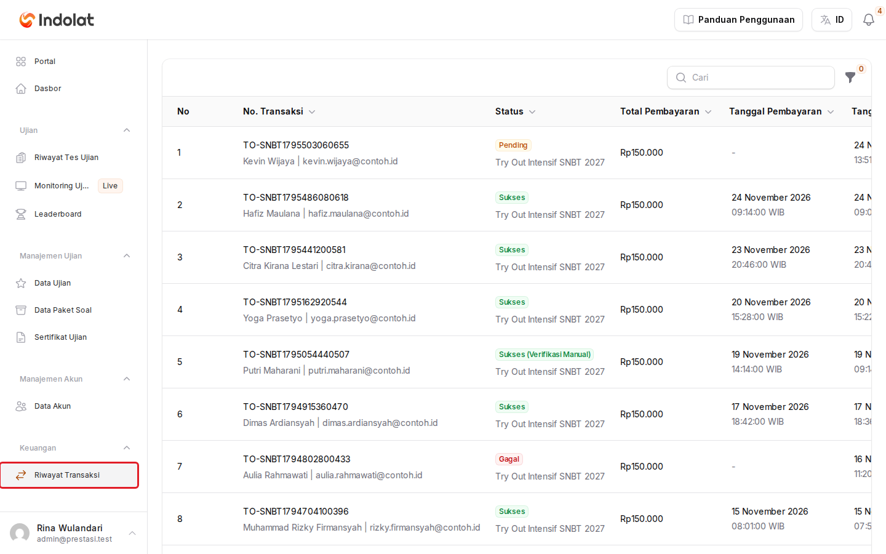
</Frame>

| Column | Content |
| --- | --- |
| **No. Transaksi** | Transaction number, for example `TO-SNBT1793756460174`, with the participant's name and email below it. |
| **Status** | Payment status, with the name of the paid exam below it. |
| **Total Pembayaran** | Amount paid. If the participant used a voucher, the voucher code and discount appear below the amount. |
| **Tanggal Pembayaran** | When the payment was received. Empty (`-`) if not paid yet. |
| **Tanggal Transaksi** | When the transaction was created, as the participant registered or chose to pay. |
| **Tanggal Kedaluwarsa** | Payment deadline, 2 hours after the transaction was created. |

Possible statuses:

- **Pending**: the participant hasn't completed the payment.
- **Sukses** (success): paid through the payment system; the project balance increases.
- **Sukses (Verifikasi Manual)** (success, manual verification): marked as paid by an admin with **Tandai Lunas**. The participant's exam access is activated, but the project balance does not increase.
- **Gagal** (failed): the payment was rejected.
- **Kedaluwarsa** (expired): the payment wasn't completed before the deadline.

Use the **Cari** (search) box to find a transaction number or participant email, and the filter icon to filter by **Nama Ujian** (exam name). The table is wide; scroll right to see the date columns and the action button.

### Mark a transaction as paid manually

If a participant paid outside the system, for example in cash at the tutoring office, you can activate their access without waiting for an automatic payment.

<Steps>
  <Step title="Click Tandai Lunas">
    The **Tandai Lunas** (mark as paid) button only appears on **Pending** transactions.

    <Frame>
      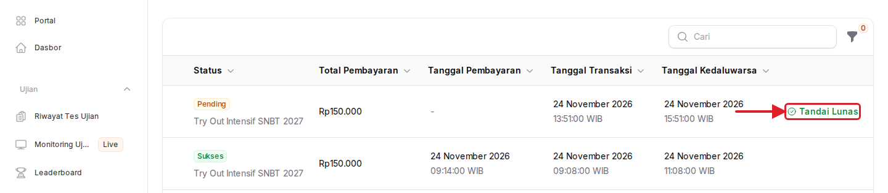
    </Frame>
  </Step>
  <Step title="Confirm">
    Read the warning in the **Konfirmasi Flagging Lunas Manual** window, then click **Ya, Flagging Lunas**.

    <Frame>
      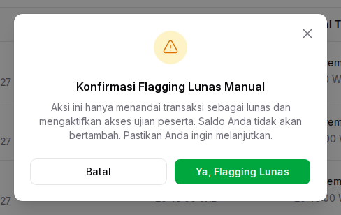
    </Frame>

    The status changes to **Sukses (Verifikasi Manual)** and the participant's exam access is processed.
  </Step>
</Steps>

<Warning>
  A transaction marked as paid manually doesn't add to the project balance and can't be returned to **Pending**.
</Warning>

### Total Dibayar summary

Below the table there's a **Rangkuman** (summary) for the **Total Pembayaran** column. **Total Dibayar** (total paid) adds up paid transactions only, that is **Sukses** and **Sukses (Verifikasi Manual)**; **Pending**, **Gagal** and **Kedaluwarsa** transactions are not counted.

<Frame>
  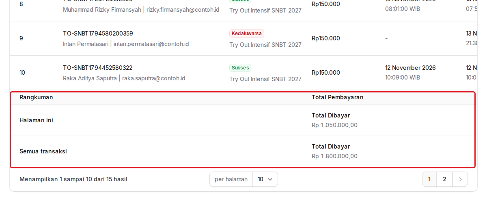
</Frame>

- **Halaman ini** (this page): total of the transactions currently shown. This row only appears when the data spans more than one page.
- **Semua transaksi** (all transactions): total of every transaction matching the current search and filters, including other pages.

In the example, the first page holds seven paid transactions of Rp150.000, so **Halaman ini** shows **Rp1.050.000**. **Semua transaksi** shows **Rp1.800.000** from twelve paid transactions.

<Note>
  **Total Dibayar** is the total paid by participants, not the withdrawable balance. **Sukses (Verifikasi Manual)** transactions are included in the total but don't add to the balance. To see the balance, open **Penarikan Saldo**.
</Note>

## 2. View the project balance

Open **Administrasi Aplikasi** → **Keuangan** → **Penarikan Saldo**. The project balance is shown above the withdrawal history table.

<Frame>
  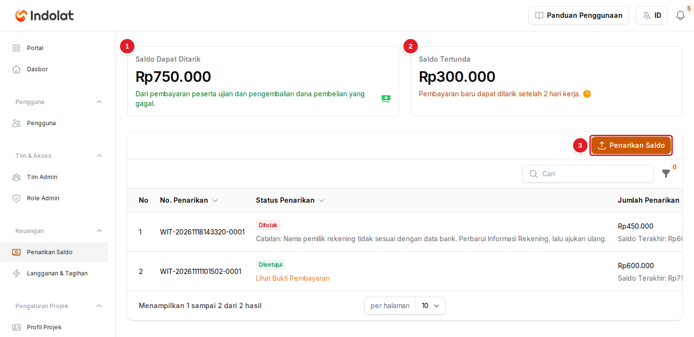
</Frame>

1. **Saldo Dapat Ditarik** (withdrawable balance): the amount you can pay out now. It comes from participant exam payments and from refunds of failed purchases, for example a domain purchase the registrar rejected.
2. **Saldo Tertunda** (pending balance): new payments that can't be withdrawn yet. Payments become withdrawable 2 working days after they're received.
3. **Penarikan Saldo**: the button to request a withdrawal.

> **Example:** Saldo Dapat Ditarik is **Rp750.000** and Saldo Tertunda is **Rp300.000**. Rina can withdraw at most **Rp750.000** right now. The Rp300.000 comes from two payments received yesterday and today.

## 3. Set the bank account

The balance is always paid out to the **project owner's** bank account. Before the first withdrawal, the owner must fill in **Informasi Rekening** (bank account information) in their account profile. If it's incomplete, the withdrawal is refused with the **Informasi Rekening Diperlukan** notification.

<Frame>
  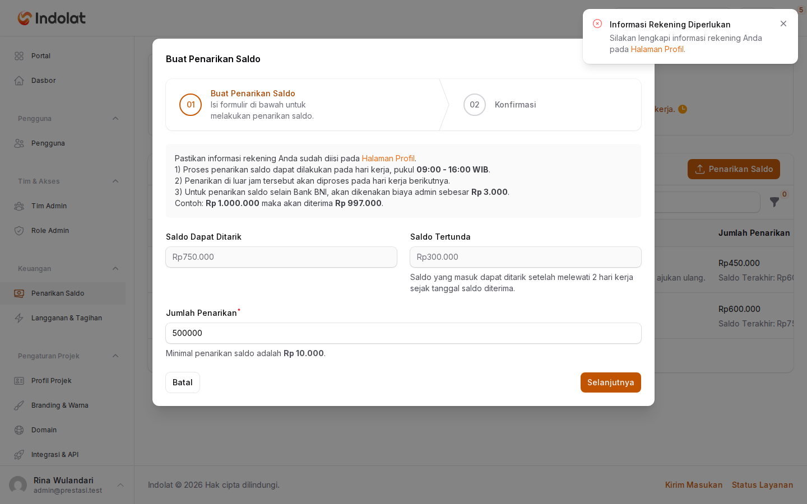
</Frame>

<Note>
  If you're an **Admin Team** member, the notification asks the project owner to complete their account details. Team members can't fill in the owner's bank account.
</Note>

<Steps>
  <Step title="Open Profil from the account menu">
    Click your account name at the bottom left of the sidebar, then choose **Profil**. You can also click the **Halaman Profil** link in the **Buat Penarikan Saldo** window.

    <Frame>
      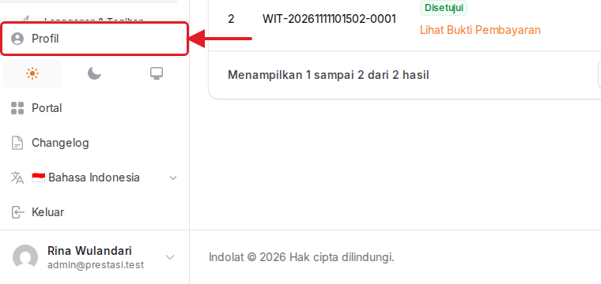
    </Frame>

    <Warning>
      The **Halaman Profil** button on the Portal opens a short **Profil** page (name, email, password and two-factor authentication) without **Informasi Rekening**. Use the **Profil** item in the sidebar instead.
    </Warning>
  </Step>
  <Step title="Fill in Informasi Rekening">
    Scroll to **Informasi Rekening** and enter the account details.

    <Frame>
      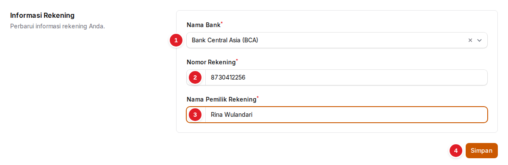
    </Frame>

    1. **Nama Bank** (bank name): pick your bank, for example **Bank Central Asia (BCA)**.
    2. **Nomor Rekening** (account number): digits only, for example `8730412256`.
    3. **Nama Pemilik Rekening** (account holder name): as printed in your bank book, for example `Rina Wulandari`.
    4. Click **Simpan** (Save) below the **Informasi Rekening** section. The notification *Informasi profil Anda telah berhasil disimpan.* appears.

    <Tip>
      Make sure the account holder name matches the bank's records exactly. A different name can get the withdrawal rejected.
    </Tip>
  </Step>
</Steps>

## 4. Request a withdrawal

<Steps>
  <Step title="Open the withdrawal form">
    On the **Penarikan Saldo** page, click the **Penarikan Saldo** button.
  </Step>
  <Step title="Enter the amount">
    <Frame>
      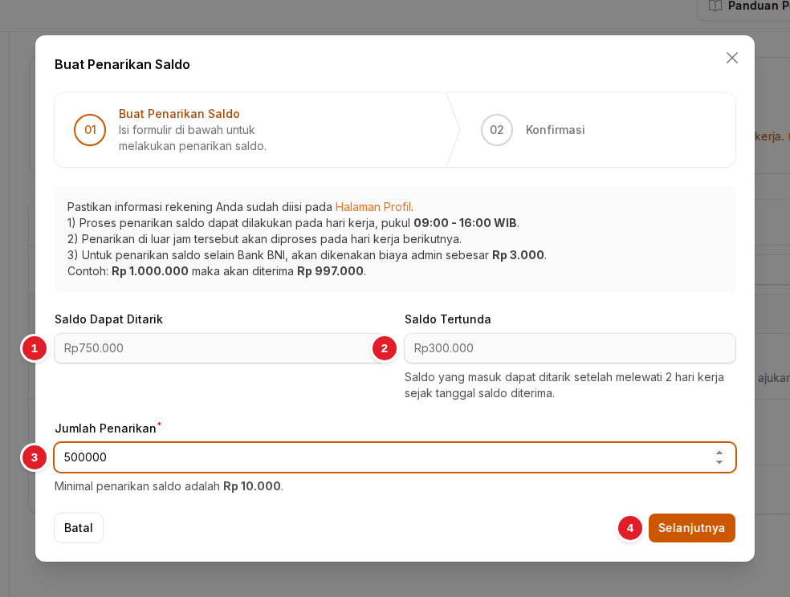
    </Frame>

    1. **Saldo Dapat Ditarik**: the withdrawable balance (read only).
    2. **Saldo Tertunda**: the balance still on hold (read only).
    3. **Jumlah Penarikan** (withdrawal amount): the amount to pay out, without dots, for example `500000`. The minimum is **Rp10.000** and it can't exceed **Saldo Dapat Ditarik**.
    4. Click **Selanjutnya** (Next).

    Withdrawal terms shown on the form:

    - Withdrawals are processed on working days from **09.00 to 16.00 WIB**; requests outside those hours are processed on the next working day.
    - Withdrawals to banks other than **BNI** have a **Rp3.000** admin fee. Example: a Rp1.000.000 withdrawal arrives as Rp997.000.
  </Step>
  <Step title="Review and create the withdrawal">
    The form shows **Jenis Bank** (bank), **Rekening Tujuan** (destination account), **Atas Nama** (account holder) and **Jumlah Penarikan**. Check them, then click **Buat Penarikan** (Create Withdrawal). Click **Sebelumnya** (Previous) to change the amount.

    <Frame>
      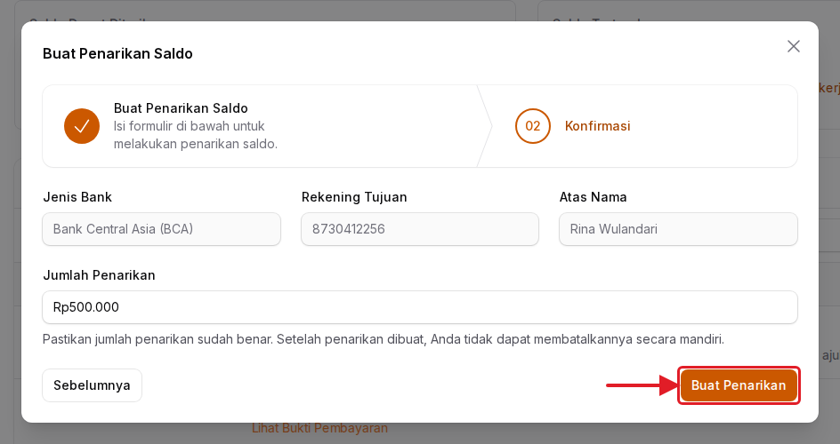
    </Frame>

    The **Penarikan Saldo Berhasil** notification appears and the amount is deducted from the balance straight away.

    <Warning>
      You can't cancel a withdrawal yourself once it's created. Make sure the account and amount are correct before clicking **Buat Penarikan**.
    </Warning>
  </Step>
</Steps>

<Note>
  You can't create a new withdrawal while another one is still **Pending**. The system shows *Anda masih memiliki penarikan saldo yang sedang diproses.*
</Note>

## 5. Track withdrawal status

Every request is listed on the **Penarikan Saldo** page with its **No. Penarikan** (withdrawal number), **Status Penarikan**, **Jumlah Penarikan** with the **Saldo Terakhir** (balance before the withdrawal), **Tanggal Pembayaran** (payout date) and **Tanggal Penarikan** (request date). Use the **Tanggal Penarikan** filter to narrow the list to a period.

<Frame>
  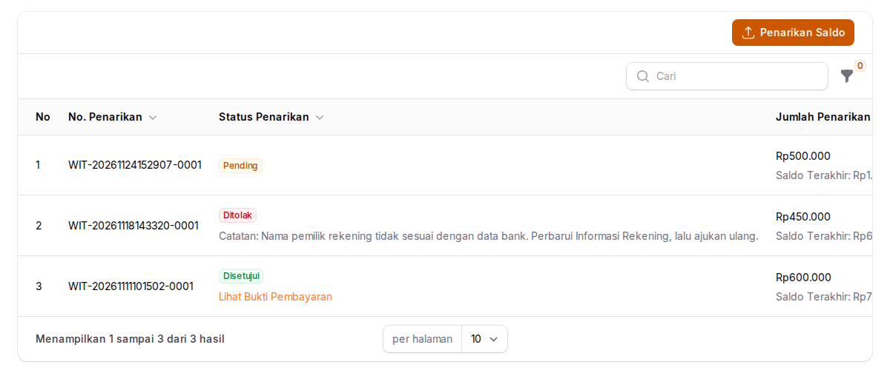
</Frame>

- **Pending**: the request has been submitted and is being processed.
- **Disetujui** (approved): the money has been transferred. Click **Lihat Bukti Pembayaran** to open the transfer receipt; **Tanggal Pembayaran** shows when it was sent.
- **Ditolak** (rejected): the withdrawal was cancelled and the amount returned to the balance. The reason appears as **Catatan** (note), for example a mismatched account holder name. Fix what's requested, then submit a new withdrawal.
