Schools and institutions use the **Learning Management System (LMS)** module to manage teaching and learning: academic periods, classes, subjects, subject teachers, teaching schedules, and announcements. This page gives an overview of each menu and how the menus relate to each other in the Panel. Materials, assignments, and grading by teachers happen in the **LMS by Indolat** app and are not covered here.

<Info>
  Menu location: **Portal** → **Learning Management System (LMS)**.

  The LMS can be activated by the project owner or by an admin with access to **Langganan & Tagihan** (Subscriptions and Billing).
</Info>

The examples on this page use the **SMA Harapan Bangsa** project with the **2026/2027 Ganjil** (odd semester) period.

## Activating the LMS

The LMS has to be activated once for each project. Activation installs the free **LMS Standard** plan with 100 MB of storage and a quota of 50 active students.

<Steps>
  <Step title="Open the LMS module from the Portal">
    Select the **Learning Management System (LMS)** tile on the Portal. The tile carries a **BARU** (New) badge.

    <Frame>
      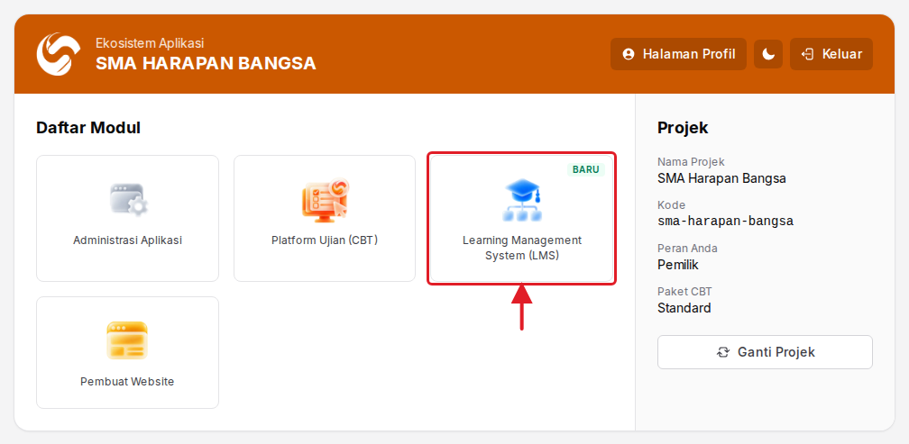
    </Frame>
  </Step>
  <Step title="Select Aktifkan LMS by Indolat">
    While the LMS is not active, the **Dasbor** (Dashboard) shows the **LMS by Indolat belum diaktifkan** (not activated yet) card with a summary of its features. Select **Aktifkan LMS by Indolat** (Activate LMS by Indolat).

    <Frame>
      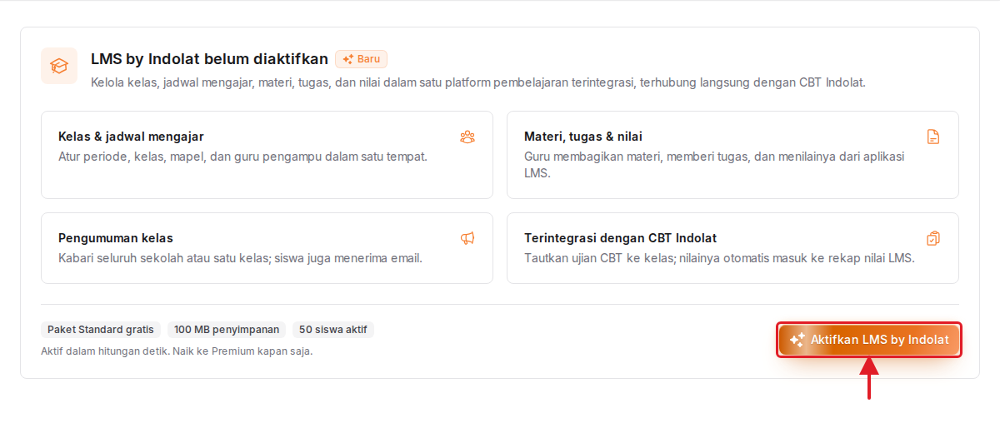
    </Frame>

    The other LMS menus are locked too and show the same button. Data created earlier stays visible but cannot be changed while the LMS is inactive.

    <Frame>
      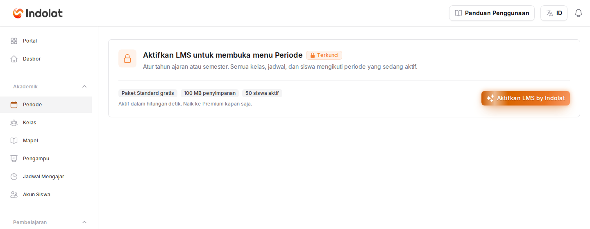
    </Frame>
  </Step>
  <Step title="Confirm the activation">
    Select **Aktifkan** (Activate) in the confirmation window.

    <Frame>
      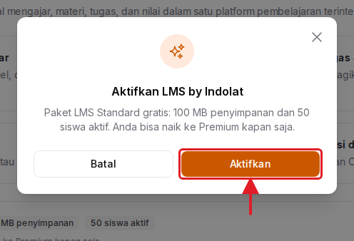
    </Frame>

    The **LMS by Indolat aktif** (LMS by Indolat active) notification appears and every LMS menu opens.
  </Step>
</Steps>

## Dasbor (Dashboard)

Once the LMS is active, the **Dasbor** shows the LMS plan, storage usage, and the number of active students against the quota. The **Kelola di Administrasi** (Manage in Administration) button opens **Administrasi Aplikasi** → **Keuangan** → **Langganan & Tagihan** to upgrade the plan.

<Frame>
  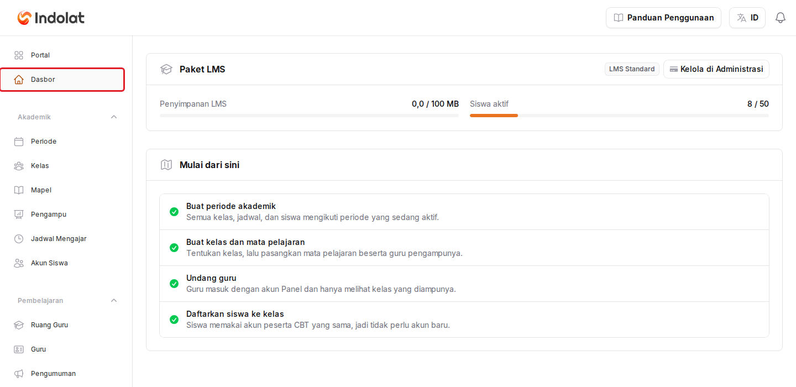
</Frame>

The **Mulai dari sini** (Start here) section lists four first steps that tick themselves off once the data exists: create an academic period, create classes and subjects, invite teachers, and enrol students in classes.

## Order for setting up the LMS

The LMS menus depend on each other. This order is the easiest to follow:

1. Create a **Periode** (Period) and make one period active.
2. Add the list of **Mapel** (Subjects).
3. Invite **Guru** (Teachers).
4. Create **Kelas** (Classes) in the active period, then add students from **Akun Siswa** (Student Accounts).
5. Set the **Pengampu** (subject teacher for each subject in each class).
6. Build the **Jadwal Mengajar** (Teaching Schedule).
7. Send **Pengumuman** (Announcements) when needed.

## Akademik (Academic)

### Periode (Period)

A period is a school year or semester, for example **2026/2027 Ganjil**. Every class is created inside a period.

<Frame>
  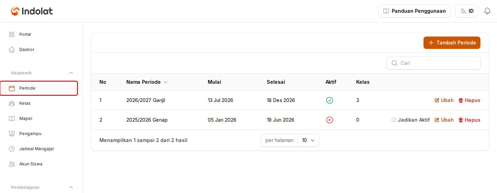
</Frame>

Select **Tambah Periode** (Add Period), then fill in **Nama Periode** (Period Name), **Mulai** (Start), and **Selesai** (End). Only one period can be active. Select **Jadikan Aktif** (Make Active) on another period to switch. The active-student quota is counted from classes in the active period.

### Kelas (Class)

A class is created in a period, for example **X IPA 1** at grade **X**. The class list shows the homeroom teacher, the number of active students, and the number of subjects.

<Frame>
  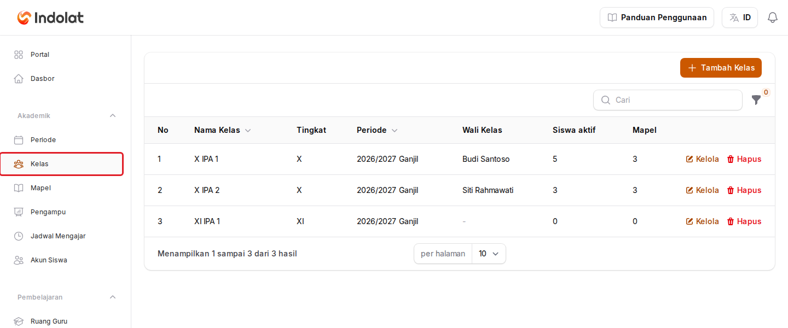
</Frame>

Select **Tambah Kelas** (Add Class), then fill in **Periode**, **Nama Kelas** (Class Name), **Tingkat** (Grade), and **Wali Kelas** (Homeroom Teacher). The **Wali Kelas** options are the project owner and teachers who have accepted their invitation. Select **Kelola** (Manage) on a class to set up its contents.

<Frame>
  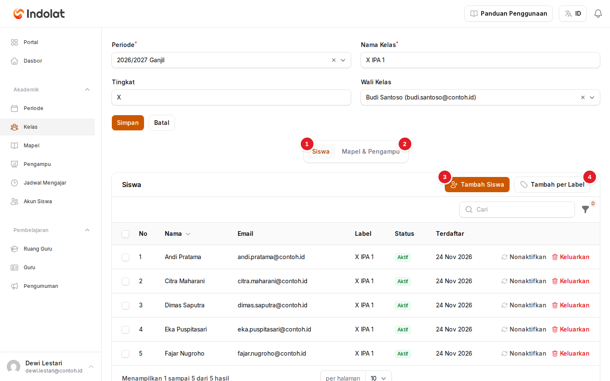
</Frame>

1. **Siswa** (Students): the students in this class and their status. Select **Nonaktifkan** (Deactivate) to deactivate a student without removing them, or **Keluarkan** (Remove) to remove them from the class.
2. **Mapel & Pengampu** (Subjects and Teachers): the subjects taught in this class and their teachers. Subjects can be added directly from this tab.
3. **Tambah Siswa** (Add Students): search student accounts by name or email, then choose one or more students.
4. **Tambah per Label** (Add by Label): add every student account with a given label at once, for example the **X IPA 1** label.

Students added to a class receive an email notification. When the plan's active-student quota is full, no new students can be added until the plan is upgraded.

### Mapel (Subject)

Subjects are the list of school subjects and their codes, for example **Matematika** (Mathematics) with the code **MTK**. One subject can be taught in many classes.

<Frame>
  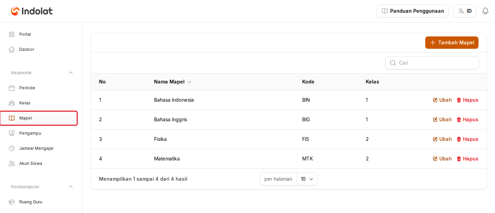
</Frame>

Select **Tambah Mapel** (Add Subject), then fill in **Nama Mapel** (Subject Name) and **Kode** (Code, optional). The **Kelas** column shows how many classes use the subject.

### Pengampu (Subject Teacher)

A pengampu entry pairs a class with a subject and the teacher who teaches it, for example **Matematika** in **X IPA 1** taught by **Budi Santoso**.

<Frame>
  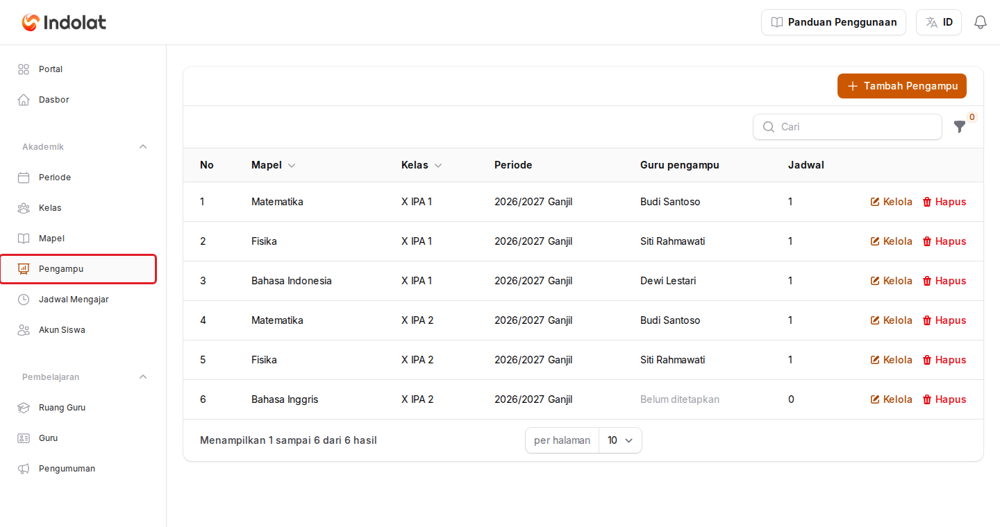
</Frame>

Select **Tambah Pengampu** (Add Subject Teacher), then choose the **Kelas**, **Mapel**, and **Guru pengampu** (subject teacher). Pairs without a teacher are marked **Belum ditetapkan** (Not assigned). Select **Kelola** to open the details.

<Frame>
  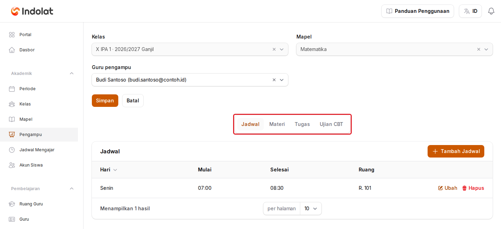
</Frame>

- **Jadwal** (Schedule): the lesson schedule for this subject in this class.
- **Materi** (Materials) and **Tugas** (Assignments): materials and assignments that teachers create in the LMS app. In the Panel they can only be viewed and deleted.
- **Ujian CBT** (CBT Exams): link an exam from **Platform Ujian (CBT)** with **Tautkan Ujian** (Link Exam), or create a new one with **Buat Ujian Baru** (Create New Exam). Grades from linked exams flow into the LMS grade summary.

### Jadwal Mengajar (Teaching Schedule)

The teaching schedule is the weekly timetable for every class. Teachers and students see it in the LMS app.

<Frame>
  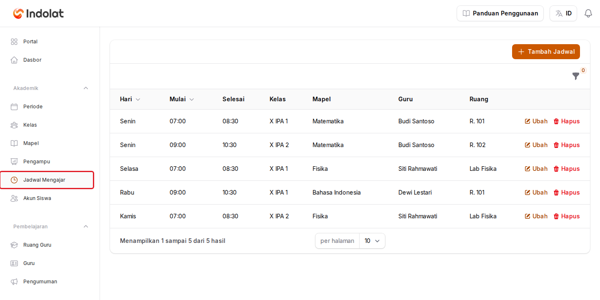
</Frame>

Select **Tambah Jadwal** (Add Schedule), then choose **Kelas & Mapel** (Class and Subject), **Hari** (Day), **Mulai** (Start), **Selesai** (End), and **Ruang** (Room). The end time must be after the start time. The same schedule can also be added from the **Jadwal** tab of a pengampu entry.

### Akun Siswa (Student Accounts)

Student accounts are the same participant accounts as **Data Akun** in the CBT module and **Pengguna** in Administrasi Aplikasi. Students need only one account to join classes in the LMS and exams in the CBT.

<Frame>
  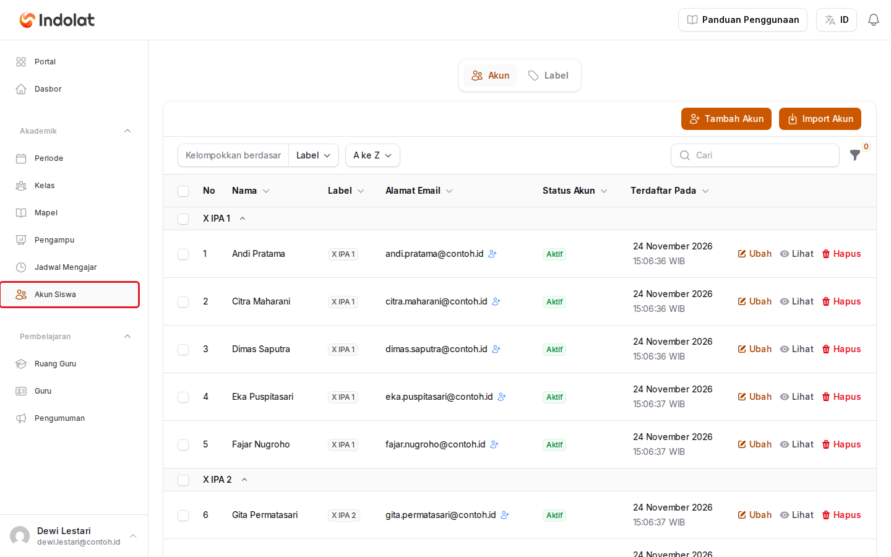
</Frame>

Here you can use **Tambah Akun** (Add Account) and **Import Akun** (Import Accounts), and manage labels on the **Label** tab. Label students by class so you can enrol them all at once with **Tambah per Label**. The full steps are in [Adding Participant Accounts](/en/data-akun/menambahkan-akun-peserta).

## Pembelajaran (Learning)

### Ruang Guru (Teacher Space)

Ruang Guru lists the classes and subjects you teach, with their period. Select **Buka LMS by Indolat** (Open LMS by Indolat) to go to the LMS app, where materials, assignments, grading, and class exams are managed.

<Frame>
  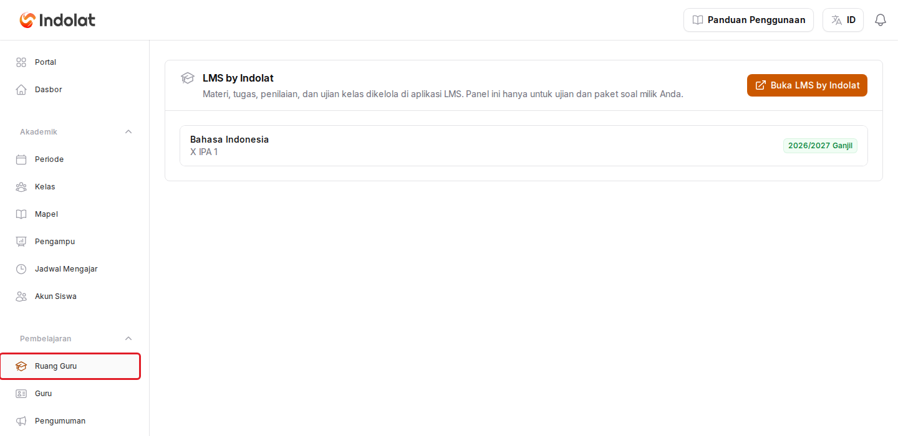
</Frame>

### Guru (Teachers)

Teachers are invited by email and sign in to the Panel with their own account. A teacher sees only the classes they teach in the LMS, plus their own exams and question packages in the CBT. There is no limit on the number of teachers on any plan.

<Frame>
  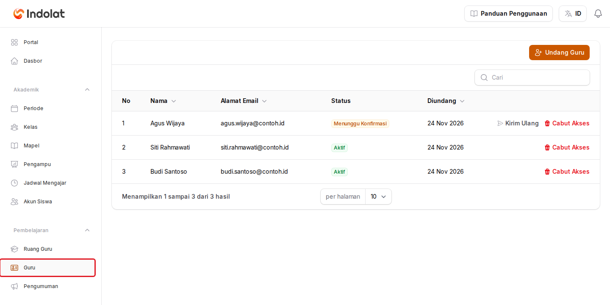
</Frame>

Select **Undang Guru** (Invite Teacher), then fill in **Alamat Email** and **Nama Guru** (Teacher Name, optional, used when no account with that email exists yet). The **Menunggu Konfirmasi** (Awaiting Confirmation) status changes to **Aktif** once the teacher accepts the invitation. Select **Kirim Ulang** (Resend) to send the invitation again, or **Cabut Akses** (Revoke Access) to end the teacher's access to the project. A teacher can be chosen as homeroom teacher or subject teacher only once their status is **Aktif**.

### Pengumuman (Announcements)

Announcements can go to the whole school or to one class. Students also receive an email notification.

<Frame>
  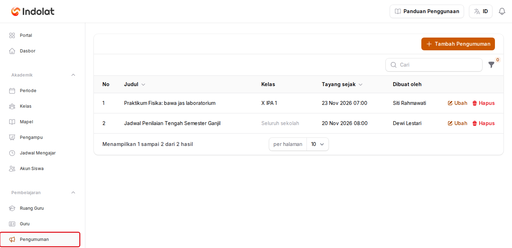
</Frame>

Select **Tambah Pengumuman** (Add Announcement), then fill in **Judul** (Title), **Kelas** (leave empty for the whole school), **Tayang sejak** (Visible from), and **Isi** (Content). The announcement appears in the LMS app from the **Tayang sejak** time.
