This quick-start guide walks you through one exam from start to finish: preparing a question package, creating the exam, its test and session, adding participants, trying the exam as a participant, then monitoring and downloading the results. Advanced settings are left out; every section links to the full guide for that topic.

The UI is in Indonesian, so menu and button names are written exactly as they appear on screen, with an English gloss in parentheses the first time they are mentioned.

<Info>
  **Menu location:** **Portal** → **Platform Ujian (CBT)** (Exam Platform). All admin steps on this page take place in the Platform Ujian (CBT) module.

  **Role:** the project owner, or an admin who has access to **Data Paket Soal**, **Data Ujian**, and the other **Ujian** menus (see [Admin Access Management](/en/lainnya/manajemen-akses-admin)).
</Info>

## How the pieces fit together

An exam in CBT Indolat is made of the following parts.

| Part | Purpose | Example in this guide |
| --- | --- | --- |
| **Paket Soal** (question package) | A question bank holding the questions and their answer keys. | **Paket Penalaran Matematika** (code **PM-TOAKBAR27**), 3 multiple-choice questions |
| **Ujian** (exam) | The main event participants take part in. | **Tryout Akbar SNBT 2027 – Gelombang 1** (code **TOAKBAR27-G1**), a practice exam for Indonesia's national university entrance test |
| **Tes Ujian** (test) | A subject (subtest) inside the exam, with its own duration and scoring method. | **Penalaran Matematika**, 30 minutes |
| **Sesi Ujian** (exam session) | The schedule for a test, plus the question package it uses. | **Sesi 1**, 24 November 2026 at 13:00 to 30 November 2026 at 21:00 |
| **Peserta** (participants) | Accounts registered for the exam and assigned to a session. | 5 students imported from Excel, for example **Dimas Pratama** |

The order is: create the question package, create the exam, add a test, create a session for that test, add participants, then assign the participants to the session. Participants can only take the test once all four are in place.

## 1. Open Platform Ujian (CBT)

<Steps>
  <Step title="Sign in and open the Platform Ujian (CBT) module">
    <Frame>
      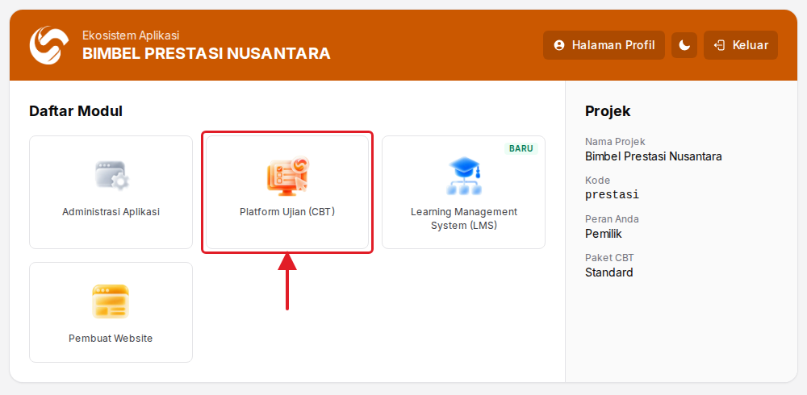
    </Frame>

    After signing in to the admin panel you land on the **Portal** page. Under **Daftar Modul** (module list), click **Platform Ujian (CBT)**. Every menu used in this guide is in that module's sidebar.
  </Step>
</Steps>

## 2. Create a question package

<Steps>
  <Step title="Open Data Paket Soal, then click Tambah Paket Soal">
    <Frame>
      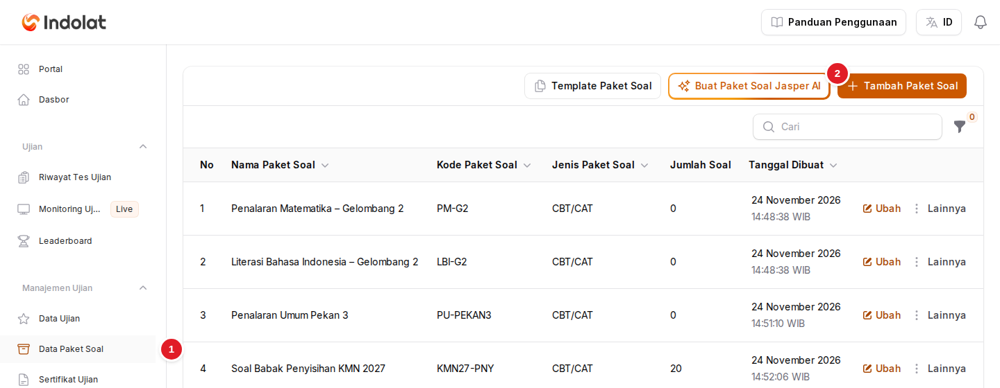
    </Frame>

    1. In the sidebar, click **Manajemen Ujian** → **Data Paket Soal** (question packages).
    2. Click **Tambah Paket Soal** (add question package).
  </Step>
  <Step title="Fill in the package details">
    <Frame>
      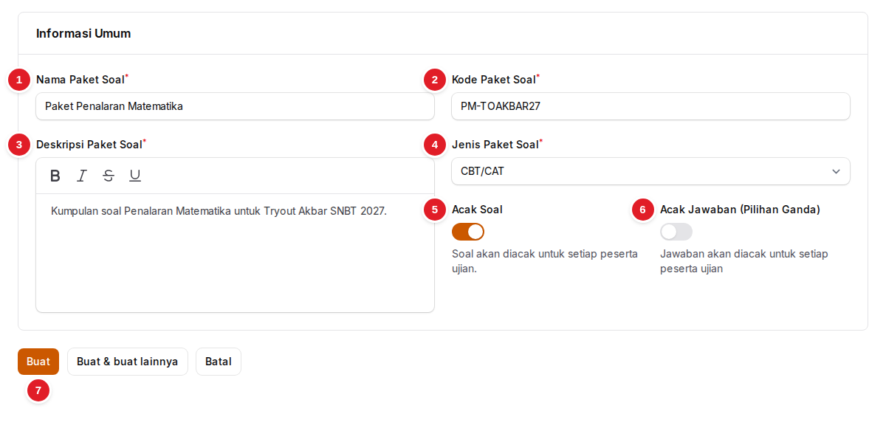
    </Frame>

    1. **Nama Paket Soal** (package name): an easy-to-recognize name, for example **Paket Penalaran Matematika**.
    2. **Kode Paket Soal** (package code): a code that is unique in your project, for example **PM-TOAKBAR27**. A code already used by another package is rejected.
    3. **Deskripsi Paket Soal** (description): a short description of the package (up to 1,000 characters).
    4. **Jenis Paket Soal** (package type): choose **CBT/CAT** so participants answer on screen and are scored automatically. The type cannot be changed after the package is saved.
    5. **Acak Soal** (shuffle questions): turn on to give each participant a different question order.
    6. **Acak Jawaban (Pilihan Ganda)** (shuffle answers): turn on to give each participant a different answer order.
    7. Click **Buat** (create). The package page opens so you can add questions straight away.

    <Note>
      Choose **Esai/Upload File (Jawaban Manual)** when participants write essays or upload answer files that are graded by hand. Packages of this type cannot be used for CBT/CAT tests, and vice versa. See [Create a Question Package](/en/paket-soal/membuat-paket-soal).
    </Note>
  </Step>
</Steps>

<Tip>
  Instead of entering questions one by one, you can use **Template Paket Soal** (package template), [import questions from Excel](/en/paket-soal/import-paket-soal), or [generate questions with Jasper AI](/en/paket-soal/generate-soal-ai).
</Tip>

## 3. Add questions

<Steps>
  <Step title="Click Tambah Soal">
    <Frame>
      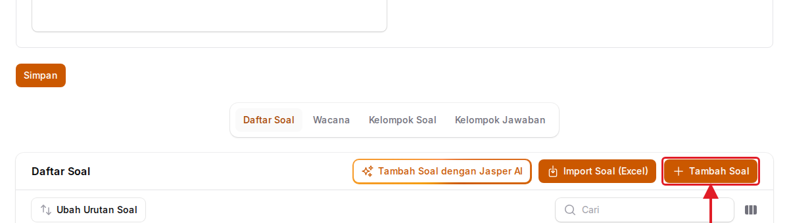
    </Frame>

    Scroll to the **Daftar Soal** (question list) section and click **Tambah Soal** (add question). The **Tambah Soal** window opens with the tabs **Soal** (question), **Jawaban** (answers), **Pembahasan** (explanation), and **Penilaian** (scoring).

    To open this package again later, go to **Data Paket Soal** and click **Ubah** (edit) on the package.
  </Step>
  <Step title="Fill in the Soal tab">
    <Frame>
      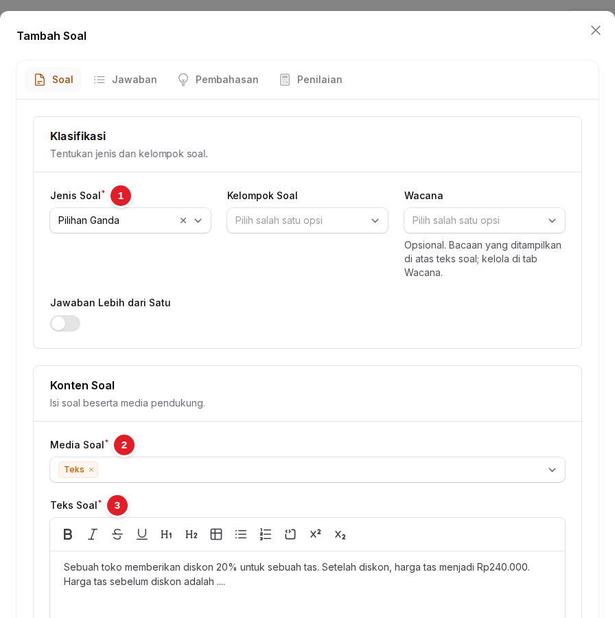
    </Frame>

    1. **Jenis Soal** (question type): choose **Pilihan Ganda** (multiple choice).
    2. **Media Soal** (question media): choose **Teks** (text). You can pick more than one medium, for example text and an image.
    3. **Teks Soal** (question text): write the question, for example _Sebuah toko memberikan diskon 20% untuk sebuah tas. Setelah diskon, harga tas menjadi Rp240.000. Harga tas sebelum diskon adalah ...._ (A shop gives a 20% discount on a bag; after the discount the bag costs Rp240,000; what was the price before the discount?)

    **Kelompok Soal** (question group), **Wacana** (reading passage), and **Jawaban Lebih dari Satu** (multiple correct answers) can stay empty for stand-alone questions. The other question types (**Jawaban Singkat**, **Majemuk Kompleks**, **Menjodohkan**) are covered in [Create a Question Package](/en/paket-soal/membuat-paket-soal).
  </Step>
  <Step title="Fill in the answer options on the Jawaban tab">
    <Frame>
      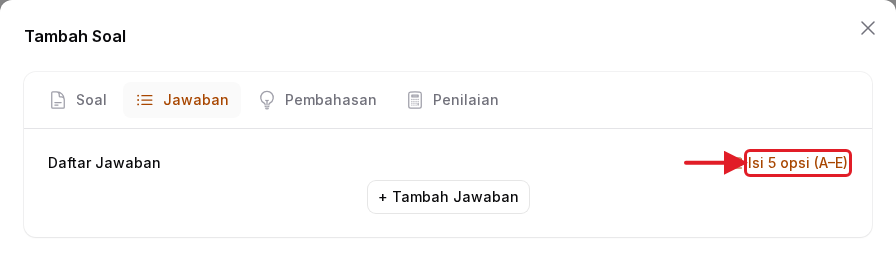
    </Frame>

    Open the **Jawaban** tab and click **Isi 5 opsi (A–E)** (fill 5 options) to create five answer options at once, each with **Teks** media. Use **+ Tambah Jawaban** (add answer) if you need more options.

    <Frame>
      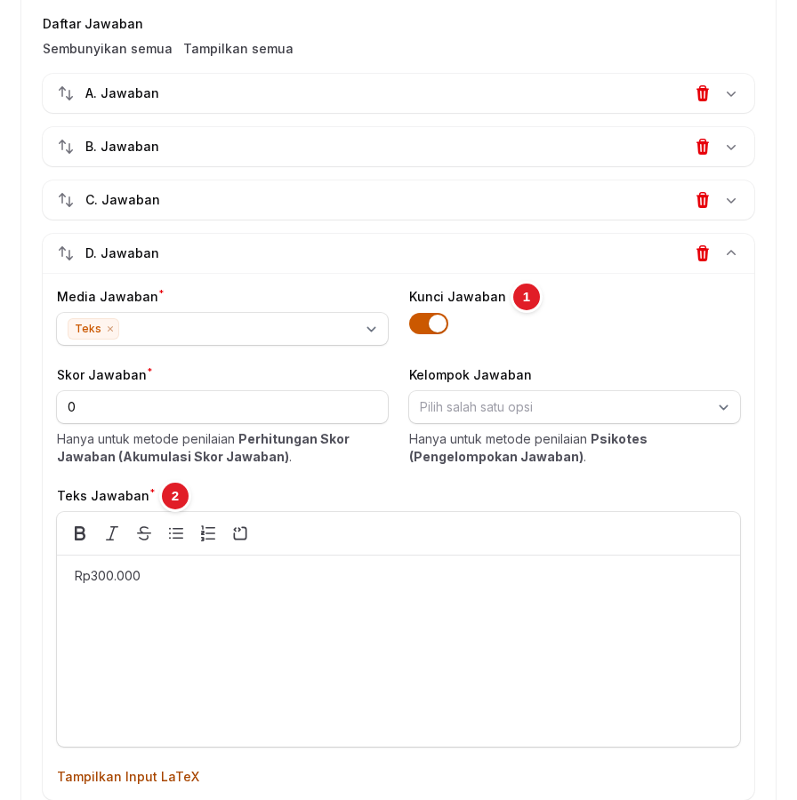
    </Frame>

    For each answer option:

    1. **Kunci Jawaban** (answer key): turn on only for the correct option, option D in this example.
    2. **Teks Jawaban** (answer text): write the option participants see, for example **Rp300.000**.

    **Skor Jawaban** (answer score) and **Kelompok Jawaban** (answer group) are only used by specific scoring methods and can be left as they are. Click **Buat** to save the question, or **Buat & buat lainnya** (create and add another) to go straight to the next one.
  </Step>
  <Step title="Check the question list">
    <Frame>
      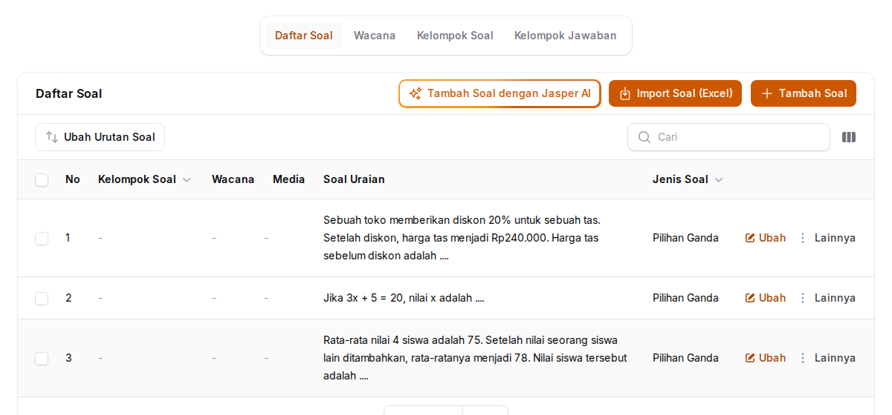
    </Frame>

    Repeat the steps above until all questions are in. This example uses three Penalaran Matematika (mathematical reasoning) questions.
  </Step>
  <Step title="Set the question scores">
    <Frame>
      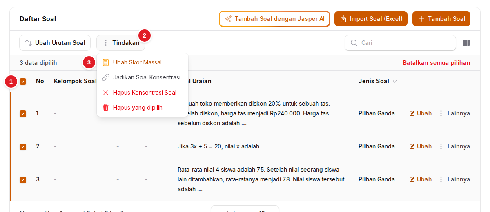
    </Frame>

    Decide how many points each question is worth:

    1. Tick the checkbox in the table header to select all questions.
    2. Click **Tindakan** (actions).
    3. Choose **Ubah Skor Massal** (bulk change score).

    <Frame>
      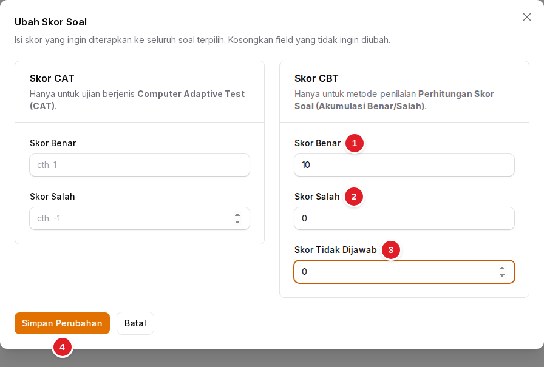
    </Frame>

    In the **Skor CBT** section, enter:

    1. **Skor Benar** (correct score): for example **10**.
    2. **Skor Salah** (incorrect score): for example **0** (use a negative number to deduct points for wrong answers).
    3. **Skor Tidak Dijawab** (unanswered score): for example **0**.
    4. Click **Simpan Perubahan** (save changes).

    With these settings, a participant who answers all three questions correctly scores **30**. You can also set scores per question on the **Penilaian** tab of the question window.

    <Warning>
      With the **Perhitungan Skor Soal (Akumulasi Benar/Salah)** scoring method, a participant's score is the sum of the question scores. If **Skor Benar** is left empty, every participant scores **0** even with correct answers. Question scores cannot be changed while a participant is taking a test that uses this package.
    </Warning>
  </Step>
</Steps>

## 4. Create the exam

<Steps>
  <Step title="Open Data Ujian, then click Tambah Ujian">
    <Frame>
      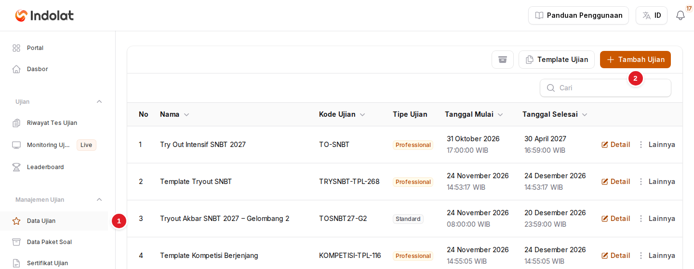
    </Frame>

    1. In the sidebar, click **Manajemen Ujian** → **Data Ujian** (exams).
    2. Click **Tambah Ujian** (add exam).
  </Step>
  <Step title="Fill in the exam details">
    <Frame>
      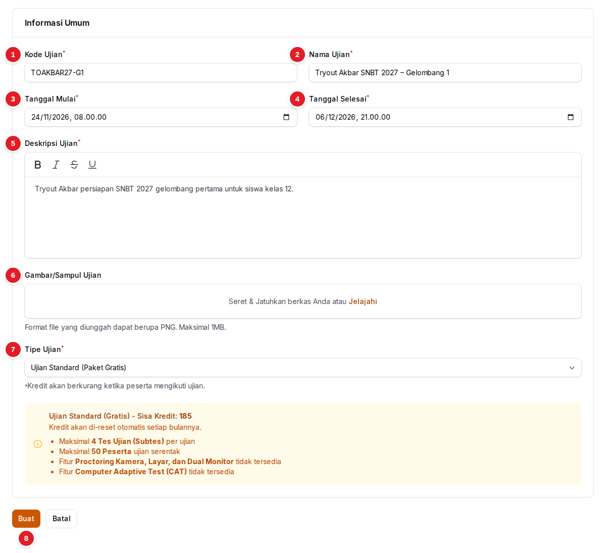
    </Frame>

    1. **Kode Ujian** (exam code): a unique code made of letters, numbers, hyphens (-), or hash signs (#), for example **TOAKBAR27-G1**. It is converted to upper case and becomes the prefix of each **Kode Peserta** (participant code).
    2. **Nama Ujian** (exam name): the name participants see, for example **Tryout Akbar SNBT 2027 – Gelombang 1**.
    3. **Tanggal Mulai** (start date): the start of the exam period, for example 24 November 2026 at 08:00.
    4. **Tanggal Selesai** (end date): the end of the exam period, for example 6 December 2026 at 21:00. It can be at most one year from today.
    5. **Deskripsi Ujian** (description): a short description of the exam.
    6. **Gambar/Sampul Ujian** (cover image, optional): a PNG file of up to 1 MB.
    7. **Tipe Ujian** (exam type): choose **Ujian Standard (Paket Gratis)** (free standard exam) for a simple exam. The box below it shows the remaining credit and the limits: up to 4 tests per exam, up to 50 participants testing at the same time, no camera, screen, or dual-monitor proctoring, and no CAT. **Ujian Professional (Paket Berbayar)** (paid professional exam) raises the limits to 30 tests and 1,000 concurrent participants and includes those features.
    8. Click **Buat**.

    <Note>
      Exam credit is used when participants take the exam. If you choose **Ujian Professional (Paket Berbayar)** without professional exam credit, a warning appears and participants cannot start the exam until credit is available.
    </Note>
  </Step>
  <Step title="Get to know the exam detail page">
    <Frame>
      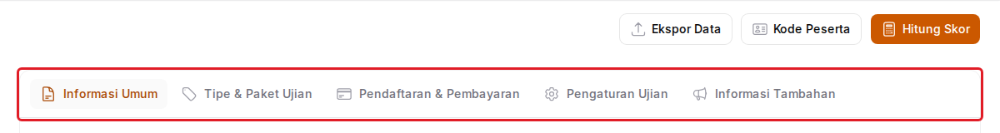
    </Frame>

    Once the exam is created, its detail page opens. The settings are split into the tabs **Informasi Umum** (general), **Tipe & Paket Ujian** (type and plan), **Pendaftaran & Pembayaran** (registration and payment), **Pengaturan Ujian** (exam settings), and **Informasi Tambahan** (additional information). Below them are the **Daftar Tes Ujian** (tests), **Formulir Pendaftaran** (registration form), and **Daftar Peserta Ujian** (participants) tabs.

    For this quick start the default settings are enough: a free, single-stage (not multi-level) exam that participants do not register for themselves. Each tab is explained in [Create an Exam](/en/data-ujian/membuat-ujian).

    To open this page again later, go to **Data Ujian** and click **Detail** on the exam.
  </Step>
</Steps>

## 5. Add a test

<Steps>
  <Step title="Click Tambah Tes Ujian">
    <Frame>
      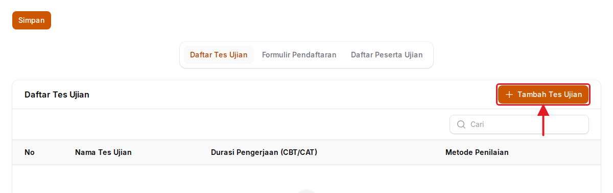
    </Frame>

    Scroll to the **Daftar Tes Ujian** tab and click **Tambah Tes Ujian** (add test).
  </Step>
  <Step title="Fill in the test details">
    <Frame>
      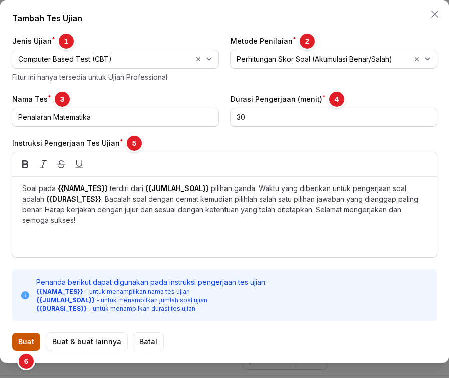
    </Frame>

    1. **Jenis Ujian** (test type): keep **Computer Based Test (CBT)**. The text **Fitur ini hanya tersedia untuk Ujian Professional.** (This feature is only available for Professional Exams.) below it is only a reminder that CAT is not available on a Standard exam.
    2. **Metode Penilaian** (scoring method): choose **Perhitungan Skor Soal (Akumulasi Benar/Salah)** (question score, sum of right and wrong), which totals the question scores you set earlier.
    3. **Nama Tes** (test name): for example **Penalaran Matematika**.
    4. **Durasi Pengerjaan (menit)** (duration in minutes): for example **30**.
    5. **Instruksi Pengerjaan Tes Ujian** (instructions): pre-filled with default text. The placeholders `{{NAMA_TES}}`, `{{JUMLAH_SOAL}}`, and `{{DURASI_TES}}` are replaced with the test name, number of questions, and duration.
    6. Click **Buat**.

    Other scoring methods (psychometric, IRT, and so on) are covered in [Create a Test](/en/data-ujian/membuat-tes-ujian).
  </Step>
  <Step title="Open the new test">
    <Frame>
      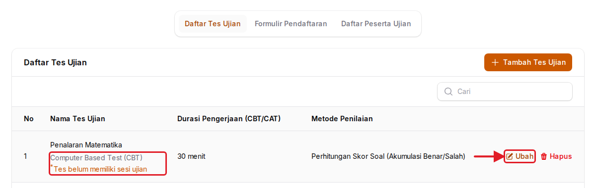
    </Frame>

    The new test shows the note **\*Tes belum memiliki sesi ujian** (the test has no session yet), which means it cannot be taken yet. Click **Ubah** to open the test page.
  </Step>
  <Step title="Show the score to participants">
    <Frame>
      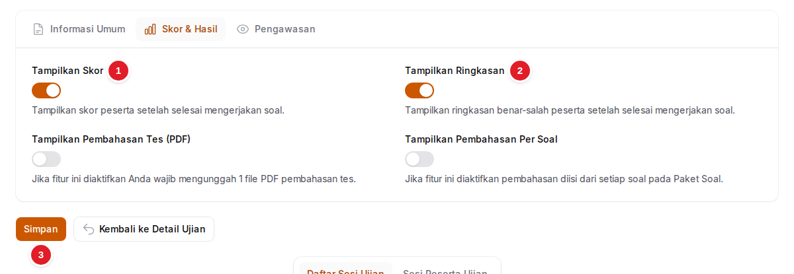
    </Frame>

    Open the **Skor & Hasil** (score and results) tab, then:

    1. Turn on **Tampilkan Skor** (show score) so participants see their score when they finish.
    2. Turn on **Tampilkan Ringkasan** (show summary) so participants see how many answers were right and wrong.
    3. Click **Simpan** (save).

    The **Pengawasan** (proctoring) tab holds settings such as **Deteksi Pindah Tab** (tab-switch detection); see [Create a Test](/en/data-ujian/membuat-tes-ujian).
  </Step>
</Steps>

## 6. Create an exam session

<Steps>
  <Step title="Click Tambah Sesi Ujian">
    <Frame>
      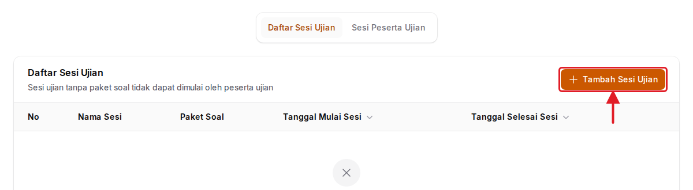
    </Frame>

    Still on the test page, scroll to the **Daftar Sesi Ujian** (sessions) tab and click **Tambah Sesi Ujian** (add session).
  </Step>
  <Step title="Set the schedule and question package">
    <Frame>
      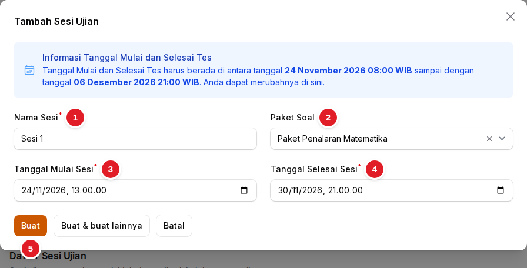
    </Frame>

    1. **Nama Sesi** (session name): for example **Sesi 1**.
    2. **Paket Soal**: choose **Paket Penalaran Matematika**. Only **CBT/CAT** packages are listed for a CBT test.
    3. **Tanggal Mulai Sesi** (session start): for example 24 November 2026 at 13:00.
    4. **Tanggal Selesai Sesi** (session end): for example 30 November 2026 at 21:00.
    5. Click **Buat**.

    The information box above the form shows the exam's date range. Session dates must fall within it.

    <Warning>
      Participants cannot start a session that has no question package. Make sure **Paket Soal** is selected.
    </Warning>

    If participants are split across several time slots, create several sessions. See [Create an Exam Session](/en/data-ujian/membuat-sesi-ujian).
  </Step>
</Steps>

## 7. Add participants

In this example the admin prepares the participant accounts by importing an Excel file. Other options are described at the end of this section.

<Steps>
  <Step title="Open Daftar Peserta Ujian, then click Import Peserta">
    <Frame>
      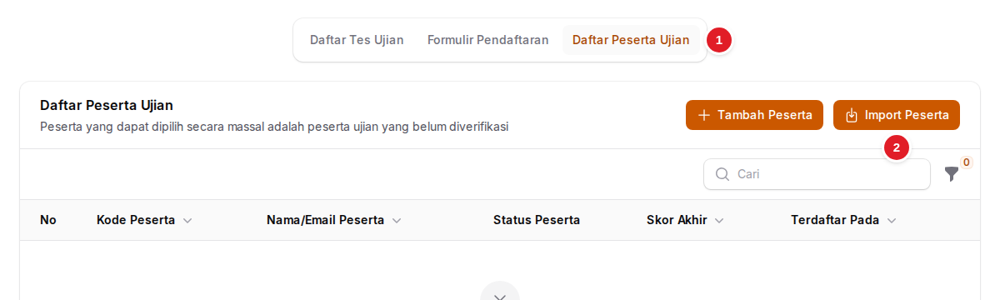
    </Frame>

    Go back to the exam detail page (click **Kembali ke Detail Ujian**, back to exam detail, on the test page).

    1. Click the **Daftar Peserta Ujian** tab.
    2. Click **Import Peserta** (import participants).
  </Step>
  <Step title="Download the template and fill in the participants">
    <Frame>
      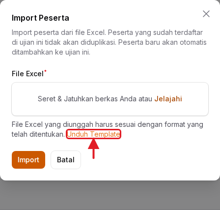
    </Frame>

    Click **Unduh Template** (download template) to get the Excel file, then fill in one row per participant:

    | Nama | Alamat Email | Kata Sandi | Label |
    | --- | --- | --- | --- |
    | Dimas Pratama | dimas.pratama@contoh.id | (participant's password) | Gelombang 1 |
    | Siti Rahmawati | siti.rahmawati@contoh.id | (participant's password) | Gelombang 1 |

    - **Nama** (name), **Alamat Email** (email address), and **Kata Sandi** (password) are required. Incomplete rows are skipped.
    - **Label** is optional; use it to group participants, for example **Gelombang 1** or **Kelas 12 IPA**.
    - Participants sign in with the email address. The system does not check whether the address actually exists, so you can use exam-only addresses as long as each participant has a different one.
  </Step>
  <Step title="Upload the file and click Import">
    <Frame>
      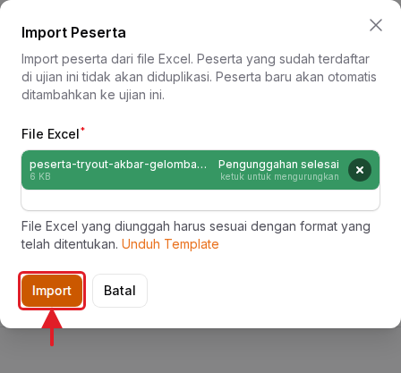
    </Frame>

    Drag the file into the **File Excel** field or click **Jelajahi** (browse). When **Pengunggahan selesai** (upload complete) appears, click **Import**.

    <Frame>
      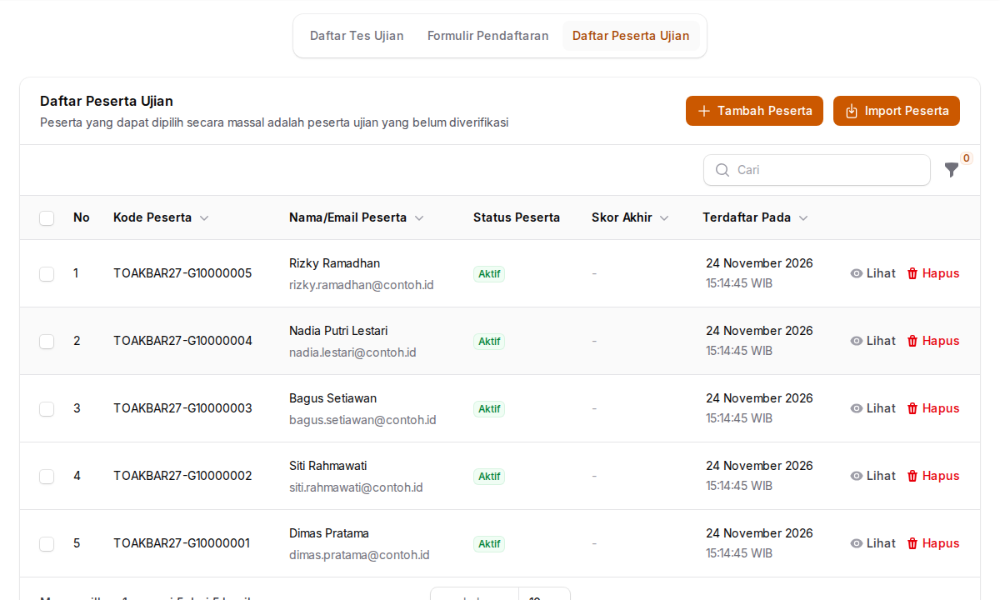
    </Frame>

    The import runs in the background and its progress is shown at the top of the page. Accounts that do not exist yet are created automatically, and every participant is added to the exam with a **Kode Peserta** such as **TOAKBAR27-G10000001**. Participants already registered for this exam are not duplicated.
  </Step>
</Steps>

<AccordionGroup>
  <Accordion title="Adding existing accounts">
    If the participant accounts already exist under **Manajemen Akun** → **Data Akun** (accounts), click **Tambah Peserta** (add participants) on the **Daftar Peserta Ujian** tab, tick the accounts you want, and click **Tambahkan Peserta**. Creating accounts is covered in [Add Participant Accounts](/en/data-akun/menambahkan-akun-peserta).
  </Accordion>
  <Accordion title="Participants register themselves">
    For an exam that is open to the public, participants can create an account and register for the exam themselves:

    1. Turn on **Izinkan pendaftaran akun mandiri** (allow self-registration) in **Lainnya** → **Pengaturan Aplikasi** so the **Daftar** (register) button appears on the participant login page.
    2. Turn on **Apakah Pendaftaran Ujian Dibuka?** (is exam registration open?) on the **Pendaftaran & Pembayaran** tab of the exam (requires the registration page add-on). Participants then register through the **Pendaftaran Tes Baru** (new test registration) button in the participant app.
    3. Set the **Tipe Pembayaran** (payment type), registration form, and participant verification as needed.

    The full steps are in [Create a Registration Form](/en/data-ujian/membuat-formulir-pendaftaran) and [Add Exam Participants](/en/data-ujian/menambahkan-peserta-ujian). Self-registered participants must also be assigned to a session unless **Set Sesi Otomatis Setelah Pendaftaran** (assign session after registration) is turned on.
  </Accordion>
</AccordionGroup>

## 8. Assign participants to the session

Participants registered for the exam cannot take a test until they are assigned to one of its sessions.

<Steps>
  <Step title="Open Sesi Peserta Ujian on the test page">
    <Frame>
      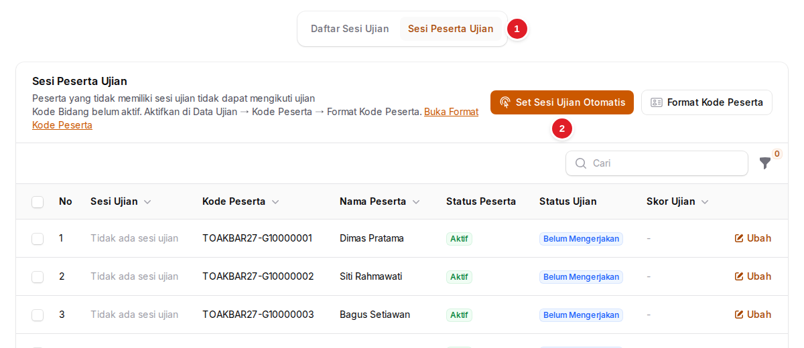
    </Frame>

    Open the test page (**Daftar Tes Ujian** tab → **Ubah** on **Penalaran Matematika**), then:

    1. Click the **Sesi Peserta Ujian** (participant sessions) tab. Participants without a session are marked **Tidak ada sesi ujian** (no session).
    2. Click **Set Sesi Ujian Otomatis** (assign sessions automatically).
  </Step>
  <Step title="Confirm the assignment">
    <Frame>
      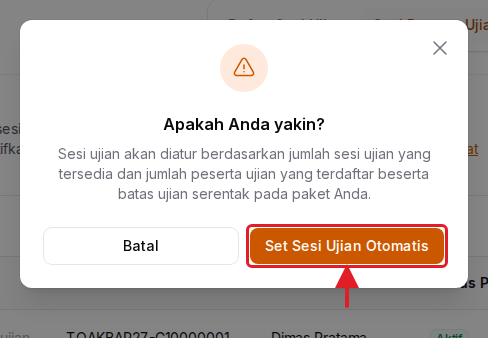
    </Frame>

    Click **Set Sesi Ujian Otomatis** in the confirmation window. The system spreads participants evenly across the available sessions; with one session, everyone goes into **Sesi 1**.

    <Frame>
      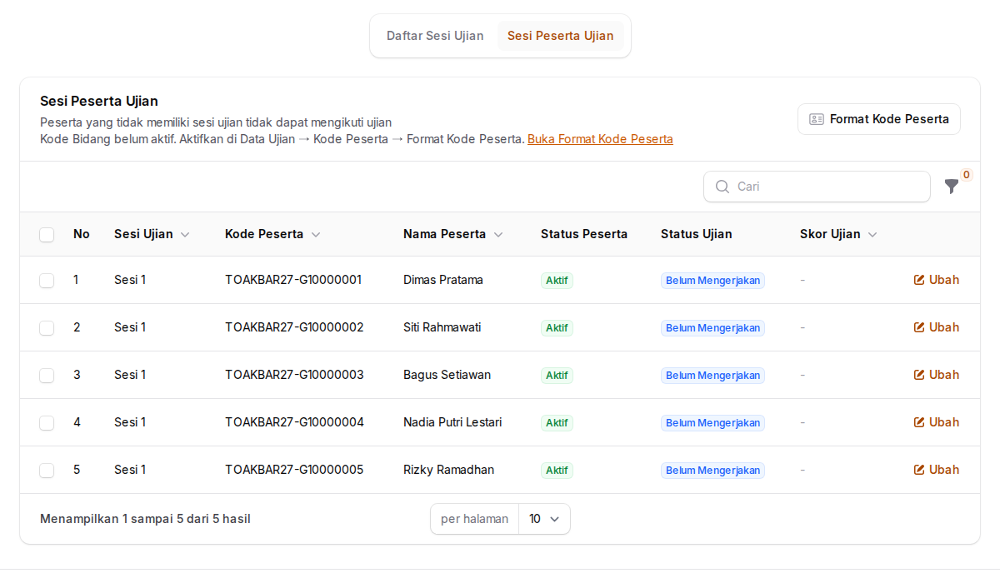
    </Frame>
  </Step>
</Steps>

<Tip>
  To choose the session yourself, tick the participants, click **Tindakan**, and choose **Set Sesi Ujian Kolektif** (bulk assign session). For a single participant, click **Ubah** on their row. The **Set Sesi Ujian Otomatis** button only appears while some participants have no session and nobody is currently taking the test.
</Tip>

## 9. Share the participant login link

<Steps>
  <Step title="Copy Tautan Login Peserta">
    <Frame>
      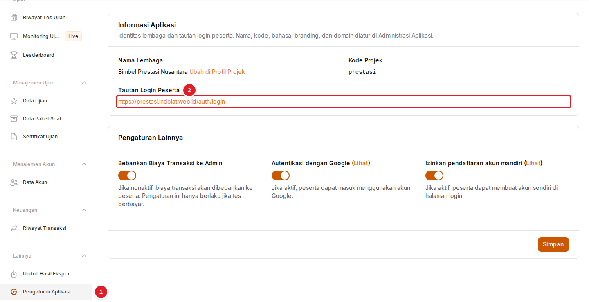
    </Frame>

    1. In the sidebar, click **Lainnya** → **Pengaturan Aplikasi** (application settings).
    2. Copy **Tautan Login Peserta** (participant login link) from the **Informasi Aplikasi** card, for example `https://prestasi.indolat.web.id/auth/login`, and share it with participants together with their email and password.

    The address is based on the project code. The institution name, code, and domain are changed under **Administrasi Aplikasi** → **Pengaturan Projek**. See also [Participant Login](/en/lainnya/login-peserta).
  </Step>
</Steps>

## 10. Participants take the exam

This section shows the participant's side. Try it yourself with one of the participant accounts before opening the exam to everyone.

<Steps>
  <Step title="Sign in to the participant app">
    <Frame>
      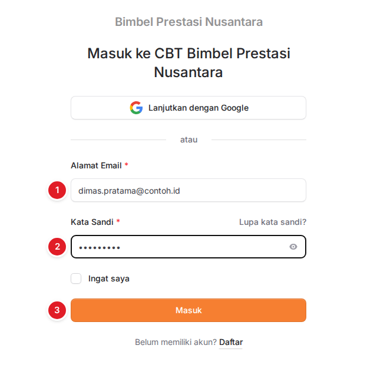
    </Frame>

    1. Open the login link and enter the **Alamat Email**.
    2. Enter the **Kata Sandi**.
    3. Click **Masuk** (sign in).
  </Step>
  <Step title="Choose the test on Daftar Tes">
    <Frame>
      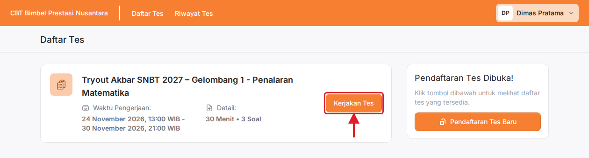
    </Frame>

    The **Daftar Tes** (test list) page shows the tests the participant can take, with the session window, duration, and number of questions. Click **Kerjakan Tes** (take test).
  </Step>
  <Step title="Read the instructions and start">
    <Frame>
      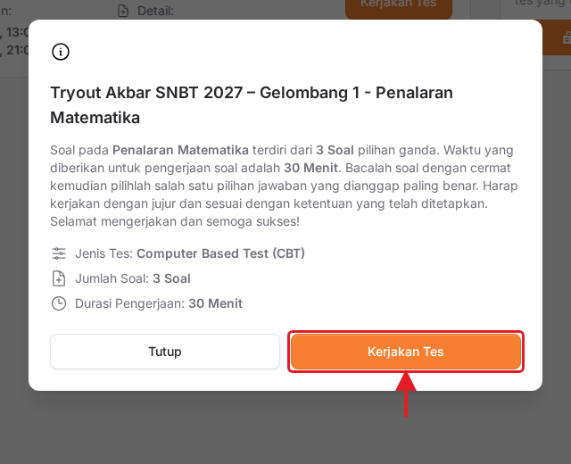
    </Frame>

    The instruction window shows the **Instruksi Pengerjaan Tes Ujian** you wrote, the test type, number of questions, and duration. Click **Kerjakan Tes**.

    <Frame>
      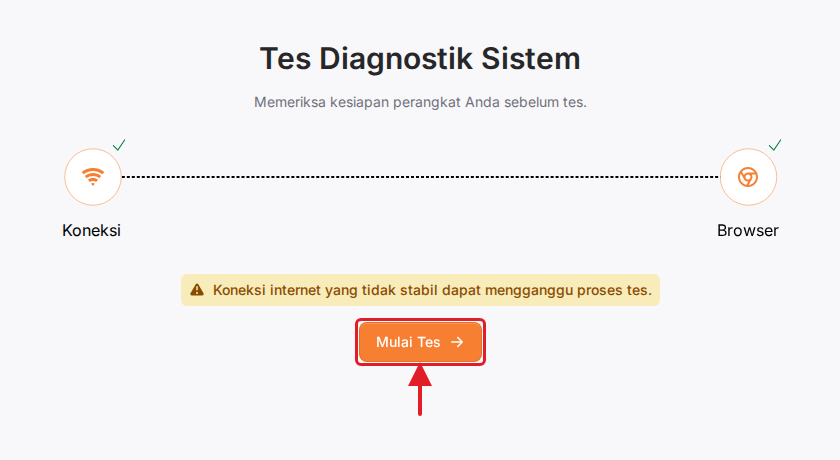
    </Frame>

    The **Tes Diagnostik Sistem** (system check) page checks the participant's connection and browser. When the check finishes, click **Mulai Tes** (start test). The timer starts.
  </Step>
  <Step title="Answer the questions">
    <Frame>
      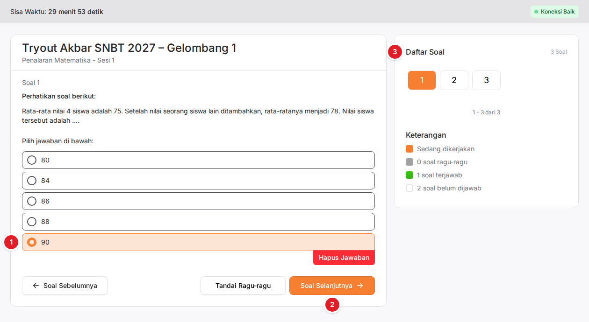
    </Frame>

    1. Click an answer option. Use **Hapus Jawaban** (clear answer) to undo the choice.
    2. Click **Soal Selanjutnya** (next question) to move on. **Tandai Ragu-ragu** (mark as unsure) flags a question to review later.
    3. The **Daftar Soal** panel shows which questions are answered; click a number to jump to that question.

    The remaining time is shown at the top. Because **Acak Soal** is on, each participant sees the questions in a different order.
  </Step>
  <Step title="Finish the test">
    <Frame>
      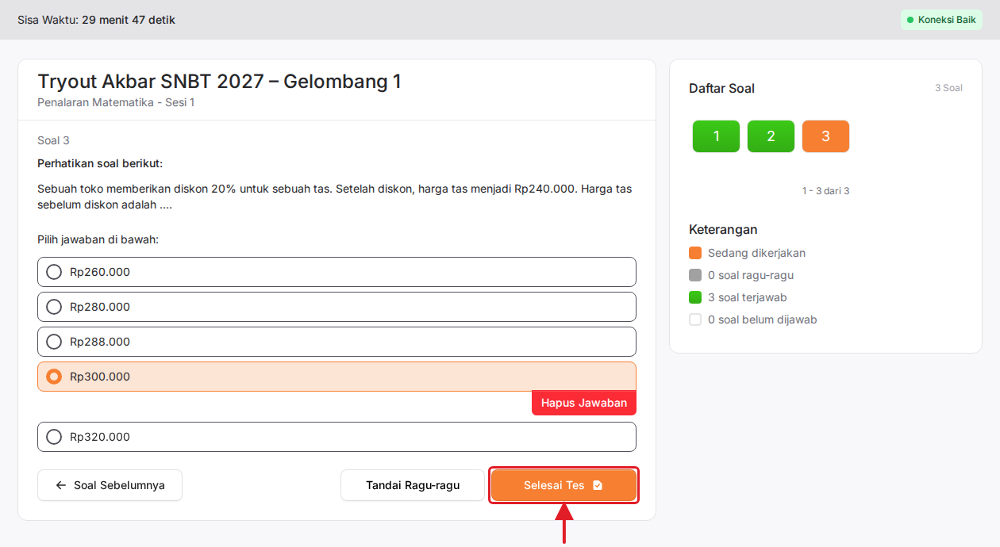
    </Frame>

    On the last question, click **Selesai Tes** (finish test).

    <Frame>
      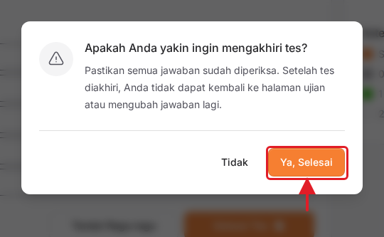
    </Frame>

    Click **Ya, Selesai** (yes, finish). Once the test ends, the participant cannot return to the exam page or change answers.

    <Frame>
      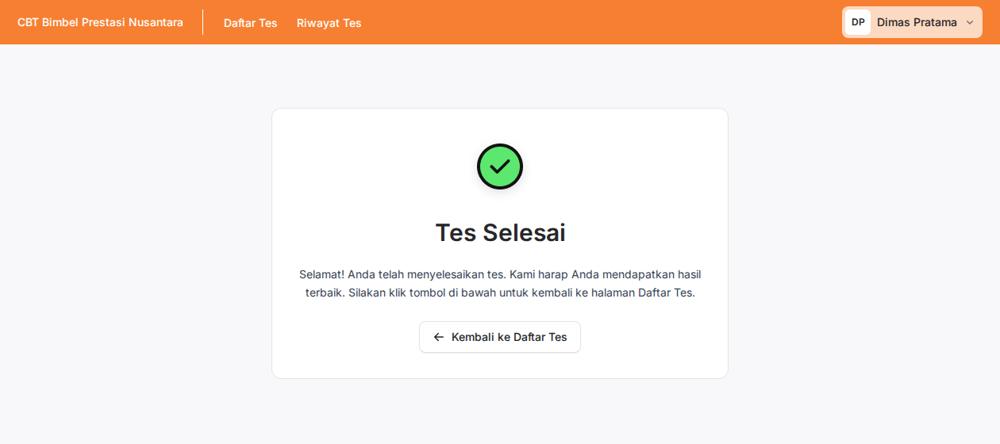
    </Frame>
  </Step>
  <Step title="See the score in Riwayat Tes">
    <Frame>
      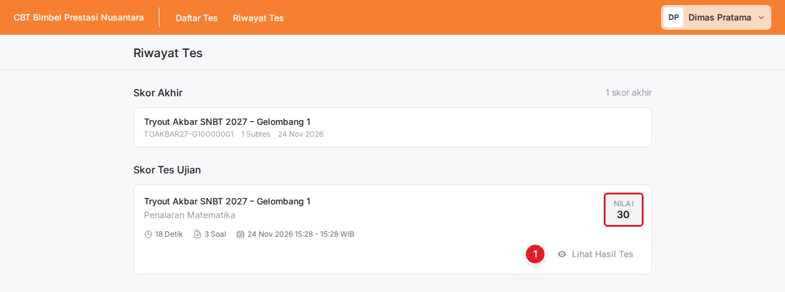
    </Frame>

    On the **Riwayat Tes** (test history) menu, participants see the **Nilai** (score) for the test because **Tampilkan Skor** is on. Clicking **Lihat Hasil Tes** (view test result) opens the answer sheet and the right/wrong summary (shown because **Tampilkan Ringkasan** is on).
  </Step>
</Steps>

## 11. Monitor and review results

### Monitor participants who are testing

<Frame>
  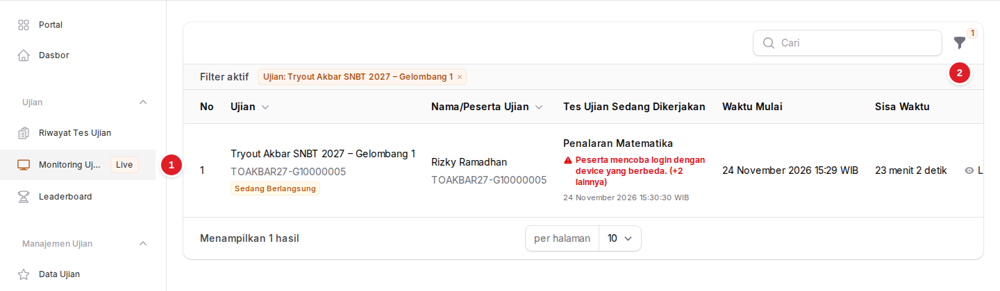
</Frame>

1. In the sidebar, click **Ujian** → **Monitoring Ujian** (live exam monitoring). The page refreshes automatically every 10 seconds.
2. Click the filter icon to choose an **Ujian** (exam), **Status Ujian** (testing or not started), or **Terdeteksi Kecurangan** (cheating detected), then click **Terapkan filter** (apply filter).

The list shows participants who have not finished their exam yet, with the test in progress, start time, remaining time, and warnings such as **Peserta mencoba login dengan device yang berbeda** (participant tried to sign in from another device). Participants who finish move to **Riwayat Tes Ujian**.

### Review participant results

<Frame>
  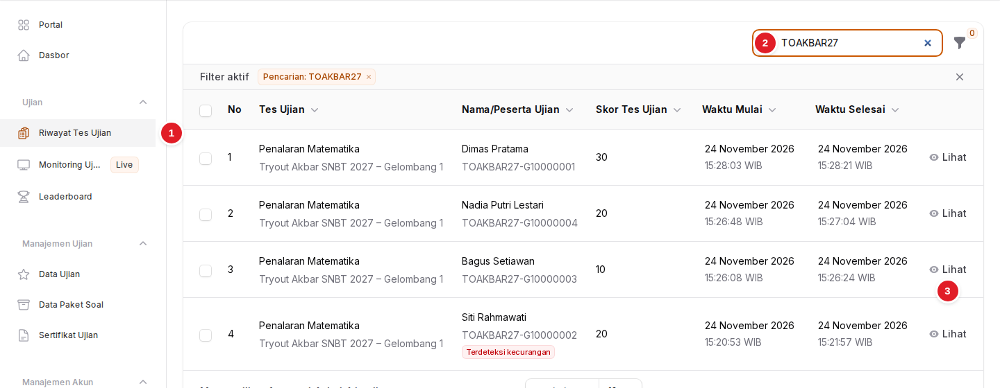
</Frame>

1. In the sidebar, click **Ujian** → **Riwayat Tes Ujian** (test history).
2. Search by participant name or code. Because participant codes start with the exam code, typing **TOAKBAR27** lists every participant of this exam. You can also use the **Tes Ujian** (test) or **Tanggal Pengerjaan** (test date) filters. The table shows each participant's **Skor Tes Ujian** (test score), **Waktu Mulai** (start), and **Waktu Selesai** (finish); a **Terdeteksi kecurangan** label appears when the system logged a violation.
3. Click **Lihat** (view) to open a participant's result.

<Frame>
  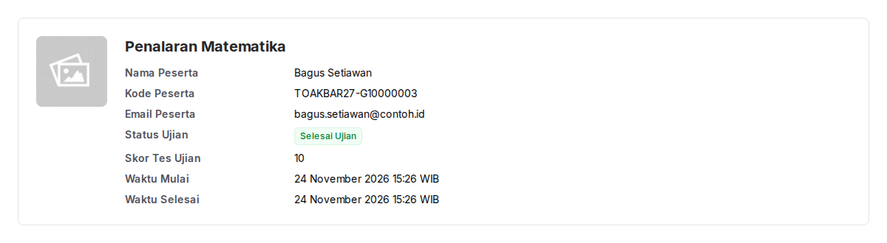
</Frame>

<Frame>
  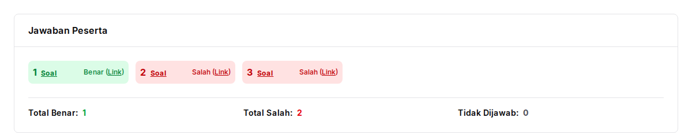
</Frame>

The detail page contains the participant summary, **Log Peserta & Ujian** (participant and exam log: when the test started, finished, and other events), and **Jawaban Peserta** (participant answers) with the right/wrong status per question. The **Soal** link opens the question and the **Link** link opens the answer option the participant chose, each in a new tab.

<Tip>
  If you change question scores after participants have finished, recalculate them with **Hitung Skor** → **Perhitungan Skor Ujian** (recalculate exam scores) on the exam detail page, or **Hitung Ulang Skor** (recalculate scores) on the **Sesi Peserta Ujian** tab of the test page. Tests that use an IRT method are scored with **Hitung Skor** → **Perhitungan IRT** once all participants have finished.
</Tip>

### Download the results report

<Steps>
  <Step title="Export the test results">
    <Frame>
      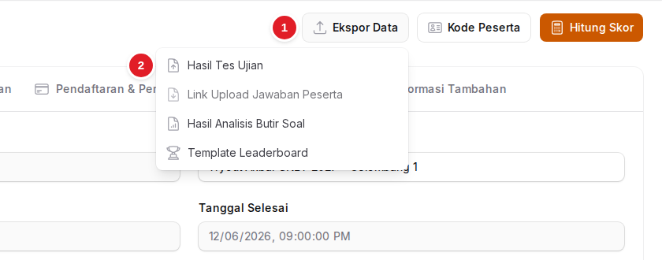
    </Frame>

    On the exam detail page:

    1. Click **Ekspor Data** (export data).
    2. Choose **Hasil Tes Ujian** (test results), then click **Konfirmasi** (confirm).

    The Excel file is generated in the background, and you get a notification when it is ready. It contains two worksheets: a score summary per participant, and participant details with timing and cheating data.
  </Step>
  <Step title="Download the file">
    <Frame>
      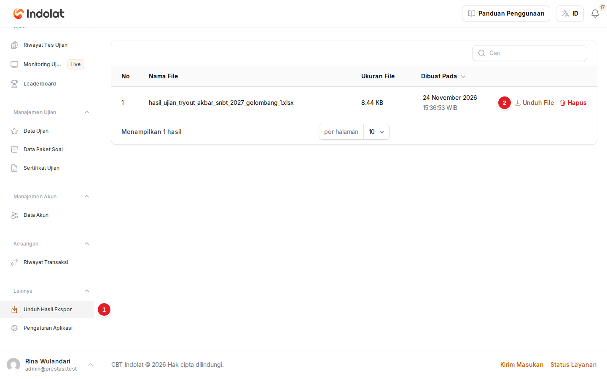
    </Frame>

    1. In the sidebar, click **Lainnya** → **Unduh Hasil Ekspor** (download exports).
    2. Click **Unduh File** (download file) on the export, for example **hasil_ujian_tryout_akbar_snbt_2027_gelombang_1.xlsx**.

    <Check>
      Done. You have created a question package, an exam, a test, and a session, added participants, tried the exam as a participant, and monitored and downloaded the results.
    </Check>
  </Step>
</Steps>
