This page takes you from creating an admin account to being ready to work in the new layout: signing in to the Panel, completing your profile, getting to know the **Portal**, opening each module, and finding where the old menus have moved.

<Info>
  The new layout is opened at `app.indolat.com/web`. After signing in, you land on the **Portal**. The **Lengkapi Profil** (Complete Profile) wizard, the **Panduan Menu** (Menu Guide) tour, and the **Mulai cepat** (Quick Start) checklist are shown to project owners only.
</Info>

<Note>
  From **30 November 2026**, every admin uses this new layout and the old layout can no longer be chosen. Your data, exams, and participants stay intact. Only the layout and the location of menus change.
</Note>

The examples on this page use the admin **Dewi Lestari** (`dewi.lestari@contoh.id`), who registers her school, **SMA Harapan Bangsa**.

## Creating an admin account

<Steps>
  <Step title="Open the registration page">
    Open `app.indolat.com/web/register`, or select **Daftar** (Register) below the **Masuk** (Sign in) button on the sign-in page.
  </Step>
  <Step title="Fill in the Daftar Akun form">
    <Frame>
      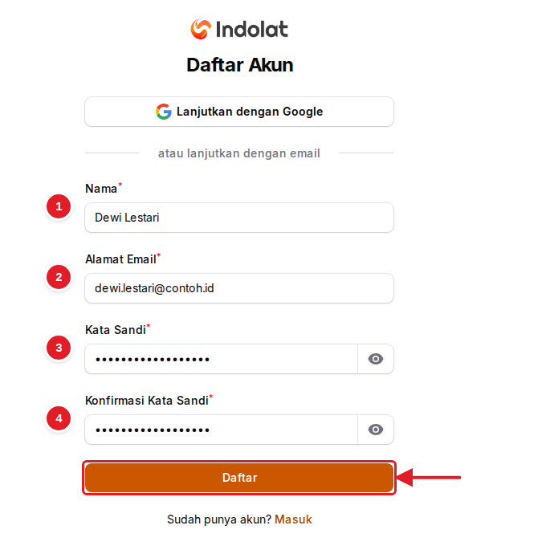
    </Frame>

    1. **Nama** (Name): your name as the admin, for example **Dewi Lestari**.
    2. **Alamat Email** (Email Address): an active email you will use to sign in. Disposable email addresses and addresses that are already registered are rejected.
    3. **Kata Sandi** (Password): at least 8 characters.
    4. **Konfirmasi Kata Sandi** (Confirm Password): type the same password again.

    Select **Daftar**. If a security check box appears, complete it first.

    <Tip>
      You can also select **Lanjutkan dengan Google** (Continue with Google). A Google account that is not registered yet immediately gets an admin account and a project, and its email counts as verified.
    </Tip>
  </Step>
  <Step title="Verify your email address">
    After registering, the **Akun Berhasil Dibuat** (Account created) notification confirms that the **Standard** plan is active. The Panel then asks you to verify your email.

    <Frame>
      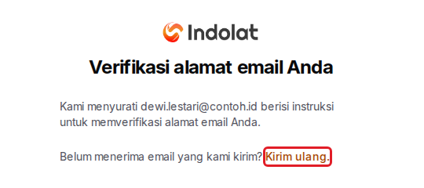
    </Frame>

    Open the email titled **Verifikasi Alamat Email** (Verify Email Address) and select the **Verifikasi Alamat Email** button. If the email does not arrive, check your spam folder or select **Kirim ulang** (Resend) on the verification page.

    <Frame>
      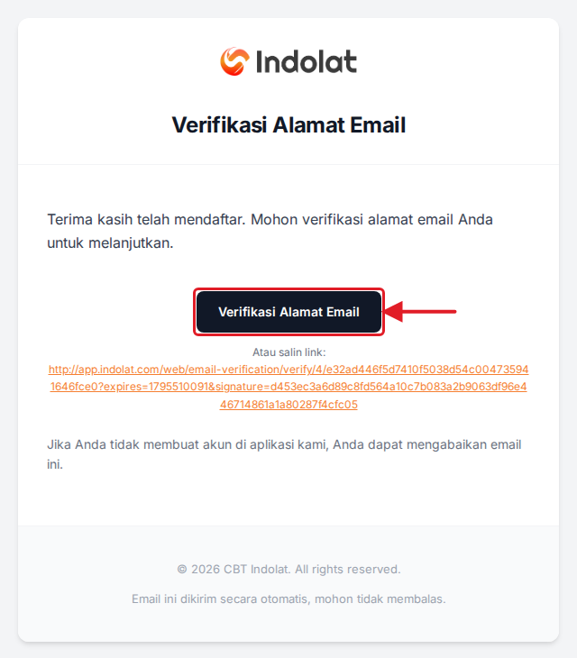
    </Frame>
  </Step>
</Steps>

Every new account automatically gets one project on the **Standard** plan. The project name is replaced with the institution name you enter in the **Lengkapi Profil** wizard, while its code is generated automatically (for example `cl-1795506490`).

<Tip>
  The project code is part of the participant login link (`project-code.indolat.web.id`). Replace the generated code with one that is easy to remember in **Portal** → **Administrasi Aplikasi** → **Pengaturan Projek** → **Profil Projek**. The examples on this page use the code `sma-harapan-bangsa`.
</Tip>

## Completing your profile

As soon as your email is verified, the **Lengkapi Profil** wizard opens. Until the profile is complete, your free allowance is **50 exam credits** per month. Once all four steps are done, it grows by **150 credits** to **200 credits** per month.

<Steps>
  <Step title="Step 1: Identitas Anda (Your Identity)">
    <Frame>
      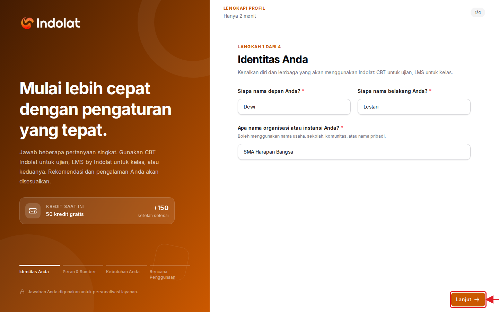
    </Frame>

    Your first and last name are filled in from your account name. Fill in **Apa nama organisasi atau instansi Anda?** (What is the name of your organisation?) with your institution name, for example **SMA Harapan Bangsa**. This name becomes the project name and is shown on the Portal and in the participant app. Select **Lanjut** (Next).
  </Step>
  <Step title="Step 2: Peran & Sumber (Role and Source)">
    <Frame>
      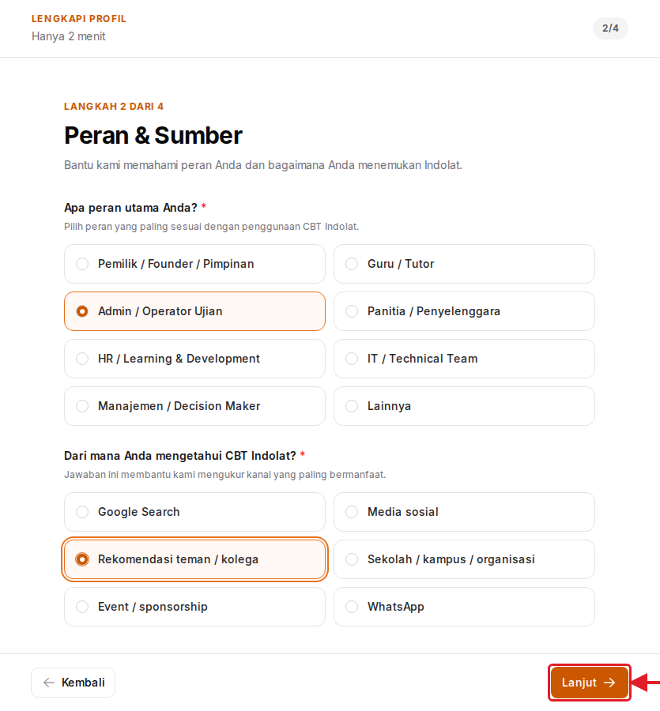
    </Frame>

    Choose your main role (for example **Admin / Operator Ujian**) and how you heard about CBT Indolat. If you choose **Lainnya** (Other), type your answer in the field that appears. Select **Lanjut**.
  </Step>
  <Step title="Step 3: Kebutuhan Anda (Your Needs)">
    <Frame>
      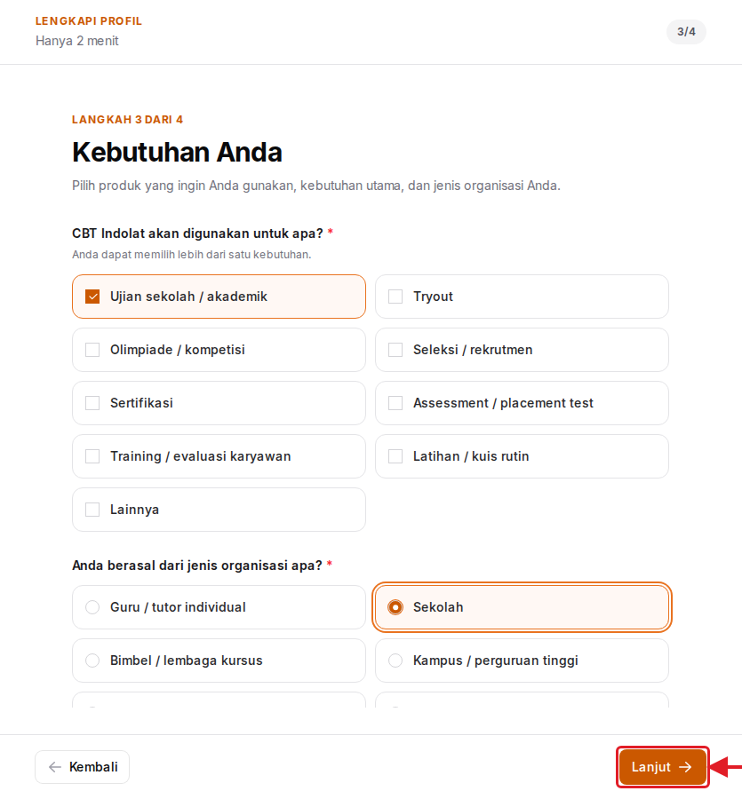
    </Frame>

    Choose one or more use cases (for example **Ujian sekolah / akademik**) and your organisation type (for example **Sekolah**). Select **Lanjut**.
  </Step>
  <Step title="Step 4: Rencana Penggunaan (Usage Plan)">
    <Frame>
      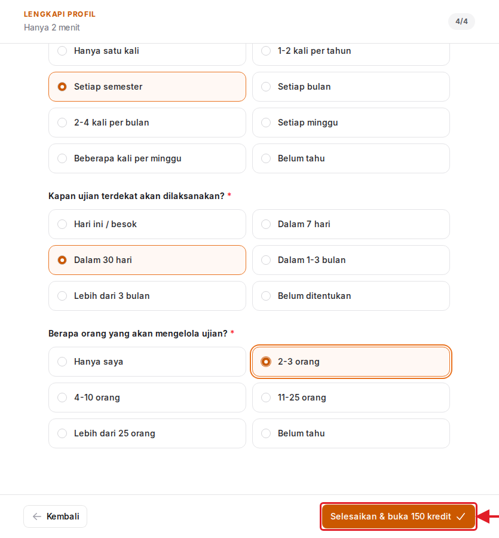
    </Frame>

    Answer the expected number of participants, how often you hold exams, when the next exam takes place, and how many people manage exams. Select **Selesaikan & buka 150 kredit** (Finish and unlock 150 credits).
  </Step>
  <Step title="Go to the Portal">
    <Frame>
      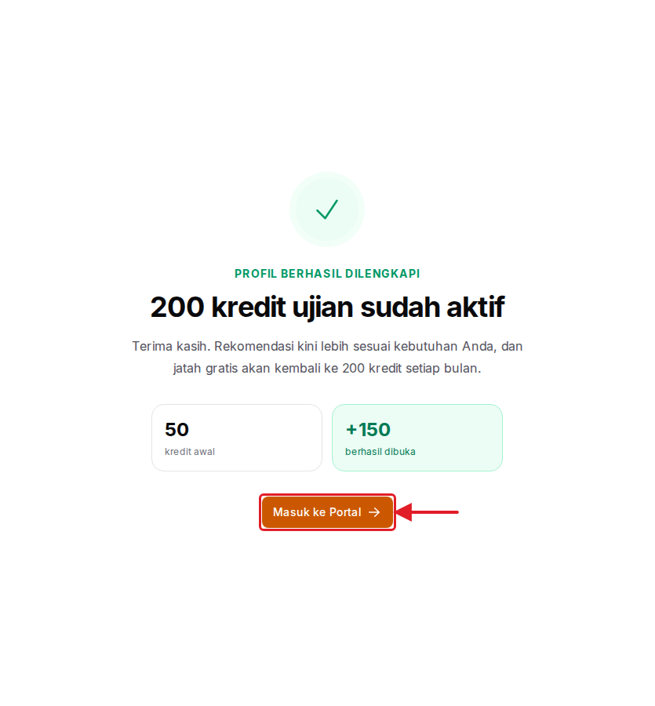
    </Frame>

    The **Profil berhasil dilengkapi** (Profile completed) page shows the 50 starting credits and the 150 extra credits you unlocked. Select **Masuk ke Portal** (Go to the Portal).
  </Step>
</Steps>

Every question is required. Use **Kembali** (Back) to correct an answer in a previous step.

## Signing in to the Panel

<Frame>
  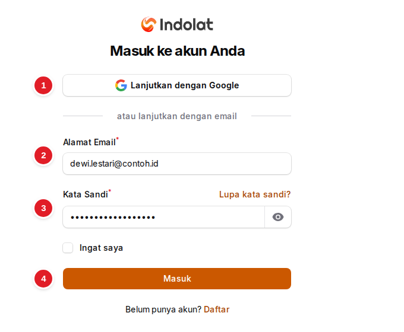
</Frame>

1. **Lanjutkan dengan Google**: sign in with a Google account that uses the same email as your admin account.
2. **Alamat Email**: your admin account email.
3. **Kata Sandi**: your password. Select **Lupa kata sandi?** (Forgot password?) if you have forgotten it, then follow the link sent to your email. Tick **Ingat saya** (Remember me) to stay signed in on the same device.
4. Select **Masuk**.

The language button in the top-right corner (**ID**) switches the sign-in page to English and back.

If you have only one project, you land on the Portal straight away. If you have access to more than one project, first choose one from the **Pilih Projek** (Choose Project) list.

<Frame>
  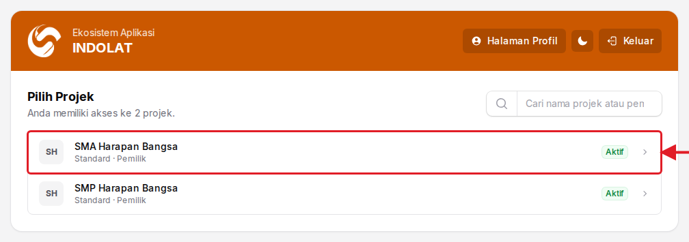
</Frame>

Each row shows the project name, plan, your role, and the project status. Use the **Cari nama projek atau pemilik…** (Search project or owner name) field when the list is long.

## Getting to know the Portal

The **Portal** is the first page after signing in. From here you choose the module you want to open.

<Frame>
  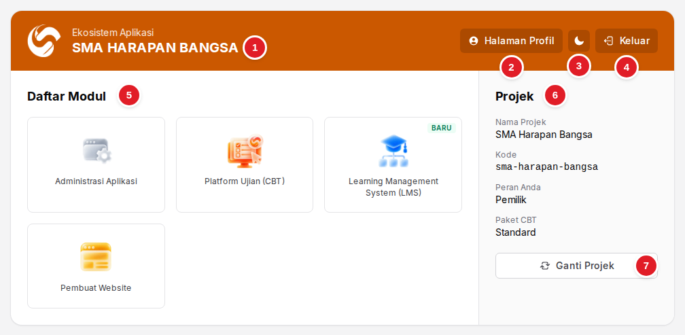
</Frame>

1. **Identity ribbon**: the institution name of the project that is open.
2. **Halaman Profil** (Profile Page): opens the **Profil** page, where you change your account name, email address, and password.
3. **Change theme**: switches between light and dark mode.
4. **Keluar** (Sign out): signs you out.
5. **Daftar Modul** (Module List): tiles for the modules you can open. Hover over a tile to see a short description. A tile is shown only for modules your role allows.
6. **Projek** (Project): project name, code, your role in this project (for example **Pemilik**, Owner), and CBT plan.
7. **Ganti Projek** (Switch Project): shown when you have access to more than one project.

<Frame>
  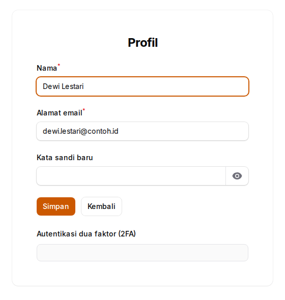
</Frame>

On the **Profil** page, leave **Kata sandi baru** (New password) empty if you do not want to change your password. Select **Simpan** (Save) to save your changes or **Kembali** to go back.

<Frame>
  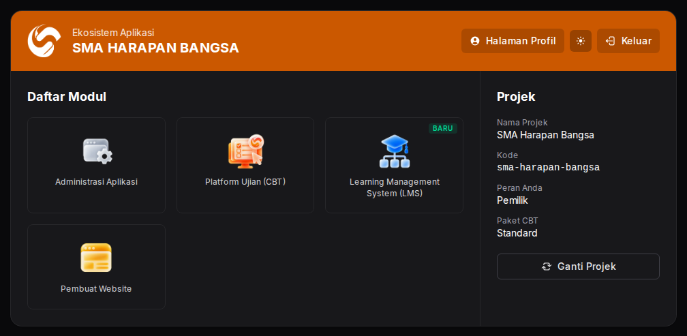
</Frame>

### Switching projects

If you manage more than one institution, for example a senior and a junior high school under one foundation, select **Ganti Projek** on the **Projek** panel.

<Frame>
  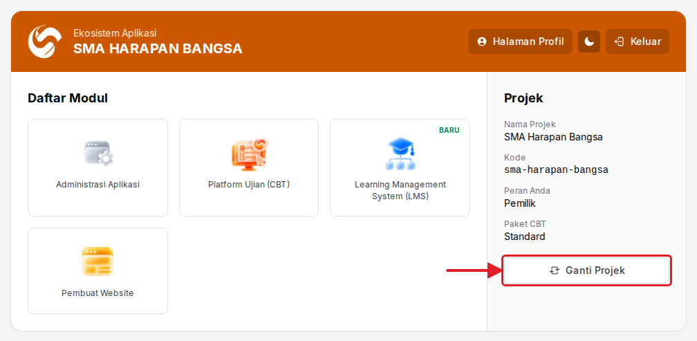
</Frame>

The Portal shows the **Pilih Projek** list again. Choose the project you want to open. Every module you open afterwards works on that project.

## Available modules

| Portal tile | Purpose |
| --- | --- |
| **Administrasi Aplikasi** (App Administration) | Manages the project as a whole: users, admin team and roles, balance withdrawals, subscriptions and billing, project profile, branding, domains, and API integration. |
| **Platform Ujian (CBT)** (Exam Platform) | Runs exams and assessments: question packages, exam data, monitoring, results, leaderboards, certificates, and exam payment history. |
| **Learning Management System (LMS)** | Manages classes, teaching schedules, materials, assignments, and grades. See [Getting to Know the LMS](/en/lms/mengenal-lms). |
| **Pembuat Website** (Website Builder) | Builds and publishes your institution's website without code. See [Creating a Website](/en/web-builder/membuat-website). |

Each module has its own sidebar. The **Portal** menu is always at the top of the sidebar, so you can return to the Portal and switch modules with one click.

<Tabs>
  <Tab title="Administrasi Aplikasi">
    <Frame>
      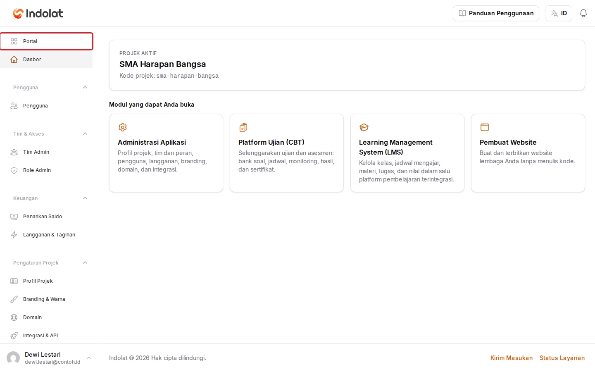
    </Frame>

    Sidebar: **Dasbor**; **Pengguna**: **Pengguna**; **Tim & Akses**: **Tim Admin**, **Role Admin**; **Keuangan**: **Penarikan Saldo**, **Langganan & Tagihan**; **Pengaturan Projek**: **Profil Projek**, **Branding & Warna**, **Domain**, **Integrasi & API**. The dashboard shows the active project and the modules you can open.
  </Tab>
  <Tab title="Platform Ujian (CBT)">
    <Frame>
      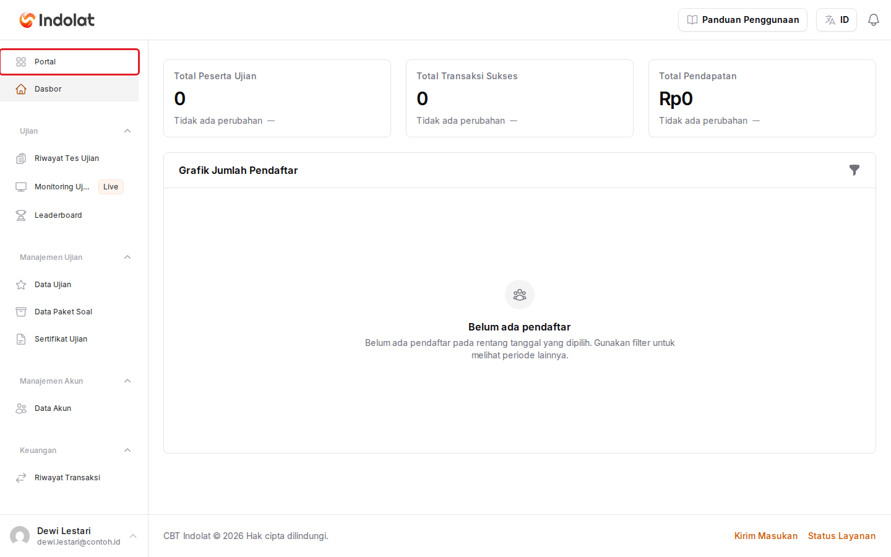
    </Frame>

    Sidebar: **Dasbor**; **Ujian**: **Riwayat Tes Ujian**, **Monitoring Ujian**, **Leaderboard**; **Manajemen Ujian**: **Data Ujian**, **Data Paket Soal**, **Sertifikat Ujian**; **Manajemen Akun**: **Data Akun**; **Keuangan**: **Riwayat Transaksi**; **Lainnya**: **Unduh Hasil Ekspor**, **Pengaturan Aplikasi**.
  </Tab>
  <Tab title="Learning Management System (LMS)">
    <Frame>
      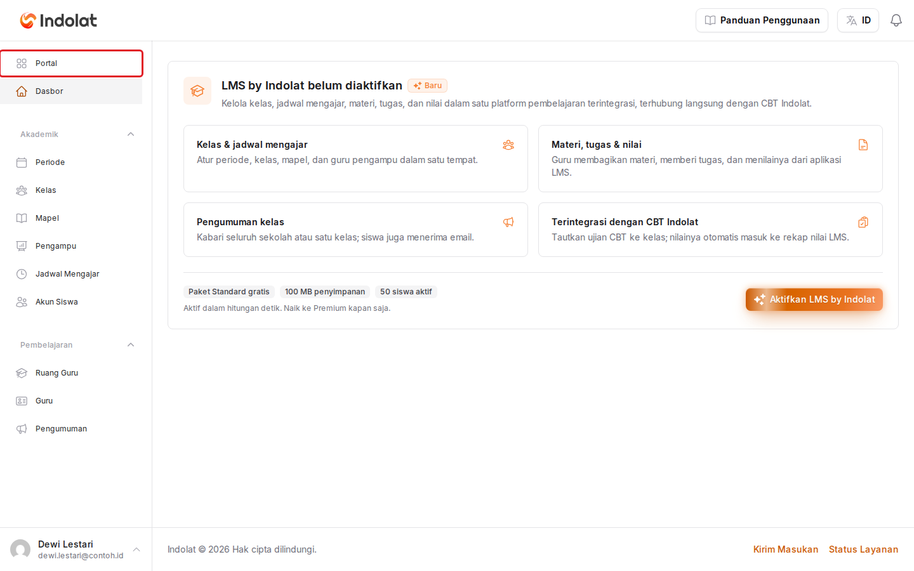
    </Frame>

    Sidebar: **Dasbor**; **Akademik**: **Periode**, **Kelas**, **Mapel**, **Pengampu**, **Jadwal Mengajar**, **Akun Siswa**; **Pembelajaran**: **Ruang Guru**, **Guru**, **Pengumuman**. The LMS has to be activated once before use.
  </Tab>
  <Tab title="Pembuat Website">
    <Frame>
      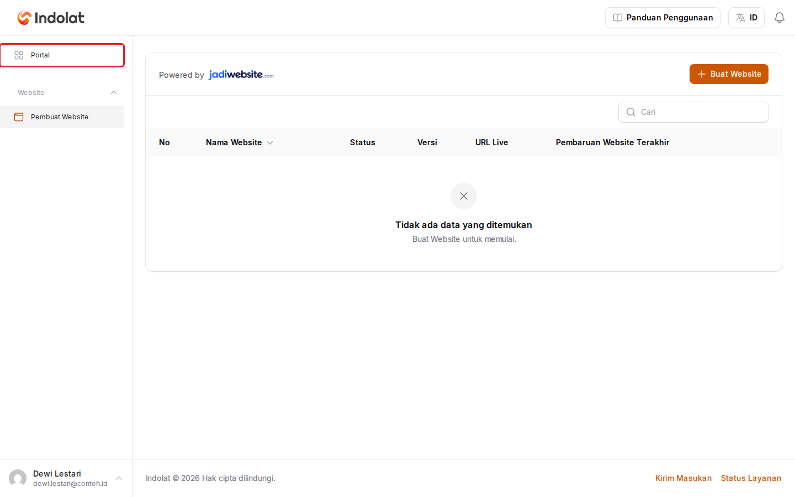
    </Frame>

    Sidebar: **Website**: **Pembuat Website**.
  </Tab>
</Tabs>

## Top bar and account menu

<Frame>
  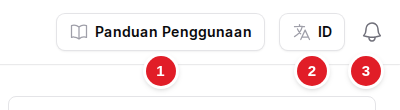
</Frame>

1. **Panduan Penggunaan** (User Guide): opens this documentation.
2. **Language switch** (**ID**): changes the Panel language between **Bahasa Indonesia** and **English**.
3. **Notifications** (bell icon): opens the list of notifications for your account.

<Frame>
  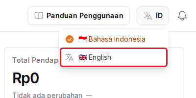
</Frame>

Select your name at the bottom of the sidebar to open the account menu.

<Frame>
  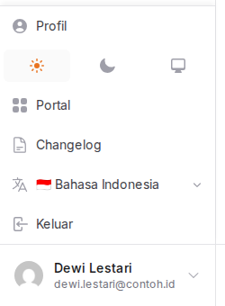
</Frame>

The account menu contains **Profil**, the theme options (light, dark, or follow the system), **Portal**, **Changelog** (release notes), the language switch, and **Keluar**. The bottom of each page also has **Kirim Masukan** (Send Feedback) and **Status Layanan** (Service Status) links.

## Panduan Menu (Menu Guide)

When a project owner opens a module for the first time, the **Panduan Menu** tour starts automatically. It highlights each sidebar menu in turn and explains what it is for.

<Frame>
  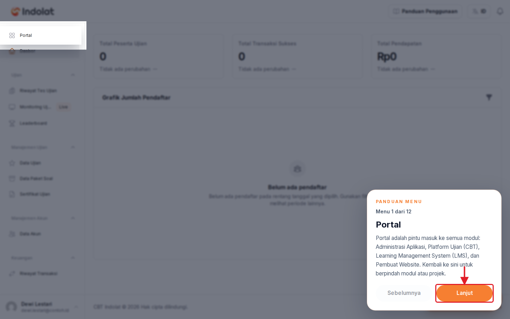
</Frame>

- Select **Lanjut** to go to the next menu and **Sebelumnya** (Previous) to go back.
- On some steps the button changes to **Klik menu yang disorot** (Click the highlighted menu). Click the highlighted sidebar menu to continue the tour on that page.

<Frame>
  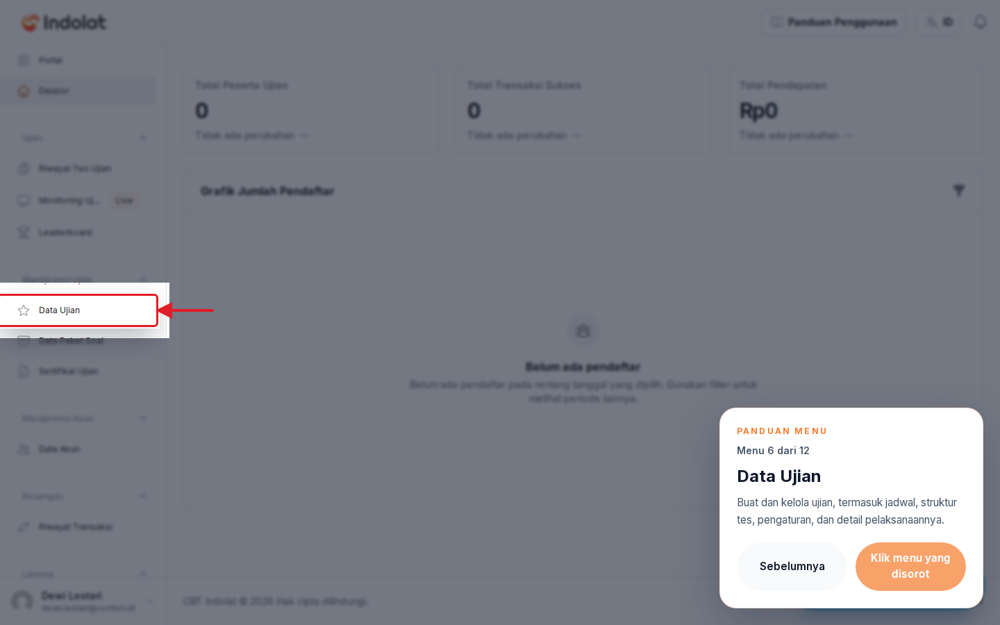
</Frame>

- The **Platform Ujian (CBT)** tour covers 12 menus and ends with the **Panduan Penggunaan** button. Select **Selesai** (Done) on the last step.
- The tours in **Administrasi Aplikasi**, **LMS**, and **Pembuat Website** are shorter and can be skipped with **Lewati** (Skip).

<Frame>
  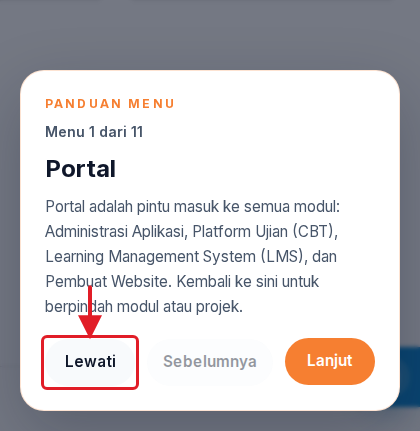
</Frame>

Each tour runs only once per module for each project.

## Mulai cepat (Quick Start)

In the **Platform Ujian (CBT)** module, the **Mulai cepat** button in the bottom-right corner lists the first three tasks for preparing an exam.

<Frame>
  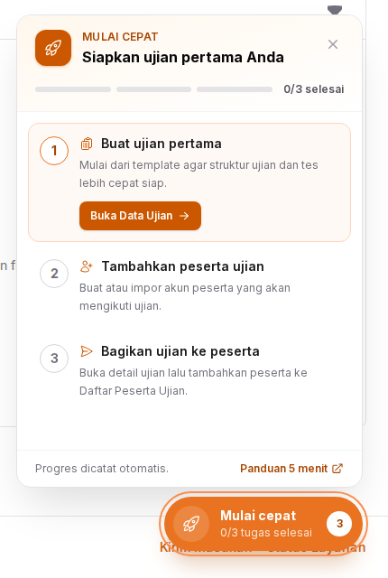
</Frame>

1. **Buat ujian pertama** (Create your first exam): the **Buka Data Ujian** button takes you to **Data Ujian**.
2. **Tambahkan peserta ujian** (Add exam participants): create or import participant accounts in **Data Akun**.
3. **Bagikan ujian ke peserta** (Share the exam with participants): open the exam detail, then add participants to its participant list.

Progress is detected automatically from your data, so each task ticks itself off when done. The **Panduan 5 menit** (5-minute guide) link opens [Create Your First Exam in 5 Minutes](/en/membuat-ujian-pertama-anda-dalam-5-menit). The checklist is shown only to project owners who have completed their profile, and it disappears once all three tasks are done.

## Changes from the old layout

In the old layout, every menu sat in one sidebar at `/web`. In the new layout, menus that apply to the whole project have moved to **Administrasi Aplikasi**, and **Pembuat Website** has become a module of its own.

| Old layout (sidebar at `/web`) | New layout |
| --- | --- |
| **Manajemen Paket** (Plan Management) | **Administrasi Aplikasi** → **Keuangan** → **Langganan & Tagihan** (Subscriptions and Billing) |
| **Penarikan Saldo** (Balance Withdrawal) | **Administrasi Aplikasi** → **Keuangan** → **Penarikan Saldo**. The withdrawable and pending balances now appear above the table. |
| **Riwayat Transaksi** (Transaction History) | Stays in **Platform Ujian (CBT)** → **Keuangan** → **Riwayat Transaksi** |
| **Tim Admin** and **Role Admin** | **Administrasi Aplikasi** → **Tim & Akses** → **Tim Admin** and **Role Admin** |
| **Pembuat Website** | The **Pembuat Website** module → **Website** → **Pembuat Website** |
| **Data Akun** (Account Data) | The main list is in **Administrasi Aplikasi** → **Pengguna** → **Pengguna**. **Data Akun** remains in **Platform Ujian (CBT)** → **Manajemen Akun** and shows the same data. In the LMS, the same data appears as **Akun Siswa** (Student Accounts). |
| **Pengaturan Aplikasi**, **Informasi Umum** tab (name, code, language) | **Administrasi Aplikasi** → **Pengaturan Projek** → **Profil Projek** |
| **Pengaturan Aplikasi**, **Kustomisasi Branding** tab | **Administrasi Aplikasi** → **Pengaturan Projek** → **Branding & Warna** |
| **Pengaturan Aplikasi**, **Kustom Domain** tab | **Administrasi Aplikasi** → **Pengaturan Projek** → **Domain** |
| **Pengaturan Aplikasi**, **Integrasi API** tab | **Administrasi Aplikasi** → **Pengaturan Projek** → **Integrasi & API** |
| **Pengaturan Aplikasi**, **Pengaturan Lainnya** tab | Stays in **Platform Ujian (CBT)** → **Lainnya** → **Pengaturan Aplikasi** |

The **Pengaturan Aplikasi** page in the CBT module now has two cards:

- **Informasi Aplikasi** (App Information): the institution name (read-only, with an **Ubah di Profil Projek** link), **Kode Projek** (project code), and **Tautan Login Peserta** (participant login link).
- **Pengaturan Lainnya** (Other Settings): **Bebankan Biaya Transaksi ke Admin** (charge transaction fees to the admin), **Autentikasi dengan Google** (sign in with Google), and **Izinkan pendaftaran akun mandiri** (allow self-registration).

The other CBT menus (**Dasbor**, **Riwayat Tes Ujian**, **Monitoring Ujian**, **Leaderboard**, **Data Ujian**, **Data Paket Soal**, **Sertifikat Ujian**, and **Unduh Hasil Ekspor**) stay in **Platform Ujian (CBT)**.
