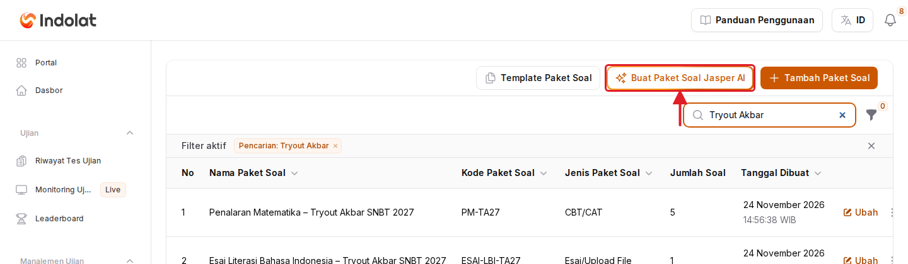
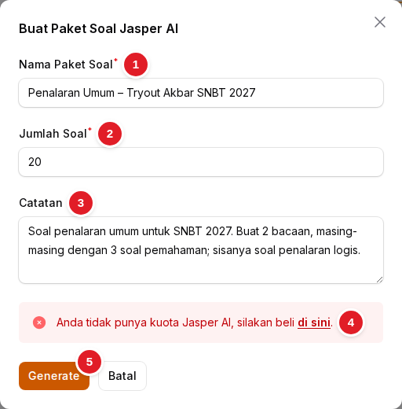
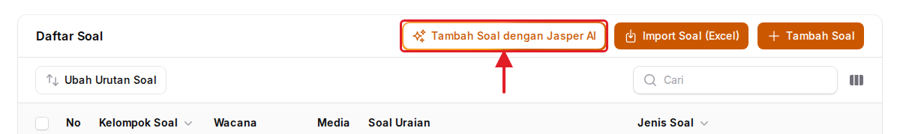
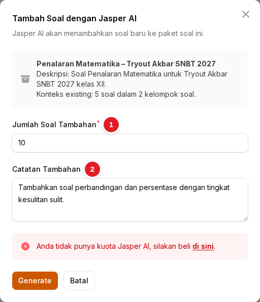

**Jasper AI** automatically writes questions with answer options, keys, explanations, difficulty levels, and scores, based on the package name and the instructions you give. It is useful for preparing draft questions quickly, which you then review and refine.

<Info>
  **Menu location:**

  - New package: **Portal** → **Platform Ujian (CBT)** → **Manajemen Ujian** → **Data Paket Soal** → **Buat Paket Soal Jasper AI**.
  - Existing package: **Data Paket Soal** → **Ubah** (Edit) on the package → **Daftar Soal** → **Tambah Soal dengan Jasper AI**.

  Jasper AI only creates questions for **CBT/CAT** packages and uses your project's **Jasper AI quota**: each question uses one unit of quota.
</Info>

## Jasper AI quota

The remaining quota is shown at the bottom of the Jasper AI form, for example **Sisa kuota Jasper AI: 100 soal** (remaining quota: 100 questions). The quota is deducted by the **Jumlah Soal** (number of questions) when the process starts. If you have no quota left, the form shows **Anda tidak punya kuota Jasper AI, silakan beli di sini** (you have no Jasper AI quota, buy it here); the **di sini** link opens the Jasper AI add-on purchase in **Administrasi Aplikasi** → **Keuangan** → **Langganan & Tagihan**.

If the requested number of questions exceeds the remaining quota, the process does not start and the message **Kuota Jasper AI Tidak Cukup** (insufficient quota) shows your remaining quota.

## Creating a new package with Jasper AI

As an example, you prepare the package **Penalaran Umum – Tryout Akbar SNBT 2027** with 20 questions as a starting point.

<Steps>
  <Step title="Click Buat Paket Soal Jasper AI">
    Open **Data Paket Soal**, then click **Buat Paket Soal Jasper AI** (Create Question Package with Jasper AI).

    <Frame>
      
    </Frame>
  </Step>
  <Step title="Fill in the form">
    <Frame>
      
    </Frame>

    1. **Nama Paket Soal** (package name): the name of the new package. Jasper AI also uses it as a hint about the subject, so choose a clear name, for example **Penalaran Umum – Tryout Akbar SNBT 2027**.
    2. **Jumlah Soal** (number of questions): at least 1, for example **20**.
    3. **Catatan** (notes, optional): extra instructions on topics, level, question format, difficulty, or language. Example: _Soal penalaran umum untuk SNBT 2027. Buat 2 bacaan, masing-masing dengan 3 soal pemahaman; sisanya soal penalaran logis._ (General reasoning questions for SNBT 2027; two reading passages with three comprehension questions each, the rest logical reasoning.)
    4. Remaining Jasper AI quota. In the example, the project has no quota yet, so the form shows the purchase link.
    5. Click **Generate**.
  </Step>
  <Step title="Wait for the process to finish">
    The notification **Proses Pembuatan Soal Dimulai** (question generation started) appears. Questions are created in stages in the background (at most 20 questions per stage), so you can leave the page.

    While the process runs, the **Buat Paket Soal Jasper AI** button changes to **Sedang Membuat Paket Soal... (x/y)**, showing how many questions are already saved. Click it to see the progress. When it finishes, you receive the notification **Soal berhasil dibuat** (questions created) and the new package appears in the list.

    <Note>
      Only one Jasper AI process can run in a project at a time. If you start another process before the previous one finishes, the message **Pembuatan Soal Sedang Berjalan** (generation in progress) appears.
    </Note>

    If a stage still fails after several retries, you receive the notification **Pembuatan soal Jasper AI terhenti** (generation stopped), which states how many questions were saved.
  </Step>
  <Step title="Review the generated package">
    Click **Ubah** on the new package and review its information and every question. A Jasper AI package has the following characteristics:

    - Type **CBT/CAT** with an automatically generated code (the initials of the package name followed by **-AI-** and five random characters). Change the code and description if needed, then click **Simpan**.
    - **Acak Soal** (shuffle questions) is on. **Acak Jawaban (Pilihan Ganda)** (shuffle answers) is on, except for psychological test packages.
    - Questions are **Pilihan Ganda** (multiple choice) or **Jawaban Singkat** (short answer with a numeric key), each with an explanation, **Tingkat Kesulitan** (difficulty), and **Skor CBT** and **Skor CAT**. Math formulas are written in LaTeX.
    - Questions are grouped into **Kelompok Soal** (question groups) by subtopic.
    - Reading text, tables, or cases used by several questions are written once as a **reading passage** in the **Wacana** tab and shown above each related question during the exam. You can ask specifically for passage-based questions in **Catatan**.
    - If the package name or notes indicate a personality or psychological test (for example DISC, MBTI, or career interest), Jasper AI creates multiple-choice questions without correct answers, together with **Kelompok Jawaban** (answer groups) for the scoring method **Psikotes (Pengelompokan Jawaban)**.
    - Questions are written in Indonesian unless you ask for another language in **Catatan**.

    How to edit questions, passages, and question groups is described in [Create a Question Package](/en/paket-soal/membuat-paket-soal).
  </Step>
</Steps>

## Adding questions to an existing package

Use this to add Jasper AI questions to a CBT/CAT package that already has questions, for example 10 more questions for **Penalaran Matematika – Tryout Akbar SNBT 2027**.

<Steps>
  <Step title="Click Tambah Soal dengan Jasper AI">
    Open the package with **Ubah**, then click **Tambah Soal dengan Jasper AI** (Add Questions with Jasper AI) in the **Daftar Soal** section.

    <Frame>
      
    </Frame>

    The button is hidden while a participant is taking an exam that uses the package or while another Jasper AI process is running.
  </Step>
  <Step title="Fill in the form and click Generate">
    <Frame>
      
    </Frame>

    The top of the form shows the package name, its description, and the number of existing questions and question groups. Jasper AI uses this information and sample existing questions as context so the new questions fit the package and do not repeat existing ones.

    1. **Jumlah Soal Tambahan** (number of additional questions): at least 1.
    2. **Catatan Tambahan** (additional notes, optional): instructions for the new questions, at most 2,000 characters, for example _Tambahkan soal perbandingan dan persentase dengan tingkat kesulitan sulit._ (Add hard ratio and percentage questions.)

    Click **Generate**. The notification **Proses Penambahan Soal Dimulai** appears, and the button changes to **Sedang Menambah Soal... (x/y)** while the process runs. New questions are added at the end of **Daftar Soal**.
  </Step>
</Steps>

## Tips for writing notes

- State the level and purpose, for example _grade XII, SNBT 2027 preparation_.
- State which topics to emphasise or avoid.
- State the question format, for example _numeric short-answer questions_ or _3 reading passages with 4 comprehension questions each_.
- State the desired difficulty, for example _medium to hard_.

<Warning>
  Always review Jasper AI results before using them in an exam. Make sure the questions, answer options, keys, explanations, and scores match the material and the intended difficulty. Use **Preview Soal** to see how they look to participants.
</Warning>
