Use **Import Soal (Excel)** (Import Questions) when your questions are already prepared in Excel and you want to add them to a question package in one go. You download the template from the app, fill it in, and upload it again. This is faster than adding questions one by one through the [question form](/en/paket-soal/membuat-paket-soal).

<Info>
  **Menu location:** **Portal** → **Platform Ujian (CBT)** → **Manajemen Ujian** → **Data Paket Soal** → **Ubah** (Edit) on the package → **Daftar Soal** → **Import Soal (Excel)**.

  Import is only available for **CBT/CAT** packages and cannot be used while a participant is taking an exam that uses the package.
</Info>

As an example, the teaching team prepares five **Pengetahuan Kuantitatif** (quantitative knowledge) questions for the **Tryout Akbar SNBT 2027**: two multiple-choice, two short-answer, and one complex multiple-statement question, with one reading passage containing class average scores. They are imported into the new package **Pengetahuan Kuantitatif – Tryout Akbar SNBT 2027** (code **PK-TA27**).

<Warning>
  Import questions into an **empty** package. In the **Data Jawaban** sheet, question numbers are matched against the order of all questions in the package, not only the questions being imported. If the package already contains questions, answer options can land on existing questions and replace their answers, while the new questions get no options. To combine questions, import into an empty package first.
</Warning>

<Steps>
  <Step title="Click Ubah on the package">
    Open **Data Paket Soal**, then click **Ubah** on the package you want to fill. The **Jumlah Soal** (number of questions) column shows whether the package is still empty. If there is no package yet, create a **CBT/CAT** package first as described in [Create a Question Package](/en/paket-soal/membuat-paket-soal).

    <Frame>
      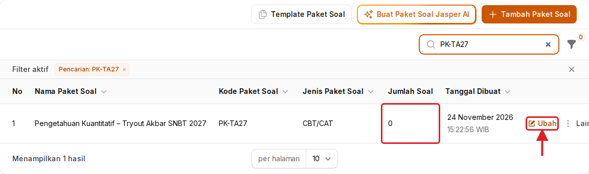
    </Frame>
  </Step>
  <Step title="Click Import Soal (Excel)">
    <Frame>
      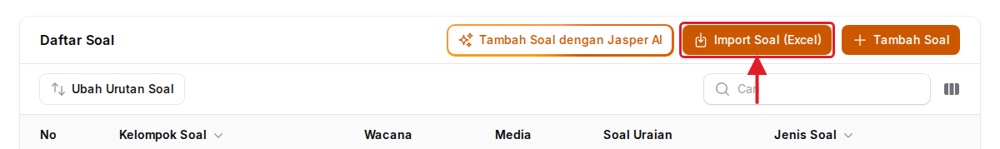
    </Frame>
  </Step>
  <Step title="Click Unduh Template">
    In the **Import Soal (Excel)** window, click the **Unduh Template** (Download Template) link. The file **template-import-soal-….xlsx** is downloaded.

    <Frame>
      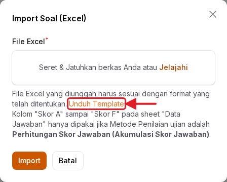
    </Frame>

    Always use the latest template from the app. The current template version is **1.3.0**; files from template versions 1.0.0, 1.1.0, and 1.2.0 can still be imported, but columns that did not exist in those versions are treated as empty.
  </Step>
  <Step title="Get to know the template">
    The template has four sheets: **Panduan** (guide), **Data Soal** (questions), **Data Jawaban** (answers), and **Data Wacana** (reading passages).

    The **Panduan** sheet contains filling instructions, the template version, and the **Referensi Data Master** (codes for question types and media, difficulty values, and **Jawaban Lebih dari Satu** values). The sheet is locked and does not need to be changed.

    <Frame>
      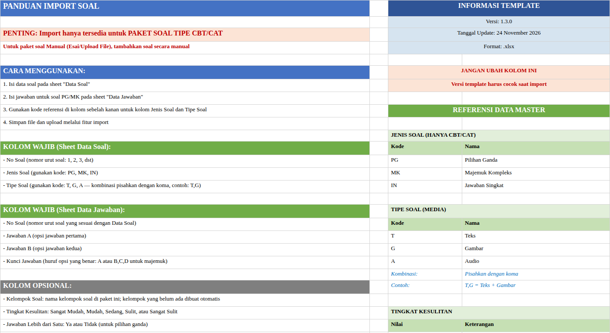
    </Frame>

    <Note>
      - Do not change the sheet names, column headers, or the template information on the **Panduan** sheet. The **Data Soal** and **Data Jawaban** sheets are required.
      - A freshly downloaded template already contains **sample rows** in **Data Soal**, **Data Jawaban**, and **Data Wacana**. Delete or overwrite them; any sample row left in the file is imported too.
      - Every cell has a short hint and some columns have dropdowns. The notes on the right of each sheet summarize the filling rules.
    </Note>
  </Step>
  <Step title="Fill in the Data Soal sheet">
    Each row is one question. Columns marked with an asterisk are required.

    <Frame>
      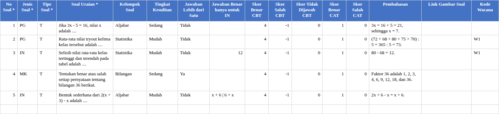
    </Frame>

    | Column | Content |
    | --- | --- |
    | **No Soal \*** | Question number: 1, 2, 3, and so on. Questions are saved in row order. |
    | **Jenis Soal \*** | **PG** (Pilihan Ganda, multiple choice), **MK** (Majemuk Kompleks, complex multiple-statement), or **IN** (Jawaban Singkat, short answer). Matching questions cannot be imported yet; add them through the question form. |
    | **Tipe Soal \*** | Question media: **T** (Teks), **G** (Gambar, image), **A** (Audio). Combine with commas, for example **T,G**. |
    | **Soal Uraian \*** | Question text, at most 5,000 characters. May be empty if the question is only an image from **Link Gambar Soal**. |
    | **Kelompok Soal** | Question group name, at most 255 characters. Groups that do not exist in the package are created automatically. |
    | **Tingkat Kesulitan** | **Sangat Mudah**, **Mudah**, **Sedang**, **Sulit**, or **Sangat Sulit**. Required if the package is used by a CAT test. |
    | **Jawaban Lebih dari Satu** | **Ya** (yes) or **Tidak** (no). Use **Ya** for multiple-choice questions with more than one correct answer. |
    | **Jawaban Benar hanya untuk IN** | Required for **IN** questions and must be empty for other types. Enter a number or text; separate several correct answers with **\|**, for example `x + 6 \| 6 + x` or `0,5 \| 1/2` (up to 21 answers of at most 255 characters each). The first answer becomes the main key. |
    | **Skor Benar CBT**, **Skor Salah CBT**, **Skor Tidak Dijawab CBT** | Scores for the scoring method **Perhitungan Skor Soal (Akumulasi Benar/Salah)**, for example 4, -1, and 0. |
    | **Skor Benar CAT**, **Skor Salah CAT** | Scores for CAT exams. |
    | **Pembahasan** | Explanation (optional). |
    | **Link Gambar Soal** | Question image links (optional). Put several images one link per line in the same cell, up to 10 images. See **Image link rules** below. |
    | **Kode Wacana** | Passage code from the **Data Wacana** sheet, for example **W1**, if the question uses a shared reading passage (optional). |

    For **IN** questions the answer format is set automatically: if all correct answers are numbers, participants can only type numbers; if any answer is text, participants can type free text.

    <Tip>
      Question, answer, and explanation text may use simple HTML (for example `<b>`, `<i>`, `<u>`, ``, ``, `<table>`, and lists) and LaTeX formulas between dollar signs, for example `$\frac{1}{2}$`. Separate paragraphs with a line break inside the cell (**Alt+Enter**).
    </Tip>
  </Step>
  <Step title="Fill in the Data Jawaban sheet">
    This sheet holds answer options for **PG** and **MK** questions only. **IN** questions are not entered here.

    <Frame>
      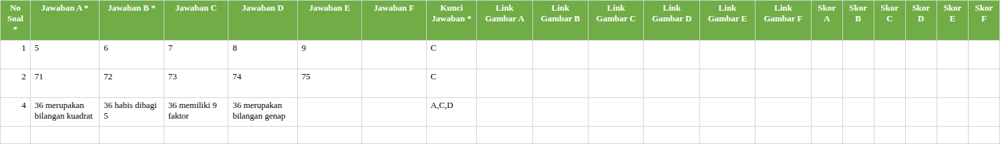
    </Frame>

    | Column | Content |
    | --- | --- |
    | **No Soal \*** | The question's number in the **Data Soal** sheet. In the example, questions 3 and 5 (IN) are skipped. |
    | **Jawaban A \*** to **Jawaban F** | Text of each option. At least **Jawaban A** and **Jawaban B**, at most six options (A to F). Leave unused options empty. |
    | **Kunci Jawaban \*** | Letter of the correct option, A to F. For several answers, separate them with commas without spaces, for example **A,C,D**. |
    | **Link Gambar A** to **Link Gambar F** | One image link per option (optional). An option may be text, an image, or both. |
    | **Skor A** to **Skor F** | Score of each option (optional), between -1,000 and 1,000, decimals and negatives allowed. Only used by the scoring method **Perhitungan Skor Jawaban (Akumulasi Skor Jawaban)**; leave empty for a score of 0. |

    For **MK** questions, each option becomes one statement with the labels **Benar/Salah** (True/False): options listed in **Kunci Jawaban** are **Benar**, the rest are **Salah**. In the example, question 4 has four statements about the number 36 with the key **A,C,D**. To use another label pair, such as **Fakta/Opini**, edit the question after the import.
  </Step>
  <Step title="Fill in the Data Wacana sheet (optional)">
    Fill in this sheet only if several questions share the same reading text.

    <Frame>
      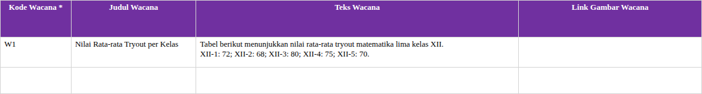
    </Frame>

    | Column | Content |
    | --- | --- |
    | **Kode Wacana \*** | A unique code per passage, for example **W1**, **W2**. Write the same code in the **Kode Wacana** column of **Data Soal** for every question that uses the passage. |
    | **Judul Wacana** | Title visible only to admins, at most 255 characters. If empty, the title is **Wacana** followed by the code. |
    | **Teks Wacana** | Passage text, at most 20,000 characters. Separate paragraphs with **Alt+Enter**. May be empty if the passage is an image. |
    | **Link Gambar Wacana** | Passage image links (optional), one link per line, up to 10 images. |

    In the example, questions 2 and 3 use passage **W1**, so during the exam both show the same class average data above the question text.
  </Step>
  <Step title="Upload the file and click Import">
    Save the Excel file (.xlsx). Go back to the package, click **Import Soal (Excel)**, drag the file into **File Excel** or click **Jelajahi** (Browse), wait until it says **Pengunggahan selesai** (upload complete), then click **Import**.

    <Frame>
      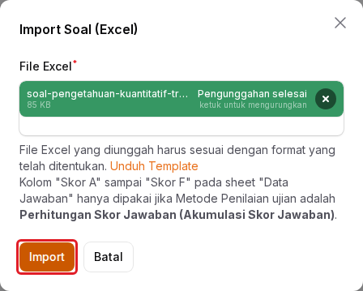
    </Frame>

    The notification **Impor Soal Sedang Diproses** (import in progress) appears. The import runs in the background, and its progress is shown in the **Mengimpor Soal & Jawaban** box at the top of the page.

    <Frame>
      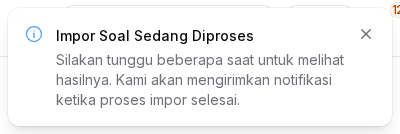
    </Frame>

    <Frame>
      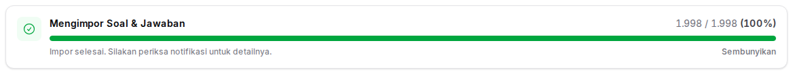
    </Frame>
  </Step>
  <Step title="Check the result">
    When the import finishes, you receive the notification **Berhasil Mengimpor Soal dan Jawaban** (questions and answers imported) with the number of imported questions (click the bell icon to see it). Reload the package page to see the questions in **Daftar Soal**.

    <Frame>
      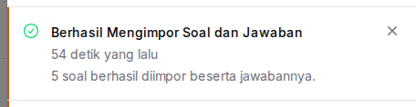
    </Frame>

    <Frame>
      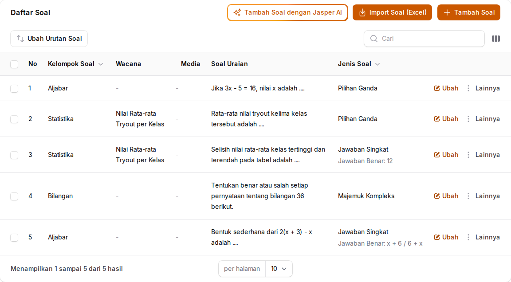
    </Frame>

    Questions are added at the end of the list. New question groups and passages appear in the **Kelompok Soal** and **Wacana** tabs. Check every question with **Ubah** or **Preview Soal**, and add audio where needed, because audio and video cannot be imported.
  </Step>
</Steps>

## Image link rules

- Use a full link that starts with `https://` and points directly to a **JPG, PNG, GIF, or WebP** image of at most **5 MB**. An easy check: when you open the link in a browser, only the image is shown.
- Page links, such as a Google Drive sharing page or a web page containing the image, are not image links and are rejected.
- Images are **downloaded and stored in your project's storage**, not linked to the original. Questions stay intact even if the original link changes or is removed, and the image size counts toward your storage quota. If the storage quota is full, the import is cancelled.
- For security, the system only downloads from public internet servers and checks that the file really is an image.
- Up to 300 image links per file. If one image fails to download, **the whole import is cancelled** and the notification names the row to fix.

## If the import fails

The whole file is checked before anything is saved. If a single error is found, no questions are imported and you receive the notification **Gagal Mengimpor Soal** (import failed) naming the sheet and row with the problem. Fix the file and import it again. Common causes:

| Message | Fix |
| --- | --- |
| Berkas tidak memiliki sheet yang diperlukan (required sheet missing) | Use the template from the app and do not rename the **Data Soal** and **Data Jawaban** sheets. |
| Versi template tidak sesuai (template version mismatch) | Download the latest template with **Unduh Template** and copy your content into it. |
| Kode "Jenis Soal" atau "Tipe Soal" tidak valid (invalid code) | Use the codes **PG**, **MK**, **IN** and **T**, **G**, **A** from the **Referensi Data Master**. |
| Kolom "Jawaban Benar" wajib diisi untuk jenis soal "IN" / harus kosong untuk jenis soal selain "IN" | Fill in **Jawaban Benar hanya untuk IN** only for **IN** questions. |
| Kode Wacana tidak ada di sheet "Data Wacana" (unknown passage code) | Make sure the code in **Data Soal** exactly matches a code in **Data Wacana**. |
| Nomor soal tidak ditemukan di sheet "Data Soal" / bukan jenis Pilihan Ganda atau Majemuk Kompleks | Check the **No Soal** column in **Data Jawaban** and make sure the question type is **PG** or **MK**. |
| Kunci jawaban tidak valid (invalid answer key) | Use the letters A to F, separated by commas without spaces. |
| Kolom "Tingkat Kesulitan" wajib diisi (difficulty required) | The package is used by a CAT test; fill in the difficulty of every question. |

<Tip>
  After the import, you can change **Skor CBT** and **Skor CAT** for many questions at once with **Tindakan** → **Ubah Skor Massal** in **Daftar Soal**. See [Create a Question Package](/en/paket-soal/membuat-paket-soal).
</Tip>
