This page explains how to create a question package and fill it with questions. A **question package** (**Paket Soal**) is a collection of questions used in exam tests. One package can contain many questions, and one package can be used in more than one exam.

<Info>
  **Menu location:** **Portal** → **Platform Ujian (CBT)** → **Manajemen Ujian** → **Data Paket Soal**.

  Admins with the **Guru** (teacher) role only see and manage the packages they created themselves.
</Info>

The examples on this page use a tutoring center preparing the **Tryout Akbar SNBT 2027**. For that exam it creates the package **Penalaran Matematika – Tryout Akbar SNBT 2027** (code **PM-TA27**) containing multiple-choice, short-answer, complex multiple-statement, and matching questions.

In short, the process has two parts:

1. Create the **question package** (name, code, description, and type).
2. Fill the package with **questions and answers**, manually, by [Excel import](/en/paket-soal/import-paket-soal), or with [Jasper AI](/en/paket-soal/generate-soal-ai).

## The Data Paket Soal page

Open **Data Paket Soal** (Question Package Data) in the sidebar of the **Platform Ujian (CBT)** module.

<Frame>
  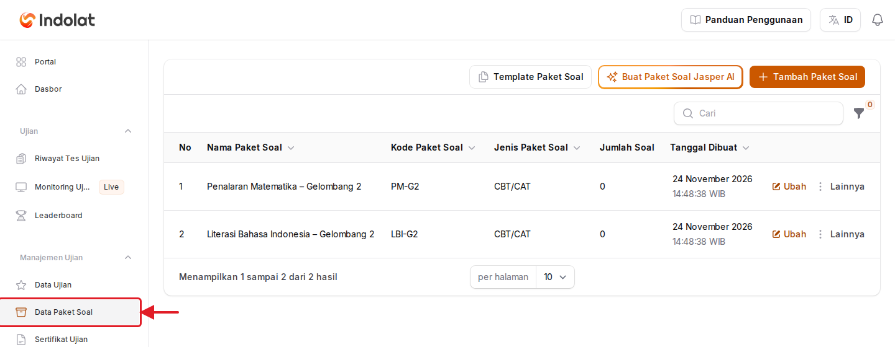
</Frame>

The table lists all packages with the columns **Nama Paket Soal** (name), **Kode Paket Soal** (code), **Jenis Paket Soal** (type), **Jumlah Soal** (number of questions), and **Tanggal Dibuat** (date created). Use **Cari** (Search) to find a package by name or code, and the filter icon to filter by **Jenis Paket Soal**.

<Frame>
  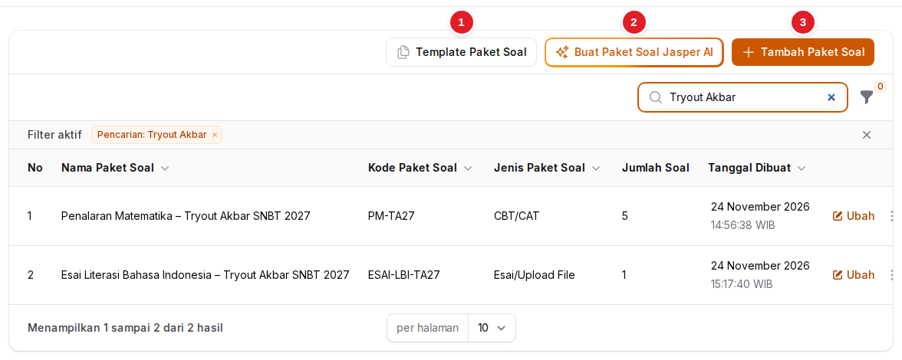
</Frame>

There are three ways to create a package, matching the numbers in the image:

1. **Template Paket Soal**: create a package from a template that already contains questions. This button only appears when templates are available.
2. **Buat Paket Soal Jasper AI**: create a package and its questions automatically with AI. See [Generate Questions with Jasper AI](/en/paket-soal/generate-soal-ai).
3. **Tambah Paket Soal** (Add Question Package): create an empty package manually and add the questions yourself.

Each package row has an **Ubah** (Edit) button to open the package and a **Lainnya** (More) menu containing:

- **Duplikat Paket Soal**: copies the package with its question groups, answer groups, questions, answers, and media files. The copy is processed in the background, and you receive a notification when it is done.
- **Hapus**: deletes the package.

<Frame>
  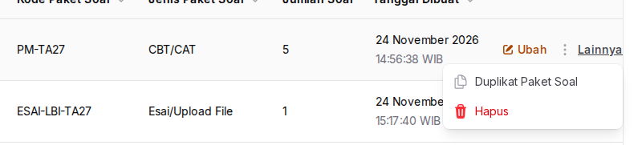
</Frame>

<Warning>
  A package that is used in an exam session of an existing exam cannot be deleted. The system shows **Gagal Menghapus Paket Soal**. Remove or replace the package in that exam first.
</Warning>

## Creating a package manually

Choose the package type according to how participants answer:

| Jenis Paket Soal | Use |
| --- | --- |
| **CBT/CAT** | Participants answer directly in the exam app and answers are scored automatically. Suitable for UTBK-SNBT tryouts, olympiads, and other computer-based exams. Supports multiple choice, short answer, complex multiple-statement, matching, reading passages, Excel import, and Jasper AI. |
| **Esai/Upload File (Jawaban Manual)** | Participants write an essay answer or upload answer files, and a grader reviews them manually. |

<Note>
  The two types cannot be combined in one package. If an exam needs both, create two packages, for example **Penalaran Matematika – Tryout Akbar SNBT 2027** (CBT/CAT) and **Esai Literasi Bahasa Indonesia – Tryout Akbar SNBT 2027** (Esai/Upload File), and add each one as a separate exam test. **Jenis Paket Soal** cannot be changed after the package is created.
</Note>

<Steps>
  <Step title="Click Tambah Paket Soal">
    <Frame>
      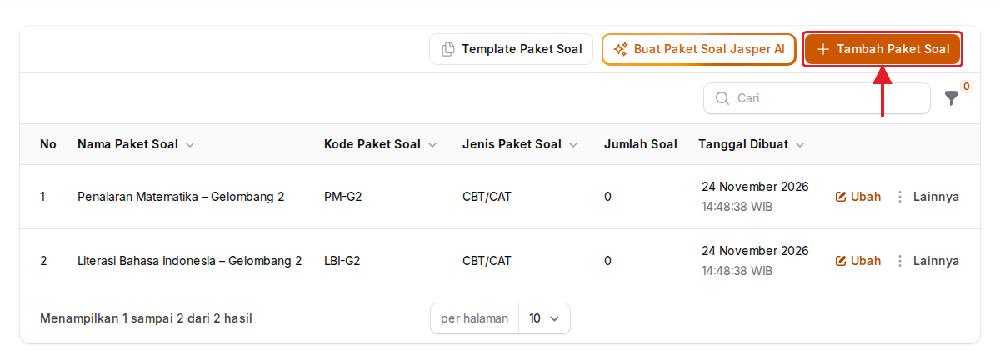
    </Frame>
  </Step>
  <Step title="Fill in the Informasi Umum section">
    <Frame>
      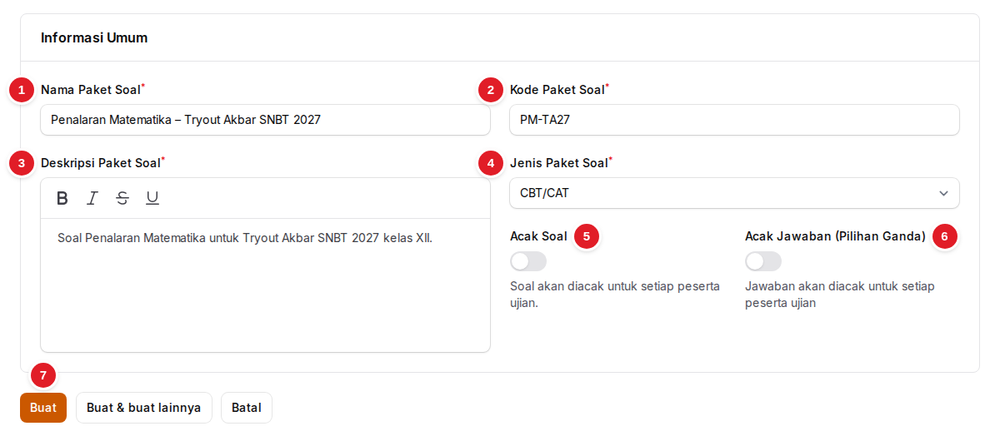
    </Frame>

    1. **Nama Paket Soal**: an easily recognizable name, for example **Penalaran Matematika – Tryout Akbar SNBT 2027**.
    2. **Kode Paket Soal**: a short code that is unique in your project, for example **PM-TA27**. If another package already uses the code, the message **Kode paket soal sudah digunakan.** appears.
    3. **Deskripsi Paket Soal**: a short description of the package, at most 1,000 characters. Jasper AI also uses it as context when adding questions.
    4. **Jenis Paket Soal**: choose **CBT/CAT** or **Esai/Upload File (Jawaban Manual)**.
    5. **Acak Soal** (Shuffle Questions, CBT/CAT only): the question order is shuffled for each participant.
    6. **Acak Jawaban (Pilihan Ganda)** (Shuffle Answers, CBT/CAT only): the option order of multiple-choice questions is shuffled for each participant.
    7. Click **Buat** (Create). Use **Buat & buat lainnya** to create the next package right away, or **Batal** to go back without saving.

    If you choose **Esai/Upload File (Jawaban Manual)**, the shuffle options are hidden and a note says the package cannot be used for CBT/CAT exams.

    <Frame>
      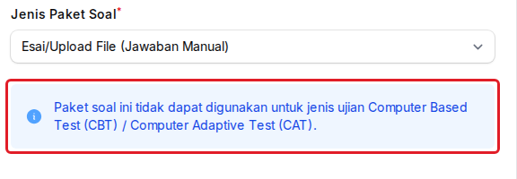
    </Frame>
  </Step>
  <Step title="Continue on the Ubah Paket Soal page">
    After the package is saved, the system opens the **Ubah Paket Soal** (Edit Question Package) page. This is where you add questions, as described below.
  </Step>
</Steps>

## Creating a package from a template

Templates are complete sample packages with questions and answers. A package created from a template belongs entirely to you and can be edited.

<Steps>
  <Step title="Click Template Paket Soal">
    On the **Data Paket Soal** page, click **Template Paket Soal**.
  </Step>
  <Step title="Select a template and click Gunakan Template">
    <Frame>
      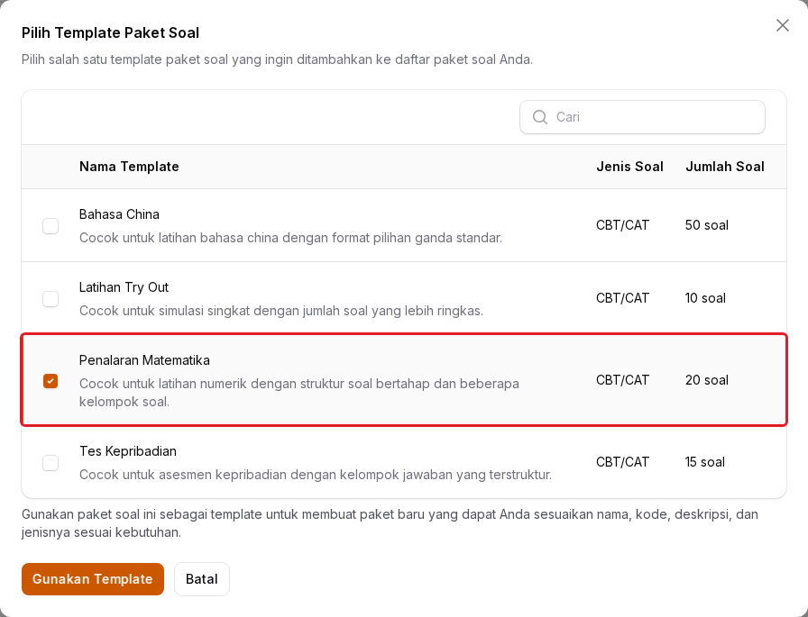
    </Frame>

    The list shows each **Nama Template** (template name) with a summary, **Jenis Soal**, and **Jumlah Soal**. Click the template row you want, then click **Gunakan Template** (Use Template). The notification **Template Paket Soal Berhasil Ditambahkan** appears, and the new package is listed with the template's name and an automatically generated code.
  </Step>
  <Step title="Adjust the name, code, and content">
    Click **Ubah** on the new package. Change **Nama Paket Soal** and **Kode Paket Soal** as needed, then click **Simpan** (Save).

    <Frame>
      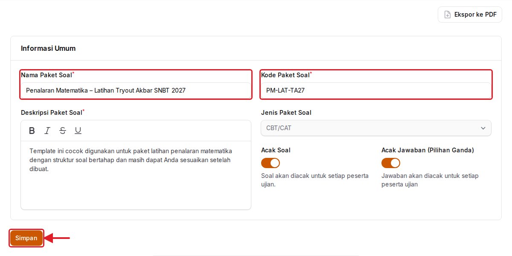
    </Frame>

    A template may already enable **Acak Soal** and **Acak Jawaban (Pilihan Ganda)** and contain reading passages and question groups. Review the settings and every question before using the package in an exam.
  </Step>
</Steps>

## The Ubah Paket Soal page

Click **Ubah** on a package to open the following page.

<Frame>
  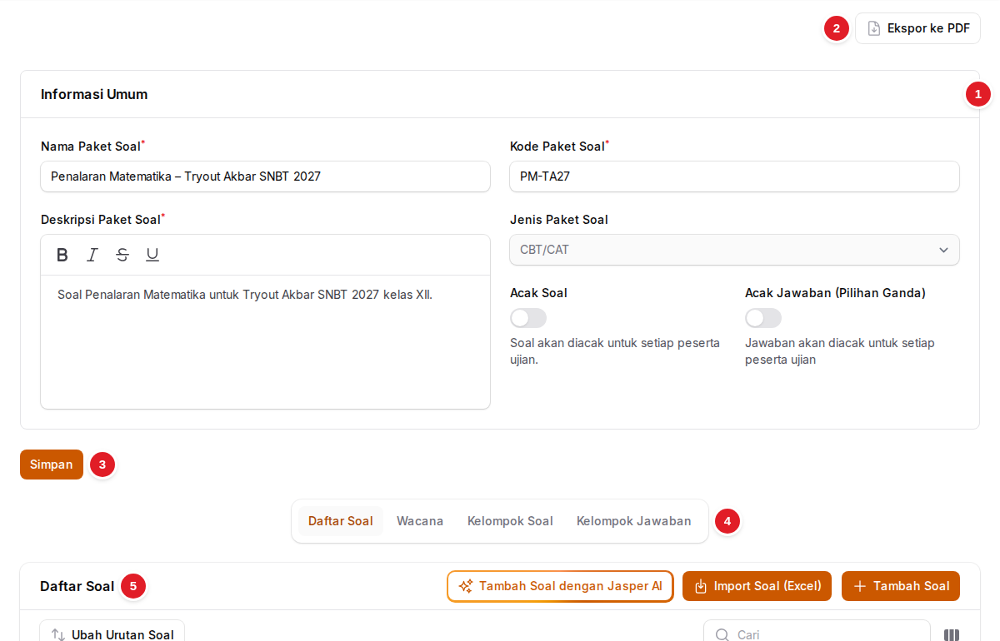
</Frame>

1. **Informasi Umum** (General Information): name, code, description, and shuffle settings. **Jenis Paket Soal** is shown but cannot be changed.
2. **Ekspor ke PDF** (Export to PDF, CBT/CAT only): creates a PDF of the package. Choose **PDF dengan jawaban & pembahasan** (with answers and explanations) for internal review or **PDF soal murni** (questions only) to share with participants, then click **Proses Ekspor**. The export runs in the background, and you receive a notification when the file is ready.
3. **Simpan**: saves changes to **Informasi Umum**.
4. Content tabs (CBT/CAT only): **Daftar Soal** (Question List), **Wacana** (Reading Passages), **Kelompok Soal** (Question Groups), and **Kelompok Jawaban** (Answer Groups). Esai/Upload File packages only have **Daftar Soal**.
5. **Daftar Soal**: the question list with the **Tambah Soal dengan Jasper AI**, **Import Soal (Excel)**, and **Tambah Soal** buttons.

<Frame>
  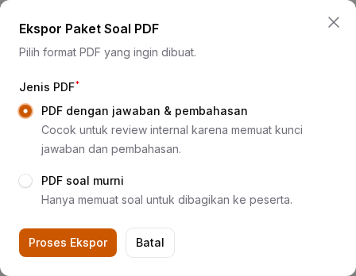
</Frame>

## Adding questions to a CBT/CAT package

This section uses the package **Penalaran Matematika – Tryout Akbar SNBT 2027**. If questions share a reading text or should be grouped by topic, prepare the [reading passages](#managing-reading-passages) and [question groups](#managing-question-groups) first so you can select them while creating questions.

<Steps>
  <Step title="Click Tambah Soal">
    <Frame>
      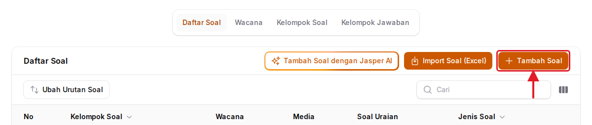
    </Frame>

    The **Tambah Soal** (Add Question) window opens with the tabs **Soal** (Question), **Jawaban** (Answers), **Pembahasan** (Explanation), and **Penilaian** (Scoring). The **Jawaban** tab only appears for **Pilihan Ganda** and **Majemuk Kompleks** questions.
  </Step>
  <Step title="Fill in the Klasifikasi section">
    <Frame>
      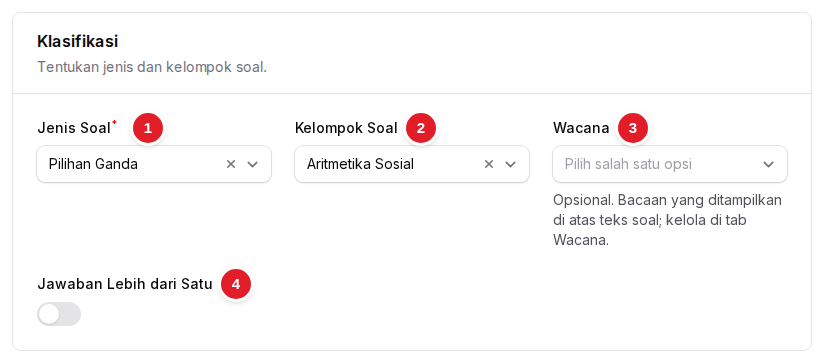
    </Frame>

    1. **Jenis Soal** (question type): cannot be changed after the question is saved. The options are explained under **CBT/CAT question types** below.
    2. **Kelompok Soal** (optional): the topic or subtest, for example **Aritmetika Sosial**. The list comes from the **Kelompok Soal** tab.
    3. **Wacana** (optional): a shared reading passage shown above the question text. The list comes from the **Wacana** tab.
    4. **Jawaban Lebih dari Satu** (More Than One Answer): enable it if participants must choose more than one correct answer. Only shown for **Pilihan Ganda** questions.

    <Frame>
      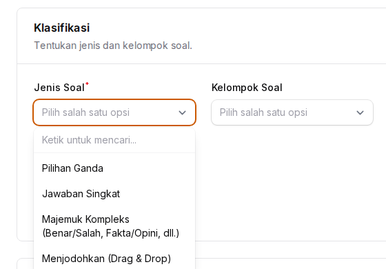
    </Frame>
  </Step>
  <Step title="Fill in the Konten Soal section">
    <Frame>
      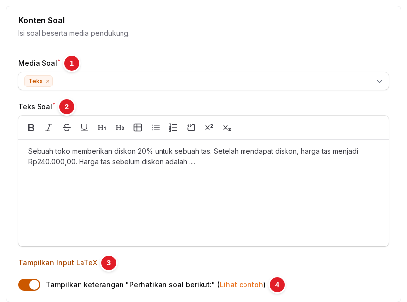
    </Frame>

    1. **Media Soal** (question media): choose one or more of **Teks** (Text), **Gambar** (Image), and **Audio**. The following fields depend on the media you choose.
    2. **Teks Soal** (question text, Text media): at most 5,000 characters. The toolbar offers bold, italic, strikethrough, underline, headings (H1, H2), tables, bulleted and numbered lists, code blocks, superscript, and subscript.
    3. **Tampilkan Input LaTeX**: opens a helper field for writing math formulas. See [Writing math formulas (LaTeX)](#writing-math-formulas-latex).
    4. **Tampilkan keterangan "Perhatikan soal berikut:"**: when enabled, this sentence ("Look at the following question:") appears above the question text during the exam. Click **Lihat contoh** to see an example.

    With **Gambar** media, upload one or more images (JPG, PNG, or GIF) in **Berkas Gambar**; drag them to change the order. A **Tampilkan keterangan "Perhatikan gambar berikut:"** setting is also available. With **Audio** media, upload an MP3, WAV, or OGG file in **Berkas Audio**.

    Example question text: _Sebuah toko memberikan diskon 20% untuk sebuah tas. Setelah mendapat diskon, harga tas menjadi Rp240.000,00. Harga tas sebelum diskon adalah ...._ (A shop gives a 20% discount on a bag; after the discount the bag costs Rp240,000. What was the price before the discount?)
  </Step>
  <Step title="Add answer options in the Jawaban tab">
    For a **Pilihan Ganda** question, open the **Jawaban** tab. Click **Isi 5 opsi (A–E)** to create five text options at once, or **+ Tambah Jawaban** to add them one by one (including option F and beyond). The **Isi 5 opsi (A–E)** link only appears while the answer list is empty.

    <Frame>
      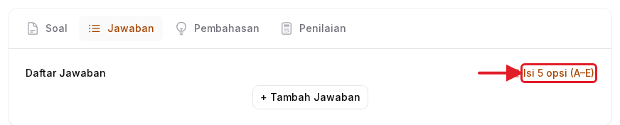
    </Frame>

    Complete each answer option:

    <Frame>
      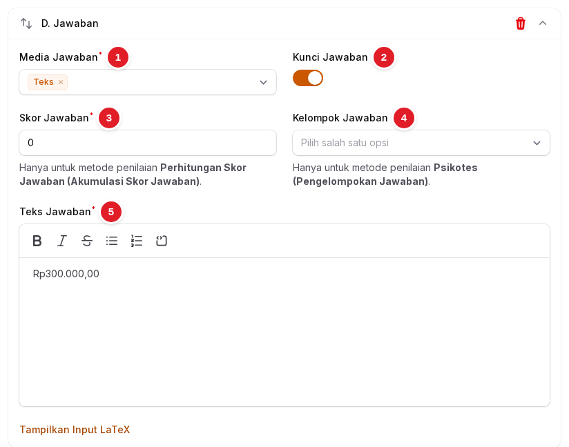
    </Frame>

    1. **Media Jawaban** (answer media): **Teks**, **Gambar**, **Audio**, or a combination.
    2. **Kunci Jawaban** (answer key): enable it only on the correct option, in this example **Rp300.000,00**. If **Jawaban Lebih dari Satu** is enabled, enable it on every correct option.
    3. **Skor Jawaban** (option score): only used by the scoring method **Perhitungan Skor Jawaban (Akumulasi Skor Jawaban)**; leave it at **0** for other methods.
    4. **Kelompok Jawaban** (answer group): only for the scoring method **Psikotes (Pengelompokan Jawaban)**. The list comes from the **Kelompok Jawaban** tab.
    5. **Teks Jawaban** (option text): the text participants see. This field also has **Tampilkan Input LaTeX**. With Image or Audio media, upload the file (images JPG, PNG, or GIF; audio MP3, WAV, or OGG).

    Options are lettered A, B, C, and so on in their order. Drag the arrow icon to reorder an option, or click the trash icon to delete it.

    <Frame>
      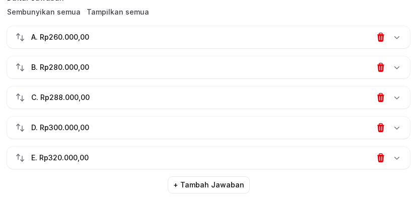
    </Frame>
  </Step>
  <Step title="Write an explanation (optional)">
    Open the **Pembahasan** tab. In **Format Pembahasan**, choose **Teks** to write the explanation in **Isi Pembahasan** (with the same toolbar and LaTeX input as the question text), or **Unggah Berkas (PDF / Gambar)** to upload a PDF, JPG, or PNG file.

    <Frame>
      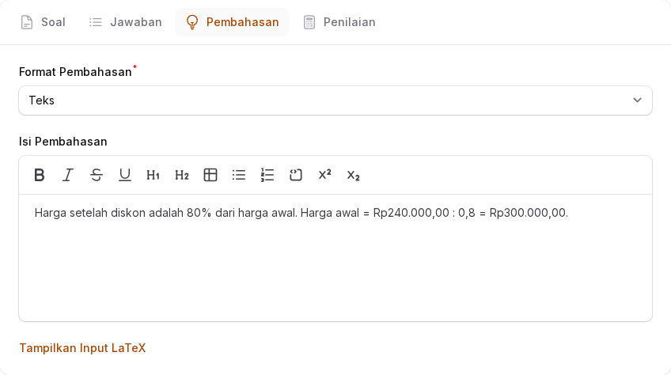
    </Frame>

    <Note>
      When the package is exported to PDF, only text or image explanations are embedded.
    </Note>
  </Step>
  <Step title="Set the scores in the Penilaian tab">
    <Frame>
      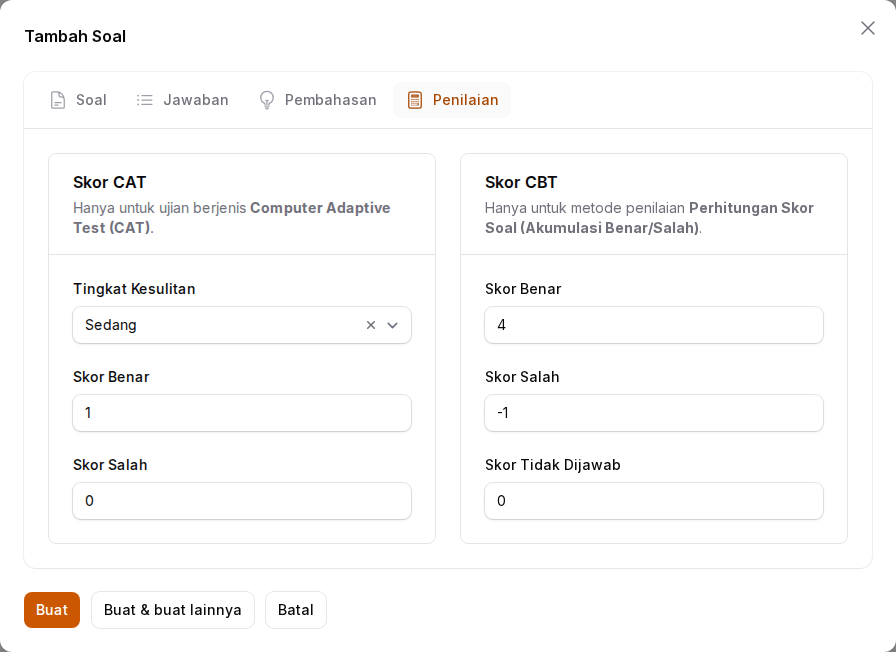
    </Frame>

    - **Skor CAT**: only used in **Computer Adaptive Test (CAT)** exams. Fill in **Tingkat Kesulitan** (difficulty: **Sangat Mudah**, **Mudah**, **Sedang**, **Sulit**, or **Sangat Sulit**), **Skor Benar** (correct), and **Skor Salah** (incorrect). **Tingkat Kesulitan** is required if the package is used by a CAT test.
    - **Skor CBT**: only used by the scoring method **Perhitungan Skor Soal (Akumulasi Benar/Salah)**. Fill in **Skor Benar**, **Skor Salah**, and **Skor Tidak Dijawab** (unanswered), for example 4, -1, and 0.

    The scoring method is chosen when you set up the exam test. See [Create a Test](/en/data-ujian/membuat-tes-ujian).
  </Step>
  <Step title="Save the question">
    Click **Buat** to save, or **Buat & buat lainnya** to save and start the next question right away. New questions are added at the end of the list.

    <Warning>
      If the question text exceeds 5,000 characters, the question is not saved and the message **Gagal Menyimpan Soal** shows the character count.
    </Warning>
  </Step>
</Steps>

### CBT/CAT question types

| Jenis Soal | How participants answer | Where to set the key |
| --- | --- | --- |
| **Pilihan Ganda** (multiple choice) | Choose one answer, or several when **Jawaban Lebih dari Satu** is enabled. | **Jawaban** tab, **Kunci Jawaban** toggle. |
| **Jawaban Singkat** (short answer) | Type a number or text. | **Kunci Jawaban** section in the **Soal** tab. |
| **Majemuk Kompleks (Benar/Salah, Fakta/Opini, dll.)** (complex multiple-statement) | Choose one of two labels for each statement. | **Jawaban** tab, **Jawaban Benar** field of each statement. |
| **Menjodohkan (Drag & Drop)** (matching) | Drag the answers on the right to the matching statements on the left. | **Pasangan Menjodohkan** section in the **Soal** tab. |

#### Jawaban Singkat

After choosing **Jawaban Singkat**, the **Kunci Jawaban** section appears. Example question: _Persentase kenaikan jumlah buku tulis yang terjual dari bulan Januari ke bulan Februari adalah ... %_ (the percentage increase in notebooks sold from January to February), with the key **20**.

<Frame>
  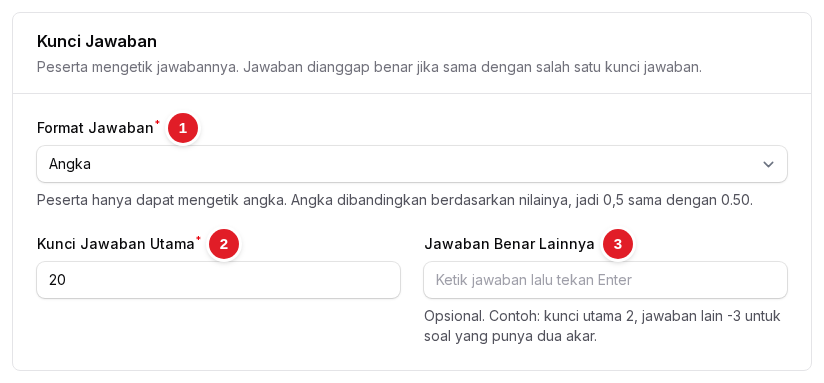
</Frame>

1. **Format Jawaban** (answer format):
   - **Angka** (number): participants can only type numbers. Numbers are compared by value, so 0,5 equals 0.50. The key may start with a minus sign and use a comma or a period as the decimal separator, for example 250, 0, -3, or 1,5.
   - **Teks** (text): participants can type free text. Letter case and extra spaces are ignored; numbers are still compared by value.
2. **Kunci Jawaban Utama** (main key): the correct answer, at most 255 characters.
3. **Jawaban Benar Lainnya** (other correct answers, optional): other answers that are also accepted, for example **Jakarta** for the main key **DKI Jakarta**, or -3 for a question with two roots. Type an answer and press Enter; up to 20 answers.

The key is shown under the question type in **Daftar Soal**, for example **Jawaban Benar: 20**.

#### Majemuk Kompleks

After choosing **Majemuk Kompleks (Benar/Salah, Fakta/Opini, dll.)**, the **Label Kolom Pernyataan** (statement column labels) section appears. In **Pasangan Label**, choose **Benar / Salah** (True/False), **Fakta / Opini** (Fact/Opinion), **Sesuai / Tidak Sesuai**, **Setuju / Tidak Setuju**, or **Ya / Tidak**. Choose **Label lain (isi sendiri)** to write your own **Label Kolom Pertama** and **Label Kolom Kedua** (at most 50 characters each, and they must differ).

<Frame>
  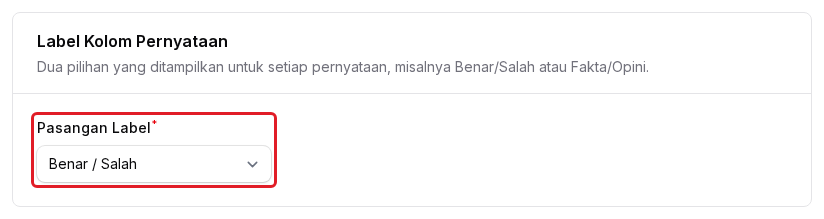
</Frame>

In the **Jawaban** tab, each item holds one statement. Choose the correct label for the statement in **Jawaban Benar**. Example for the question `Diketahui fungsi $f(x)=2x+3$. Tentukan benar atau salah setiap pernyataan berikut.`:

- `Nilai $f(2)=7$`: **Benar**
- Grafik fungsi f memotong sumbu Y di titik (0, 3): **Benar**
- Fungsi f merupakan fungsi kuadrat: **Salah**

<Frame>
  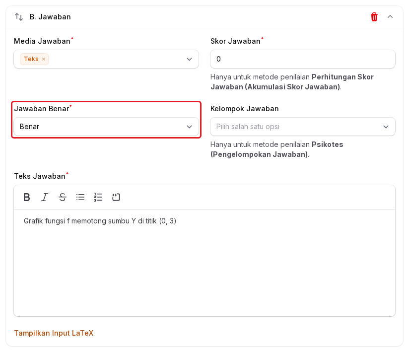
</Frame>

During the exam, the statements appear as a table with two label columns:

<Frame>
  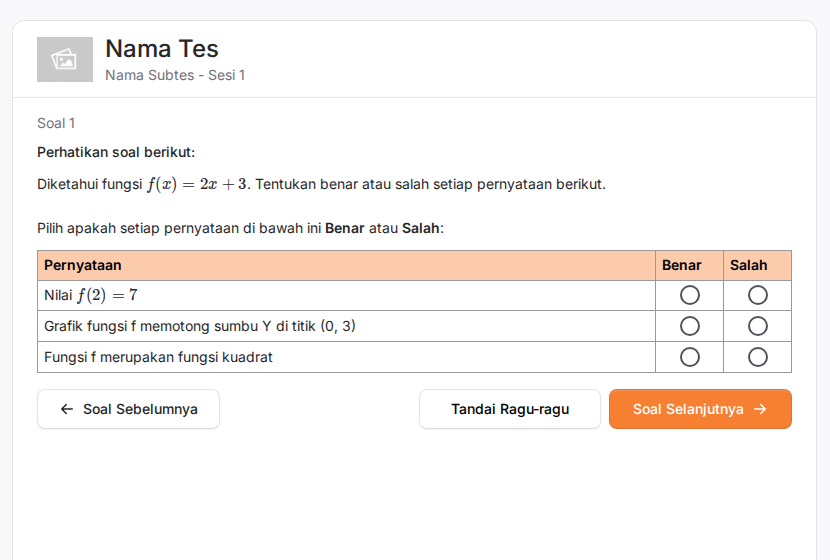
</Frame>

#### Menjodohkan

After choosing **Menjodohkan (Drag & Drop)**, the **Pasangan Menjodohkan** (matching pairs) section appears with two starting pairs. Fill in **Pernyataan (Kiri)** (left statement) and **Jawaban (Kanan)** (right answer) for each pair, and click **+ Tambah Pasangan** to add more. At least two pairs are required. The right side is shuffled during the exam, and participants match them by drag and drop.

<Frame>
  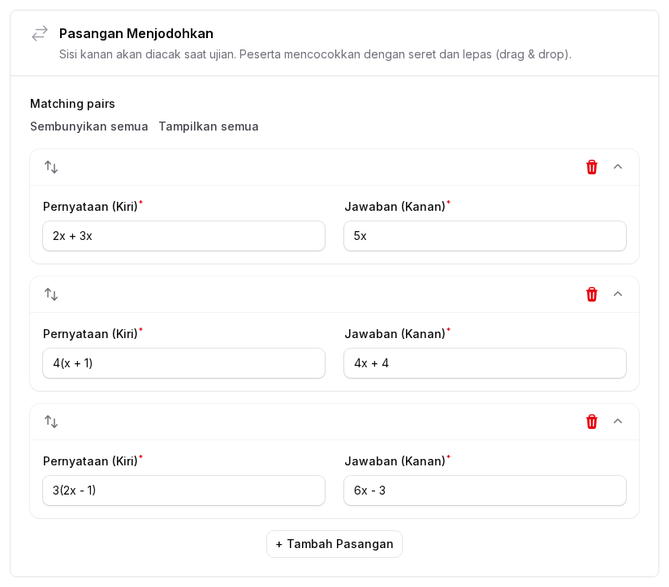
</Frame>

### Writing math formulas (LaTeX)

Write formulas in LaTeX between two dollar signs, for example `$f(x)=2x+3$` or `$\frac{1}{2}$`. You can type them directly in the question text, answer text, explanation, or passage text, or use the helper field:

1. Click **Tampilkan Input LaTeX** below the editor.
2. Type the formula in the field that appears. It is rendered as math right away.
3. Click **Salin** (Copy). The formula is copied together with its dollar signs.
4. Paste it at the desired position in the editor.

<Frame>
  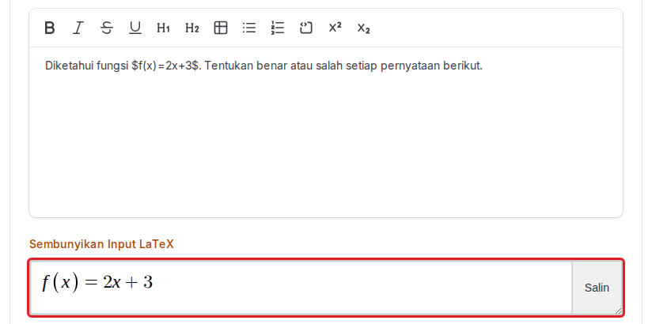
</Frame>

In the editor and in **Daftar Soal**, formulas remain visible as LaTeX text (shown in bold in **Daftar Soal**). During the exam and in **Preview Soal**, they are rendered as math.

## Managing the question list

<Frame>
  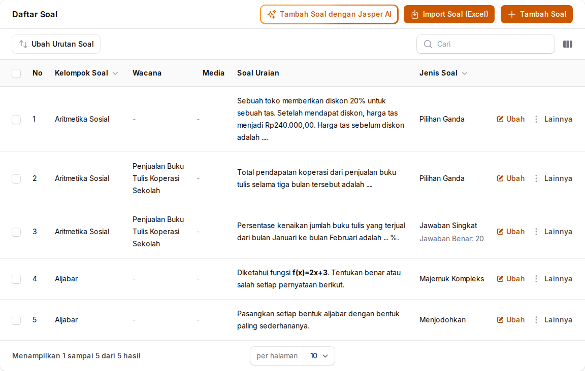
</Frame>

**Daftar Soal** shows the number, **Kelompok Soal**, **Wacana**, **Media**, **Soal Uraian** (question text), and **Jenis Soal**. Short-answer questions show their key under the type; complex multiple-statement questions show their label pair. Use **Cari** to search questions and the column icon to show or hide the **Wacana** column. The table shows 10 or 25 questions per page.

### Reordering questions

Click **Ubah Urutan Soal** (Reorder Questions), drag questions by the icon on the left to the desired position, then click **Selesai Mengurutkan** (Finish Reordering).

<Frame>
  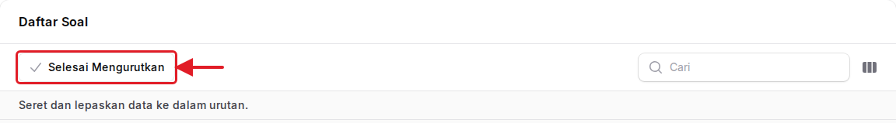
</Frame>

<Note>
  This order is used during the exam when **Acak Soal** is off. When **Acak Soal** is on, questions are shuffled for each participant; questions that share a reading passage stay together in their package order.
</Note>

### Bulk actions

Tick several questions (or the box in the column header to select all), then click **Tindakan** (Actions):

<Frame>
  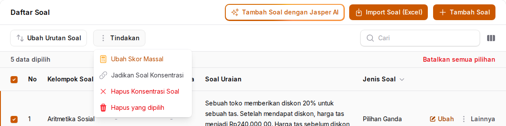
</Frame>

- **Ubah Skor Massal** (bulk score change, CBT/CAT only): sets **Skor CAT** and **Skor CBT** for all selected questions at once. Leave fields you do not want to change empty, then click **Simpan Perubahan**.
- **Jadikan Soal Konsentrasi** (mark as concentration questions): marks the selected questions with the same color. Questions with the same color are used to assess the consistency of a participant's answers (Analisa Konsentrasi) in the exam result details, for example in psychological tests.
- **Hapus Konsentrasi Soal**: removes the concentration color from the selected questions.
- **Hapus yang dipilih**: deletes the selected questions.

<Frame>
  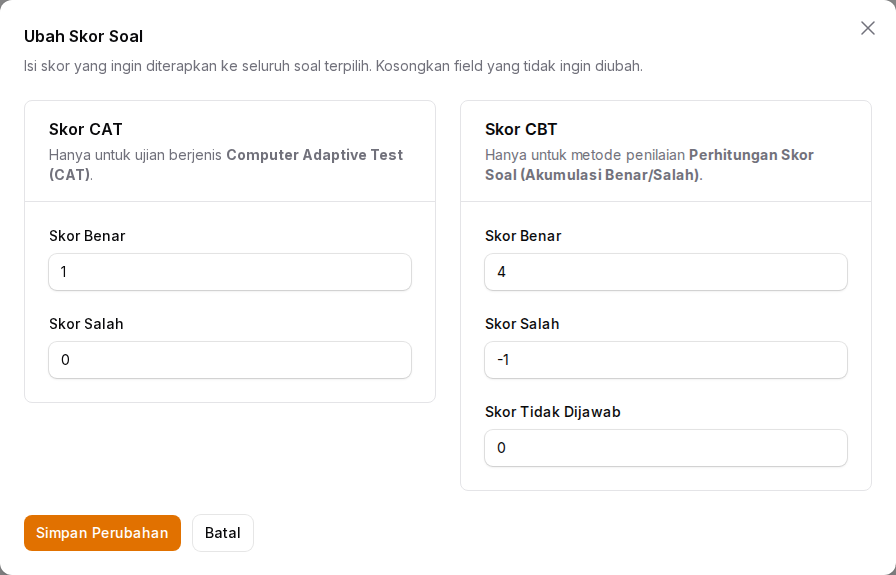
</Frame>

### Editing, duplicating, and previewing questions

Click **Ubah** on a question to open the **Ubah Soal** window with the same fields as when adding a question (except **Jenis Soal**, which cannot be changed). Besides **Simpan**, the bottom of the window contains:

- **Preview Soal**: opens the question as participants see it in a new tab (CBT/CAT only).
- **Buka Halaman Detail**: opens the question on its own page in a new tab.
- **Hapus**: deletes the question. This cannot be undone.

<Frame>
  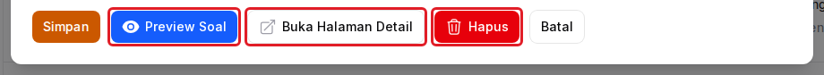
</Frame>

The **Lainnya** menu of each question contains **Duplikat Soal** (copies the question with its answers and media files into the same package), **Preview Soal**, and **Hapus**.

<Frame>
  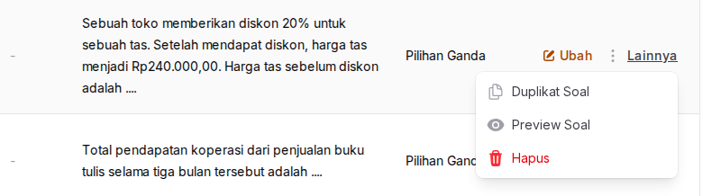
</Frame>

<Frame>
  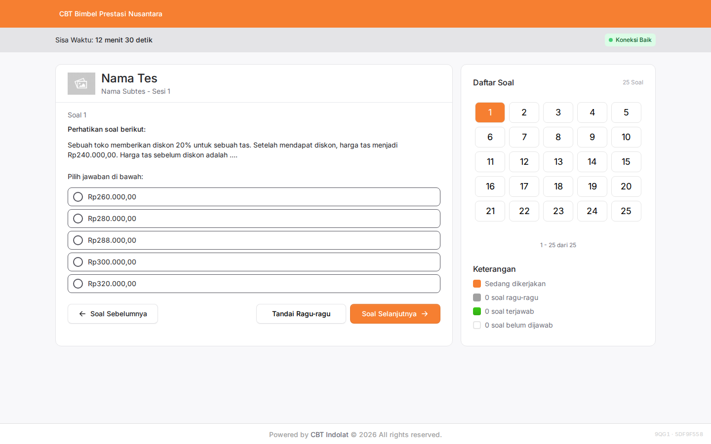
</Frame>

## Managing reading passages

A reading passage (**Wacana**) is a text, chart, table, or recording used by several questions, for example one sales data set for two questions. Write the passage once and select it on every question that uses it. The **Wacana** tab is only available in CBT/CAT packages.

<Steps>
  <Step title="Open the Wacana tab and click Tambah Wacana">
    <Frame>
      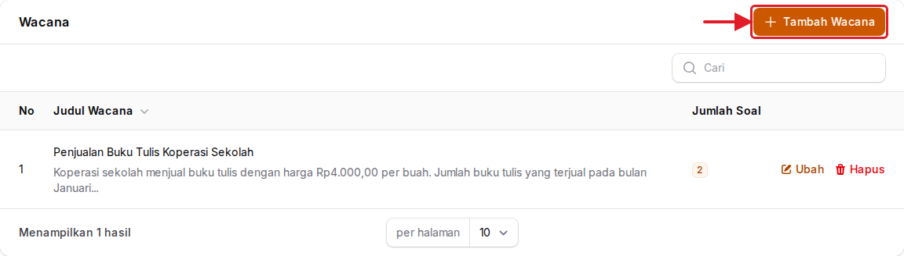
    </Frame>

    The **Jumlah Soal** column shows how many questions use each passage.
  </Step>
  <Step title="Fill in the passage">
    <Frame>
      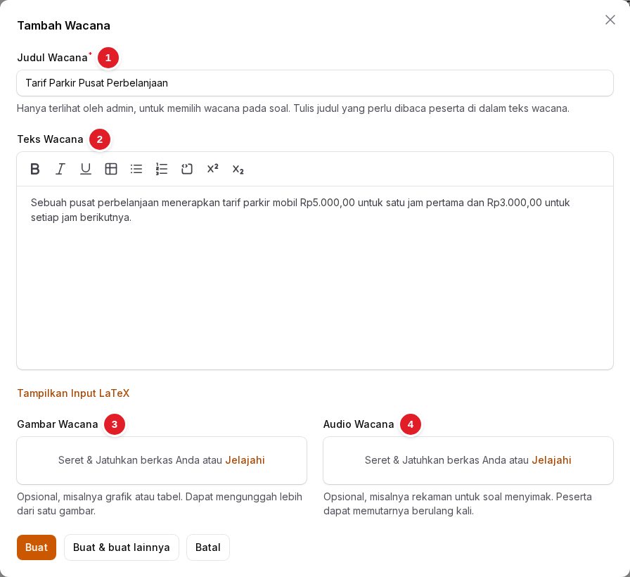
    </Frame>

    1. **Judul Wacana** (title): the name used to select the passage on questions. It is only visible to admins; if participants need to read a title, write it inside the passage text.
    2. **Teks Wacana** (text): at most 20,000 characters, with the same toolbar and LaTeX input as the question text.
    3. **Gambar Wacana** (images, optional): for example a chart or table. More than one image is allowed.
    4. **Audio Wacana** (audio, optional): for example a recording for listening questions. Participants can replay it; if the audio may only be played once, attach it to the question instead.

    At least one of text, image, or audio must be filled in. Click **Buat**.
  </Step>
  <Step title="Select the passage on the questions">
    When adding or editing a question, choose the passage in the **Wacana** field of the **Klasifikasi** section. Do this for every question that uses the passage.
  </Step>
</Steps>

<Info>
  During the exam, the passage appears as part of the question: passage images are shown first together with the question images, then the passage text directly above the question text. When questions are shuffled, questions sharing a passage stay together so participants only read it once.
</Info>

<Note>
  A passage still used by questions cannot be deleted (the message **Gagal Menghapus Wacana** appears); detach it from those questions first. Passages cannot be edited while an exam is in progress.
</Note>

## Managing question groups

Question groups (**Kelompok Soal**) group questions by topic or subtest, for example **Aritmetika Sosial** and **Aljabar**. Question groups do not show any text to participants; for shared reading text, use [reading passages](#managing-reading-passages).

Open the **Kelompok Soal** tab, click **Tambah Kelompok Soal**, fill in **Nama**, then click **Buat**. Question groups are also created automatically by [Excel import](/en/paket-soal/import-paket-soal) when the name does not exist yet.

<Frame>
  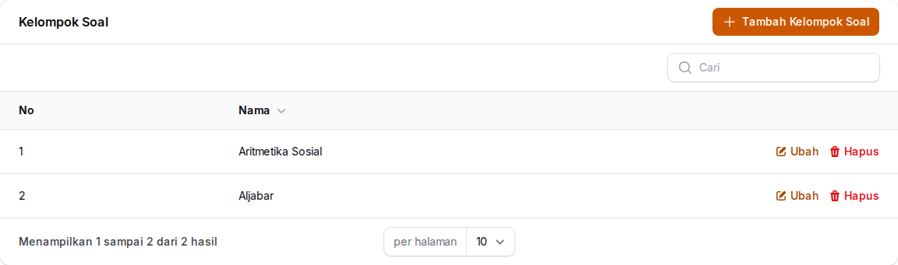
</Frame>

<Note>
  A question group that contains questions cannot be deleted.
</Note>

## Managing answer groups

Answer groups (**Kelompok Jawaban**) are used by the scoring method **Psikotes (Pengelompokan Jawaban)**, for example for personality tests. Each answer option is linked to one group through the **Kelompok Jawaban** field in the **Jawaban** tab, and participant results are calculated per group.

<Frame>
  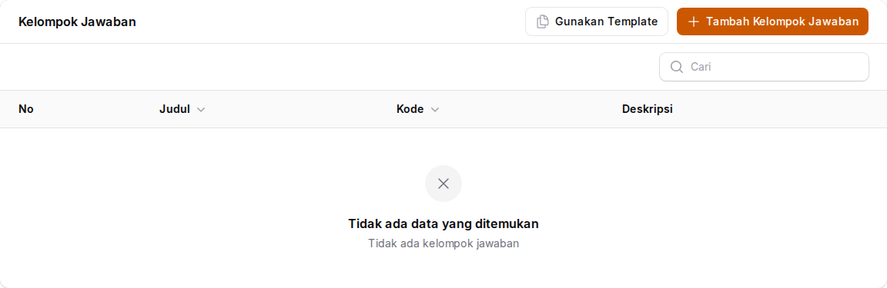
</Frame>

- **Tambah Kelompok Jawaban**: fill in **Judul** (title), **Kode** (code), **Deskripsi** (description), and **Warna** (color).
- **Gunakan Template**: adds ready-made answer groups, for example **DISC Personality**, **MBTI Dimensi**, **Big Five Personality (OCEAN)**, **Holland Code (RIASEC) — Minat Karir**, or **Gaya Belajar (VARK)**. Choose a template, then click **Terapkan Template**.

<Frame>
  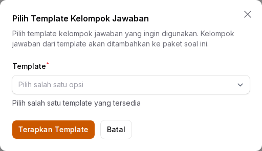
</Frame>

## Adding questions to an Esai/Upload File package

An **Esai/Upload File (Jawaban Manual)** package only has the **Daftar Soal** section with the **Tambah Soal** button. Excel import, Jasper AI, reading passages, question groups, automatic scoring, Preview Soal, and Export to PDF are not available for this type.

Click **Tambah Soal**, then complete the **Soal** tab:

<Frame>
  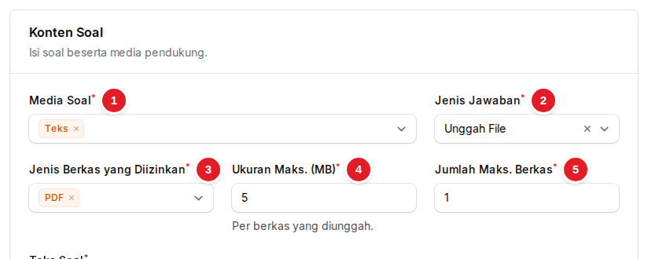
</Frame>

1. **Media Soal**: **Teks**, **Gambar**, **File**, or a combination. With **File**, fill in **Nama Berkas** (file name) and upload **Berkas Lampiran** (attachment: PDF, DOCX, XLSX, PPTX, JPG, PNG, GIF, ZIP, or RAR), for example the question sheet as a PDF.
2. **Jenis Jawaban** (answer type): **Jawaban Uraian** (participants write the answer in the app) or **Unggah File** (participants upload answer files). The answer type cannot be changed after the question is saved.
3. **Jenis Berkas yang Diizinkan** (allowed file types, Unggah File): PDF, Gambar (JPG, PNG, GIF), MS Word (DOCX), MS Excel (XLSX), MS PowerPoint (PPTX), CSV, ZIP, or RAR.
4. **Ukuran Maks. (MB)** (Unggah File): maximum size per file, 1–100 MB.
5. **Jumlah Maks. Berkas** (Unggah File): number of files allowed, 1–10.

Then write the **Teks Soal**, for example _Tulislah esai argumentatif sepanjang 300–500 kata tentang manfaat membaca buku cetak bagi pelajar. Unggah jawaban Anda dalam format PDF._ (Write a 300–500 word argumentative essay on the benefits of reading printed books for students and upload it as a PDF.)

The **Panduan Pengerjaan** (work guide) section (optional) adds a guide link or file for participants. Click the section title to open it, click **+ Tambah Panduan**, choose **Jenis Panduan** (**Tautan** for a link or **Berkas** for a file), fill in **Judul**, then fill in **Tautan** or upload **Berkas**.

<Frame>
  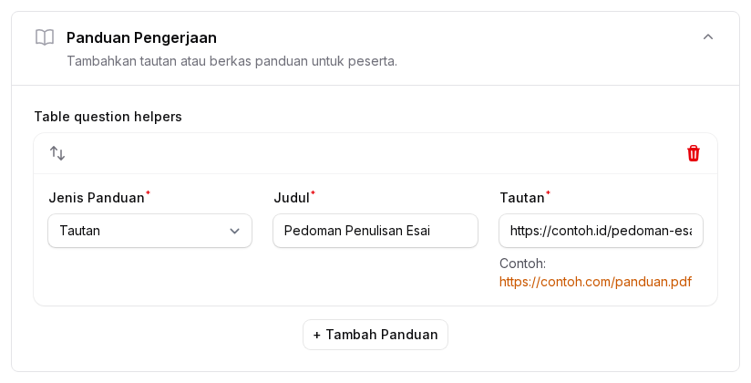
</Frame>

The **Pembahasan** tab works as in CBT/CAT packages. Click **Buat** to save. In **Daftar Soal**, the answer type is shown in the **Tipe Jawaban** column.

<Frame>
  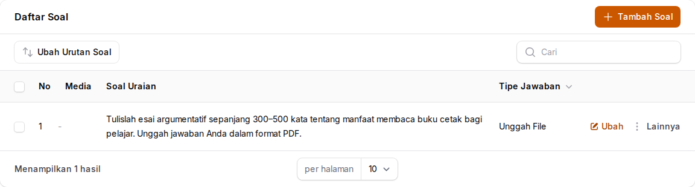
</Frame>

## Changes while an exam is in progress

While a participant is taking an exam that uses the package:

- **CBT/CAT package**: the package, questions, passages, and question groups cannot be edited, added, or deleted. The package page shows **Paket soal ini tidak dapat diubah karena ujian sedang berlangsung.** The **Tambah Soal**, **Import Soal (Excel)**, and **Tambah Soal dengan Jasper AI** buttons are hidden.
- **Esai/Upload File package**: questions can still be edited but not added or deleted.

Packages created through the API import are read-only. Use **Duplikat Paket Soal** to create an editable copy.

<Tip>
  When the package is ready, add it to an exam as described in [Create a Test](/en/data-ujian/membuat-tes-ujian).
</Tip>
