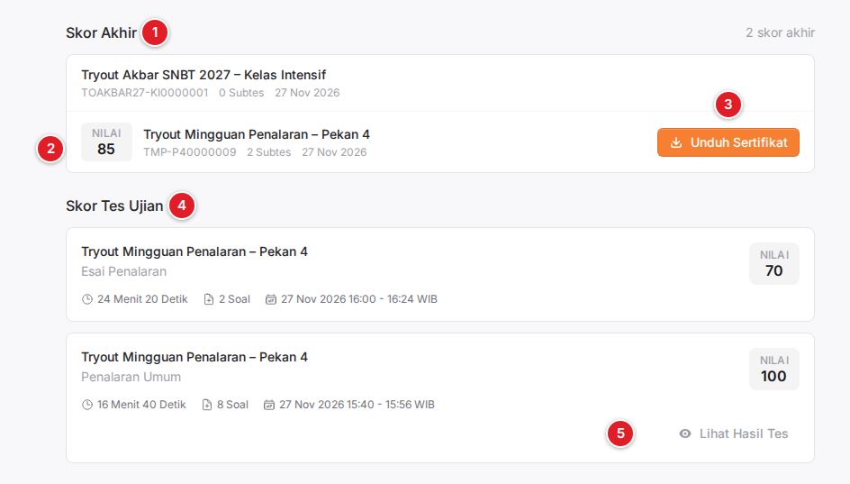
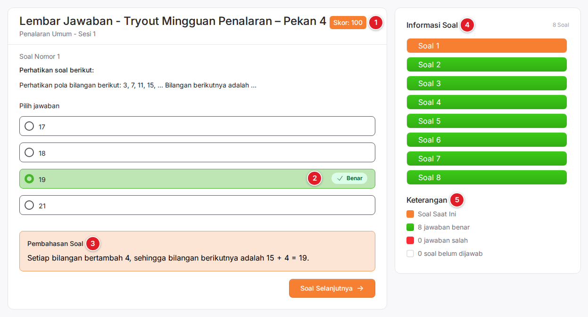
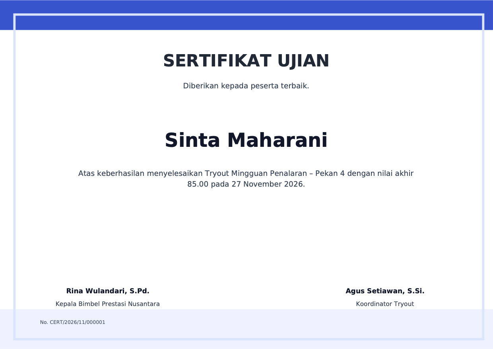
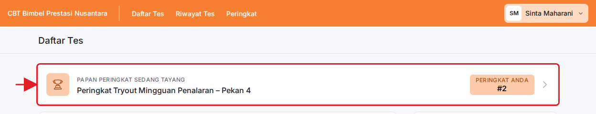
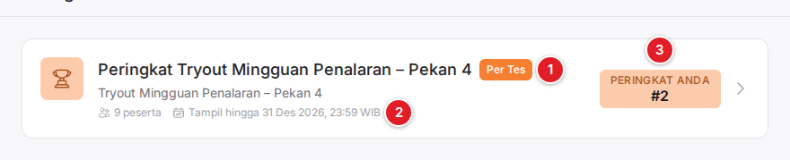
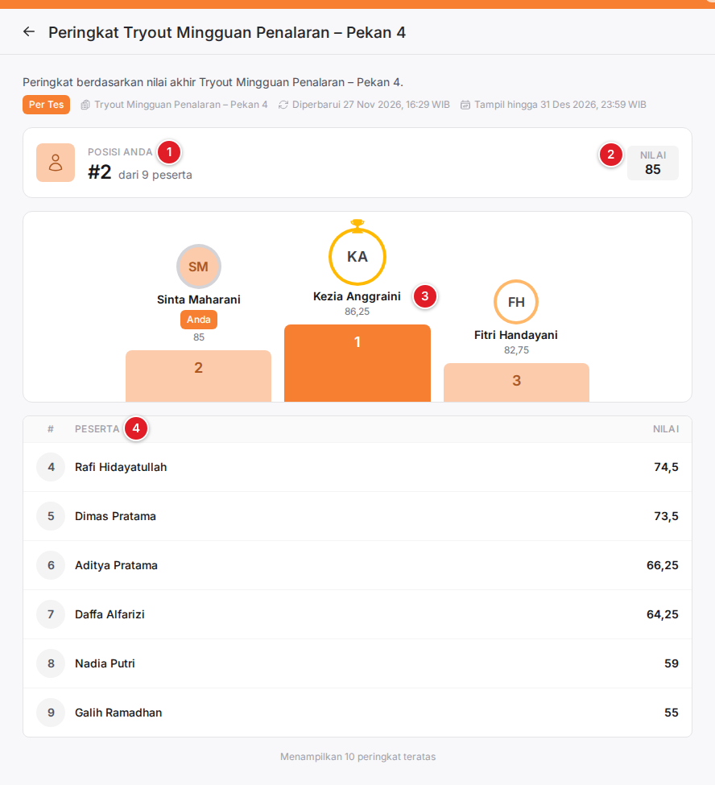
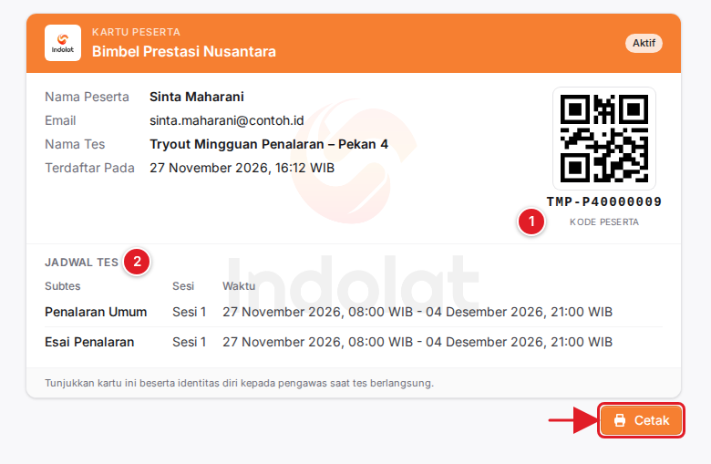

After a test, you can see your scores, open the answer sheet with its explanations, download a certificate, and check your position on the leaderboard. This page also covers the participant card. What you can see depends on the organiser's settings, so some parts may not appear on your account.

<Info>
  **Menu location:** participant app → **Riwayat Tes** (test history) for scores, answer sheets, and certificates; **Peringkat** (ranking) for leaderboards; your name at the top right → **Kartu Peserta** (participant card).
</Info>

## Test history

<Frame>
  
</Frame>

1. **Skor Akhir** (final scores): the exams you take, with your participant code, the number of subtests taken, and the registration date. Exams you have not taken yet also appear, without a score.
2. **NILAI** (score): the exam's final score, combining all of its tests. Example: **85**.
3. **Unduh Sertifikat** (download certificate): downloads the exam certificate. See [Certificate](#certificate).
4. **Skor Tes Ujian** (test scores): the score of each test, with the time taken, the number of questions, and when it was taken.
5. **Lihat Hasil Tes** (view test result): opens the answer sheet of that test.

<Note>
  - Scores, answer sheets, and explanations only appear if the organiser allows them. If all of them are hidden, you only see that the test is finished.
  - Scores for essay or file upload tests only appear after the organiser has marked them. In this example, **Esai Penalaran** has been marked **70**.
  - In exams scored with IRT, scores only appear after the organiser calculates them, usually once every participant has finished.
</Note>

## Answer sheet

Click **Lihat Hasil Tes** to open the answer sheet.

<Frame>
  
</Frame>

1. **Skor** (score) of your test.
2. Your answer and its result. A correct answer is green with the label **Benar** (correct); a wrong answer is red, and the correct answer is marked green.
3. **Pembahasan Soal** (question explanation): the organiser's explanation of the answer.
4. **Informasi Soal** (question information): every question number. Green means correct, red means wrong, and white means unanswered. Click a number to open that question.
5. **Keterangan** (legend): the number of correct answers, wrong answers, and unanswered questions.

If the organiser provides the explanations as a PDF, the answer sheet shows **Pembahasan Tes** (test explanation) with a **Buka PDF Pembahasan** (open explanation PDF) button.

## Certificate

If the organiser provides a certificate, the **Unduh Sertifikat** button appears in the **Skor Akhir** section once you meet its requirements, for example finishing every test and reaching the minimum score. The certificate downloads as a PDF.

<Frame>
  
</Frame>

The organiser decides the certificate's design and content. If the certificate needs the organiser's approval, it works like this:

1. Click **Ajukan Sertifikat** (request certificate). The message **Permintaan sertifikat telah diajukan. Silakan menunggu persetujuan admin.** (request submitted, wait for approval) appears.
2. The button changes to **Menunggu Persetujuan** (awaiting approval).
3. Once approved, the button changes to **Unduh Sertifikat**.

If no certificate button appears, the exam has no certificate, or you have not met its requirements yet.

## Ranking

When the organiser shows a leaderboard, **Daftar Tes** (test list) shows the **Papan peringkat sedang tayang** (leaderboard now showing) card with your position. Click the card to open the leaderboard directly.

<Frame>
  
</Frame>

Every leaderboard available to you is listed under the **Peringkat** menu.

<Frame>
  
</Frame>

1. The leaderboard type: **Per Tes** (final score of one exam), **Gabungan Tes** (several exams), **Per Subtes** (each test), or **Per Papan** (a ranking the organiser uploads from a file).
2. The number of participants and how long it is shown, for example **Tampil hingga 31 Des 2026, 23:59 WIB** (shown until).
3. **Peringkat Anda** (your rank). If you are not on it yet, it reads **Belum masuk peringkat** (not ranked yet).

Click a leaderboard to see its details.

<Frame>
  
</Frame>

1. **Posisi Anda** (your position), for example **#2** out of 9 participants.
2. Your **Nilai** (score).
3. The top-three podium. Your place is marked with the **Anda** (you) label.
4. The rest of the ranking.

<Note>
  - The ranking does not change the moment you finish. The new order appears after the organiser refreshes the leaderboard.
  - The organiser can show the order without scores, or limit how many ranks are shown, for example **Menampilkan 10 peringkat teratas** (showing the top 10 ranks).
</Note>

## Participant card

The participant card holds your details, participant code, and test schedule for one exam. Open it by clicking your name at the top right, then choosing **Kartu Peserta**.

<Frame>
  
</Frame>

1. **Kode Peserta** (participant code) and its QR code, for example **TMP-P40000009**.
2. **Jadwal Tes** (test schedule): each test with its session and time. If a session has not been set, it reads **Belum dijadwalkan** (not scheduled yet).

Click **Cetak** (print) under the card to print it or save it as a PDF. If you are registered for several exams, each exam has its own card.

<Tip>
  For in-person exams, bring the participant card and your identity card and show them to the invigilator. The card is only available once the organiser has verified your registration.
</Tip>
