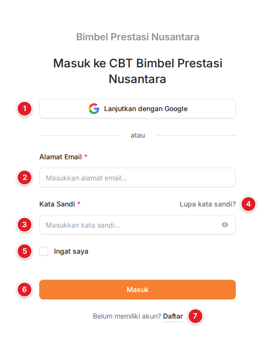
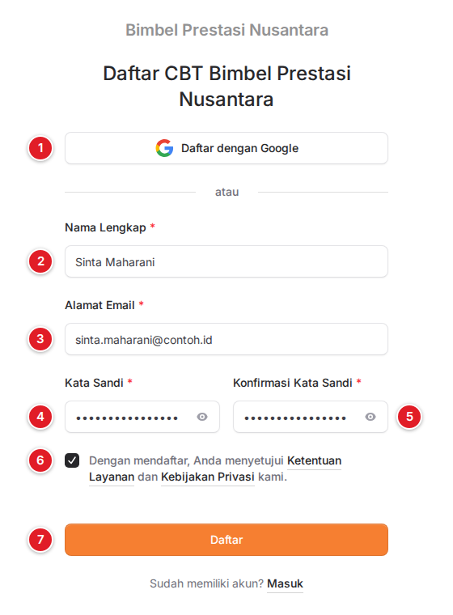
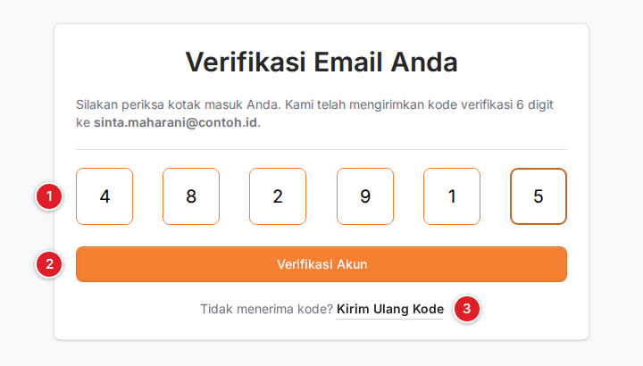
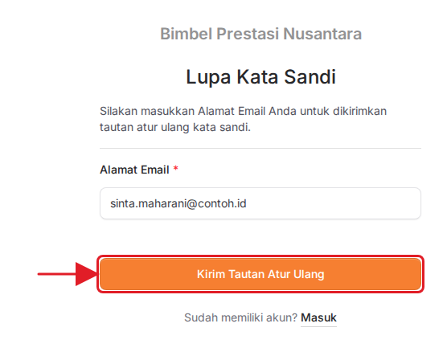
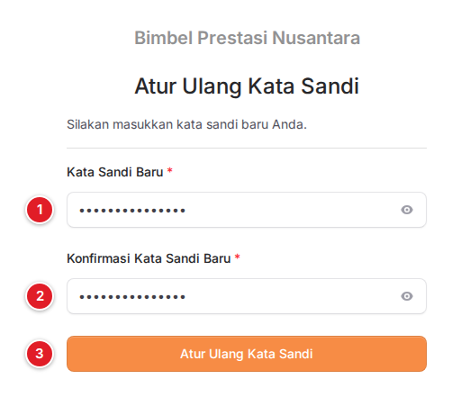
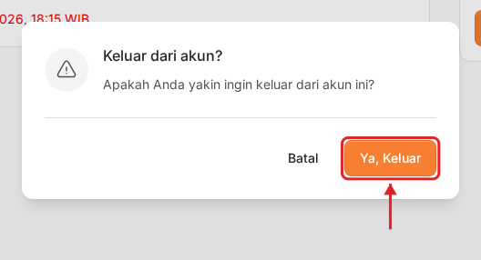

To take an exam, you need to sign in to your organiser's participant app. This page explains how to sign in, create your own account, verify your email, reset a forgotten password, and sign out.

<Info>
  **Menu location:** the participant app address from your organiser, for example `https://prestasi.indolat.web.id`. The sign-in page appears automatically when you are not signed in.
</Info>

A participant account belongs to one organiser. An account at Bimbel Prestasi Nusantara cannot be used to sign in to another organiser's participant app, even with the same email.

## Signing in

Use this if you already have an account, whether the organiser created it for you or you created it yourself.

<Frame>
  
</Frame>

1. **Lanjutkan dengan Google** (continue with Google): signs in with a Google account whose email is already registered. This button only appears if the organiser enables it.
2. **Alamat Email** (email address): your account email.
3. **Kata Sandi** (password): your account password. Click the eye icon to show what you typed.
4. **Lupa kata sandi?** (forgot password): resets your password, see [Forgotten password](#forgotten-password).
5. **Ingat saya** (remember me): keeps you signed in on this browser even after it is closed. Do not tick it on a shared device.
6. **Masuk** (sign in): signs you in. You are taken to **Daftar Tes** (test list).
7. **Daftar** (register): creates a new account. This link only appears if the organiser allows account registration.

The sign-in, registration, and forgotten-password pages can show a Cloudflare security check above the button. Wait until the check finishes before clicking the button. If the check fails, the message **Verifikasi keamanan gagal. Selesaikan verifikasi lalu coba lagi.** (security check failed) appears.

<Note>
  - The message **Alamat email atau kata sandi tidak valid** (invalid email or password) means the email or password is wrong, or the organiser has deactivated your account.
  - After 5 failed sign-in attempts within one minute, you have to wait a little before trying again.
  - An account is only active on one device. If you sign in on another device, the previous device is signed out.
</Note>

## Creating your own account

If the organiser allows account registration, you can create your own account from the sign-in page.

<Steps>
  <Step title="Click Daftar">
    On the sign-in page, click **Daftar** below the **Masuk** button.
  </Step>
  <Step title="Fill in the registration form">
    <Frame>
      
    </Frame>

    1. **Daftar dengan Google** (register with Google): creates an account with your Google account, without the form and without a verification code.
    2. **Nama Lengkap** (full name): the name shown in the app, on the participant card, and on certificates. Example: **Sinta Maharani**.
    3. **Alamat Email**: an active email address you own, for example `sinta.maharani@contoh.id`. The verification code is sent here.
    4. **Kata Sandi**: the password you will sign in with.
    5. **Konfirmasi Kata Sandi** (confirm password): type the same password again.
    6. Tick the agreement to the **Ketentuan Layanan** (Terms of Service) and **Kebijakan Privasi** (Privacy Policy).
    7. Click **Daftar**.

    <Note>
      Temporary (*disposable*) email addresses and anonymous email services cannot be used to register. If the email is already registered, the message **Alamat email ini sudah terdaftar** (this email is already registered) appears; sign in with that email or reset its password.
    </Note>
  </Step>
  <Step title="Enter the verification code">
    Open your email. A 6-digit verification code is sent with the subject **Kode OTP Anda: …** (your OTP code). Enter the code, then click **Verifikasi Akun** (verify account).

    <Frame>
      
    </Frame>

    1. The verification code boxes.
    2. **Verifikasi Akun**: checks the code.
    3. **Kirim Ulang Kode** (resend code): requests a new code if the email did not arrive.

    When it succeeds, the message **Email berhasil diverifikasi** (email verified) appears and you are taken to **Daftar Tes**.
  </Step>
</Steps>

<Note>
  - The verification code is valid for 5 minutes. If the code has expired when you enter it, the system automatically sends a new code to your email.
  - While the previous code is still valid, **Kirim Ulang Kode** shows **OTP sebelumnya masih berlaku.** (the previous OTP is still valid). Check your spam or promotions folder first, then try again after a few minutes.
  - An account that has not been verified is always taken to the verification page when it signs in.
</Note>

## Forgotten password

<Steps>
  <Step title="Click Lupa kata sandi?">
    On the sign-in page, click **Lupa kata sandi?** next to the **Kata Sandi** field.
  </Step>
  <Step title="Send the reset link">
    Fill in your account's **Alamat Email**, then click **Kirim Tautan Atur Ulang** (send reset link).

    <Frame>
      
    </Frame>

    The link is sent to your email with the subject **Atur Ulang Kata Sandi Anda** (reset your password). If the message **Alamat email ini belum terdaftar.** (this email is not registered) appears, check how you typed your email.
  </Step>
  <Step title="Create a new password">
    Open the email, then click **Atur Ulang Kata Sandi**. The password reset page opens in your browser.

    <Frame>
      
    </Frame>

    1. **Kata Sandi Baru** (new password): your new password.
    2. **Konfirmasi Kata Sandi Baru** (confirm new password): type the same password again.
    3. Click **Atur Ulang Kata Sandi**.

    When the message **Kata sandi berhasil diatur ulang** (password reset) appears, sign in with the new password.
  </Step>
</Steps>

<Note>
  - The reset link is valid for 1 hour and can only be used once. A used or expired link shows **Token reset kata sandi ini tidak valid atau telah kedaluwarsa.** (the reset token is invalid or has expired); request a new link.
  - If you registered with **Daftar dengan Google**, simply sign in again with **Lanjutkan dengan Google**.
  - The organiser can also change your account password if the email cannot be received.
</Note>

## Signing out

Click your name at the top right, choose **Keluar** (sign out), then click **Ya, Keluar** (yes, sign out) in the confirmation window.

<Frame>
  
</Frame>

Always sign out when you use a shared computer, for example in a school computer lab.
