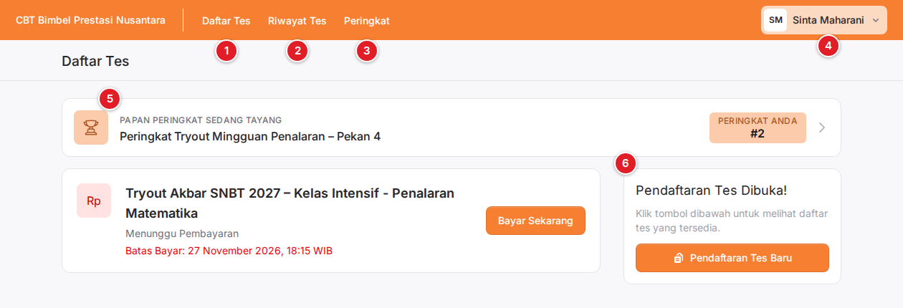
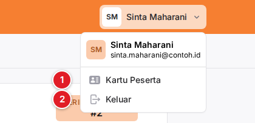
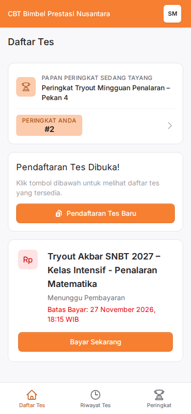

The Participant Guide is written for you if you are going to sit an exam, test, or tryout on CBT Indolat, for example as a student, a tutoring centre participant, or a job applicant. This page explains what to prepare, how to open the participant app, and what its main menus contain.

<Info>
  **App location:** every exam organiser has its own participant app address, usually `https://<project-code>.indolat.web.id`. For example, participants of **Bimbel Prestasi Nusantara** open `https://prestasi.indolat.web.id`. Organisers can also use their own domain. You receive this address from the school, tutoring centre, or institution running the exam.
</Info>

The examples in the Participant Guide follow the participant **Sinta Maharani** from **Bimbel Prestasi Nusantara**, who takes the exam **Tryout Mingguan Penalaran – Pekan 4**. The exam has two tests: **Penalaran Umum** (choice questions with a 20-minute time limit) and **Esai Penalaran** (an essay answer and a file upload).

## What to prepare

- **Device:** a laptop, computer, phone, or tablet.
- **Browser:** Google Chrome, Chromium, Microsoft Edge, or Safari. You can also use the CBT Indolat app for phones.
- **A stable internet connection.** Answers are sent to the server every time you answer, so a connection that keeps dropping can disrupt your test.
- **An account:** the email and password from your organiser, or an account you create yourself if the organiser allows registration.
- **A camera:** only if the exam is camera-proctored. Make sure the camera works and allow your browser to use it.

## How taking an exam works

<CardGroup cols={2}>
  <Card title="1. Create an Account and Sign In" icon="right-to-bracket" href="/en/peserta/membuat-akun-dan-masuk">
    Sign in with the account from your organiser or create your own.
  </Card>
  <Card title="2. Register for a Test" icon="file-pen" href="/en/peserta/mendaftar-tes">
    Register for an exam the organiser has opened, including paid exams.
  </Card>
  <Card title="3. Take a Test" icon="pen-to-square" href="/en/peserta/mengerjakan-tes">
    Start the test, answer the questions, and finish before time runs out.
  </Card>
  <Card title="4. View Your Scores, Certificate, and Ranking" icon="trophy" href="/en/peserta/melihat-hasil">
    See your scores, answer sheet, certificate, and position on the leaderboard.
  </Card>
</CardGroup>

If the organiser has already registered you for the exam, you can skip step 2: your tests appear on **Daftar Tes** (test list) as soon as you sign in.

## Getting to know the app

After signing in, you land on the **Daftar Tes** page.

<Frame>
  
</Frame>

1. **Daftar Tes**: the tests you can take. Finished tests move to **Riwayat Tes**.
2. **Riwayat Tes** (test history): finished tests with their scores, answer sheets, and certificates.
3. **Peringkat** (ranking): leaderboards the organiser is showing. This menu only appears when there is a leaderboard for you.
4. Your name: opens the account menu.
5. **Papan peringkat sedang tayang** (leaderboard now showing): your position on a leaderboard. Click the card to open the leaderboard.
6. **Pendaftaran Tes Dibuka!** (registration open): the **Pendaftaran Tes Baru** (new test registration) button for registering for another exam. This card only appears when an exam is open for registration.

Click your name at the top right to open the account menu.

<Frame>
  
</Frame>

1. **Kartu Peserta** (participant card): a card with your participant code and test schedule. See [View Your Scores, Certificate, and Ranking](/en/peserta/melihat-hasil#participant-card).
2. **Keluar** (sign out): signs you out. See [Create an Account and Sign In](/en/peserta/membuat-akun-dan-masuk#signing-out).

The app appears in Indonesian or English, depending on the organiser's setting.

## Taking an exam on a phone

On a phone, the **Daftar Tes**, **Riwayat Tes**, and **Peringkat** menus move to a bar at the bottom of the screen, and the account menu opens from your initials at the top right.

<Frame>
  
</Frame>

Things to keep in mind on a phone:

- Charge the battery and turn off notifications from other apps. In exams that detect tab switching, switching to another app is recorded as a tab switch.
- Exams that require screen sharing cannot be taken in a phone browser. Use the CBT Indolat app.
- The **Lanjutkan dengan Google** (continue with Google) button is not available in the CBT Indolat app. Sign in with your email and password.
