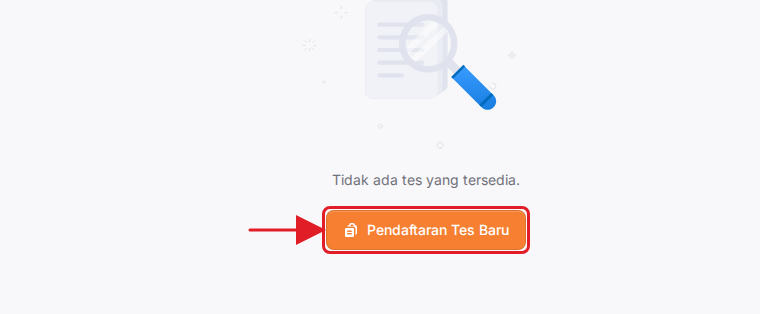
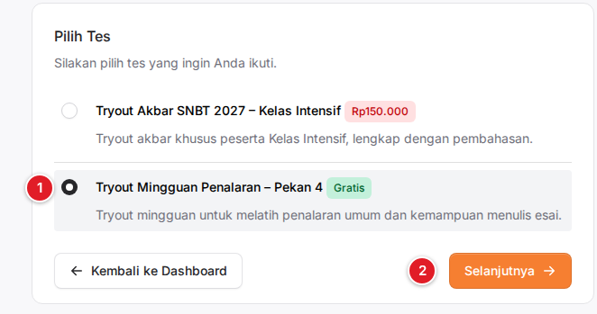
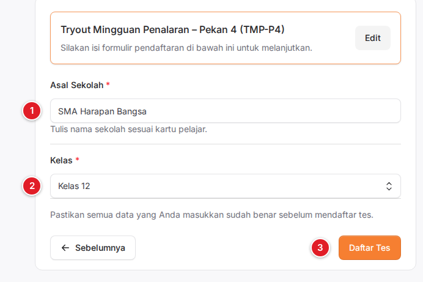
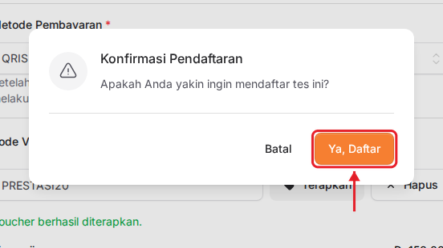
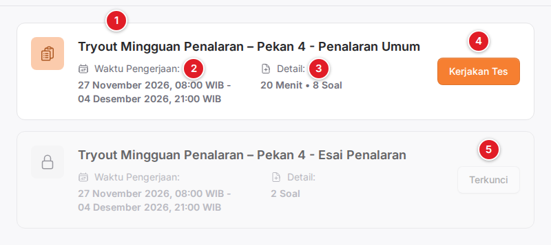
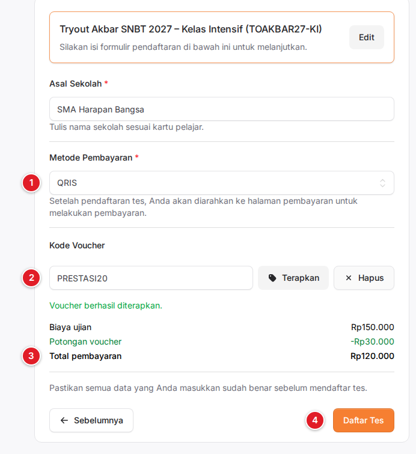
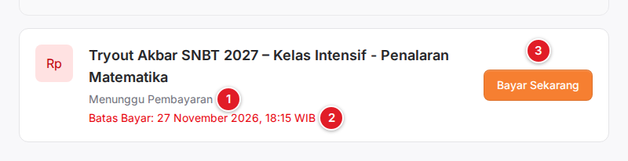
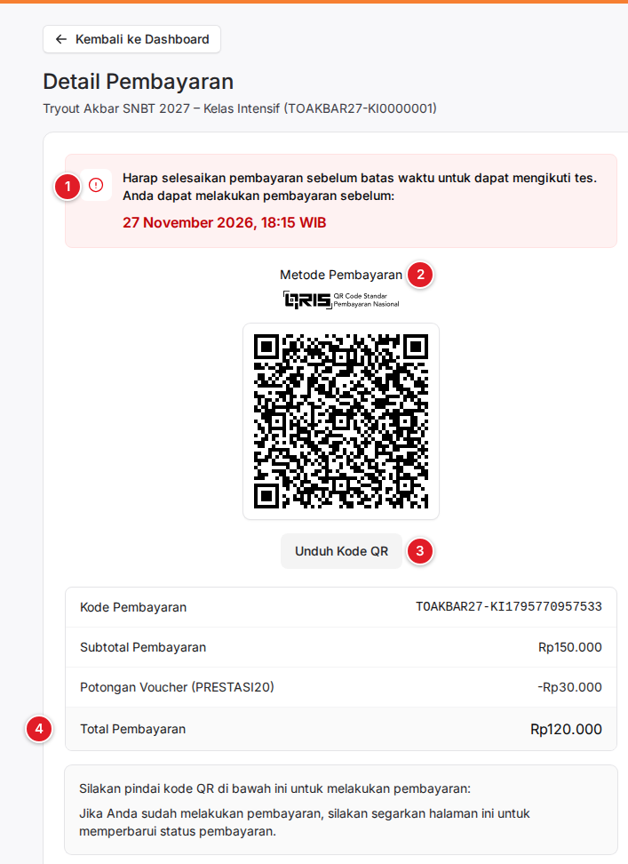

If the organiser opens registration, you can register for an exam yourself from the participant app. This page explains how to register for a free exam, fill in the registration form, register for a paid exam with a voucher code, and pay through QRIS.

<Info>
  **Menu location:** participant app → **Daftar Tes** (test list) → **Pendaftaran Tes Baru** (new test registration). If the organiser has already registered you for the exam, its tests appear on **Daftar Tes** straight away and you do not need to register again.
</Info>

## Registering for an exam

As an example, Sinta Maharani registers for the free exam **Tryout Mingguan Penalaran – Pekan 4**.

<Steps>
  <Step title="Click Pendaftaran Tes Baru">
    On **Daftar Tes**, click **Pendaftaran Tes Baru**. If you already have tests, the button sits in the **Pendaftaran Tes Dibuka!** (registration open) card on the right.

    <Frame>
      
    </Frame>

    This button only appears when an exam is open for registration.
  </Step>
  <Step title="Choose the exam">
    <Frame>
      
    </Frame>

    1. Choose the exam you want to take. The label next to its name shows the fee: **Gratis** (free) or an amount, for example **Rp150.000**.
    2. Click **Selanjutnya** (next).

    Exams you have already registered for are labelled **Terdaftar** (registered). If you choose one again, the message **Anda sudah terdaftar pada tes ini** (you are already registered for this test) appears.
  </Step>
  <Step title="Fill in the registration form">
    Answer the questions the organiser asks. Fields with a red asterisk are required.

    <Frame>
      
    </Frame>

    1. **Asal Sekolah** (school): an example of a text question. Help text appears under the field.
    2. **Kelas** (grade): an example of a choice question. Example: **Kelas 12**.
    3. Click **Daftar Tes** (register for test).

    If the exam has no form, the message **Tidak ada formulir pendaftaran yang diperlukan. Anda dapat langsung mendaftar tes.** (no registration form is required) appears. Click **Edit** or **Sebelumnya** (previous) to change the exam.
  </Step>
  <Step title="Confirm the registration">
    In the **Konfirmasi Pendaftaran** (confirm registration) window, click **Ya, Daftar** (yes, register).

    <Frame>
      
    </Frame>

    The notice **Anda telah berhasil mendaftar tes.** (you have registered for the test) appears, and the exam's tests appear on **Daftar Tes**.
  </Step>
</Steps>

## Reading the test card

Each test in an exam appears as one card on **Daftar Tes**.

<Frame>
  
</Frame>

1. The exam name and test name, for example **Tryout Mingguan Penalaran – Pekan 4 - Penalaran Umum**.
2. **Waktu Pengerjaan** (test window): your session schedule. The test can only be started within this window.
3. **Detail**: the time limit and number of questions.
4. **Kerjakan Tes** (start test): starts the test. See [Take a Test](/en/peserta/mengerjakan-tes).
5. **Terkunci** (locked): the test cannot be taken yet. In this example, **Esai Penalaran** opens only after **Penalaran Umum** is finished, because the organiser requires the tests to be taken in order.

Buttons on the card:

| Button or label | Meaning |
| --- | --- |
| **Kerjakan Tes** | The test is ready to take within its session schedule. |
| **Terkunci** | An earlier test must be finished first, your session has not been set, or the test is waiting for payment. |
| **Proses Verifikasi** (under review) | The organiser is checking your registration. The test opens once the registration is approved. |
| **Bayar Sekarang** (pay now) | The registration is waiting for payment. See [Paying for a paid exam](#paying-for-a-paid-exam). |

<Tip>
  If a button stays **Terkunci** although the earlier test is finished and the session has started, ask the organiser to check that you have been placed in a session.
</Tip>

## Paying for a paid exam

Paid exams use the **Metode Pembayaran** (payment method) question in the registration form. As an example, Sinta registers for **Tryout Akbar SNBT 2027 – Kelas Intensif**, priced **Rp150.000**, and uses the voucher **PRESTASI20**.

<Steps>
  <Step title="Fill in the form and apply the voucher">
    Choose the paid exam on the **Pilih Tes** (choose test) page, click **Selanjutnya**, then fill in the form.

    <Frame>
      
    </Frame>

    1. **Metode Pembayaran**: choose **QRIS**.
    2. **Kode Voucher** (voucher code, if you have one): type the code, then click **Terapkan** (apply). The message **Voucher berhasil diterapkan.** (voucher applied) appears. Click **Hapus** (remove) to cancel the voucher.
    3. The fee breakdown: **Biaya ujian** (exam fee), **Potongan voucher** (voucher discount), and **Total pembayaran** (total payment) to pay. In this example, the 20% discount brings the total to **Rp120.000**.
    4. Click **Daftar Tes**, then **Ya, Daftar** in the confirmation window.

    The **Kode Voucher** field only appears if the organiser offers vouchers for that exam. A voucher that cannot be used shows the reason, for example **Kode voucher tidak valid.** (invalid voucher code) or **Kuota penggunaan voucher sudah habis.** (voucher quota used up).
  </Step>
  <Step title="Open the payment page">
    After you click **Ya, Daftar**, the app opens the **Detail Pembayaran** (payment details) page straight away. If that page is closed, reopen it from **Daftar Tes**: the test shows **Menunggu Pembayaran** (awaiting payment); click **Bayar Sekarang**.

    <Frame>
      
    </Frame>

    1. **Menunggu Pembayaran**: the status of your registration.
    2. **Batas Bayar** (payment deadline): 2 hours after you register.
    3. **Bayar Sekarang**: opens the **Detail Pembayaran** page.
  </Step>
  <Step title="Pay with QRIS">
    Scan the QR code with a banking or e-wallet app that supports QRIS, then pay the **Total Pembayaran**.

    <Frame>
      
    </Frame>

    1. The payment deadline.
    2. **Metode Pembayaran** and the QRIS QR code.
    3. **Unduh Kode QR** (download QR code): saves the QR code as an image, for example to pay from another phone.
    4. **Total Pembayaran**: the amount to pay. If the organiser charges the transaction fee to participants, a **Biaya Transaksi** (transaction fee) row also appears.
  </Step>
  <Step title="Reload the page after paying">
    After paying, reload the **Detail Pembayaran** page. When the payment is received, the message **Pembayaran Anda telah diterima dengan sukses. Terima kasih!** (payment received) and the status **Sudah Dibayar** (paid) appear. Your test opens according to its session schedule.
  </Step>
</Steps>

<Warning>
  Pay before the **Batas Bayar**. Once the deadline passes, the payment page shows **Waktu pembayaran telah habis.** (payment time is up) and the QR code can no longer be used. For exams paid once up front, your registration is cancelled automatically, so you need to register again to get a new QR code. Contact the organiser if you have paid but the status has not changed.
</Warning>
