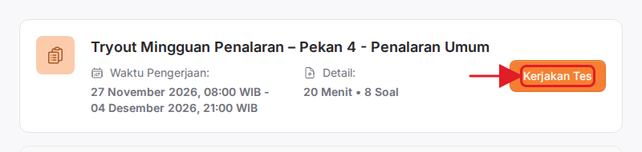
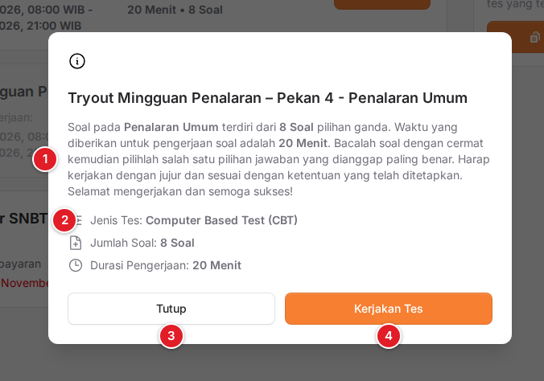
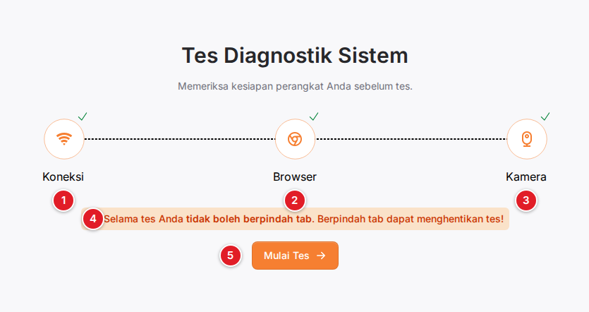
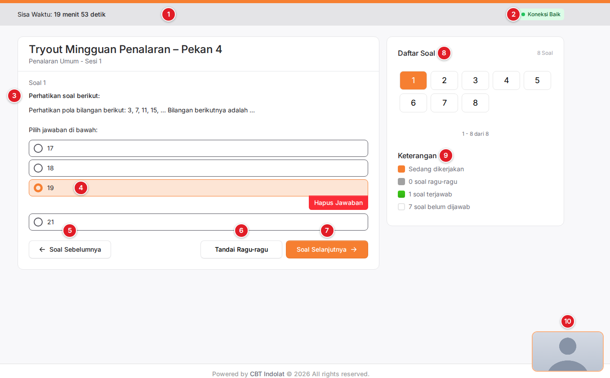
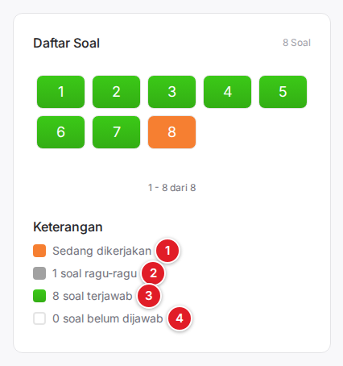
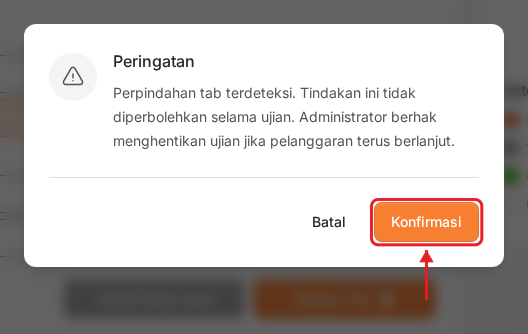
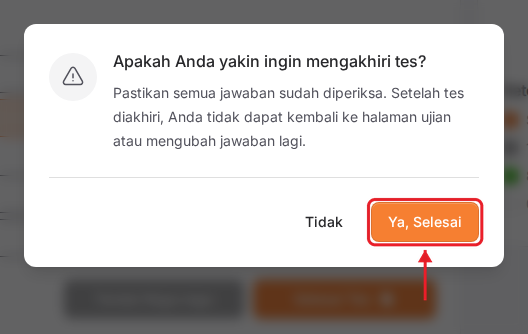
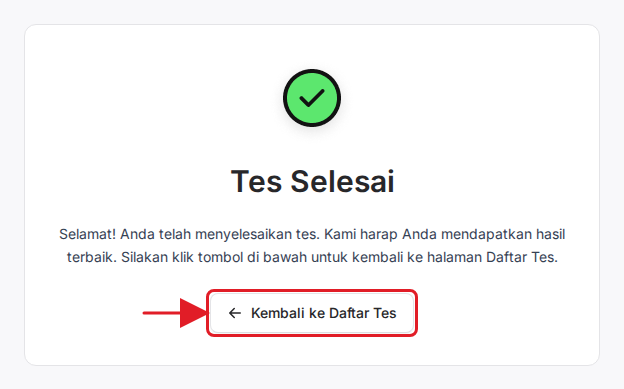

This page walks through taking a test from start to finish: reading the instructions, passing the device check, answering questions, checking your answers, and ending the test. How to answer each question type is explained in [How to Answer Each Question Type](/en/peserta/menjawab-soal).

<Info>
  **Menu location:** participant app → **Daftar Tes** (test list) → **Kerjakan Tes** (start test) on the test card.
</Info>

<Warning>
  The time limit starts when you click **Mulai Tes** (begin test) and is counted by the server, not by your device. It keeps running even if the browser is closed or the device switches off. If you start close to the end of the session, your time ends with the session even if the time limit has not run out.
</Warning>

## Starting a test

<Steps>
  <Step title="Click Kerjakan Tes">
    On **Daftar Tes**, click **Kerjakan Tes** on the test card. The button can only be clicked within your session's **Waktu Pengerjaan** (test window).

    <Frame>
      
    </Frame>
  </Step>
  <Step title="Read the test instructions">
    <Frame>
      
    </Frame>

    1. The organiser's instructions.
    2. **Jenis Tes** (test type), **Jumlah Soal** (number of questions), and **Durasi Pengerjaan** (time limit).
    3. **Tutup** (close): returns to **Daftar Tes** without starting the test.
    4. **Kerjakan Tes**: continues to the device check.
  </Step>
  <Step title="Wait for the Tes Diagnostik Sistem">
    The system checks that your device is ready. Each check that passes gets a green tick.

    <Frame>
      
    </Frame>

    1. **Koneksi** (connection): your device can reach the server and the limit on simultaneous participants has not been reached.
    2. **Browser**: your browser is supported (Google Chrome, Chromium, Microsoft Edge, Safari, or the CBT Indolat app).
    3. **Kamera** (camera): the browser is allowed to use the camera. This check only appears in camera-proctored exams. When the browser asks for camera permission, choose **Allow**.
    4. A warning that you must not switch tabs. It appears in exams that detect tab switching.
    5. **Mulai Tes**: starts the test. The button becomes active once every check has passed.

    Depending on the exam settings, the **Bagikan Layar** (screen share) check (you must share your entire screen, not a single tab or window) and the **Monitor Ganda** (dual monitor) check (only one screen may be connected) can also appear.
  </Step>
  <Step title="Click Mulai Tes">
    The question page opens and **Sisa Waktu** (time remaining) starts counting down.
  </Step>
</Steps>

<Note>
  Essay and file upload tests do not use the Tes Diagnostik Sistem. The test starts as soon as you click **Kerjakan Tes** in the instructions window, and **Sisa Waktu** counts down to the end of the session. See [How to Answer Each Question Type](/en/peserta/menjawab-soal#essay-answer).
</Note>

## The question page

<Frame>
  
</Frame>

1. **Sisa Waktu**: the countdown of your time limit.
2. Connection indicator: **Koneksi Baik** (good), **Koneksi Lambat** (slow), or **Koneksi Buruk** (poor).
3. The question number and question.
4. Your chosen answer. Answers are saved automatically every time you answer; **Menyimpan jawaban...** (saving answer) shows briefly. Click **Hapus Jawaban** (clear answer) to empty this question's answer.
5. **Soal Sebelumnya** (previous question): goes back to the previous question.
6. **Tandai Ragu-ragu** (mark as unsure): marks a question you want to check again. A question marked unsure is still scored if it has an answer.
7. **Soal Selanjutnya** (next question): moves to the next question. On the last question, this button becomes **Selesai Tes** (finish test).
8. **Daftar Soal** (question list): every question number. Click a number to open that question directly.
9. **Keterangan** (legend): how many questions are unsure, answered, and unanswered.
10. Camera preview. Shown in camera-proctored exams.

In a CAT (*Computer Adaptive Test*) test, the next question is chosen from your previous answers, so the **Soal Sebelumnya** and **Tandai Ragu-ragu** buttons are not available.

## Checking your answers before finishing

The colours of the numbers in **Daftar Soal** help you check your work.

<Frame>
  
</Frame>

1. **Sedang dikerjakan** (current, orange): the question that is open.
2. **Soal ragu-ragu** (unsure, grey): questions you marked unsure.
3. **Soal terjawab** (answered, green): questions you have answered. A matching question only counts as answered once all its pairs are placed.
4. **Soal belum dijawab** (unanswered, white): questions that are still empty.

Before ending the test, make sure no question is unanswered, then go back to the questions marked unsure.

## Rules during the test

- **One test at a time.** While a test is running, opening another page of the app always returns you to the question page with the message **Silakan selesaikan tes yang sedang berlangsung.** (please finish the test in progress).
- **The order of questions and answer choices can be shuffled** by the organiser, so your question 1 may differ from other participants'.
- **If the connection drops**, answers already saved are not lost. Once the connection is back, reload the page if asked, then check **Daftar Soal** to make sure your last answer is green.
- **If the browser closes**, open the participant app address again and sign in. The test in progress opens straight away, with the time remaining already reduced.

## Exam proctoring

The organiser can turn on one or more of the following. Every violation is recorded and visible to the organiser.

| Proctoring | What you need to do |
| --- | --- |
| Tab switch detection | Stay on the test page. Opening another tab, switching to another app, or minimising the browser shows a warning. |
| Camera | Keep the camera on and its permission allowed until the test ends. If the permission is revoked, the message **Akses kamera tidak tersedia** (camera access unavailable) appears. |
| Screen share | Share your entire screen and do not stop sharing. This is not available in phone browsers; use the CBT Indolat app. |
| Single screen | Disconnect any second monitor before you start. If one is detected, the message **Monitor ganda terdeteksi** (dual monitor detected) appears. |

When a tab switch is detected, the **Peringatan** (warning) window appears. Click **Konfirmasi** (confirm) to return to the questions.

<Frame>
  
</Frame>

<Warning>
  The organiser may stop your test if violations continue. A stopped test cannot be resumed without the organiser's help.
</Warning>

## Finishing the test

<Steps>
  <Step title="Click Selesai Tes">
    On the last question, click **Selesai Tes**. In the confirmation window, click **Ya, Selesai** (yes, finish), or **Tidak** (no) if you still want to check your answers.

    <Frame>
      
    </Frame>
  </Step>
  <Step title="Return to Daftar Tes">
    The **Tes Selesai** (test finished) page appears. Click **Kembali ke Daftar Tes** (back to test list).

    <Frame>
      
    </Frame>

    If you opened the test from another app run by the organiser, the button can be **Lanjutkan** (continue), which takes you back to that app.
  </Step>
</Steps>

Once finished, the test cannot be opened again and its answers cannot be changed. The next test that was **Terkunci** (locked) opens, and the result moves to **Riwayat Tes** (test history). See [View Your Scores, Certificate, and Ranking](/en/peserta/melihat-hasil).

### If time runs out

When **Sisa Waktu** reaches zero, the test ends automatically with the notice **Waktu Habis** (time is up, **Waktu tes telah habis.**), then the **Tes Selesai** page appears. Every answer already saved is still scored; unanswered questions count as unanswered.
