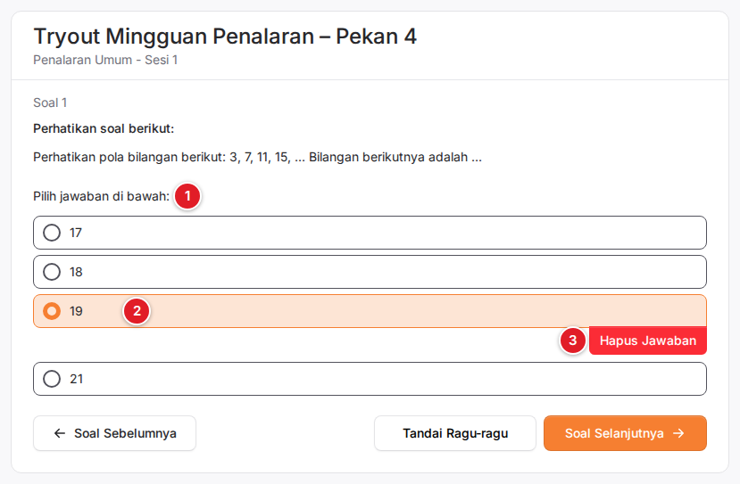
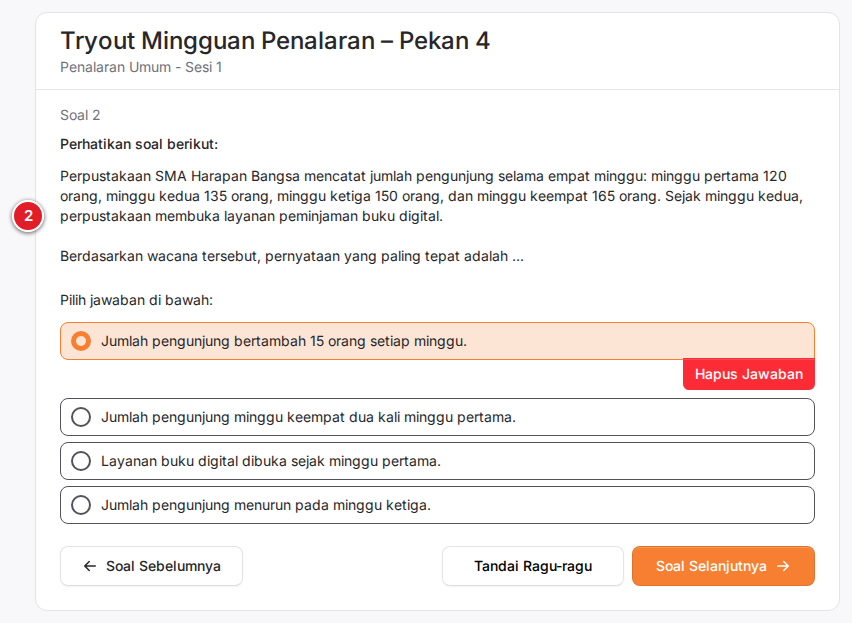
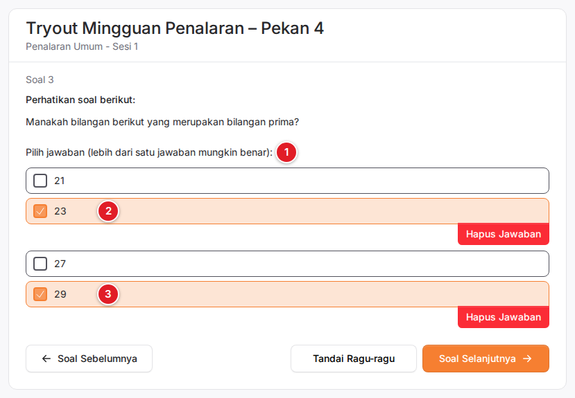
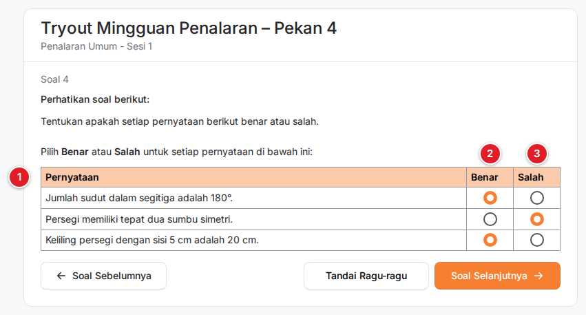
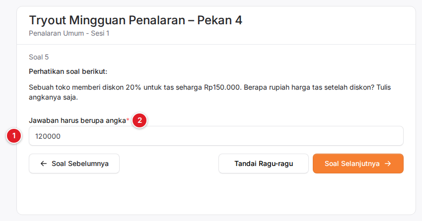
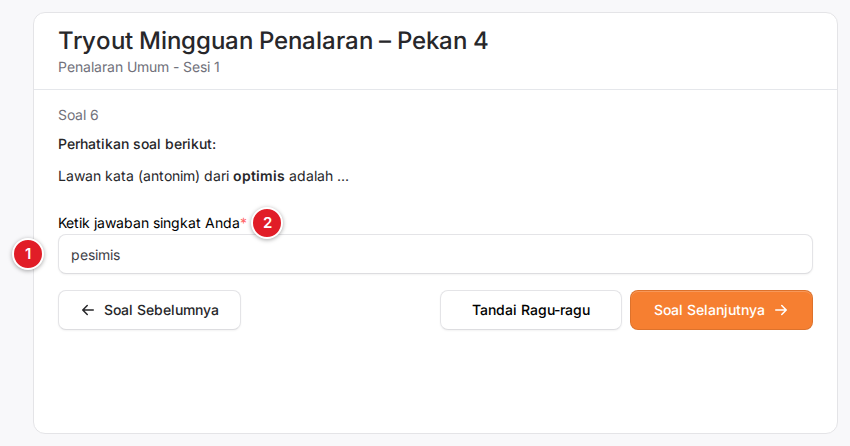
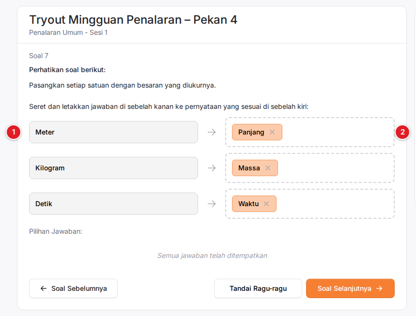
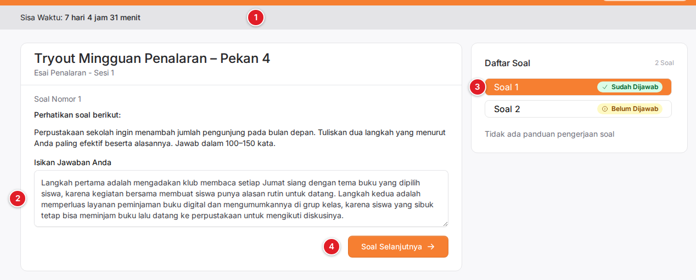
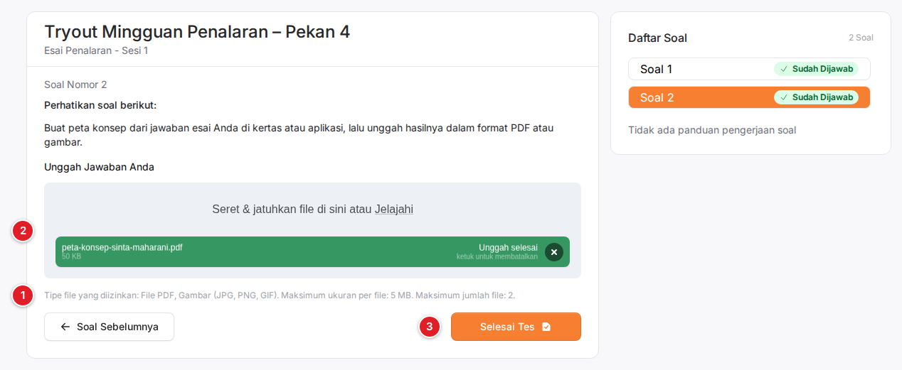

One test can contain several question types. This page explains how to answer each type you may come across. The pictures come from the **Penalaran Umum** and **Esai Penalaran** tests in the exam **Tryout Mingguan Penalaran – Pekan 4**.

<Info>
  **Menu location:** participant app → **Daftar Tes** (test list) → **Kerjakan Tes** (start test), then the question page. Opening the question page is explained in [Take a Test](/en/peserta/mengerjakan-tes).
</Info>

For every question type, your answer is saved automatically each time you answer. You do not need to press a save button.

## Multiple choice

Click one of the answer choices.

<Frame>
  
</Frame>

1. **Pilih jawaban di bawah:** (choose an answer below) means you choose only one answer.
2. The chosen answer turns orange. Click another choice to change your answer.
3. **Hapus Jawaban** (clear answer): empties this question's answer.

## Questions with a reading passage

Some questions start with a passage shared by several questions. Read the passage, then answer the question below it like a multiple-choice question.

<Frame>
  
</Frame>

1. The passage.
2. The question about the passage.

Questions that share a passage always come one after another, even when the question order is shuffled.

## Multiple choice with more than one answer

When the instruction reads **Pilih jawaban (lebih dari satu jawaban mungkin benar):** (more than one answer may be correct), tick every answer you think is correct.

<Frame>
  
</Frame>

1. The instruction that more than one answer may be correct.
2. The first ticked answer.
3. The second ticked answer.

Each ticked choice has its own **Hapus Jawaban** button. Click it to remove that choice only.

<Note>
  These questions are usually counted as correct only when every correct answer is ticked and no wrong answer is ticked as well. How they are scored depends on the organiser's settings.
</Note>

## True or false for each statement

This question has a table of statements. Choose one column for each row.

<Frame>
  
</Frame>

1. **Pernyataan** (statement): the statements to judge.
2. The **Benar** (true) column.
3. The **Salah** (false) column.

The column labels can differ, for example **Fakta** (fact) and **Opini** (opinion). Answer every statement; one wrong statement can make the whole question count as wrong.

## Short numeric answer

Type a number in the answer field.

<Frame>
  
</Frame>

1. The answer field. Example: `120000`.
2. The hint **Jawaban harus berupa angka** (the answer must be a number). This field only accepts numbers.

Type the number only, without units and without thousands separators, unless the question says otherwise. Example: type `120000`, not `Rp120.000` or `120.000`.

## Short text answer

Type a short answer, usually one word or phrase.

<Frame>
  
</Frame>

1. The answer field. Example: `pesimis`.
2. The hint **Ketik jawaban singkat Anda** (type your short answer).

Upper or lower case and extra spaces do not affect the score, but the spelling must be exact.

## Matching

Drag each item under **Pilihan Jawaban:** (answer choices) into the box to the right of the matching statement.

<Frame>
  
</Frame>

1. The statement on the left, for example **Meter**.
2. The answer box. Example: **Panjang** dragged into the box next to **Meter**.

Once every choice is placed, **Semua jawaban telah ditempatkan** (all answers placed) appears. To change a pair, click the **×** on an answer or drag it back to **Pilihan Jawaban:**. The question only counts as answered once every box is filled.

## Essay answer

Essay and file upload tests are scored by the organiser after the test. They look different from multiple-choice tests.

<Frame>
  
</Frame>

1. **Sisa Waktu** (time remaining): counts down to the end of the session, so it can run to several days.
2. **Isikan Jawaban Anda** (fill in your answer): type your essay here.
3. **Daftar Soal** (question list): the status of each question, **Sudah Dijawab** (answered) or **Belum Dijawab** (not answered). Click a question to open it.
4. **Soal Selanjutnya** (next question): moves to the next question.

## File upload

A file upload question asks for a file as the answer, for example a photo of your answer sheet or a PDF document.

<Frame>
  
</Frame>

1. The allowed file types, the maximum size per file, and the maximum number of files.
2. The upload area. Drag a file onto it or click **Jelajahi** (browse) to choose a file. Wait until it says **Unggah selesai** (upload complete). Click **×** to remove a file.
3. **Selesai Tes** (finish test): ends the test once every question is answered.

A file of the wrong type or size is rejected with the message **File ini tidak diterima: periksa jenis dan ukurannya.** (this file was not accepted: check its type and size).

<Tip>
  Essay and file upload scores only appear in **Riwayat Tes** (test history) after the organiser has marked them. See [View Your Scores, Certificate, and Ranking](/en/peserta/melihat-hasil).
</Tip>
