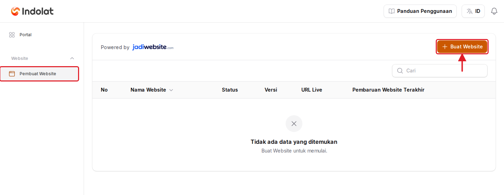
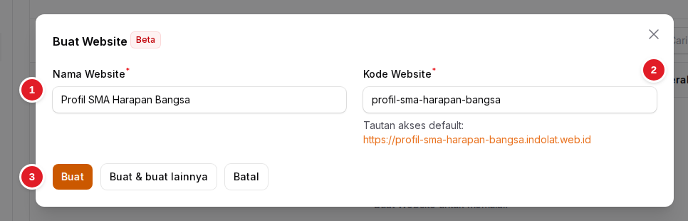
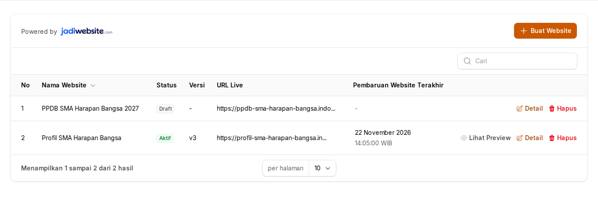
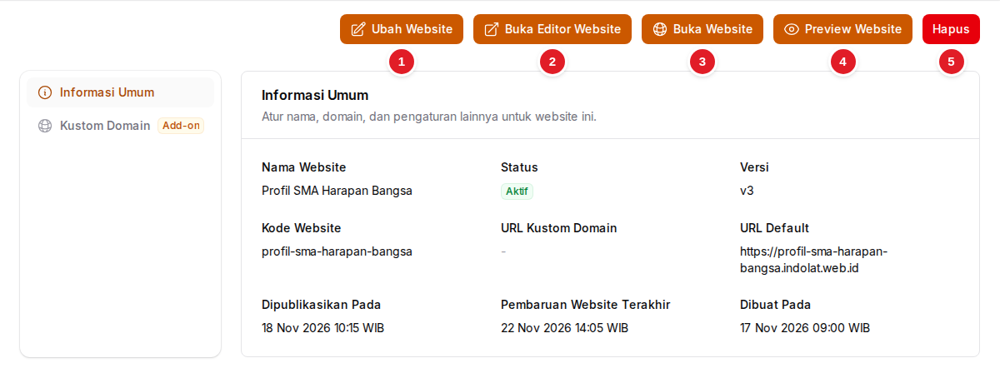
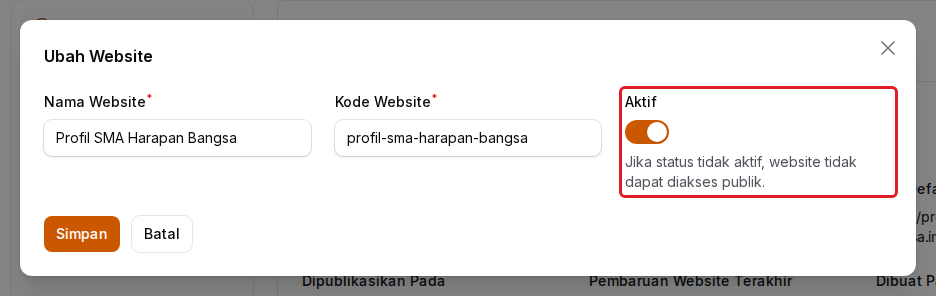
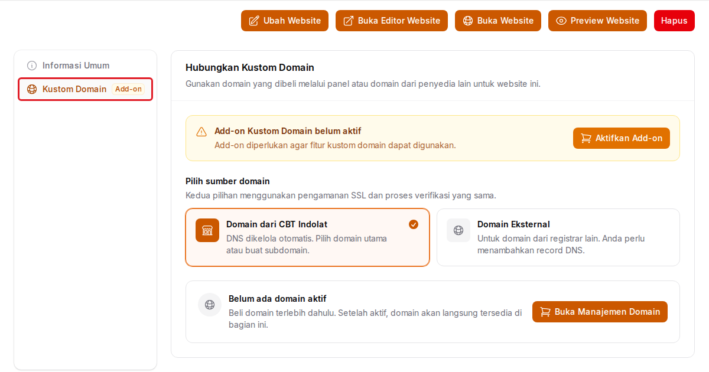

The **Pembuat Website** (Website Builder) module lets you build your institution's website, for example a school profile or an admissions page, without writing code. Pages are edited in the **jadiwebsite.com** editor, which is connected to the Panel, while the website settings (name, code, status, and domain) are managed in the Panel.

<Info>
  Menu location: **Portal** → **Pembuat Website** → **Website** → **Pembuat Website**.

  This module is free. Each project can have at most 2 websites.
</Info>

The examples on this page use the **SMA Harapan Bangsa** project and its **Profil SMA Harapan Bangsa** website.

## Creating a new website

<Steps>
  <Step title="Select Buat Website">
    Open **Pembuat Website**, then select **Buat Website** (Create Website).

    <Frame>
      
    </Frame>
  </Step>
  <Step title="Fill in the website name and code">
    <Frame>
      
    </Frame>

    1. **Nama Website** (Website Name): the name you use to recognise the website in the Panel, for example **Profil SMA Harapan Bangsa**.
    2. **Kode Website** (Website Code): filled in automatically from the name and used as the website's default address, for example `https://profil-sma-harapan-bangsa.indolat.web.id`. Use lowercase letters, numbers, and hyphens only. The code must be unique and must not match any project code; if it is taken, the message **Kode website sudah digunakan. Silakan gunakan kode lain.** (Website code already in use) appears.
    3. Select **Buat** (Create), or **Buat & buat lainnya** (Create and create another) to start the next website straight away.

    A new website has the **Draft** status until it is published from the editor.
  </Step>
</Steps>

<Note>
  When the project already has 2 websites, creating another one is refused with the message **Batas website tercapai** (Website limit reached). Delete a website you no longer use or contact the CBT Indolat team to raise the limit.
</Note>

## Website list

<Frame>
  
</Frame>

The website list shows:

- **Status**: **Draft** (never published), **Aktif** (Active, publicly accessible), or **Tidak Aktif** (Inactive, published before but closed to the public).
- **Versi** (Version): the publication number, for example **v3** for a website published three times.
- **URL Live**: the website address. Once a custom domain is active, this address uses that domain.
- **Pembaruan Website Terakhir** (Last Website Update): when the website was last published from the editor.

Select **Lihat Preview** (View Preview) to see the latest published version, **Detail** to open the website settings, or **Hapus** (Delete) to delete it.

## Editing and publishing a website

Select **Detail** on the website you want to manage.

<Frame>
  
</Frame>

1. **Ubah Website** (Edit Website): changes the website name, code, and status.
2. **Buka Editor Website** (Open Website Editor): opens the jadiwebsite.com editor in a new tab. You are signed in with your Panel account, with no separate login.
3. **Buka Website** (Open Website): opens the live website. This button is shown only when the website status is **Aktif**.
4. **Preview Website**: opens the latest published version. This button appears once the website has been published.
5. **Hapus**: deletes the website.

The **Informasi Umum** (General Information) tab shows **Nama Website**, **Status**, **Versi**, **Kode Website**, **URL Kustom Domain** (Custom Domain URL), **URL Default**, **Dipublikasikan Pada** (Published At), **Pembaruan Website Terakhir**, and **Dibuat Pada** (Created At).

<Steps>
  <Step title="Open the editor">
    Select **Buka Editor Website**. Build the pages, text, images, and menus of your website in the editor that opens in a new tab.
  </Step>
  <Step title="Publish from the editor">
    Publish the website from the editor. Every publication increases the **Versi** number. After the first publication, the website status changes to **Aktif** and the website can be opened at its **URL Default**.
  </Step>
  <Step title="Check the result">
    Go back to the Panel and select **Preview Website** or **Buka Website** to check the result.
  </Step>
</Steps>

## Changing the name, code, or status

Select **Ubah Website** on the detail page.

<Frame>
  
</Frame>

- **Nama Website** and **Kode Website** follow the same rules as when you create a website. Changing the code also changes the website's default address.
- Turn off the **Aktif** switch to close the website to the public. The status becomes **Tidak Aktif** and the website cannot be reached until you turn the switch back on. Publishing again from the editor also reactivates the website.

Select **Simpan** (Save) to save your changes.

<Note>
  The status of a website that is still **Draft** cannot be changed in the Panel. Publish the website from the editor first.
</Note>

## Connecting a custom domain

By default, the website can be opened at `website-code.indolat.web.id`. To use your own domain, for example `www.smaharapanbangsa.sch.id`, open the **Kustom Domain** (Custom Domain) tab on the detail page.

<Frame>
  
</Frame>

- This feature needs the **Kustom Domain** add-on. If the add-on is not active, select **Aktifkan Add-on** (Activate Add-on) to buy it through **Langganan & Tagihan**.
- **Domain dari CBT Indolat** (Domain from CBT Indolat): a domain bought through the Panel. DNS is set up automatically; choose the main domain or create a subdomain. The main domain can be used for one service only, while you can create several subdomains. If you have no domain yet, select **Buka Manajemen Domain** (Open Domain Management) to buy one in **Administrasi Aplikasi** → **Pengaturan Projek** → **Domain**.
- **Domain Eksternal** (External Domain): a domain from another registrar. After you save the request, the Panel shows the DNS records you must add at that domain's DNS provider.

Both options use the same SSL protection and verification process. During verification the domain status is **Menunggu Verifikasi** (Awaiting Verification). Once the domain is active, its address appears under **URL Kustom Domain** and the **Buka Website** button uses that domain.

## Deleting a website

Select **Hapus** on the website list or the detail page, then confirm.

<Warning>
  Deleting a website also removes it from the editor. This cannot be undone.
</Warning>
