Halaman ini mengajak Anda melihat CBT Indolat dari sisi peserta. Dengan memahami setiap layar yang akan ditemui peserta, Anda dapat menjelaskan cara mengerjakan ujian kepada siswa, karyawan, atau peserta tryout, sekaligus menjawab pertanyaan mereka sebelum dan sesudah ujian.

<Info>
  **Tempat peserta mengerjakan ujian:** aplikasi peserta (sering disebut *aplikasi CBT*), yaitu situs terpisah dari panel admin dengan alamat `https://<kode-projek>.indolat.web.id`. Untuk projek berkode `prestasi`, alamatnya `https://prestasi.indolat.web.id`.

  **Tempat Anda mengatur semuanya:** panel admin, modul **Platform Ujian (CBT)**. Setiap bagian di bawah menautkan halaman panduan yang menjelaskan pengaturannya.
</Info>

<Tip>
  Untuk panduan yang ditujukan langsung kepada peserta, bagikan [Memulai sebagai Peserta](/peserta/memulai) dan halaman lain di tab **Panduan Peserta**.
</Tip>

Contoh pada halaman ini memakai peserta **Laras Kusumawati** dari **Bimbel Prestasi Nusantara**. Laras mendaftar ujian **Simulasi Ujian Peserta 2027** yang berisi satu tes, **Penalaran Umum**, dengan 10 soal pilihan ganda dan waktu 20 menit.

## Gambaran alur

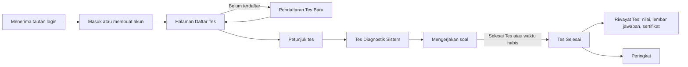

Aplikasi peserta hanya memiliki beberapa menu, sehingga mudah dijelaskan:

| Menu | Isi |
| --- | --- |
| **Daftar Tes** | Tes yang sudah didaftarkan dan belum dikerjakan, serta tombol **Pendaftaran Tes Baru**. |
| **Riwayat Tes** | Tes yang sudah selesai, nilai (jika ditampilkan), lembar jawaban, dan sertifikat. |
| **Peringkat** | Papan peringkat (*leaderboard*). Menu ini hanya muncul selama ada papan peringkat yang ditayangkan untuk peserta tersebut. |
| Menu nama peserta (pojok kanan atas) | **Kartu Peserta** dan **Keluar**. |

## 1. Menerima tautan login

Peserta tidak membuka panel admin. Mereka membuka **Tautan Login Peserta**, yang dapat Anda salin dari **Portal** → **Platform Ujian (CBT)** → **Lainnya** → **Pengaturan Aplikasi**, kartu **Informasi Aplikasi**.

<Frame>
  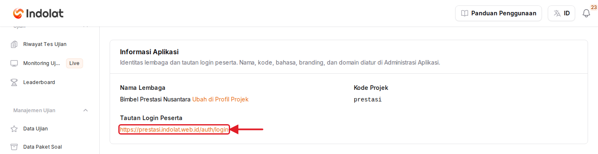
</Frame>

Bagikan tautan ini melalui WhatsApp, email, atau grup kelas. Jika akun peserta dibuat oleh admin, sertakan juga alamat email dan kata sandi awalnya. Alamat tautan mengikuti **Kode Projek**; jika kode projek diganti, tautan lama tidak berlaku lagi. Penjelasan lengkap ada di [Login Peserta](/lainnya/login-peserta).

## 2. Masuk atau membuat akun

Tautan login membuka halaman **Masuk ke CBT** dengan nama lembaga Anda.

<Frame>
  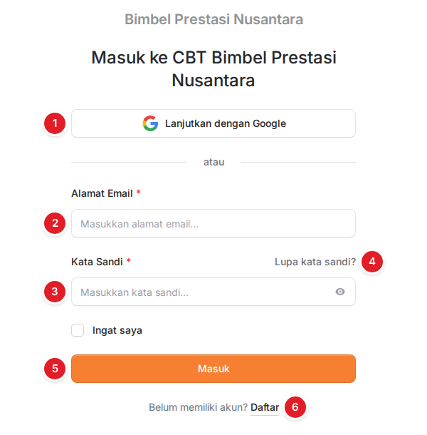
</Frame>

1. **Lanjutkan dengan Google**: masuk dengan akun Google. Tombol ini tampil jika **Autentikasi dengan Google** diaktifkan admin.
2. **Alamat Email**: email akun peserta.
3. **Kata Sandi**: kata sandi akun.
4. **Lupa kata sandi?**: meminta tautan atur ulang kata sandi lewat email.
5. **Masuk**: masuk ke aplikasi.
6. **Daftar**: membuat akun sendiri. Tautan ini hanya tampil jika **Izinkan pendaftaran akun mandiri** diaktifkan admin. Peserta yang mendaftar sendiri harus memasukkan kode verifikasi 6 angka yang dikirim ke emailnya.

Hal yang sering ditanyakan peserta pada tahap ini:

- **Lupa kata sandi.** Peserta mengklik **Lupa kata sandi?**, memasukkan email, lalu mengklik **Kirim Tautan Atur Ulang**. Tautan atur ulang berlaku 60 menit, dan permintaan baru baru dapat dikirim setelah satu jam. Admin juga dapat langsung mengganti kata sandi peserta (lihat [Pertanyaan Umum](/konsep/pertanyaan-umum#akun-dan-login)).

  <Frame>
    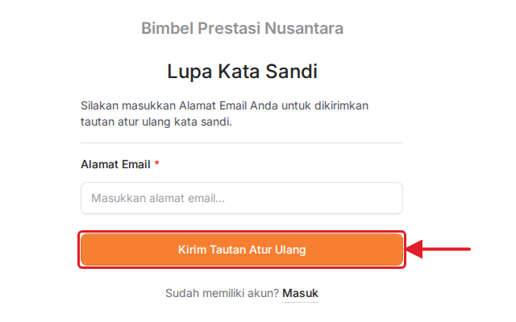
  </Frame>

- **Salah kata sandi berkali-kali.** Setelah 5 kali gagal dalam satu menit, peserta diminta menunggu sebentar sebelum mencoba lagi.
- **Akun yang dinonaktifkan admin** tidak dapat masuk, dan pesan yang muncul sama dengan pesan salah kata sandi.
- **Membuka halaman aplikasi sebelum masuk.** Peserta yang belum masuk, atau yang sesinya sudah berakhir, kadang membuka halaman aplikasi langsung, misalnya dari bookmark `https://prestasi.indolat.web.id/app/dashboard`. Aplikasi mengarahkannya ke halaman login projek dengan pesan **Silakan masuk terlebih dahulu untuk melanjutkan.** Setelah masuk, peserta langsung kembali ke halaman yang tadi dibukanya.

  <Frame>
    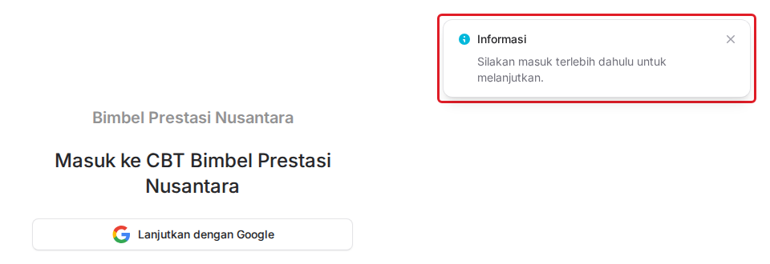
  </Frame>

  Jika halaman dibuka dari alamat utama CBT Indolat (tanpa kode projek di alamatnya), aplikasi memakai projek yang terakhir dibuka di browser tersebut. Jika browser itu belum pernah membuka projek mana pun, peserta diarahkan ke halaman awal untuk memasukkan kode projek. Karena itu, bagikan selalu tautan login yang memuat kode projek Anda.

Langkah pendaftaran akun mandiri dan verifikasi email dijelaskan di [Login Peserta](/lainnya/login-peserta#cara-peserta-mendaftar-dan-masuk).

## 3. Halaman Daftar Tes

Setelah masuk, peserta mendarat di **Daftar Tes**. Peserta yang belum terdaftar di ujian mana pun melihat pesan **Tidak ada tes yang tersedia.** dan tombol **Pendaftaran Tes Baru** (tombol ini hanya tampil jika ada ujian yang pendaftarannya dibuka).

<Frame>
  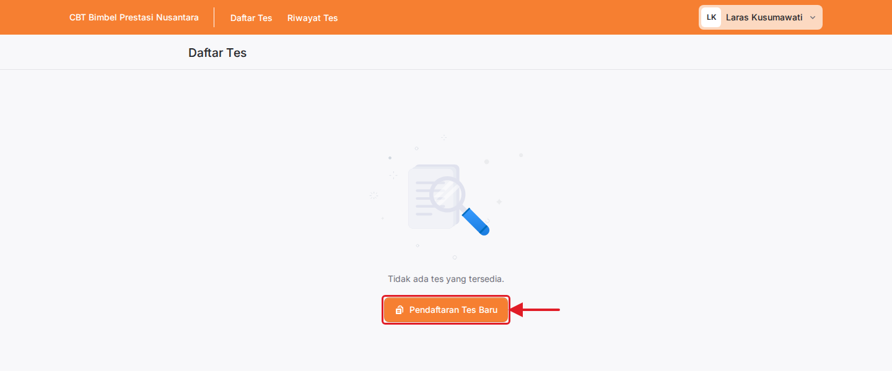
</Frame>

Peserta yang Anda masukkan langsung ke ujian, misalnya lewat [Menambahkan Peserta Ujian](/data-ujian/menambahkan-peserta-ujian), tidak perlu mendaftar lagi: tesnya sudah tampil di halaman ini.

## 4. Mendaftar ujian sendiri

Jika **Apakah Pendaftaran Ujian Dibuka?** aktif pada ujian, peserta dapat mendaftar sendiri.

<Steps>
  <Step title="Pilih tes, lalu klik Selanjutnya">
    <Frame>
      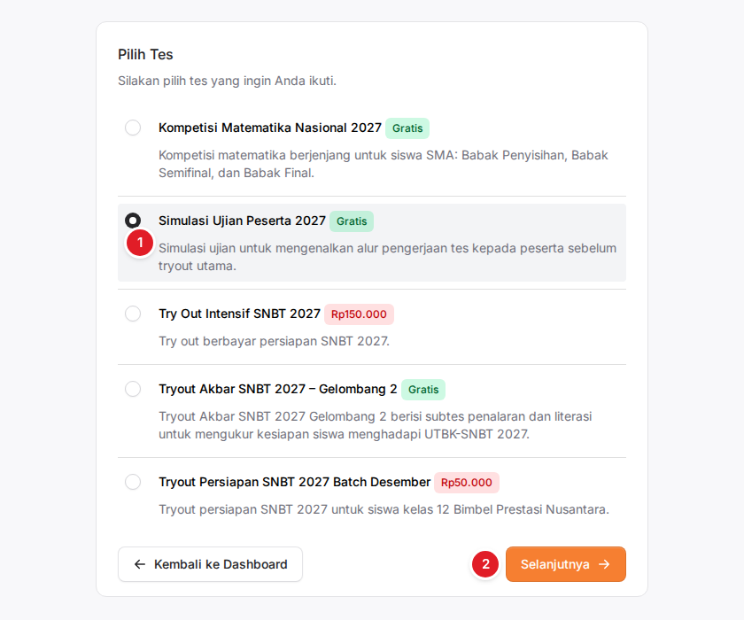
    </Frame>

    1. Pilih ujian. Label **Gratis** atau harga (misalnya **Rp50.000**) menunjukkan biaya ujian.
    2. Klik **Selanjutnya**.
  </Step>
  <Step title="Isi formulir, lalu klik Daftar Tes">
    Jika ujian tidak memakai formulir, peserta melihat pesan **Tidak ada formulir pendaftaran yang diperlukan.** Klik **Daftar Tes**, lalu **Ya, Daftar** pada jendela konfirmasi.

    <Frame>
      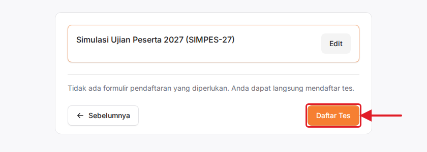
    </Frame>
  </Step>
</Steps>

Untuk ujian dengan formulir, kode voucher, atau pembayaran, peserta mengisi formulir lalu membayar melalui kode QR. Alur dari sisi peserta ada di [Formulir Pendaftaran Peserta](/data-ujian/membuat-formulir-pendaftaran#3-pendaftaran-dari-sisi-peserta); konsep ujian berbayar dijelaskan di [Ujian Berbayar: Alur Pembayaran Peserta dan Saldo](/konsep/ujian-berbayar-dan-saldo).

Setelah terdaftar, tes muncul sebagai kartu di **Daftar Tes**:

<Frame>
  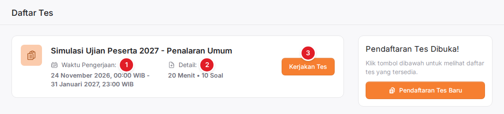
</Frame>

1. **Waktu Pengerjaan**: rentang waktu sesi. Tes hanya dapat dimulai di dalam rentang ini.
2. **Detail**: durasi pengerjaan dan jumlah soal.
3. **Kerjakan Tes**: membuka petunjuk tes.

Tombol pada kartu dapat berbeda sesuai keadaan peserta:

| Tombol | Artinya |
| --- | --- |
| **Kerjakan Tes** | Tes siap dikerjakan. Jika sesi belum dimulai atau sudah lewat, tombol tidak dapat diklik. |
| **Terkunci** | Peserta belum dimasukkan ke sesi ujian, sesi belum memiliki paket soal, tes sebelumnya harus diselesaikan dahulu (tes berurutan), atau tes menunggu pembayaran. |
| **Proses Verifikasi** | Pendaftaran menunggu verifikasi admin. |
| **Bayar Sekarang** atau nominal biaya | Peserta perlu menyelesaikan pembayaran. |

<Tip>
  Jika peserta melaporkan tombol **Terkunci**, periksa dahulu apakah peserta sudah dipasangkan ke sesi ujian. Lihat [Membuat Sesi Ujian](/data-ujian/membuat-sesi-ujian#memasangkan-peserta-ke-sesi-ujian).
</Tip>

## 5. Petunjuk tes

Saat **Kerjakan Tes** diklik, muncul jendela petunjuk berisi deskripsi tes yang Anda tulis, **Jenis Tes**, **Jumlah Soal**, dan **Durasi Pengerjaan**. Peserta mengklik **Kerjakan Tes** sekali lagi untuk melanjutkan, atau **Tutup** untuk kembali.

<Frame>
  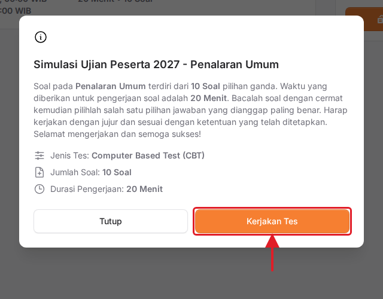
</Frame>

Isi petunjuk diambil dari deskripsi tes ujian. Penanda seperti `{{NAMA_TES}}`, `{{JUMLAH_SOAL}}`, dan `{{DURASI_TES}}` otomatis diganti dengan nama tes, jumlah soal, dan durasi. Lihat [Membuat Tes Ujian](/data-ujian/membuat-tes-ujian).

## 6. Tes Diagnostik Sistem

Sebelum soal tampil, sistem memeriksa kesiapan perangkat peserta. Setiap pemeriksaan yang lolos diberi tanda centang, lalu tombol **Mulai Tes** dapat diklik.

<Frame>
  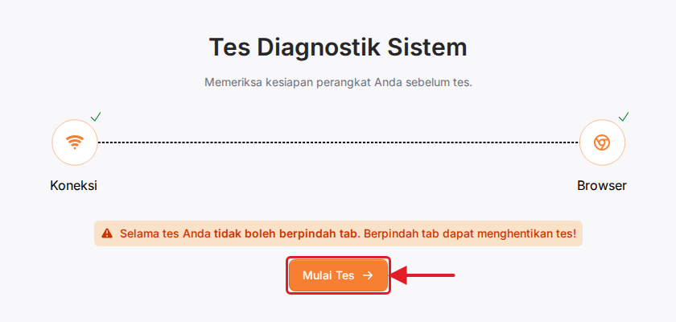
</Frame>

| Pemeriksaan | Yang dicek | Kapan muncul |
| --- | --- | --- |
| **Koneksi** | Server dapat dihubungi dan kuota peserta serentak ujian belum penuh. | Selalu |
| **Browser** | Browser yang didukung: Google Chrome, Chromium, Microsoft Edge, atau Safari, atau aplikasi CBT Indolat. | Selalu |
| **Kamera** | Peserta mengizinkan akses kamera. | Jika **Pengawasan Kamera** aktif |
| **Bagikan Layar** | Peserta membagikan seluruh layar, bukan hanya satu tab. | Jika **Pengawasan Layar (Share Screen)** aktif |
| **Monitor Ganda** | Hanya satu layar yang tersambung. | Jika **Hanya Izinkan Satu Layar** aktif |

Jika **Deteksi Pindah Tab** aktif, halaman ini juga menampilkan peringatan bahwa peserta tidak boleh berpindah tab. Arti setiap pengawasan dijelaskan di [Pengawasan Ujian dan Deteksi Kecurangan](/konsep/pengawasan-dan-kecurangan).

<Warning>
  Waktu pengerjaan mulai berjalan saat peserta mengklik **Mulai Tes**, dan pada saat itu satu kredit ujian terpakai. Jika kredit projek habis, peserta mendapat pesan **Kuota tes tidak mencukupi** dan tidak dapat memulai tes. Lihat [Kredit Ujian, Ujian Standard, dan Ujian Professional](/konsep/kredit-dan-tipe-ujian).
</Warning>

## 7. Mengerjakan soal

Halaman soal terdiri dari area soal di kiri dan panel **Daftar Soal** di kanan.

<Frame>
  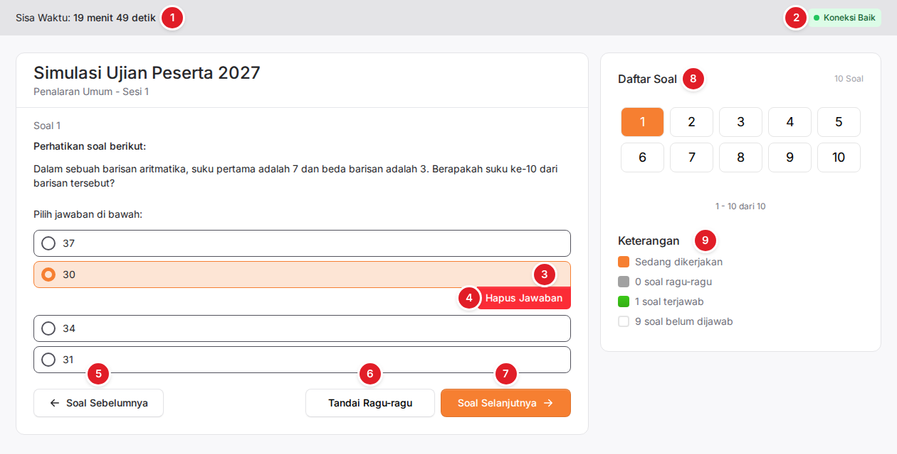
</Frame>

1. **Sisa Waktu**: hitung mundur waktu pengerjaan.
2. **Status koneksi**: **Koneksi Baik**, **Koneksi Lambat**, atau **Koneksi Buruk**.
3. **Pilihan jawaban**: jawaban yang dipilih diberi warna.
4. **Hapus Jawaban**: mengosongkan jawaban soal ini.
5. **Soal Sebelumnya**: kembali ke soal sebelumnya.
6. **Tandai Ragu-ragu**: menandai soal yang ingin diperiksa lagi.
7. **Soal Selanjutnya**: pindah ke soal berikutnya. Pada soal terakhir, tombol ini berganti menjadi **Selesai Tes**.
8. **Daftar Soal**: nomor semua soal. Klik nomor mana pun untuk langsung melompat ke soal itu.
9. **Keterangan**: arti warna nomor soal dan jumlah soal per status.

Warna nomor pada **Daftar Soal** membantu peserta memeriksa pekerjaannya sebelum selesai:

<Frame>
  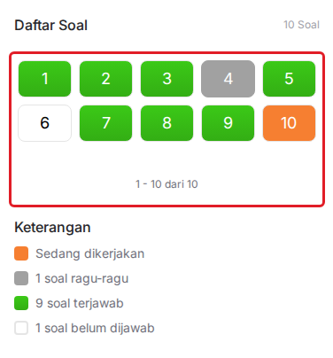
</Frame>

- **Oranye**: soal yang sedang dibuka.
- **Abu-abu**: soal yang ditandai ragu-ragu.
- **Hijau**: soal yang sudah dijawab. Soal **Menjodohkan** baru berwarna hijau setelah semua pasangannya ditempatkan; soal yang baru sebagian dipasangkan tetap dihitung belum dijawab.
- **Putih**: soal yang belum dijawab.

Beberapa perilaku yang perlu Anda ketahui:

- **Jawaban tersimpan otomatis.** Setiap kali peserta memilih atau mengetik jawaban, jawaban langsung dikirim ke server (tampil tanda **Menyimpan jawaban...** sebentar). Peserta tidak perlu menekan tombol simpan.
- **Urutan soal dan pilihan jawaban dapat diacak** jika **Acak Soal** dan **Acak Jawaban (Pilihan Ganda)** diaktifkan pada paket soal, sehingga soal nomor 1 dua peserta bisa berbeda.
- **Waktu dihitung oleh server**, bukan oleh perangkat peserta. Waktu tetap berjalan walaupun browser ditutup atau perangkat mati.
- **Waktu dibatasi oleh akhir sesi.** Jika peserta mulai mengerjakan mendekati akhir sesi, waktunya berakhir bersama sesi, walaupun durasi tes belum habis. Contoh: sesi berakhir pukul 10.00 dan durasi tes 60 menit; peserta yang mulai pukul 09.30 hanya mendapat 30 menit.
- **Tanda ragu-ragu hanya untuk membantu peserta.** Soal yang ditandai ragu-ragu tetapi sudah dijawab tetap dinilai. Tanda ini tersimpan selama peserta tetap masuk di perangkat yang sama.
- **Satu tes dalam satu waktu.** Selama ada tes yang sedang berjalan, peserta yang membuka halaman lain di aplikasi selalu dikembalikan ke halaman soal dengan pesan **Silakan selesaikan tes yang sedang berlangsung.**
- **Tes CAT** (*Computer Adaptive Test*) tidak memiliki tombol **Soal Sebelumnya** dan **Tandai Ragu-ragu**, karena soal berikutnya dipilih berdasarkan jawaban sebelumnya. Lihat [Perbedaan CBT, CAT, dan Esai/Upload File](/konsep/jenis-ujian-cbt-cat-esai).

### Jika koneksi terputus

Indikator koneksi berubah menjadi **Koneksi Buruk** saat perangkat kehilangan internet, lalu kembali menjadi **Koneksi Baik** dengan sendirinya setelah koneksi pulih.

<Frame>
  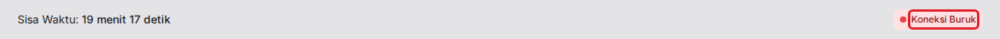
</Frame>

Jawaban yang sudah tersimpan tidak hilang. Jika halaman meminta dimuat ulang, peserta cukup memuat ulang atau masuk kembali; aplikasi langsung membuka tes yang sedang berjalan beserta jawaban sebelumnya. Peserta sebaiknya memeriksa **Daftar Soal** setelah koneksi pulih untuk memastikan jawaban terakhirnya berwarna hijau.

### Jika browser tertutup atau berganti perangkat

Peserta cukup membuka tautan login lagi dan masuk. Aplikasi langsung membawa peserta ke tes yang sedang berjalan, dengan sisa waktu yang sudah berkurang selama browser tertutup.

<Frame>
  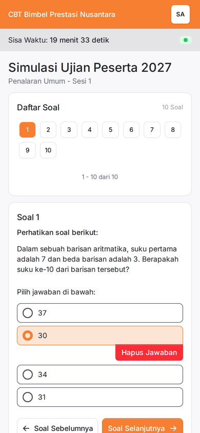
</Frame>

Satu akun hanya dapat aktif di satu perangkat. Jika peserta masuk dari perangkat lain selagi sesi di perangkat lama masih aktif, halaman ujian di perangkat lama menampilkan pesan **Sesi tidak valid. Akun Anda digunakan di perangkat lain.** Jika halaman di perangkat lama dimuat ulang, peserta diarahkan ke halaman login dengan peringatan yang sama.

<Frame>
  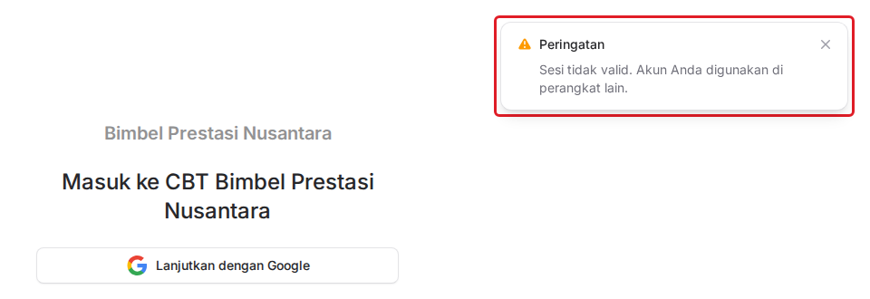
</Frame>

Selama tes berjalan, sistem juga mencatat **Peserta mencoba login dengan device yang berbeda.** di [Monitoring Ujian](/cbt/monitoring-ujian). Catatan ini wajar jika peserta memang berpindah perangkat karena gangguan. Peserta yang keluar dari akun (**Keluar**) lalu masuk lagi, baik di perangkat yang sama maupun di perangkat lain, tidak dicatat.

## 8. Menyelesaikan tes

Pada soal terakhir, peserta mengklik **Selesai Tes**.

<Frame>
  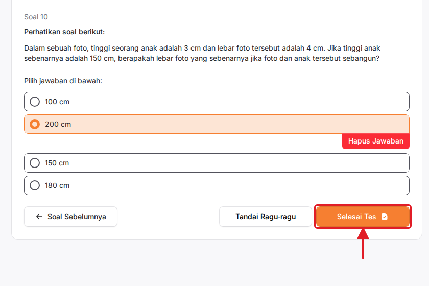
</Frame>

Jendela konfirmasi mengingatkan bahwa setelah tes diakhiri, peserta tidak dapat kembali ke halaman ujian atau mengubah jawaban. Peserta mengklik **Ya, Selesai** untuk mengakhiri, atau **Tidak** untuk kembali memeriksa.

<Frame>
  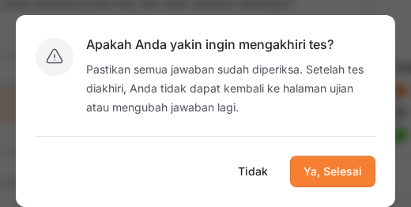
</Frame>

Setelah itu muncul halaman **Tes Selesai** dengan tombol **Kembali ke Daftar Tes**. Tes yang sudah selesai tidak dapat dibuka lagi dari **Daftar Tes** (pada ujian berjenjang, tes itu ditandai **Selesai**), dan hasilnya pindah ke **Riwayat Tes**.

<Frame>
  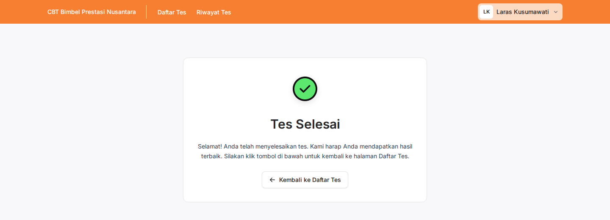
</Frame>

### Jika waktu habis

Saat **Sisa Waktu** mencapai nol, tes diakhiri otomatis. Peserta melihat pemberitahuan **Waktu Habis**, lalu diarahkan ke halaman **Tes Selesai**. Semua jawaban yang sudah tersimpan tetap dinilai; soal yang belum dijawab dihitung sebagai tidak dijawab.

<Frame>
  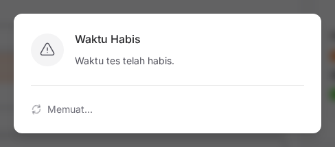
</Frame>

Jika peserta menutup browser dan tidak kembali, sistem tetap mengakhiri tesnya sendiri setelah waktunya habis, sehingga nilainya terhitung dan tes berikutnya (pada ujian berjenjang) terbuka tepat waktu.

Selain itu, tes dapat berakhir atau terhenti karena tindakan admin di [Monitoring Ujian](/cbt/monitoring-ujian): **Hentikan Ujian** mengakhiri tes, sedangkan **Suspend Ujian** menghentikan sementara. Lama penangguhan tidak mengurangi sisa waktu peserta, kecuali sesi ujian berakhir lebih dulu.

## 9. Riwayat Tes dan nilai

Menu **Riwayat Tes** berisi dua bagian: **Skor Akhir** (nilai keseluruhan ujian) dan **Skor Tes Ujian** (nilai setiap tes).

<Frame>
  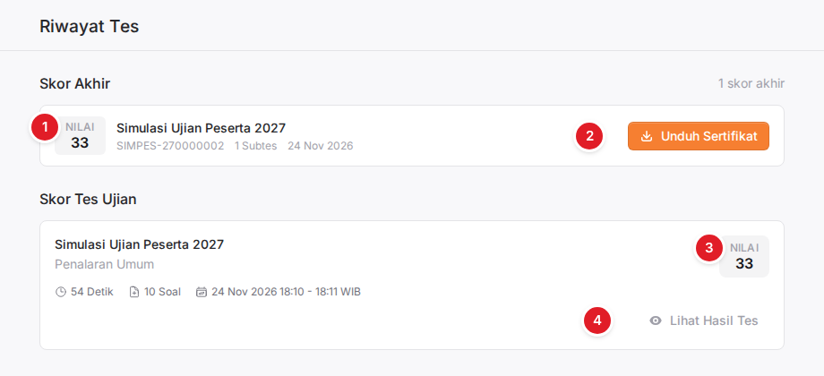
</Frame>

1. **NILAI** pada **Skor Akhir**: nilai akhir ujian, gabungan semua tes.
2. **Unduh Sertifikat**: tampil jika ujian memiliki sertifikat dan peserta memenuhi syaratnya.
3. **NILAI** pada **Skor Tes Ujian**: skor satu tes.
4. **Lihat Hasil Tes**: membuka lembar jawaban.

Apa yang terlihat di halaman ini sepenuhnya Anda tentukan melalui pengaturan berikut:

| Yang dilihat peserta | Pengaturan | Tempat mengatur |
| --- | --- | --- |
| **NILAI** pada **Skor Akhir** | **Apakah Tampilkan Skor Akhir Ujian?** | Tab **Pengaturan Ujian**, lihat [Membuat Ujian](/data-ujian/membuat-ujian#pengaturan-ujian) |
| **NILAI** pada **Skor Tes Ujian** dan di lembar jawaban | **Tampilkan Skor** | Tab **Skor & Hasil** pada tes, lihat [Membuat Tes Ujian](/data-ujian/membuat-tes-ujian#mengatur-skor-dan-hasil) |
| Tombol **Lihat Hasil Tes** (lembar jawaban dan kunci) | **Tampilkan Ringkasan** | Tab **Skor & Hasil** |
| Kotak **Pembahasan Soal** di lembar jawaban | **Tampilkan Pembahasan Per Soal** | Tab **Skor & Hasil** |
| PDF pembahasan di lembar jawaban | **Tampilkan Pembahasan Tes (PDF)** | Tab **Skor & Hasil** |

<Note>
  Pembahasan, baik per soal maupun PDF, hanya dapat dibuka dari lembar jawaban. Jadi pembahasan baru terlihat oleh peserta jika **Tampilkan Ringkasan** juga aktif. Jika semua pengaturan di atas nonaktif, peserta hanya melihat bahwa tesnya sudah selesai, tanpa nilai.
</Note>

Nilai juga belum tampil selama belum dihitung, misalnya tes esai yang belum dinilai admin atau tes IRT yang belum dihitung melalui **Hitung Skor** → **Perhitungan IRT**. Lihat [Cara Perhitungan Metode Penilaian](/konsep/metode-penilaian).

### Lembar jawaban

**Lihat Hasil Tes** membuka **Lembar Jawaban**. Peserta dapat membuka setiap soal dan melihat jawabannya.

<Frame>
  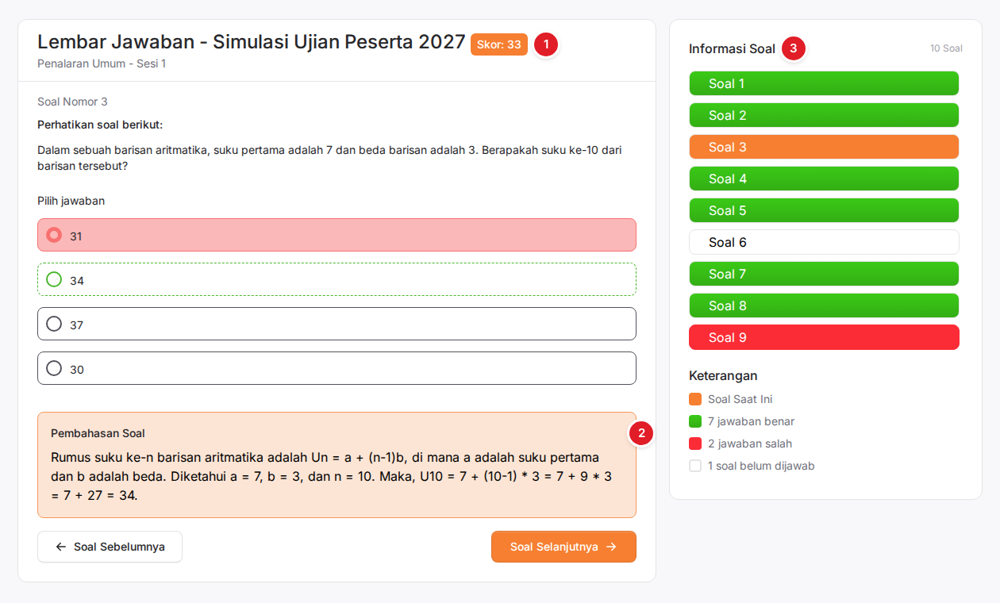
</Frame>

1. **Skor**: skor tes (jika **Tampilkan Skor** aktif).
2. **Pembahasan Soal**: penjelasan jawaban (jika **Tampilkan Pembahasan Per Soal** aktif).
3. **Informasi Soal**: daftar soal berwarna hijau (benar), merah (salah), atau putih (tidak dijawab), beserta jumlahnya.

Jawaban peserta yang salah ditandai merah, sedangkan kunci jawaban ditandai garis putus-putus hijau.

<Warning>
  Lembar jawaban memperlihatkan kunci jawaban. Jika paket soal yang sama masih dikerjakan peserta lain pada sesi berikutnya, aktifkan **Tampilkan Ringkasan** setelah semua sesi selesai.
</Warning>

## 10. Sertifikat

Jika ujian memiliki template sertifikat yang dipublikasikan dan ditampilkan ke peserta, tombol **Unduh Sertifikat** muncul pada bagian **Skor Akhir** setelah peserta memenuhi syarat, misalnya menyelesaikan semua tes dan mencapai skor minimum. Sertifikat diunduh dalam format PDF.

Jika template memerlukan persetujuan admin, peserta melihat **Ajukan Sertifikat**, lalu **Menunggu Persetujuan**, dan baru dapat mengunduh setelah Anda menyetujuinya. Pengaturan lengkapnya ada di [Sertifikat Ujian](/lainnya/sertifikat-ujian#3-alur-sertifikat-di-aplikasi-peserta).

## 11. Peringkat

Saat Anda menayangkan *leaderboard* (papan peringkat) untuk peserta, menu **Peringkat** muncul di bilah atas, dan **Daftar Tes** menampilkan kartu **Papan peringkat sedang tayang** beserta posisi peserta.

<Frame>
  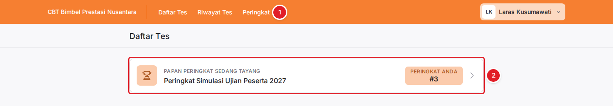
</Frame>

1. Menu **Peringkat**: daftar semua papan peringkat yang sedang tayang.
2. Kartu papan peringkat: langsung membuka papan tersebut.

Halaman papan peringkat menampilkan posisi peserta sendiri, podium tiga besar, dan daftar peringkat berikutnya.

<Frame>
  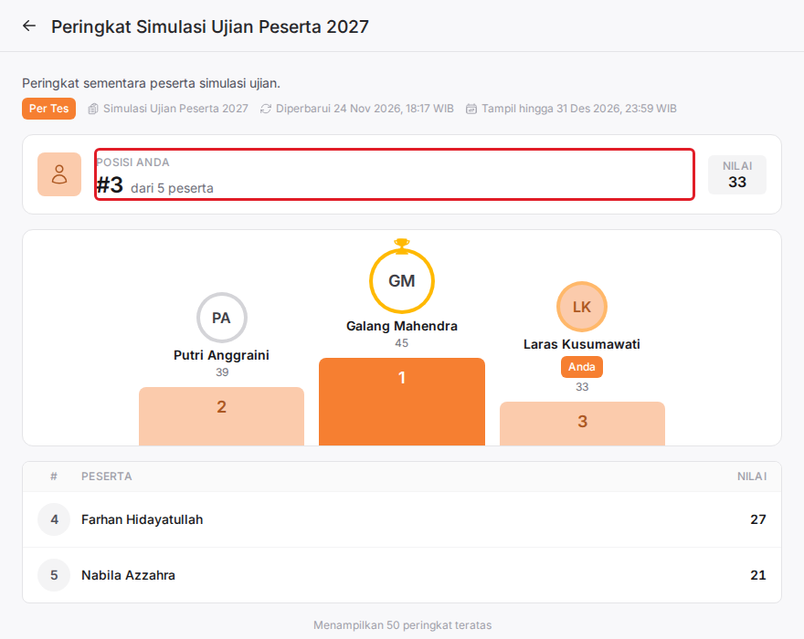
</Frame>

Peringkat tidak berubah secara langsung saat peserta selesai; urutan baru terlihat setelah papan diperbarui (**Generate Ulang**). Anda juga dapat memilih untuk hanya menampilkan urutan tanpa nilai. Lihat [Leaderboard](/cbt/leaderboard).

## 12. Kartu Peserta

Menu nama peserta di pojok kanan atas berisi **Kartu Peserta** dan **Keluar**.

<Frame>
  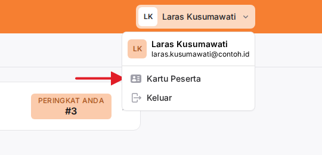
</Frame>

**Kartu Peserta** memuat nama, email, nama ujian, kode peserta beserta kode QR, dan jadwal setiap tes. Peserta dapat mencetaknya dengan tombol **Cetak**, misalnya untuk ujian tatap muka yang diawasi pengawas ruangan. Kartu baru tersedia setelah pendaftaran peserta diverifikasi. Format kode peserta diatur di [Kode Peserta dan Kode Bidang](/data-ujian/kode-peserta).

<Frame>
  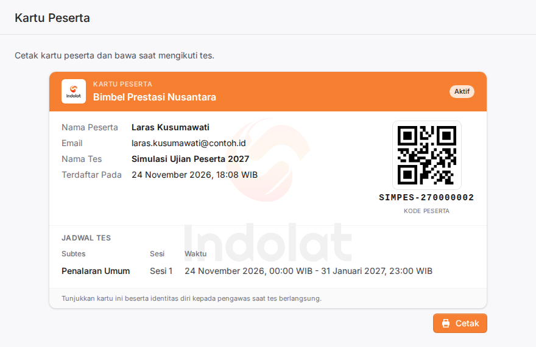
</Frame>

## 13. Mengerjakan dari ponsel

Peserta dapat mengerjakan ujian dari ponsel atau tablet melalui browser yang didukung. Tampilannya menyesuaikan layar: menu **Daftar Tes**, **Riwayat Tes**, dan **Peringkat** pindah ke bilah bawah, dan panel **Daftar Soal** tampil di atas soal.

<Frame>
  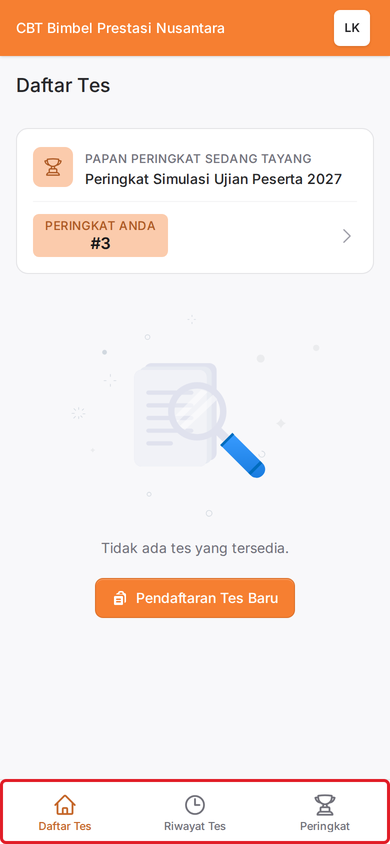
</Frame>

Hal yang perlu diperhatikan untuk ponsel:

- Ujian dengan **Pengawasan Layar (Share Screen)** tidak dapat dikerjakan dari browser ponsel. Peserta diminta memakai aplikasi CBT Indolat.
- Tombol **Lanjutkan dengan Google** tidak tampil di aplikasi CBT Indolat; peserta masuk dengan email dan kata sandi.
- Pastikan baterai cukup dan notifikasi aplikasi lain dimatikan, terutama jika **Deteksi Pindah Tab** aktif, karena berpindah ke aplikasi lain tercatat sebagai pindah tab.

## Langkah berikutnya

<CardGroup cols={2}>
  <Card title="Persiapan Sebelum Hari Ujian" icon="list-check" href="/konsep/persiapan-hari-ujian">
    Daftar periksa admin dari seminggu sebelum ujian sampai setelah ujian selesai.
  </Card>
  <Card title="Pertanyaan Umum (FAQ)" icon="circle-question" href="/konsep/pertanyaan-umum">
    Jawaban singkat untuk pertanyaan yang sering diajukan admin dan peserta.
  </Card>
</CardGroup>
