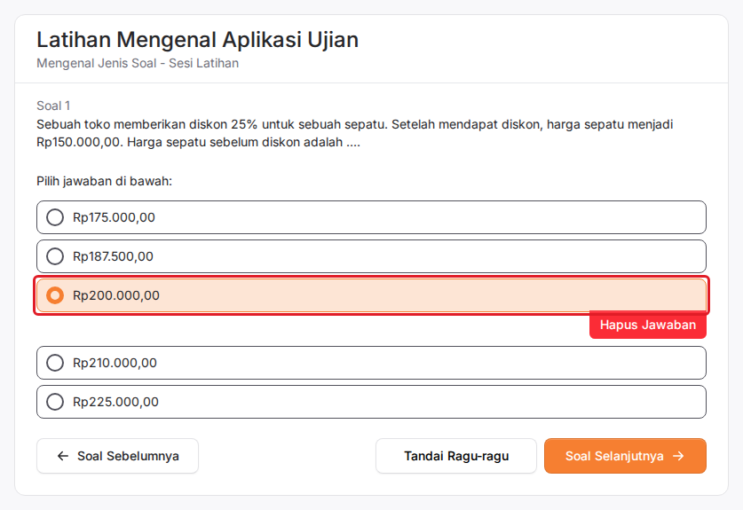
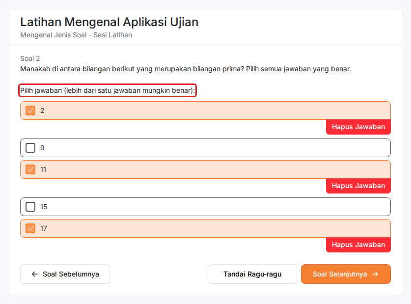
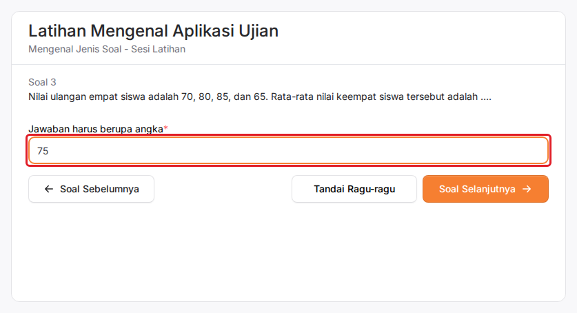
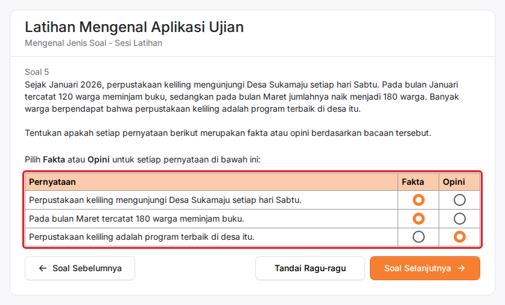
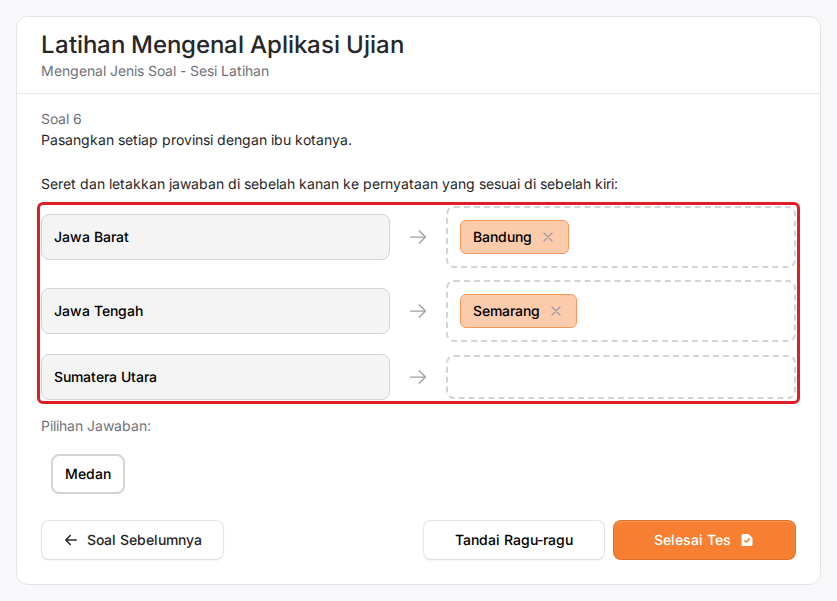
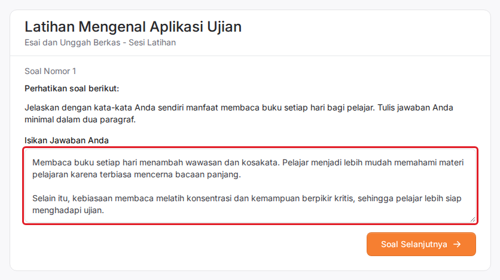
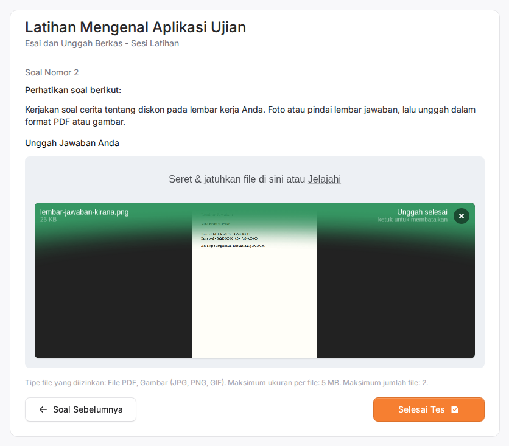
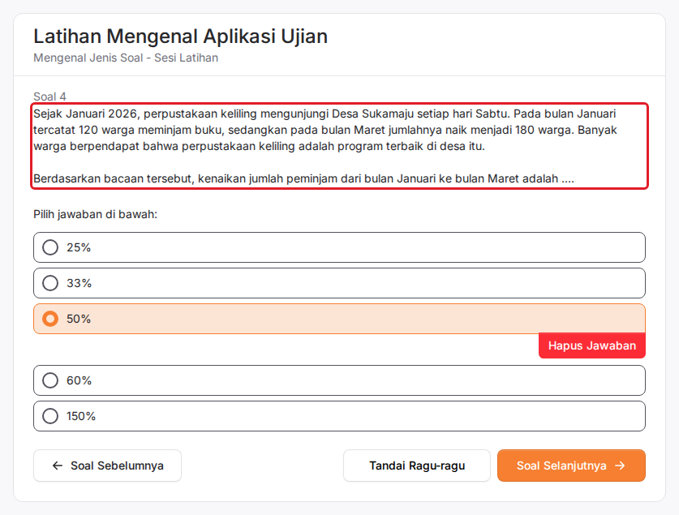

Setiap butir soal di paket soal memiliki **Jenis Soal** yang menentukan cara peserta menjawab. Halaman ini memperlihatkan tampilan setiap jenis soal di aplikasi ujian peserta, memberi contoh penggunaannya, dan menjelaskan kapan jawaban dianggap benar. Cara membuat soalnya dijelaskan di [Membuat Paket Soal](/paket-soal/membuat-paket-soal).

<Info>
  **Lokasi pengaturan:** **Portal** → **Platform Ujian (CBT)** → **Manajemen Ujian** → **Data Paket Soal** → **Ubah** pada paket → **Tambah Soal** → tab **Soal** → **Jenis Soal**. Jenis soal tidak dapat diubah setelah soal disimpan.
</Info>

Semua gambar di halaman ini diambil dari tes latihan **Mengenal Jenis Soal** yang dikerjakan peserta bernama Kirana Maheswari.

## Ringkasan jenis soal

| Jenis Soal | Cara peserta menjawab | Contoh penggunaan | Jenis paket soal |
| --- | --- | --- | --- |
| **Pilihan Ganda** | Memilih satu jawaban, atau beberapa jawaban bila soal memiliki lebih dari satu kunci | Soal hitungan atau pemahaman dengan pilihan A–E | **CBT/CAT** |
| **Jawaban Singkat** | Mengetik angka atau teks pendek | Hasil hitungan, nama kota, satu istilah | **CBT/CAT** |
| **Majemuk Kompleks (Benar/Salah, Fakta/Opini, dll.)** | Memilih satu dari dua label untuk setiap pernyataan | Benar/Salah, Fakta/Opini, Sesuai/Tidak Sesuai | **CBT/CAT** |
| **Menjodohkan (Drag & Drop)** | Menyeret jawaban ke pasangan yang sesuai | Provinsi dan ibu kota, istilah dan artinya | **CBT/CAT** |
| **Jawaban Uraian** | Menulis jawaban panjang di kotak teks | Esai, penjelasan langkah penyelesaian | **Esai/Upload File (Jawaban Manual)** |
| **Unggah File** | Mengunggah berkas jawaban | Foto lembar jawaban, laporan dalam PDF | **Esai/Upload File (Jawaban Manual)** |

Keempat jenis soal pertama dinilai otomatis dan dapat dipakai pada tes CBT maupun CAT. Dua jenis terakhir dinilai manual oleh admin dan hanya dipakai pada tes **Esai / Upload File (Jawaban Manual)**. Perbedaan jenis tes dijelaskan di [Perbedaan CBT, CAT, dan Esai/Upload File](/konsep/jenis-ujian-cbt-cat-esai).

Aturan lengkap kapan setiap jenis soal dianggap benar ada di [Cara Perhitungan Metode Penilaian](/konsep/metode-penilaian#kapan-sebuah-soal-dianggap-benar). Ringkasan pada setiap bagian di bawah hanya untuk memudahkan.

## Pilihan Ganda

Peserta memilih satu jawaban dari beberapa pilihan. Pilihan yang dipilih berwarna oranye, dan tombol **Hapus Jawaban** muncul untuk membatalkan pilihan.

<Frame>
  
</Frame>

**Contoh:** _Sebuah toko memberikan diskon 25% untuk sebuah sepatu. Setelah mendapat diskon, harga sepatu menjadi Rp150.000,00. Harga sepatu sebelum diskon adalah ...._ Kuncinya **Rp200.000,00**.

**Dianggap benar:** jika pilihan peserta sama dengan kunci jawaban.

### Pilihan Ganda dengan lebih dari satu kunci

Jika **Jawaban Lebih dari Satu** diaktifkan pada soal, pilihan berubah menjadi kotak centang dan peserta melihat keterangan **Pilih jawaban (lebih dari satu jawaban mungkin benar)**. Peserta tidak diberi tahu berapa jumlah jawaban yang benar.

<Frame>
  
</Frame>

**Contoh:** _Manakah di antara bilangan berikut yang merupakan bilangan prima? Pilih semua jawaban yang benar._ Kuncinya **2**, **11**, dan **17**.

**Dianggap benar:** jika pilihan peserta persis sama dengan semua kunci. Memilih 2 dan 11 saja (ada kunci yang terlewat), atau memilih 2, 11, 15, dan 17 (ada pilihan tambahan yang salah), dianggap salah.

## Jawaban Singkat

Peserta mengetik jawaban di kotak isian. Ada dua format jawaban yang diatur admin:

- **Angka**: kotak isian bertuliskan **Jawaban harus berupa angka** dan hanya menerima angka, tanda minus di depan, serta satu pemisah desimal (koma atau titik).
- **Teks**: kotak isian bertuliskan **Ketik jawaban singkat Anda** dan menerima teks bebas.

<Frame>
  
</Frame>

**Contoh:** _Nilai ulangan empat siswa adalah 70, 80, 85, dan 65. Rata-rata nilai keempat siswa tersebut adalah ...._ Kuncinya **75** dengan format **Angka**.

**Dianggap benar:** jika jawaban cocok dengan kunci utama atau salah satu jawaban benar lainnya yang diisi admin. Angka dibandingkan berdasarkan nilainya (`75` sama dengan `75,0`), sedangkan teks tidak membedakan huruf besar-kecil.

## Majemuk Kompleks

Soal berisi beberapa pernyataan dalam bentuk tabel. Untuk setiap pernyataan, peserta memilih salah satu dari dua label. Label bawaannya **Benar** dan **Salah**, tetapi admin dapat memakai pasangan lain seperti **Fakta** dan **Opini**, **Sesuai** dan **Tidak Sesuai**, atau label buatan sendiri.

<Frame>
  
</Frame>

**Contoh:** berdasarkan bacaan tentang perpustakaan keliling, tentukan apakah setiap pernyataan merupakan fakta atau opini:

| Pernyataan | Kunci |
| --- | --- |
| Perpustakaan keliling mengunjungi Desa Sukamaju setiap hari Sabtu. | Fakta |
| Pada bulan Maret tercatat 180 warga meminjam buku. | Fakta |
| Perpustakaan keliling adalah program terbaik di desa itu. | Opini |

**Dianggap benar:** jika label yang dipilih cocok untuk **semua** pernyataan. Satu pernyataan keliru membuat seluruh soal dianggap salah pada metode **Perhitungan Skor Soal (Akumulasi Benar/Salah)** dan IRT.

## Menjodohkan

Pernyataan tampil di sisi kiri, kotak kosong di sisi kanan, dan pilihan jawaban di bawahnya dengan urutan acak. Peserta menyeret setiap pilihan ke kotak di sebelah pernyataan yang sesuai. Jawaban yang sudah ditempatkan dapat dilepas lagi dengan ikon silang.

<Frame>
  
</Frame>

**Contoh:** _Pasangkan setiap provinsi dengan ibu kotanya._ Pasangannya **Jawa Barat**–**Bandung**, **Jawa Tengah**–**Semarang**, dan **Sumatera Utara**–**Medan**.

**Dianggap benar:** jika semua pasangan dijodohkan dengan benar. Pada gambar di atas, soal sudah terhitung dijawab, tetapi akan dinilai salah bila peserta tidak menempatkan **Medan**.

## Esai: Jawaban Uraian dan Unggah File

Soal pada paket **Esai/Upload File (Jawaban Manual)** memiliki salah satu dari dua jenis jawaban.

**Jawaban Uraian**: peserta menulis jawaban di kotak teks **Isikan Jawaban Anda**.

<Frame>
  
</Frame>

**Contoh:** _Jelaskan dengan kata-kata Anda sendiri manfaat membaca buku setiap hari bagi pelajar. Tulis jawaban Anda minimal dalam dua paragraf._

**Unggah File**: peserta menyeret berkas ke area **Unggah Jawaban Anda** atau mengklik **Jelajahi**. Di bawah area unggah tampil jenis berkas yang diizinkan, ukuran maksimal per berkas, dan jumlah berkas maksimal sesuai pengaturan admin.

<Frame>
  
</Frame>

**Contoh:** _Kerjakan soal cerita tentang diskon pada lembar kerja Anda. Foto atau pindai lembar jawaban, lalu unggah dalam format PDF atau gambar._ Berkas yang diizinkan: PDF dan gambar, maksimal 5 MB per berkas, paling banyak 2 berkas.

**Dinilai:** kedua jenis jawaban ini tidak memiliki kunci dan tidak dinilai otomatis. Admin membaca jawaban atau membuka berkas peserta, lalu mengisi skor melalui **Beri Skor Manual** (lihat [Riwayat Tes Ujian](/cbt/riwayat-tes-ujian#memberi-skor-manual-untuk-tes-esai)).

## Wacana (bacaan bersama)

**Wacana** adalah bacaan, tabel, gambar, atau rekaman yang dipakai oleh beberapa soal sekaligus. Admin cukup menulis wacana sekali, lalu memilihnya pada setiap soal yang membutuhkannya. Wacana dapat dipasangkan ke jenis soal otomatis mana pun, misalnya pilihan ganda dan majemuk kompleks yang membahas bacaan yang sama.

Bagi peserta, wacana tidak tampil di kotak terpisah. Teks wacana tampil tepat di atas teks soal, seolah-olah menjadi bagian dari soal, dan diulang pada setiap soal yang memakainya. Gambar wacana tampil lebih dulu bersama gambar soal.

<Frame>
  
</Frame>

Pada contoh di atas, soal 4 (pilihan ganda) dan soal 5 (majemuk kompleks, lihat gambar pada bagian [Majemuk Kompleks](#majemuk-kompleks)) memakai wacana yang sama. Judul wacana, **Perpustakaan Keliling Desa Sukamaju**, hanya terlihat oleh admin. Jika **Acak Soal** aktif, soal-soal dengan wacana yang sama tetap berurutan agar peserta tidak perlu mencari bacaannya lagi.

Cara membuat wacana ada di [Membuat Paket Soal](/paket-soal/membuat-paket-soal#mengelola-wacana).

## Kelompok soal

**Kelompok soal** adalah label untuk mengelompokkan soal berdasarkan topik atau subtes di dalam satu paket, misalnya **Penalaran Matematika**, **Literasi Bahasa Indonesia**, dan **Pengetahuan Umum**. Kelompok soal **tidak terlihat oleh peserta** dan tidak menampilkan bacaan apa pun.

Kelompok soal berguna untuk dua hal:

- Merapikan daftar soal bagi admin, karena kelompok setiap soal tampil di kolom **Kelompok Soal** pada **Daftar Soal**.
- Menjaga soal satu topik tetap berdekatan saat **Acak Soal** aktif. Soal-soal dalam satu kelompok diacak di dalam kelompoknya, lalu urutan antarkelompok juga diacak. Misalnya, semua soal kelompok **Penalaran Matematika** tetap berdekatan dan tidak tersebar di antara soal **Literasi Bahasa Indonesia**. Soal yang memakai wacana mengikuti wacananya, bukan kelompoknya.

Untuk bacaan yang harus dibaca peserta, gunakan wacana, bukan kelompok soal. Cara membuat kelompok soal ada di [Membuat Paket Soal](/paket-soal/membuat-paket-soal#mengelola-kelompok-soal).
