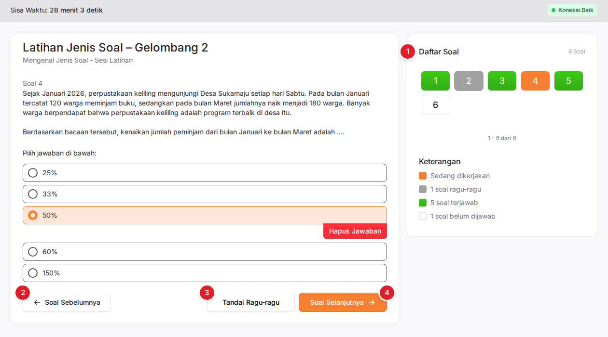
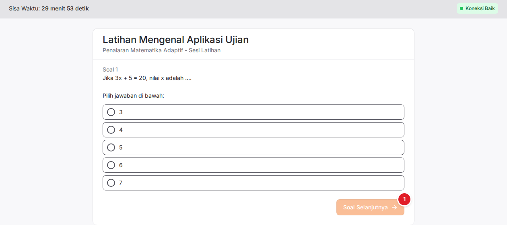
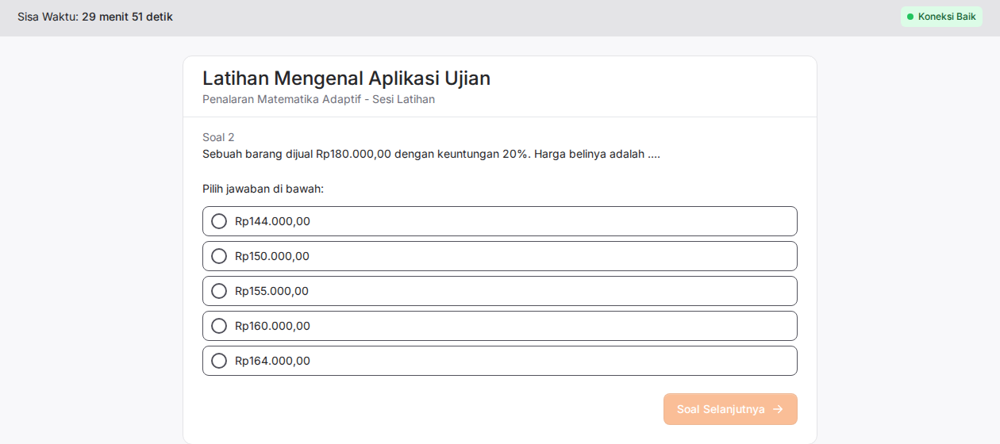
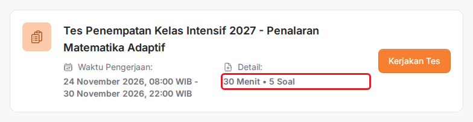
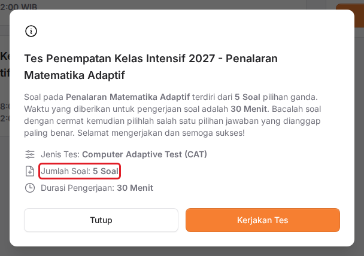
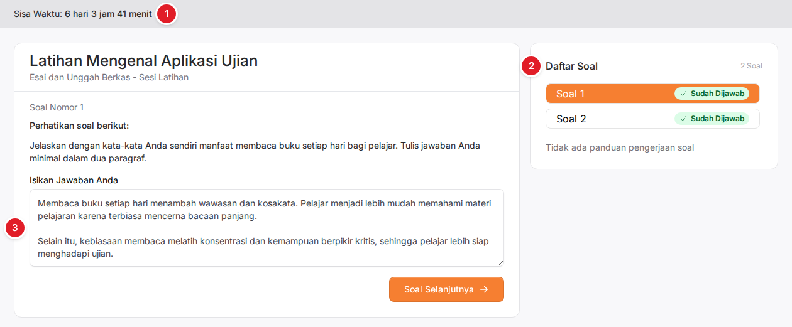

Setiap tes ujian memiliki satu **Jenis Ujian**. Jenis ujian menentukan cara soal ditampilkan kepada peserta, cara peserta menjawab, dan cara jawaban dinilai. Halaman ini menjelaskan perbedaan ketiga jenis ujian dengan bahasa sederhana agar Anda dapat memilih yang paling sesuai.

<Info>
  **Lokasi pengaturan:** **Portal** → **Platform Ujian (CBT)** → **Manajemen Ujian** → **Data Ujian** → **Detail** pada ujian → **Daftar Tes Ujian** → **Tambah Tes Ujian** → **Jenis Ujian**. Langkah lengkapnya ada di [Membuat Tes Ujian](/data-ujian/membuat-tes-ujian).
</Info>

Ketiga jenis ujian tersebut adalah:

- **Computer Based Test (CBT)**: ujian berbasis komputer biasa. Semua peserta mendapat seluruh soal dari paket soal, dan peserta bebas berpindah antarsoal.
- **Computer Adaptive Test (CAT)**: ujian adaptif. Soal ditampilkan satu per satu, dan soal berikutnya dipilih berdasarkan benar atau salahnya jawaban sebelumnya.
- **Esai / Upload File (Jawaban Manual)**: peserta menulis jawaban uraian atau mengunggah berkas, lalu admin menilainya secara manual.

Jenis ujian dipilih per tes, bukan per ujian. Satu ujian dapat berisi tes CBT dan tes esai sekaligus. Penjelasan hubungan ujian dan tes ada di [Struktur Ujian](/konsep/struktur-ujian).

## Tabel perbandingan

| | **CBT** | **CAT** | **Esai / Upload File** |
| --- | --- | --- | --- |
| Cara soal muncul | Semua soal paket, dengan urutan tetap atau diacak per peserta | Satu per satu; soal berikutnya bergantung pada jawaban sebelumnya | Semua soal paket |
| Pindah antarsoal | Bebas, termasuk kembali ke soal sebelumnya | Hanya maju; soal yang sudah dilewati tidak dapat dibuka lagi | Bebas |
| **Daftar Soal** dan **Tandai Ragu-ragu** | Ada | Tidak ada | **Daftar Soal** ada, tanpa ragu-ragu |
| Jumlah soal yang dikerjakan | Semua soal paket | Semua soal paket, atau sebanyak **Jumlah Soal yang Dikerjakan (CAT)** jika diisi admin; urutannya menyesuaikan jawaban, dan tes berakhir lebih awal jika waktu habis | Semua soal paket |
| Batas waktu | **Durasi Pengerjaan (menit)** tes, paling lambat sampai sesi berakhir | Sama seperti CBT | Tanpa durasi; dapat dikerjakan sampai sesi berakhir |
| Jenis paket soal | **CBT/CAT** | **CBT/CAT**, dan setiap soal wajib memiliki **Tingkat Kesulitan** | **Esai/Upload File (Jawaban Manual)** |
| Jenis soal | Pilihan Ganda, Jawaban Singkat, Majemuk Kompleks, Menjodohkan | Sama seperti CBT | Jawaban Uraian, Unggah File |
| Metode penilaian | Enam metode otomatis (lihat di bawah) | Hanya **Perhitungan Skor Soal (Akumulasi Benar/Salah)** dengan bobot **Skor CAT** | Hanya **Penilaian Manual** |
| Kapan skor keluar | Saat peserta selesai (IRT: setelah admin menjalankan perhitungan) | Saat peserta selesai | Setelah admin memberi skor |
| Tipe ujian dan paket | **Ujian Standard** dan **Ujian Professional**, semua paket | Hanya **Ujian Professional (Paket Berbayar)** pada projek berpaket **Rutin** atau **Intensif** | **Ujian Standard** dan **Ujian Professional**, semua paket |

Tampilan setiap jenis soal bagi peserta dijelaskan di [Jenis Soal dan Tampilannya bagi Peserta](/konsep/jenis-soal).

## Computer Based Test (CBT)

CBT adalah ujian berbasis komputer yang paling umum, mirip lembar soal kertas yang dipindahkan ke layar. Semua peserta pada sesi yang sama mendapat soal dari paket soal yang sama. Jika **Acak Soal** atau **Acak Jawaban (Pilihan Ganda)** pada paket soal aktif, urutan soal atau urutan pilihan jawaban diacak untuk setiap peserta, tetapi isi soalnya tetap sama.

### Pengalaman peserta

<Frame>
  
</Frame>

1. **Daftar Soal**: nomor semua soal. Peserta dapat langsung melompat ke nomor mana pun. Warna nomor menunjukkan status: oranye untuk soal yang sedang dibuka, hijau untuk soal yang sudah dijawab, abu-abu untuk soal yang ditandai ragu-ragu, dan putih untuk soal yang belum dijawab. Soal **Menjodohkan** baru dihitung terjawab (hijau) setelah semua pasangannya ditempatkan; pada gambar, soal 6 masih putih karena baru sebagian pasangan yang ditempatkan. Ringkasan jumlahnya tampil di bagian **Keterangan**.
2. **Soal Sebelumnya**: kembali ke soal sebelumnya untuk memeriksa atau mengubah jawaban.
3. **Tandai Ragu-ragu**: menandai soal yang ingin diperiksa lagi nanti. Tanda ini hanya pengingat bagi peserta dan tidak memengaruhi nilai.
4. **Soal Selanjutnya**: membuka soal berikutnya. Pada soal terakhir, tombol ini berganti menjadi **Selesai Tes**.

Waktu pengerjaan dihitung mundur pada **Sisa Waktu** di bagian atas layar.

### Metode penilaian

Tes CBT dapat memakai semua metode penilaian otomatis:

- **Perhitungan Skor Soal (Akumulasi Benar/Salah)**
- **Perhitungan Skor Jawaban (Akumulasi Skor Jawaban)**
- **Psikotes (Pengelompokan Jawaban)**
- **IRT (Referensi UTBK 0-1000)**, **IRT TKA SMA/SMK (200-800)**, dan **IRT TKA SD/SMP (0-100)**

Rumus dan contoh setiap metode ada di [Cara Perhitungan Metode Penilaian](/konsep/metode-penilaian).

## Computer Adaptive Test (CAT)

CAT adalah ujian yang **menyesuaikan diri dengan peserta**. Bayangkan seorang guru les yang memberi soal satu per satu secara lisan: jika muridnya menjawab benar, guru memberi soal yang lebih sulit; jika salah, guru memberi soal yang lebih mudah. CAT bekerja dengan cara yang sama, sehingga dua peserta pada tes yang sama dapat melihat soal dalam urutan yang berbeda.

### Pengalaman peserta

<Frame>
  
</Frame>

Dibandingkan CBT, tampilan CAT lebih sederhana:

- Tidak ada **Daftar Soal**, tombol **Soal Sebelumnya**, maupun **Tandai Ragu-ragu**. Soal yang sudah dilewati tidak dapat dibuka lagi.
- Tombol **Soal Selanjutnya** (nomor 1 pada gambar) baru aktif setelah peserta menjawab soal yang sedang tampil. Peserta tidak dapat melewati soal tanpa menjawab.
- Tombol **Selesai Tes** baru muncul pada soal terakhir, yaitu soal terakhir paket soal atau soal ke-*N* jika admin membatasi jumlah soal. Jika waktu habis lebih dulu, tes berakhir otomatis.

Setelah peserta menjawab benar soal pertama (tingkat **Sedang**), sistem memberikan soal tingkat **Sulit**:

<Frame>
  
</Frame>

### Cara sistem memilih soal

Setiap soal pada paket soal CAT memiliki **Tingkat Kesulitan**, dari yang paling mudah: **Sangat Mudah**, **Mudah**, **Sedang**, **Sulit**, dan **Sangat Sulit**. Tingkat ini diisi pada tab **Penilaian** di formulir soal (lihat [Membuat Paket Soal](/paket-soal/membuat-paket-soal)).

1. **Soal pertama** diambil dari tingkat kesulitan yang paling dekat dengan rata-rata tingkat kesulitan seluruh soal di paket. Untuk paket yang soalnya tersebar merata dari Sangat Mudah sampai Sangat Sulit, soal pertama bertingkat **Sedang**.
2. **Jika jawaban benar**, sistem mencari soal yang belum ditampilkan mulai dari satu tingkat lebih sulit, lalu tingkat yang lebih sulit lagi. Jika tidak ada, sistem mencari ke tingkat yang lebih mudah, dan terakhir ke tingkat yang sama.
3. **Jika jawaban salah**, urutannya dibalik: mulai dari satu tingkat lebih mudah, lalu lebih mudah lagi, kemudian tingkat yang lebih sulit, dan terakhir tingkat yang sama.
4. Jika **Acak Soal** pada paket soal aktif, soal dipilih secara acak di antara soal-soal pada tingkat yang dituju. Jika tidak aktif, soal diambil sesuai urutan di paket.

Contoh perjalanan seorang peserta pada paket berisi 10 soal (dua soal untuk setiap tingkat):

| Soal ke- | Tingkat kesulitan | Jawaban peserta | Soal berikutnya dicari mulai dari |
| --- | --- | --- | --- |
| 1 | Sedang | Benar | Sulit |
| 2 | Sulit | Salah | Sedang |
| 3 | Sedang | Salah | Mudah |
| 4 | Mudah | Salah | Sangat Mudah |
| 5 | Sangat Mudah | Salah | Mudah, karena tidak ada tingkat yang lebih mudah dari Sangat Mudah |

### Berapa soal yang dikerjakan

Secara bawaan, tes CAT di CBT Indolat menampilkan **semua soal** dalam paket soal, satu per satu. Yang menyesuaikan dengan peserta adalah **urutan** soal, bukan jumlahnya.

Admin dapat membatasi jumlah soal melalui pengaturan **Jumlah Soal yang Dikerjakan (CAT)** pada tes (lihat [Membuat Tes Ujian](/data-ujian/membuat-tes-ujian#jumlah-soal-tes-cat)). Misalnya, paket soal berisi 10 soal dan batasnya diisi **5**: setiap peserta hanya mengerjakan 5 soal, dan soal mana yang muncul tetap bergantung pada jawaban sebelumnya. Bayangkan guru les tadi berhenti bertanya setelah lima pertanyaan, walaupun masih punya soal cadangan.

Tes CAT berakhir pada kejadian mana pun yang terjadi lebih dulu:

- peserta sudah menjawab sebanyak batas jumlah soal lalu menekan **Selesai Tes**,
- peserta sudah menjawab semua soal paket soal (jika batas dikosongkan atau lebih besar dari jumlah soal paket), atau
- waktu pengerjaan habis. Soal yang belum sempat ditampilkan tidak ikut dihitung.

Jumlah soal yang dilihat peserta mengikuti batas ini. Kartu tes di dashboard peserta menampilkan, misalnya, **30 Menit • 5 Soal**:

<Frame>
  
</Frame>

Jendela petunjuk yang muncul saat peserta mengklik **Kerjakan Tes** juga menampilkan **Jumlah Soal: 5 Soal**, dan penanda `{{JUMLAH_SOAL}}` pada instruksi tes berisi angka yang sama.

<Frame>
  
</Frame>

### Syarat dan penilaian

- CAT hanya dapat dipilih jika ujian bertipe **Ujian Professional (Paket Berbayar)** **dan** paket langganan projek mencakup fitur **Computer Adaptive Test (CAT)**, yaitu paket **Rutin** dan **Intensif**. Jika salah satu syarat tidak terpenuhi, pilihan CAT berlabel **(Fitur tidak aktif)** dan tidak dapat dipilih. Tes CAT yang sudah tersimpan tetap berjalan walaupun paket projek kemudian tidak lagi mencakup CAT. Rinciannya ada di [Membuat Tes Ujian](/data-ujian/membuat-tes-ujian#jenis-ujian).
- **Setiap soal** pada paket soal yang dipakai sesi wajib memiliki **Tingkat Kesulitan**. Jika ada soal tanpa tingkat kesulitan, sesi tidak dapat dibuat atau diubah (pesan **Gagal Membuat Sesi Ujian** atau **Gagal Mengubah Sesi Ujian**), dan tes CBT yang sudah memiliki sesi tidak dapat diubah menjadi CAT (pesan **Gagal Menyimpan Tes Ujian**).
- Metode penilaian CAT hanya **Perhitungan Skor Soal (Akumulasi Benar/Salah)**, memakai bobot **Skor Benar** dan **Skor Salah** pada bagian **Skor CAT** di tab **Penilaian** setiap soal. Bagian **Skor CBT** tidak dipakai.
- Tingkat kesulitan hanya menentukan urutan soal, bukan besar nilainya. Jika soal sulit ingin bernilai lebih tinggi, beri **Skor Benar** yang lebih besar pada soal tersebut.

## Esai / Upload File (Jawaban Manual)

Jenis ini dipakai untuk jawaban yang tidak dapat dinilai otomatis, seperti karangan, uraian langkah penyelesaian, atau tugas berupa berkas. Peserta menulis jawaban langsung di aplikasi atau mengunggah berkas, misalnya foto lembar jawaban atau dokumen PDF.

### Pengalaman peserta

<Frame>
  
</Frame>

1. **Sisa Waktu**: tes esai tidak memiliki durasi pengerjaan. Waktu dihitung sampai sesi berakhir, sehingga dapat berupa hitungan hari, misalnya **6 hari 3 jam 41 menit**.
2. **Daftar Soal**: semua soal beserta statusnya, **Sudah Dijawab** atau **Belum Dijawab**. Panduan pengerjaan dari admin, jika ada, tampil di bawahnya.
3. Kolom jawaban: kotak teks untuk soal **Jawaban Uraian**, atau area unggah berkas untuk soal **Unggah File**.

### Penilaian

Tes esai hanya memakai **Penilaian Manual**. Setelah peserta selesai, admin membaca jawaban dan mengisi skor melalui **Riwayat Tes Ujian** (lihat [Riwayat Tes Ujian](/cbt/riwayat-tes-ujian#memberi-skor-manual-untuk-tes-esai)). Selama belum dinilai, tes ini belum memiliki skor dan tidak ikut dihitung dalam nilai akhir ujian. Tab **Skor & Hasil** dan **Pengawasan** juga tidak tersedia untuk tes esai.

## Kapan memilih yang mana

| Kebutuhan | Pilihan yang disarankan |
| --- | --- |
| Tryout UTBK-SNBT, ulangan harian, ujian sekolah, atau olimpiade dengan soal pilihan ganda | **CBT** dengan **Perhitungan Skor Soal (Akumulasi Benar/Salah)**, atau salah satu metode **IRT** bila ingin skor berskala UTBK atau TKA |
| Angket, survei kepuasan, atau tes kepribadian tanpa jawaban benar-salah | **CBT** dengan **Perhitungan Skor Jawaban (Akumulasi Skor Jawaban)** atau **Psikotes (Pengelompokan Jawaban)** |
| Tes penempatan kelas atau seleksi yang ingin menyesuaikan soal dengan kemampuan setiap peserta, dan bank soal sudah diberi tingkat kesulitan | **CAT** (memerlukan **Ujian Professional** dan paket **Rutin** atau **Intensif**) |
| Peserta perlu bebas kembali ke soal sebelumnya dan menandai soal ragu-ragu | **CBT** |
| Karangan, uraian langkah penyelesaian, laporan praktikum, atau tugas berupa berkas | **Esai / Upload File (Jawaban Manual)** |
| Tryout yang berisi pilihan ganda dan esai | Satu ujian dengan dua tes: tes **CBT** dan tes **Esai / Upload File (Jawaban Manual)**, masing-masing dengan paket soalnya sendiri |

<Tip>
  Jika ragu, mulailah dengan **CBT** dan **Perhitungan Skor Soal (Akumulasi Benar/Salah)**. Jenis ini paling mudah dipahami peserta dan tersedia pada semua tipe ujian.
</Tip>

<Note>
  Setelah tes dibuat, **Jenis Ujian** tidak dapat diubah dari esai ke CBT/CAT atau sebaliknya. Perpindahan antara CBT dan CAT masih dapat dilakukan selama belum ada peserta yang memulai tes. Lihat [Membuat Tes Ujian](/data-ujian/membuat-tes-ujian#jenis-ujian).
</Note>
