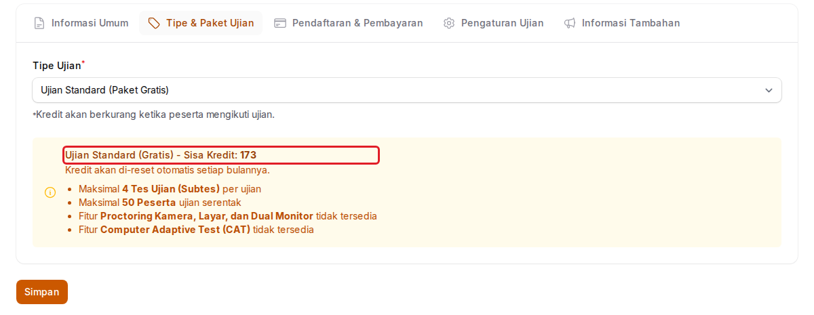
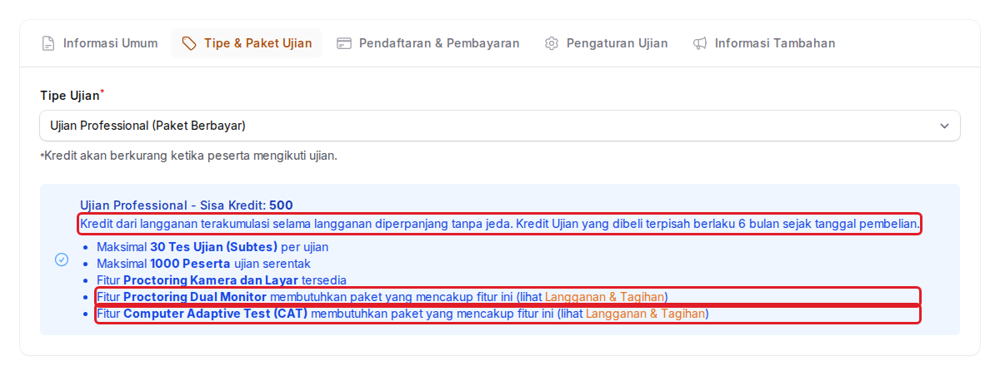
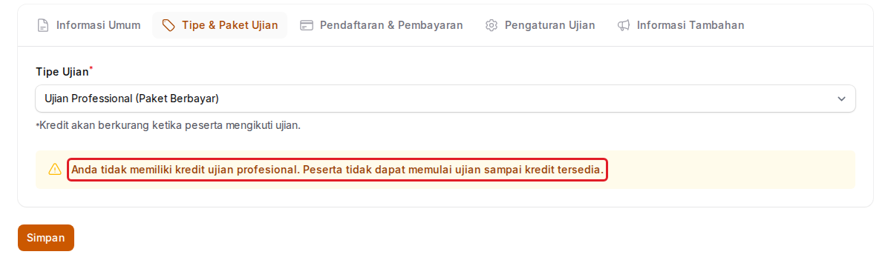
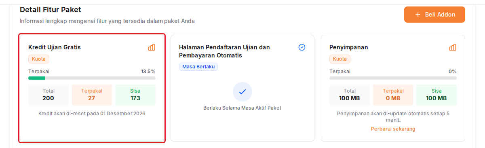

Setiap kali peserta mengerjakan tes, projek Anda memakai **kredit ujian**. Halaman ini menjelaskan apa itu kredit, kapan kredit berkurang, dari mana kredit berasal, dan bagaimana pilihan **Ujian Standard** atau **Ujian Professional** menentukan kredit mana yang dipakai serta fitur apa yang tersedia. Di akhir halaman ada contoh perhitungan untuk sebuah tryout.

<Info>
  **Tempat melihat sisa kredit:**

  - Per ujian: **Portal** → **Platform Ujian (CBT)** → **Manajemen Ujian** → **Data Ujian** → **Detail** pada ujian → tab **Tipe & Paket Ujian**.
  - Seluruh projek: **Portal** → **Administrasi Aplikasi** → **Keuangan** → **Langganan & Tagihan** → bagian **Detail Fitur Paket**.

  Langkah membeli paket, kredit, dan add-on ada di [Langganan & Tagihan](/administrasi/langganan-dan-tagihan).
</Info>

## Apa itu kredit ujian

Bayangkan kredit ujian sebagai **tiket masuk tes**. Satu tiket dipakai ketika satu peserta mulai mengerjakan satu tes. Jika sebuah ujian berisi tiga tes, misalnya **Penalaran Matematika**, **Literasi Bahasa Indonesia**, dan **Pengetahuan Kuantitatif**, seorang peserta yang mengerjakan ketiganya memakai tiga kredit.

Rumusnya:

```text
Kredit terpakai = jumlah peserta × jumlah tes yang benar-benar mereka mulai
```

### Kapan kredit terpakai

Kredit dipotong tepat saat peserta menekan **Mulai Tes** setelah pemeriksaan perangkat (atau saat tes esai dibuka), bukan saat peserta didaftarkan.

| Kejadian | Kredit ujian |
| --- | --- |
| Admin membuat ujian, menambahkan tes, atau mendaftarkan peserta | Tidak terpakai |
| Peserta mendaftar sendiri lewat formulir pendaftaran | Tidak terpakai |
| Peserta menekan **Mulai Tes** pada satu tes CBT atau CAT, atau membuka tes **Esai / Upload File** | **1 kredit** |
| Peserta melanjutkan tes yang sudah dimulai, misalnya setelah memuat ulang halaman, koneksi terputus, atau pindah perangkat | Tidak terpakai lagi |
| Admin melakukan **Reset Ujian** pada tes peserta, lalu peserta mengerjakan ulang | **1 kredit** lagi |
| Peserta terdaftar tetapi tidak pernah memulai tes | Tidak terpakai |

<Note>
  Jika tes memakai **Pengawasan Kamera** atau **Pengawasan Layar (Share Screen)**, setiap kali peserta memulai tes juga terpakai satu kredit pengawasan untuk setiap jenis yang aktif. Kredit pengawasan dibeli terpisah sebagai add-on, lihat [Pengawasan Ujian dan Deteksi Kecurangan](/konsep/pengawasan-dan-kecurangan).
</Note>

## Dua jenis kredit

Projek memiliki dua "dompet" kredit yang terpisah:

| | **Kredit Ujian Gratis** | **Kredit Ujian Profesional** |
| --- | --- | --- |
| Asal | Diberikan setiap bulan oleh semua paket, termasuk paket **Standard** yang gratis | Paket berlangganan (**Esensial**, **Rutin**, **Intensif**) atau pembelian **Kredit Ujian** |
| Jumlah | 200 kredit per bulan (50 kredit per bulan pada paket **Standard** selama profil belum dilengkapi) | Sesuai paket atau jumlah yang dibeli |
| Kapan bertambah | Diisi ulang setiap tanggal 1 | Kredit paket ditambahkan setiap bulan sesuai tanggal mulai langganan; kredit yang dibeli langsung masuk setelah pembayaran terverifikasi |
| Sisa bulan lalu | Hangus, kembali ke jatah penuh | Kredit paket terus terakumulasi selama langganan diperpanjang tanpa putus; kredit yang dibeli berlaku 6 bulan sejak pembelian |
| Dipakai oleh | **Ujian Standard** | **Ujian Professional**, dan **Ujian Standard** ketika kredit gratis habis |

### Kuota gratis bulanan

Projek baru langsung memakai paket **Standard** dan mendapat **50 kredit gratis** per bulan. Setelah pemilik projek menyelesaikan wizard **Lengkapi Profil**, jatahnya naik menjadi **200 kredit** per bulan (lihat [Mengenal Portal dan Modul](/memulai/mengenal-portal-dan-modul#melengkapi-profil)). Paket berbayar selalu mendapat 200 kredit gratis per bulan, di samping kredit profesionalnya.

Kredit gratis diisi ulang setiap tanggal 1. Kredit yang tidak terpakai bulan lalu tidak dibawa ke bulan berikutnya; sisa kembali menjadi jatah penuh. Tanggal pengisian berikutnya tertulis di kartu **Kredit Ujian Gratis**.

### Urutan pemakaian

- **Ujian Standard** memakai kredit gratis lebih dulu. Jika kredit gratis habis dan projek masih memiliki kredit profesional, sistem otomatis memakai kredit profesional.
- **Ujian Professional** hanya memakai kredit profesional. Kredit gratis tidak dapat dipakai untuk ujian ini.
- Di dalam kredit profesional, kredit dari paket berlangganan dipakai lebih dulu, lalu kredit hasil pembelian, dimulai dari yang paling cepat kedaluwarsa.

## Ujian Standard dan Ujian Professional

**Tipe Ujian** dipilih pada setiap ujian, di formulir **Tambah Ujian** atau tab **Tipe & Paket Ujian** (lihat [Membuat Ujian](/data-ujian/membuat-ujian)). Tipe ini menentukan dompet kredit yang dipakai dan batas fitur ujian tersebut. Satu projek boleh memiliki ujian dengan tipe yang berbeda-beda.

| | **Ujian Standard (Paket Gratis)** | **Ujian Professional (Paket Berbayar)** |
| --- | --- | --- |
| Kredit yang dipakai | Kredit gratis, lalu kredit profesional bila kredit gratis habis | Kredit profesional |
| Tes ujian (subtes) per ujian | Maksimal 4 | Maksimal 30 |
| Peserta yang mengerjakan tes bersamaan | Maksimal 50 per ujian | Maksimal 1.000 per ujian |
| Computer Adaptive Test (CAT) | Tidak tersedia | Tersedia jika paket projek mencakup fitur **Computer Adaptive Test (CAT)**: paket **Rutin** dan **Intensif** |
| **Hanya Izinkan Satu Layar** | Tidak tersedia | Tersedia jika paket projek mencakup fitur **Proctoring Dual Monitor**: paket **Esensial**, **Rutin**, dan **Intensif** |
| **Pengawasan Kamera**, **Pengawasan Layar (Share Screen)** | Tidak tersedia | Tersedia, dengan kredit add-on **Proctoring Kamera** atau **Proctoring Layar** |
| **Deteksi Pindah Tab** | Tersedia | Tersedia |
| Metode penilaian, termasuk IRT | Semua tersedia untuk tes CBT | Semua tersedia untuk tes CBT |

Jadi, untuk CAT dan **Hanya Izinkan Satu Layar** ada dua syarat yang harus dipenuhi sekaligus: ujiannya bertipe **Ujian Professional**, dan paket langganan projek mencakup fiturnya. Jika salah satu syarat tidak terpenuhi, pilihan tersebut berlabel **(Fitur tidak aktif)** pada formulir tes dan tidak dapat dipilih. Pengaturan yang sudah tersimpan sebelum paket berubah tetap berlaku. Rinciannya ada di [Membuat Tes Ujian](/data-ujian/membuat-tes-ujian#jenis-ujian).

Kotak informasi di bawah pilihan **Tipe Ujian** menampilkan batas tersebut beserta sisa kredit yang relevan.

<Frame>
  
</Frame>

Jika projek memiliki kredit profesional dan Anda memilih **Ujian Professional (Paket Berbayar)**, kotak informasinya menampilkan sisa kredit profesional dan aturan masa berlakunya: **Kredit dari langganan terakumulasi selama langganan diperpanjang tanpa jeda. Kredit Ujian yang dibeli terpisah berlaku 6 bulan sejak tanggal pembelian.**

<Frame>
  
</Frame>

Kotak ini menyesuaikan paket projek Anda. **Proctoring Kamera dan Layar** selalu tersedia pada Ujian Professional. **Proctoring Dual Monitor** dan **Computer Adaptive Test (CAT)** ditulis **tersedia** jika paket langganan projek mencakup fiturnya; jika tidak, kotak menyebut bahwa fitur itu membutuhkan paket yang mencakupnya, lengkap dengan tautan ke **Langganan & Tagihan**.

Jika Anda memilih **Ujian Professional (Paket Berbayar)** sementara projek belum memiliki kredit profesional, kotak informasi berganti menjadi peringatan. Ujian tetap dapat disimpan, tetapi peserta tidak dapat memulai tes sampai kredit tersedia.

<Frame>
  
</Frame>

### Arti batas peserta bersamaan

Batas 50 atau 1.000 peserta menghitung peserta yang **sedang mengerjakan** tes pada ujian yang sama, bukan jumlah peserta terdaftar. Ujian Standard boleh memiliki 120 peserta terdaftar; yang dibatasi adalah berapa orang yang berada di tengah tes pada saat yang sama. Ketika batas tercapai, peserta berikutnya yang menekan **Mulai Tes** melihat pesan bahwa lalu lintas sedang penuh dan diminta mencoba lagi, sedangkan admin menerima notifikasi **Peserta tidak dapat memulai tes.** Begitu ada peserta yang selesai, kursi kosong dapat dipakai peserta lain.

<Note>
  Batas ini berlaku untuk setiap ujian. Untuk kebutuhan khusus, tim CBT Indolat dapat menetapkan batas yang berbeda untuk ujian tertentu.
</Note>

## Paket berlangganan, kredit, dan add-on

Ada tiga cara menambah kemampuan projek. Ketiganya dibeli di **Langganan & Tagihan**:

| Pilihan | Yang Anda dapat | Cocok untuk |
| --- | --- | --- |
| **Paket berlangganan** | Kredit profesional setiap bulan, kredit gratis 200 per bulan, penyimpanan lebih besar, fitur tambahan, dan potongan harga kredit tambahan | Lembaga yang mengadakan ujian rutin setiap bulan |
| **Kredit Ujian** | Kredit profesional seharga **Rp500 per kredit**, minimal 60 dan maksimal 10.000 kredit per pembelian, berlaku 6 bulan | Ujian sesekali tanpa langganan |
| **Add-on** | Satu fitur tertentu, misalnya kredit **Proctoring Kamera**, **Halaman Pendaftaran Ujian dan Pembayaran Otomatis**, atau **Penyimpanan Ekstra** | Melengkapi paket apa pun |

Perbandingan paket:

| Paket | Harga per bulan | Kredit profesional per bulan | Kredit gratis per bulan | Penyimpanan | Fitur tes dari paket |
| --- | --- | --- | --- | --- | --- |
| **Standard** | Gratis | Tidak ada | 200 (50 sebelum profil dilengkapi) | 100 MB | Tidak ada |
| **Esensial** | Rp149.000 | 500 | 200 | 1 GB | **Proctoring Dual Monitor** |
| **Rutin** | Rp289.000 | 1.150 | 200 | 5 GB | **Proctoring Dual Monitor**, **Computer Adaptive Test (CAT)** |
| **Intensif** | Rp699.000 | 2.800 | 200 | 20 GB | **Proctoring Dual Monitor**, **Computer Adaptive Test (CAT)** |

Fitur pada kolom terakhir benar-benar diperiksa sistem: tanpa paket yang sesuai, pilihan **Computer Adaptive Test (CAT)** dan **Hanya Izinkan Satu Layar** tidak dapat dipilih pada tes, dan pembuatan tes melalui API juga ditolak. Jika Anda membuat ujian dari template ujian sementara paket projek tidak mencakup fitur tersebut, tes CAT pada template dibuat sebagai tes CBT dan **Hanya Izinkan Satu Layar** dimatikan.

Selama langganan berbayar aktif, kredit tambahan dibeli dengan potongan Rp50, yaitu **Rp450 per kredit**. Harga tahunan, fitur lain setiap paket, dan daftar lengkap add-on ada di [Langganan & Tagihan](/administrasi/langganan-dan-tagihan#pilihan-paket).

<Tip>
  Kredit dari paket berlangganan tidak hangus di akhir bulan selama langganan diperpanjang tanpa putus. Jika langganan berakhir dan tidak diperpanjang, sisa kredit paket tersebut hangus. Kredit yang dibeli terpisah tetap berlaku sampai 6 bulan sejak pembelian.
</Tip>

Add-on yang paling sering berkaitan dengan ujian:

- **Proctoring Kamera** dan **Proctoring Layar**: Rp1.000 per kredit. Dibutuhkan untuk **Pengawasan Kamera** dan **Pengawasan Layar (Share Screen)** pada Ujian Professional.
- **Halaman Pendaftaran Ujian dan Pembayaran Otomatis**: dibutuhkan agar peserta dapat mendaftar sendiri dan membayar ujian. Lihat [Ujian Berbayar: Alur Pembayaran Peserta dan Saldo](/konsep/ujian-berbayar-dan-saldo).
- **Penyimpanan Ekstra**: jika penyimpanan projek penuh, peserta juga tidak dapat memulai tes.

## Melihat sisa kredit projek

Buka **Administrasi Aplikasi** → **Keuangan** → **Langganan & Tagihan**. Kartu **Kredit Ujian Gratis** pada bagian **Detail Fitur Paket** menampilkan **Total**, **Terpakai**, dan **Sisa**, serta tanggal pengisian ulang berikutnya.

<Frame>
  
</Frame>

Jika projek memiliki kredit profesional, kartu **Kredit Ujian Profesional** tampil dengan susunan yang sama. Untuk kredit dari paket berlangganan, kartu tersebut menuliskan tanggal kuota bulan berikutnya ditambahkan dan bahwa sisa kuota diakumulasikan selama langganan berlanjut.

## Contoh perhitungan: tryout 120 peserta, 3 tes

**Bimbel Prestasi Nusantara** menyelenggarakan **Tryout Akbar SNBT 2027** dengan 120 peserta. Ujian berisi 3 tes: **Penalaran Matematika**, **Literasi Bahasa Indonesia**, dan **Pengetahuan Kuantitatif**. Semua peserta mengerjakan ketiga tes pada hari yang sama.

**Kebutuhan kredit**

```text
120 peserta × 3 tes = 360 kredit
```

Beberapa hal dapat mengubah angka ini:

- 5 peserta tidak hadir pada tes ketiga: kredit terpakai 120 + 120 + 115 = **355 kredit**.
- Admin mereset tes 2 peserta karena gangguan listrik, lalu mereka mengerjakan ulang: **+2 kredit**.
- Tes memakai **Pengawasan Kamera**: selain 360 kredit ujian, terpakai juga **360 kredit Proctoring Kamera** (360 × Rp1.000 = Rp360.000).

**Memilih tipe ujian**

| Pilihan | Hasilnya |
| --- | --- |
| **Ujian Standard**, semua peserta mulai bersamaan | Tidak cocok. Hanya 50 peserta yang dapat mengerjakan tes pada saat yang sama; peserta ke-51 dan seterusnya harus menunggu sampai ada yang selesai. Selain itu, kredit gratis paling banyak 200 per bulan, sehingga 160 kredit sisanya harus diambil dari kredit profesional. |
| **Ujian Standard**, peserta dibagi ke beberapa sesi berisi paling banyak 50 orang | Bisa, asalkan projek memiliki minimal 160 kredit profesional sebagai cadangan setelah 200 kredit gratis habis. |
| **Ujian Professional** | Cocok. Batas 1.000 peserta bersamaan mencukupi. Dibutuhkan 360 kredit profesional. |

**Biaya kredit profesional untuk Ujian Professional**

| Cara | Perhitungan | Biaya |
| --- | --- | --- |
| Membeli **Kredit Ujian** tanpa langganan | 360 × Rp500 | **Rp180.000**, berlaku 6 bulan |
| Berlangganan **Esensial** bulanan | 500 kredit per bulan sudah mencukupi | **Rp149.000** per bulan; sisa 140 kredit terbawa ke bulan berikutnya selama langganan diperpanjang |

<Tip>
  Jika tryout seperti ini diadakan setiap bulan, paket berlangganan biasanya lebih hemat. Jika hanya sekali, membeli **Kredit Ujian** cukup.
</Tip>

## Jika kredit habis

Kredit diperiksa setiap kali peserta menekan **Mulai Tes**. Jika kredit yang dibutuhkan habis:

- Peserta tidak dapat memulai tes dan melihat pesan **Kuota tes tidak mencukupi. Silakan hubungi administrator untuk informasi lebih lanjut.**
- Pemilik projek menerima notifikasi **Peserta tidak dapat memulai tes.** di Panel beserta email peserta yang terkendala, dan email berjudul **Kuota Tes Tidak Mencukupi - Peserta Tidak Dapat Memulai Tes**.
- Peserta yang sudah berada di tengah tes tidak terganggu dan dapat menyelesaikan tesnya.

Setelah Anda membeli kredit atau paket dan pembayaran terverifikasi, peserta cukup mencoba **Mulai Tes** lagi. Hal yang sama berlaku untuk kredit **Proctoring Kamera** dan **Proctoring Layar**: jika habis, peserta tidak dapat memulai tes yang memakai pengawasan tersebut.

<Warning>
  Periksa sisa kredit beberapa hari sebelum ujian besar. Pembayaran dengan **Transfer Bank Manual** diverifikasi paling lama 1 hari kerja, sehingga kredit yang dibeli mendadak pada hari ujian bisa belum aktif saat peserta mulai mengerjakan.
</Warning>
