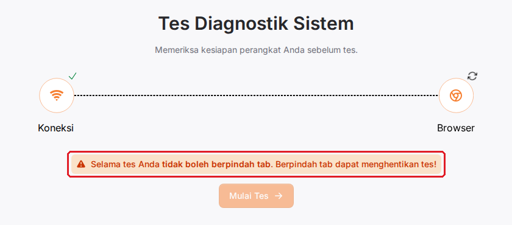
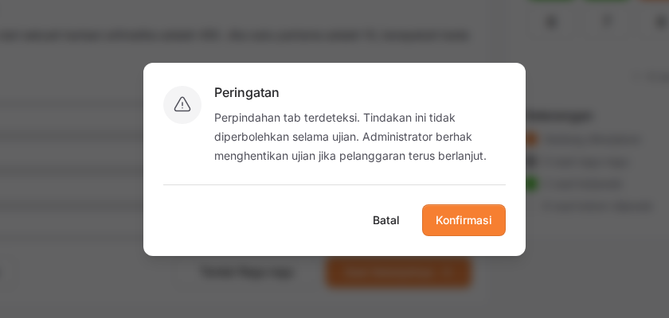
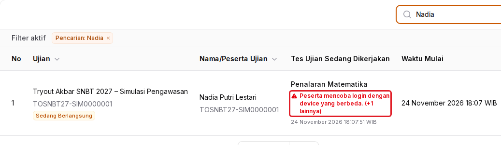
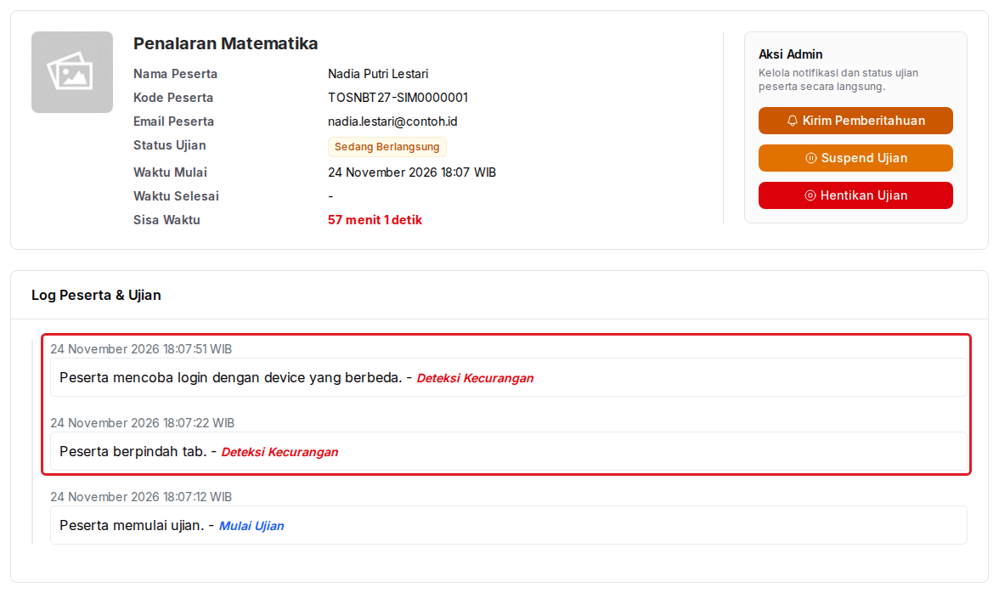
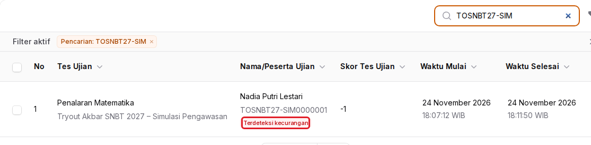
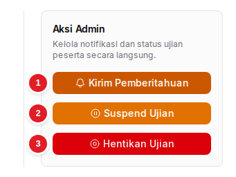

Saat ujian berlangsung secara daring, Anda tidak dapat melihat langsung apa yang dilakukan peserta. CBT Indolat membantu dengan **pengawasan otomatis** (sering disebut *proctoring*): sistem memeriksa perangkat peserta, mencatat kejadian yang mencurigakan, dan menampilkannya kepada admin. Halaman ini menjelaskan pilihan pengawasan yang ada, apa saja yang dicatat sebagai indikasi kecurangan, di mana catatan itu terlihat, dan apa yang dapat Anda lakukan.

<Info>
  **Lokasi yang berkaitan:**

  - Pengaturan pengawasan per tes: **Platform Ujian (CBT)** → **Manajemen Ujian** → **Data Ujian** → **Detail** pada ujian → **Ubah** pada tes → tab **Pengawasan**. Langkahnya ada di [Membuat Tes Ujian](/data-ujian/membuat-tes-ujian#mengatur-pengawasan).
  - Pemantauan saat ujian berlangsung: **Platform Ujian (CBT)** → **Ujian** → **Monitoring Ujian** ([panduan](/cbt/monitoring-ujian)).
  - Catatan setelah tes selesai: **Platform Ujian (CBT)** → **Ujian** → **Riwayat Tes Ujian** ([panduan](/cbt/riwayat-tes-ujian)).
</Info>

<Note>
  Sistem hanya **mencatat** dan memberi peringatan. Peserta tidak dihentikan atau didiskualifikasi otomatis karena satu catatan kecurangan; keputusan tetap di tangan admin.
</Note>

## Pilihan pengawasan

Pengawasan diatur per tes pada tab **Pengawasan**. Beberapa pilihan hanya terbuka untuk **Ujian Professional (Paket Berbayar)**; pada **Ujian Standard (Paket Gratis)** pilihan tersebut berlabel **(Fitur tidak aktif)**. Perbedaan kedua tipe ujian dijelaskan di [Kredit Ujian, Ujian Standard, dan Ujian Professional](/konsep/kredit-dan-tipe-ujian).

| Pengaturan | Yang dilakukan sistem | Tipe ujian | Biaya tambahan |
| --- | --- | --- | --- |
| **Deteksi Pindah Tab** | Mencatat setiap kali halaman ujian tidak terlihat, misalnya peserta membuka tab lain, lalu menampilkan peringatan kepada peserta | Standard dan Professional | Tidak ada |
| **Pengawasan Kamera** | Peserta wajib mengizinkan kamera; sistem mengambil foto peserta setiap beberapa detik | Professional | 1 kredit **Proctoring Kamera** setiap peserta memulai tes |
| **Pengawasan Layar (Share Screen)** | Peserta wajib membagikan **seluruh layar** (bukan satu tab atau jendela); sistem mengambil tangkapan layar setiap beberapa detik | Professional | 1 kredit **Proctoring Layar** setiap peserta memulai tes |
| **Hanya Izinkan Satu Layar** | Menolak peserta yang memakai monitor kedua, baik sebelum maupun selama tes | Professional | Tidak ada |
| **Soal Audio Sekali Putar**, **Jawaban Audio Sekali Putar** | Audio pada soal atau pilihan jawaban hanya dapat diputar satu kali. Ini bukan deteksi kecurangan, melainkan aturan untuk soal *listening*. | Standard dan Professional | Tidak ada |

Selain itu, ada perlindungan yang **selalu aktif** tanpa perlu diatur:

- **Satu akun, satu perangkat.** Jika akun peserta masuk lagi di browser atau perangkat lain saat tesnya berjalan, sistem mencatatnya dan perangkat lama tidak dapat dipakai lagi.
- **Browser yang didukung.** Tes hanya dapat dikerjakan di Google Chrome, Chromium, Microsoft Edge, Safari, atau aplikasi CBT Indolat. Browser lain, misalnya Firefox, ditolak sebelum tes dimulai.

Sebelum tes dimulai, peserta melewati halaman **Tes Diagnostik Sistem** yang memeriksa koneksi, browser, serta kamera, berbagi layar, dan monitor ganda bila pengawasannya aktif. Jika **Deteksi Pindah Tab** aktif, halaman ini juga mengingatkan peserta agar tidak berpindah tab.

<Frame>
  
</Frame>

<Note>
  - CBT Indolat tidak memiliki mode *exam browser* yang mengunci perangkat. Aplikasi CBT Indolat diperlukan terutama untuk **Pengawasan Layar (Share Screen)** di ponsel: browser ponsel tidak dapat membagikan layar, sehingga peserta diarahkan ke tombol **Unduh Aplikasi**.
  - Kredit **Proctoring Kamera** dan **Proctoring Layar** dibeli sebagai add-on di [Langganan & Tagihan](/administrasi/langganan-dan-tagihan). Jika habis, peserta tidak dapat memulai tes yang memakai pengawasan tersebut.
  - Foto kamera dan tangkapan layar dapat dilihat dan diunduh dari halaman detail peserta, dan dihapus otomatis setelah ujian berakhir lebih dari tiga bulan.
</Note>

## Yang dicatat sebagai indikasi kecurangan

Setiap kejadian di bawah ini disimpan sebagai catatan berjenis **Deteksi Kecurangan** pada log tes peserta.

| Pesan di log | Pemicu | Perlu pengaturan | Akibat bagi peserta |
| --- | --- | --- | --- |
| **Peserta berpindah tab.** | Halaman ujian tidak terlihat: membuka tab lain, meminimalkan browser, berpindah ke aplikasi lain di ponsel, atau layar ponsel terkunci | **Deteksi Pindah Tab** | Muncul jendela **Peringatan**; tes dapat dilanjutkan. Setiap kejadian dicatat. |
| **Peserta mencoba login dengan device yang berbeda.** | Akun peserta masuk lagi di browser atau perangkat mana pun saat tesnya sedang berjalan | Selalu aktif | Perangkat lama menampilkan **Sesi tidak valid. Akun Anda digunakan di perangkat lain.**; peserta melanjutkan tes dari tempat login terakhir |
| **Peserta menggunakan dua monitor.** | Monitor kedua terdeteksi selama tes | **Hanya Izinkan Satu Layar** | Layar ujian terkunci dengan pesan **Monitor ganda terdeteksi** sampai monitor kedua dilepas dan halaman dimuat ulang |
| **Peserta menonaktifkan atau mencabut izin kamera saat ujian berlangsung.** | Izin kamera dicabut atau kamera berhenti | **Pengawasan Kamera** | Layar ujian terkunci dengan pesan **Akses kamera tidak tersedia** sampai kamera diizinkan lagi dan halaman dimuat ulang |
| **Peserta menghentikan berbagi layar saat ujian berlangsung.** | Berbagi layar dihentikan atau ditolak, atau yang dibagikan bukan seluruh layar | **Pengawasan Layar (Share Screen)** | Peserta diminta membagikan seluruh layar lagi sebelum melanjutkan |

Contoh jendela peringatan yang dilihat peserta ketika berpindah tab:

<Frame>
  
</Frame>

Log tes juga dapat berisi catatan lain yang **bukan** kecurangan, misalnya **Koneksi internet peserta lambat, menyebabkan keterlambatan proctoring.** atau catatan bahwa peserta tidak dapat memulai tes karena batas peserta bersamaan tercapai. Catatan seperti ini berjenis **Lainnya** dan tidak memicu label kecurangan.

<Tip>
  **Deteksi Pindah Tab** bekerja ketika browser menganggap halaman ujian tersembunyi. Membuka jendela lain berdampingan dengan jendela ujian, tanpa menutupi atau meminimalkannya, belum tentu tercatat. Untuk ujian penting, kombinasikan dengan **Pengawasan Kamera** atau **Pengawasan Layar (Share Screen)**. Pemeriksaan **Hanya Izinkan Satu Layar** juga bergantung pada kemampuan browser dan paling andal di Google Chrome dan Microsoft Edge.
</Tip>

## Yang dilihat admin

Contoh di bawah memakai peserta **Nadia Putri Lestari** pada ujian **Tryout Akbar SNBT 2027 – Simulasi Pengawasan**, tes **Penalaran Matematika** dengan **Deteksi Pindah Tab** aktif. Nadia memulai tes pukul 18.07.12, berpindah tab pukul 18.07.22, lalu masuk lagi dari browser lain pukul 18.07.51.

**Saat ujian berlangsung**, kolom **Tes Ujian Sedang Dikerjakan** di **Monitoring Ujian** menampilkan catatan terbaru berwarna merah, jumlah catatan lainnya, dan waktunya. Gunakan filter **Terdeteksi Kecurangan** = **Ya** untuk menampilkan hanya peserta yang memiliki catatan.

<Frame>
  
</Frame>

**Detail peserta** (tombol **Lihat**) menampilkan seluruh urutan kejadian pada **Log Peserta & Ujian**, dari yang terbaru. Catatan kecurangan ditandai **Deteksi Kecurangan** berwarna merah.

<Frame>
  
</Frame>

**Setelah tes selesai**, baris peserta di **Riwayat Tes Ujian** diberi label merah **Terdeteksi kecurangan**. Filter **Terdeteksi Kecurangan** juga tersedia di halaman ini.

<Frame>
  
</Frame>

<Note>
  Label **Terdeteksi kecurangan** muncul jika tes tersebut memiliki minimal satu catatan **Deteksi Kecurangan**, berapa pun jumlahnya. Catatan tidak terhapus oleh **Reset Ujian**, sehingga label tetap tampil setelah peserta mengerjakan ulang.
</Note>

## Tindakan yang dapat diambil admin

Selama peserta mengerjakan tes CBT atau CAT, kotak **Aksi Admin** pada halaman detail peserta menyediakan tiga tombol:

<Frame>
  
</Frame>

1. **Kirim Pemberitahuan**: pesan langsung muncul di layar peserta, misalnya teguran agar tidak berpindah tab.
2. **Suspend Ujian**: menghentikan sementara pengerjaan, dengan durasi tertentu atau sampai Anda menekan **Lanjutkan Ujian**. Cocok untuk memeriksa situasi peserta.
3. **Hentikan Ujian**: mengakhiri tes peserta saat itu juga. Jawaban yang sudah tersimpan dinilai.

Setelah tes selesai, Anda masih dapat memakai **Reset Ujian** di **Riwayat Tes Ujian** agar peserta mengerjakan ulang, misalnya jika catatan ternyata disebabkan gangguan teknis. Reset menghapus jawaban dan skor, dan peserta memakai satu kredit ujian lagi saat memulai ulang.

| Situasi | Tindakan yang disarankan |
| --- | --- |
| Satu atau dua catatan pindah tab | Kirim pemberitahuan sebagai teguran, lalu pantau |
| Catatan pindah tab terus bertambah | **Suspend Ujian**, hubungi peserta, lalu lanjutkan atau hentikan |
| Catatan login dari perangkat lain, padahal peserta mengaku tidak berpindah perangkat | Periksa apakah akun dipakai orang lain; pertimbangkan **Hentikan Ujian** |
| Catatan disebabkan gangguan teknis yang terbukti | Biarkan peserta selesai, atau **Reset Ujian** setelahnya |

Langkah setiap tindakan ada di [Monitoring Ujian](/cbt/monitoring-ujian#tindakan-admin-saat-ujian-berlangsung) dan [Riwayat Tes Ujian](/cbt/riwayat-tes-ujian#mengatur-ulang-tes-reset-ujian).

## Menghindari peringatan palsu

Banyak catatan kecurangan sebenarnya disebabkan kebiasaan yang tidak disengaja. Bagikan tips berikut kepada peserta sebelum ujian:

- **Jangan login ulang di tengah tes.** Masuk lagi dari browser lain, jendela penyamaran, atau perangkat lain selalu tercatat sebagai **Peserta mencoba login dengan device yang berbeda.**, bahkan jika perangkat yang sama dipakai setelah keluar akun. Jika halaman tertutup tidak sengaja, buka kembali dengan browser yang sama; tes berlanjut tanpa login ulang selama sesi masih aktif.
- **Satu tab, satu perangkat.** Tutup tab lain sebelum mulai, dan jangan membuka tes yang sama di dua tab atau dua perangkat.
- **Matikan gangguan di ponsel.** Telepon masuk, berpindah ke aplikasi chat, atau layar terkunci otomatis membuat halaman ujian tersembunyi dan tercatat sebagai pindah tab. Aktifkan mode jangan ganggu dan pastikan baterai cukup.
- **Lepas monitor kedua sebelum mulai** jika **Hanya Izinkan Satu Layar** aktif, termasuk proyektor atau layar yang hanya dicerminkan.
- **Izinkan kamera sampai selesai** jika **Pengawasan Kamera** aktif, dan jangan menutup aplikasi lain yang memakai kamera di tengah tes.
- **Bagikan seluruh layar**, bukan satu tab atau jendela, jika **Pengawasan Layar (Share Screen)** aktif.
- **Pakai browser yang didukung**: Google Chrome, Microsoft Edge, atau Safari versi terbaru.

<Tip>
  Untuk admin: aktifkan pengawasan yang benar-benar dibutuhkan saja, dan uji tes Anda sendiri dengan akun peserta percobaan sebelum hari ujian. Setiap catatan menyertakan waktu kejadian, sehingga Anda dapat mencocokkannya dengan laporan pengawas ruangan atau pengakuan peserta.
</Tip>
