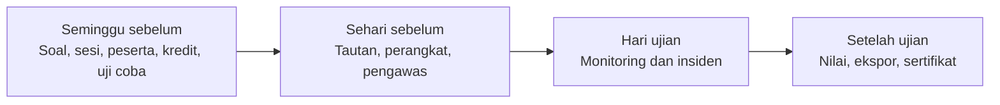
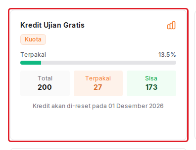
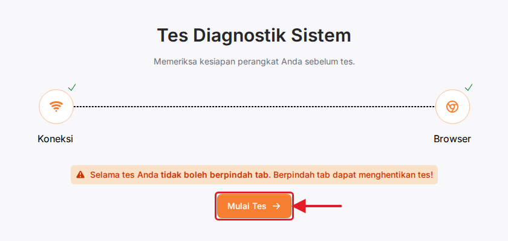

Ujian berbasis komputer jarang gagal karena aplikasinya. Yang lebih sering terjadi adalah hal kecil yang terlewat: bobot skor belum diisi, peserta belum dimasukkan ke sesi, atau kredit habis tepat saat peserta mulai mengerjakan. Halaman ini merangkum hal yang perlu Anda periksa beserta waktunya. Setiap butir berisi alasan singkat dan tautan ke halaman panduan yang menjelaskan caranya.

<Info>
  **Untuk siapa:** pemilik projek atau admin yang menyiapkan dan menjalankan ujian di **Portal** → **Platform Ujian (CBT)**.

  Jika Anda belum mengenal istilah seperti *ujian*, *tes*, *sesi*, dan *paket soal*, baca dahulu [Struktur Ujian: Paket Soal, Ujian, Tes, dan Sesi](/konsep/struktur-ujian). Untuk melihat ujian dari sisi peserta, baca [Pengalaman Peserta dari Daftar sampai Hasil](/konsep/alur-peserta).
</Info>

## Ringkasan daftar periksa

| Waktu | Yang diperiksa |
| --- | --- |
| Seminggu sebelum | Soal dan bobot skor, pengaturan tes, sesi dan jadwal, akun dan peserta ujian, kredit, pengawasan, tampilan hasil, uji coba dengan akun uji |
| Sehari sebelum | Tautan login dan akun, perangkat dan koneksi peserta, tim pengawas, rencana penanganan insiden |
| Hari ujian | Pemantauan di **Monitoring Ujian**, penanganan insiden |
| Setelah ujian | Penilaian esai, **Hitung Skor** atau **Perhitungan IRT**, menampilkan nilai, ekspor hasil, sertifikat, dan peringkat |

## Seminggu sebelum ujian

Beri waktu cukup untuk memperbaiki kesalahan. Perubahan pada soal dan sesi paling aman dilakukan sebelum ada peserta yang mulai mengerjakan.

### 1. Soal dan bobot skor sudah lengkap

Periksa jumlah soal, kunci jawaban, dan bobot skor di setiap paket soal. Bobot **Skor Benar**, **Skor Salah**, dan **Skor Tidak Dijawab** pada soal baru masih kosong (bernilai 0), sehingga tanpa diisi, peserta yang menjawab semua soal dengan benar tetap mendapat nilai **0**. Isi sekaligus dengan **Tindakan** → **Ubah Skor Massal**, lihat [Membuat Paket Soal](/paket-soal/membuat-paket-soal#tindakan-massal) dan [Cara Perhitungan Metode Penilaian](/konsep/metode-penilaian).

### 2. Pengaturan tes sudah benar

Pastikan setiap tes memakai **Jenis Ujian** (CBT, CAT, atau esai), **Metode Penilaian**, dan **Durasi Pengerjaan (menit)** yang tepat, serta **Tipe Ujian** (Standard atau Professional) sesuai jumlah peserta serentak dan fitur yang dibutuhkan. **Jenis Ujian** tidak dapat diubah setelah tes mulai dikerjakan, dan durasi tidak dapat diubah selama ada peserta yang sedang mengerjakan. Lihat [Membuat Tes Ujian](/data-ujian/membuat-tes-ujian), [Perbedaan CBT, CAT, dan Esai/Upload File](/konsep/jenis-ujian-cbt-cat-esai), dan [Kredit Ujian, Ujian Standard, dan Ujian Professional](/konsep/kredit-dan-tipe-ujian).

### 3. Sesi dan jadwal sudah dibuat

Setiap tes membutuhkan minimal satu sesi dengan paket soal dan rentang waktu. Peserta hanya dapat mulai di dalam rentang sesi, dan waktunya berakhir paling lambat saat sesi berakhir. Beri kelonggaran: buat sesi lebih panjang dari durasi tes, misalnya sesi 08.00–10.00 untuk tes 90 menit, agar peserta yang terlambat beberapa menit tetap mendapat waktu penuh. Lihat [Membuat Sesi Ujian](/data-ujian/membuat-sesi-ujian).

### 4. Akun dan peserta ujian sudah siap

Buat atau impor akun peserta, lalu masukkan mereka ke ujian, atau buka pendaftaran mandiri. Lihat [Menambahkan Akun Peserta](/data-akun/menambahkan-akun-peserta) dan [Menambahkan Peserta Ujian](/data-ujian/menambahkan-peserta-ujian).

### 5. Semua peserta sudah dipasangkan ke sesi

Peserta yang belum dipasangkan ke sesi melihat tombol **Terkunci** dan tidak dapat memulai tes. Pasangkan semua peserta, atau aktifkan **Set Sesi Otomatis Setelah Pendaftaran** untuk pendaftar mandiri. Lihat [Memasangkan peserta ke sesi ujian](/data-ujian/membuat-sesi-ujian#memasangkan-peserta-ke-sesi-ujian).

### 6. Kredit ujian mencukupi

Satu kredit terpakai setiap kali seorang peserta memulai satu tes, termasuk saat peserta mengulang tes setelah **Reset Ujian**. Hitung kebutuhannya: jumlah peserta × jumlah tes, ditambah cadangan untuk uji coba dan pengulangan. Pengawasan kamera dan layar memakai kredit proctoring tersendiri. Periksa sisa kredit di **Administrasi Aplikasi** → **Keuangan** → **Langganan & Tagihan**.

<Frame>
  
</Frame>

Lihat [Kredit Ujian, Ujian Standard, dan Ujian Professional](/konsep/kredit-dan-tipe-ujian) dan [Langganan & Tagihan](/administrasi/langganan-dan-tagihan#1-melihat-paket-aktif-dan-kuota).

### 7. Pengawasan sudah diputuskan

Tentukan pengawasan yang dipakai: **Deteksi Pindah Tab**, **Pengawasan Kamera**, **Pengawasan Layar (Share Screen)**, atau **Hanya Izinkan Satu Layar**. Pengawasan kamera, layar, dan satu layar hanya tersedia pada **Ujian Professional**, dan pengawasan layar di ponsel mengharuskan peserta memakai aplikasi CBT Indolat. Lihat [Pengawasan Ujian dan Deteksi Kecurangan](/konsep/pengawasan-dan-kecurangan) dan [Mengatur pengawasan](/data-ujian/membuat-tes-ujian#mengatur-pengawasan).

### 8. Tampilan hasil sudah ditentukan

Putuskan apa yang dilihat peserta setelah selesai: skor, ringkasan dan kunci jawaban, pembahasan, atau skor akhir. Jika paket soal yang sama dipakai di beberapa sesi, tunda **Tampilkan Ringkasan** sampai semua sesi selesai agar kunci jawaban tidak tersebar. Lihat [Mengatur skor dan hasil](/data-ujian/membuat-tes-ujian#mengatur-skor-dan-hasil) dan bagian nilai di [Pengalaman Peserta](/konsep/alur-peserta#9-riwayat-tes-dan-nilai).

### 9. Uji coba dengan akun uji

Buat satu akun uji, misalnya **Panitia Uji Coba** dengan email `panitia.ujicoba@contoh.id`, masukkan ke ujian dan sesi, lalu kerjakan tes dari laptop dan ponsel seperti peserta sungguhan. Periksa petunjuk tes, tampilan soal, nilai yang keluar, dan sertifikat. Setelah itu, hapus hasil uji coba dengan **Reset Ujian** atau keluarkan akun uji dari ujian agar tidak ikut peringkat dan ekspor. Uji coba ini memakai kredit seperti peserta biasa. Lihat [Riwayat Tes Ujian](/cbt/riwayat-tes-ujian#mengatur-ulang-tes-reset-ujian).

<Tip>
  Untuk ujian besar, buat juga ujian latihan singkat (misalnya 3 soal, 10 menit) yang dapat dicoba semua peserta sebelum hari ujian. Peserta jadi terbiasa dengan tampilan soal, dan **Tes Diagnostik Sistem** sekaligus memeriksa perangkat mereka.
</Tip>

## Sehari sebelum ujian

### 10. Tautan login dan akun sudah dibagikan

Kirim **Tautan Login Peserta**, alamat email, dan kata sandi kepada setiap peserta, beserta jadwal sesinya. Minta peserta mencoba masuk sehari sebelumnya agar masalah lupa kata sandi selesai sebelum hari ujian. Jika ujian tatap muka, minta peserta mencetak **Kartu Peserta**. Lihat [Login Peserta](/lainnya/login-peserta).

### 11. Perangkat dan koneksi peserta siap

Sampaikan syarat perangkat kepada peserta: browser Google Chrome, Microsoft Edge, atau Safari versi terbaru (Mozilla Firefox di komputer dan Android tidak didukung), koneksi internet stabil, baterai penuh, dan hanya satu perangkat per akun. Saat peserta membuka tes, **Tes Diagnostik Sistem** memeriksa koneksi, browser, dan, jika diaktifkan, kamera, berbagi layar, dan monitor ganda.

<Frame>
  
</Frame>

Lihat [Tes Diagnostik Sistem](/konsep/alur-peserta#6-tes-diagnostik-sistem).

### 12. Tim pengawas sudah ditentukan

Tentukan siapa yang memantau setiap sesi dan pastikan akunnya dapat membuka **Monitoring Ujian**. Anggota tim diundang melalui **Administrasi Aplikasi** → **Tim & Akses** → **Tim Admin** dengan role yang memiliki akses ke menu tersebut. Lihat [Manajemen Akses Admin](/lainnya/manajemen-akses-admin) dan [Monitoring Ujian](/cbt/monitoring-ujian).

### 13. Rencana penanganan insiden sudah disepakati

Sepakati saluran kontak peserta saat ujian, misalnya grup WhatsApp, dan tampilkan di **Daftar Tes** peserta melalui tab **Informasi Tambahan** (lihat [Membuat Ujian](/data-ujian/membuat-ujian#informasi-tambahan)). Bagikan tabel penanganan insiden di bawah kepada tim pengawas.

## Hari ujian

### 14. Pantau Monitoring Ujian

Buka **Portal** → **Platform Ujian (CBT)** → **Ujian** → **Monitoring Ujian** sebelum sesi dimulai. Tabel diperbarui otomatis setiap 10 detik dan menampilkan siapa yang sedang mengerjakan, sisa waktunya, serta catatan kecurangan terbaru. Lihat [Monitoring Ujian](/cbt/monitoring-ujian).

### 15. Tangani insiden

| Kejadian | Yang dilakukan |
| --- | --- |
| Peserta tidak bisa masuk | Periksa alamat email dan **Status Aktif** akun. Ganti kata sandinya melalui **Ubah** pada akun. Lihat [Menambahkan Akun Peserta](/data-akun/menambahkan-akun-peserta#mengubah-atau-menghapus-akun). |
| Tombol tes **Terkunci** | Pasangkan peserta ke sesi, atau periksa apakah tes sebelumnya harus diselesaikan dulu. Lihat [Membuat Sesi Ujian](/data-ujian/membuat-sesi-ujian#memasangkan-peserta-ke-sesi-ujian). |
| **Kerjakan Tes** tidak dapat diklik | Sesi belum dimulai atau sudah berakhir. Periksa jam sesi. |
| Koneksi peserta putus atau browser tertutup | Minta peserta masuk lagi; tes terbuka kembali dengan jawaban yang sudah tersimpan. Waktu tetap berjalan; gunakan **Suspend Ujian** jika gangguannya lama dan Anda ingin menghentikan waktu sementara. |
| Peserta mendapat pesan kuota tes tidak mencukupi | Kredit habis. Beli kredit di **Langganan & Tagihan**, lalu minta peserta mencoba lagi. Lihat [Membeli kredit ujian](/administrasi/langganan-dan-tagihan#3-membeli-kredit-ujian-dan-add-on). |
| Tes tidak dapat dimulai karena lalu lintas penuh | Batas peserta serentak ujian tercapai (50 untuk Ujian Standard, 1.000 untuk Ujian Professional). Minta sebagian peserta menunggu, atau bagi peserta ke beberapa sesi. |
| Ada catatan kecurangan | Kirim teguran dengan **Kirim Pemberitahuan**, tangguhkan dengan **Suspend Ujian**, atau akhiri dengan **Hentikan Ujian**. Lihat [Pengawasan Ujian dan Deteksi Kecurangan](/konsep/pengawasan-dan-kecurangan). |
| Peserta perlu mengulang dari awal karena gangguan teknis | Gunakan **Reset Ujian**. Semua jawaban terhapus dan peserta mengerjakan ulang selama sesinya masih berlangsung; satu kredit terpakai lagi. Lihat [Riwayat Tes Ujian](/cbt/riwayat-tes-ujian#mengatur-ulang-tes-reset-ujian). |

<Warning>
  **Reset Ujian** dan **Hentikan Ujian** tidak dapat dibatalkan. Pastikan peserta yang dipilih sudah benar sebelum mengonfirmasi.
</Warning>

## Setelah ujian

### 16. Nilai tes esai

Tes **Esai / Upload File** tidak dinilai otomatis. Beri skor setiap jawaban melalui **Riwayat Tes Ujian**. Lihat [Memberi skor manual](/cbt/riwayat-tes-ujian#memberi-skor-manual-untuk-tes-esai).

### 17. Jalankan Hitung Skor atau Perhitungan IRT

Jika Anda memperbaiki kunci jawaban atau bobot setelah peserta selesai, jalankan **Hitung Skor** → **Perhitungan Skor Ujian**. Untuk tes bermetode IRT, jalankan **Hitung Skor** → **Perhitungan IRT** setelah semua peserta selesai, karena skor IRT bergantung pada jawaban seluruh peserta. Lihat [Menghitung ulang skor](/data-ujian/hasil-dan-ekspor-ujian#menghitung-ulang-skor) dan [Cara Perhitungan Metode Penilaian](/konsep/metode-penilaian).

### 18. Tampilkan nilai kepada peserta

Setelah nilai diperiksa, aktifkan **Apakah Tampilkan Skor Akhir Ujian?** dan pengaturan pada tab **Skor & Hasil** sesuai keputusan Anda. Lihat [Membuat Ujian](/data-ujian/membuat-ujian#pengaturan-ujian).

### 19. Ekspor hasil

Unduh rekap nilai dengan **Ekspor Data** → **Hasil Tes Ujian** di halaman **Detail Ujian**, laporan PDF per peserta, atau ekspor **Riwayat Tes Ujian** ke Excel. Sebagian besar ekspor diproses di latar belakang; file hasilnya diunduh dari **Unduh Hasil Ekspor** setelah notifikasi muncul. Lihat [Hasil dan Ekspor Ujian](/data-ujian/hasil-dan-ekspor-ujian) dan [Unduh Hasil Ekspor](/cbt/unduh-hasil-ekspor).

### 20. Sertifikat dan peringkat

Setujui pengajuan sertifikat jika template memerlukan persetujuan, dan perbarui papan peringkat dengan **Generate Ulang** setelah semua nilai final. Lihat [Sertifikat Ujian](/lainnya/sertifikat-ujian) dan [Leaderboard](/cbt/leaderboard).

<Card title="Pertanyaan Umum (FAQ)" icon="circle-question" horizontal href="/konsep/pertanyaan-umum">
  Jawaban singkat untuk pertanyaan yang sering muncul sebelum, saat, dan setelah ujian.
</Card>
