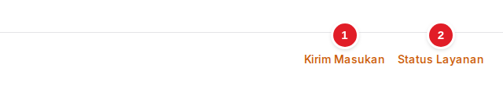
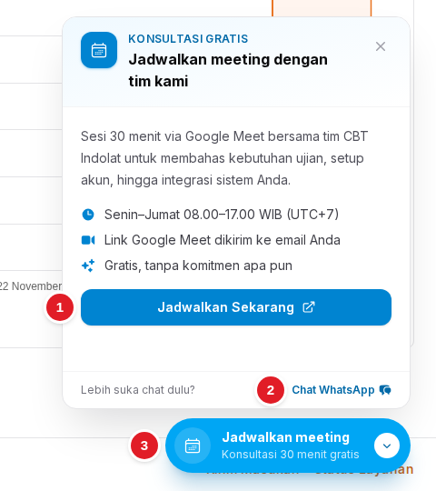

Halaman ini mengumpulkan pertanyaan yang paling sering muncul dari guru, pemilik bimbel, dan tim HR yang memakai CBT Indolat, beserta pertanyaan yang biasanya diteruskan peserta kepada Anda. Setiap jawaban dibuat singkat dan menautkan halaman panduan yang menjelaskan caranya.

<Info>
  Istilah yang belum Anda kenal dapat dicari di [Glosarium CBT Indolat](/glosarium-cbt-indolat). Untuk melihat ujian dari sisi peserta, baca [Pengalaman Peserta dari Daftar sampai Hasil](/konsep/alur-peserta).
</Info>

## Akun dan login

<AccordionGroup>
  <Accordion title="Peserta lupa kata sandi. Apakah bisa diatur ulang?">
    Bisa, dengan dua cara:

    - **Oleh peserta sendiri:** klik **Lupa kata sandi?** di halaman login, masukkan email, lalu klik **Kirim Tautan Atur Ulang**. Tautan dikirim ke email peserta dan berlaku 60 menit. Permintaan berikutnya baru dapat dikirim setelah satu jam, jadi minta peserta memeriksa folder spam lebih dulu.
    - **Oleh admin:** buka akun peserta di **Data Akun**, klik **Ubah**, isi kolom **Kata Sandi** dengan kata sandi baru, lalu simpan. Lihat [Mengubah atau menghapus akun](/data-akun/menambahkan-akun-peserta#mengubah-atau-menghapus-akun).

    Peserta yang mendaftar dengan **Lanjutkan dengan Google** cukup masuk lagi dengan tombol yang sama.
  </Accordion>
  <Accordion title="Peserta tidak bisa masuk. Apa yang perlu diperiksa?">
    Periksa berurutan:

    1. **Tautannya benar.** Alamat login memuat kode projek Anda, misalnya `https://prestasi.indolat.web.id/auth/login`. Akun dari projek lain tidak dapat masuk.
    2. **Email dan kata sandi benar.** Pesan **Alamat email atau kata sandi tidak valid** juga muncul untuk akun dengan **Status Aktif** yang dimatikan.
    3. **Belum terlalu banyak mencoba.** Setelah 5 kali gagal dalam satu menit, peserta harus menunggu sebentar.
    4. **Email sudah diverifikasi.** Peserta yang mendaftar sendiri harus memasukkan kode verifikasi. Jika kodenya tidak sampai, klik **Verifikasi Email** pada akun peserta.

    Lihat [Login Peserta](/lainnya/login-peserta) dan [Status akun](/data-akun/menambahkan-akun-peserta#status-akun).
  </Accordion>
  <Accordion title="Bagaimana cara mengganti alamat login peserta?">
    Alamat bawaan mengikuti **Kode Projek**: `https://<kode-projek>.indolat.web.id`. Ganti kode di **Administrasi Aplikasi** → **Pengaturan Projek** → **Profil Projek**; tautan lama langsung tidak berlaku, jadi umumkan alamat baru kepada peserta. Jika ingin memakai domain sendiri, misalnya `ujian.bimbelprestasi.sch.id`, aktifkan add-on **Kustom Domain**. Lihat [Profil Projek](/administrasi/profil-projek) dan [Domain](/administrasi/domain).
  </Accordion>
  <Accordion title="Apakah peserta bisa masuk dari dua perangkat sekaligus?">
    Tidak. Satu akun hanya aktif di satu perangkat. Jika peserta masuk dari perangkat kedua saat tes berjalan dan sesi di perangkat pertama masih aktif, perangkat pertama menampilkan **Sesi tidak valid. Akun Anda digunakan di perangkat lain.**, lalu diarahkan ke halaman login saat dimuat ulang. Sistem mencatat kejadian ini di **Monitoring Ujian** sebagai **Peserta mencoba login dengan device yang berbeda.** Peserta yang keluar dari akun (**Keluar**) lalu masuk lagi tidak dicatat sebagai kecurangan. Lihat [Jika browser tertutup atau berganti perangkat](/konsep/alur-peserta#jika-browser-tertutup-atau-berganti-perangkat).
  </Accordion>
  <Accordion title="Peserta membuka tautan aplikasi lalu diminta masuk. Mengapa?">
    Peserta tersebut belum masuk atau sesinya sudah berakhir, misalnya karena membuka bookmark halaman **Daftar Tes** setelah keluar. Aplikasi mengarahkannya ke halaman login projek dengan pesan **Silakan masuk terlebih dahulu untuk melanjutkan.** Setelah masuk, peserta langsung kembali ke halaman yang tadi dibukanya. Jika alamat yang dibuka tidak memuat kode projek dan browser belum pernah membuka projek Anda, peserta diminta memasukkan kode projek lebih dulu. Lihat [Masuk atau membuat akun](/konsep/alur-peserta#2-masuk-atau-membuat-akun).
  </Accordion>
</AccordionGroup>

## Ujian dan soal

<AccordionGroup>
  <Accordion title="Apa beda ujian, tes, sesi, dan paket soal?">
    Singkatnya: **ujian** adalah acaranya (misalnya Tryout Akbar SNBT 2027), **tes** adalah mata ujian di dalamnya (misalnya Penalaran Matematika), **sesi** adalah jadwal pengerjaan tes, dan **paket soal** adalah kumpulan soal yang dipakai sesi. Penjelasan lengkap ada di [Struktur Ujian: Paket Soal, Ujian, Tes, dan Sesi](/konsep/struktur-ujian).
  </Accordion>
  <Accordion title="Apakah satu akun bisa mengikuti beberapa ujian?">
    Bisa. Satu akun peserta dapat didaftarkan ke banyak ujian di projek yang sama, dan semua tesnya tampil di **Daftar Tes**. Peserta hanya dapat mengerjakan satu tes dalam satu waktu, dan tidak dapat mendaftar dua kali ke ujian yang sama. Lihat [Menambahkan Peserta Ujian](/data-ujian/menambahkan-peserta-ujian).
  </Accordion>
  <Accordion title="Berapa banyak peserta yang dapat mengerjakan bersamaan?">
    Batasnya dihitung per ujian untuk peserta yang sedang mengerjakan pada saat yang sama: **50** pada **Ujian Standard** dan **1.000** pada **Ujian Professional**. Jumlah peserta terdaftar boleh lebih banyak, asalkan tidak semuanya mengerjakan pada waktu yang sama. Jika batas tercapai, peserta berikutnya mendapat pesan bahwa lalu lintas penuh dan dapat mencoba lagi sebentar kemudian. Lihat [Kredit Ujian, Ujian Standard, dan Ujian Professional](/konsep/kredit-dan-tipe-ujian).
  </Accordion>
  <Accordion title="Apakah soal bisa diacak untuk setiap peserta?">
    Bisa. Aktifkan **Acak Soal** dan **Acak Jawaban (Pilihan Ganda)** pada paket soal. Soal yang memakai wacana yang sama tetap berurutan. Lihat [Membuat Paket Soal](/paket-soal/membuat-paket-soal).
  </Accordion>
  <Accordion title="Jenis soal apa saja yang tersedia?">
    Pilihan ganda (satu atau beberapa jawaban), jawaban singkat, majemuk kompleks (misalnya Benar/Salah), menjodohkan, serta esai dan unggah file. Lihat [Jenis Soal dan Tampilannya bagi Peserta](/konsep/jenis-soal).
  </Accordion>
  <Accordion title="Bisakah soal diubah saat ujian sedang berlangsung?">
    Tidak untuk paket CBT/CAT: selama ada peserta yang sedang mengerjakan, soal tidak dapat diubah, ditambah, atau dihapus. Perbaiki setelah semua peserta selesai, lalu jalankan **Hitung Skor**. Lihat [Perubahan saat ujian sedang berlangsung](/paket-soal/membuat-paket-soal#perubahan-saat-ujian-sedang-berlangsung).
  </Accordion>
</AccordionGroup>

## Pelaksanaan

<AccordionGroup>
  <Accordion title="Waktu peserta habis. Apa yang terjadi?">
    Tes diakhiri otomatis, peserta melihat pemberitahuan **Waktu Habis**, dan semua jawaban yang sudah tersimpan tetap dinilai. Ini juga berlaku jika peserta sudah menutup browser. Waktu tidak dapat ditambah untuk satu peserta; jika ada gangguan, gunakan **Suspend Ujian** saat itu juga agar waktunya berhenti sementara. Ingat juga bahwa waktu peserta berakhir paling lambat saat sesi berakhir. Lihat [Jika waktu habis](/konsep/alur-peserta#jika-waktu-habis).
  </Accordion>
  <Accordion title="Koneksi peserta terputus atau browser tertutup. Apakah jawabannya hilang?">
    Tidak. Setiap jawaban disimpan ke server saat dipilih. Peserta cukup membuka tautan login dan masuk lagi; aplikasi langsung membuka tes yang sedang berjalan beserta jawabannya. Waktu tetap berjalan selama peserta terputus. Lihat [Jika koneksi terputus](/konsep/alur-peserta#jika-koneksi-terputus).
  </Accordion>
  <Accordion title="Bagaimana agar peserta bisa mengulang tes?">
    Gunakan **Reset Ujian** di **Riwayat Tes Ujian** (atau di daftar peserta sesi). Semua jawaban dan nilai tes itu dihapus, dan peserta dapat mengerjakannya lagi dari **Daftar Tes** selama sesinya masih berlangsung. Satu kredit terpakai lagi saat peserta memulai ulang. Lihat [Mengatur ulang tes (Reset Ujian)](/cbt/riwayat-tes-ujian#mengatur-ulang-tes-reset-ujian).
  </Accordion>
  <Accordion title="Peserta tidak dapat memulai tes. Apa penyebabnya?">
    Lihat tombol pada kartu tes dan pesan yang muncul:

    - **Terkunci**: peserta belum dipasangkan ke sesi, sesi belum memiliki paket soal, atau tes sebelumnya harus diselesaikan dulu.
    - **Kerjakan Tes** tidak dapat diklik: jadwal sesi belum dimulai atau sudah berakhir.
    - Pesan kuota tes tidak mencukupi: kredit projek habis.
    - Pesan lalu lintas penuh: batas peserta serentak ujian tercapai.
    - **Browser Tidak Didukung**: peserta memakai browser selain Chrome, Edge, atau Safari.

    Lihat [Persiapan Sebelum Hari Ujian](/konsep/persiapan-hari-ujian#15-tangani-insiden).
  </Accordion>
  <Accordion title="Mengapa peserta ditandai melakukan kecurangan?">
    Catatan kecurangan muncul di **Monitoring Ujian** saat sistem mendeteksi, misalnya, peserta berpindah tab (jika **Deteksi Pindah Tab** aktif), memakai dua monitor, mematikan kamera, menghentikan berbagi layar, atau masuk dari perangkat lain selagi sesi lama masih aktif. Catatan ini adalah indikasi, bukan putusan; periksa konteksnya, misalnya peserta yang berpindah perangkat karena laptopnya mati. Lihat [Pengawasan Ujian dan Deteksi Kecurangan](/konsep/pengawasan-dan-kecurangan).
  </Accordion>
  <Accordion title="Apakah peserta bisa mengerjakan ujian dari ponsel?">
    Bisa, melalui Chrome atau Safari di ponsel, dengan tampilan yang menyesuaikan layar. Pengecualiannya ujian dengan **Pengawasan Layar (Share Screen)**: peserta harus memakai aplikasi CBT Indolat. Lihat [Mengerjakan dari ponsel](/konsep/alur-peserta#13-mengerjakan-dari-ponsel).
  </Accordion>
  <Accordion title="Siapa yang memantau ujian, dan dari mana?">
    Pemilik projek atau anggota **Tim Admin** dengan role yang memiliki akses ke **Monitoring Ujian**. Dari halaman ini pengawas dapat mengirim pemberitahuan, menangguhkan, atau menghentikan ujian peserta. Lihat [Monitoring Ujian](/cbt/monitoring-ujian) dan [Manajemen Akses Admin](/lainnya/manajemen-akses-admin).
  </Accordion>
</AccordionGroup>

## Nilai dan hasil

<AccordionGroup>
  <Accordion title="Mengapa nilai peserta 0?">
    Penyebab paling umum adalah bobot **Skor Benar** pada soal masih kosong, karena soal baru bernilai 0 sampai bobotnya diisi. Isi bobot dengan **Tindakan** → **Ubah Skor Massal** di paket soal, lalu jalankan **Hitung Skor** → **Perhitungan Skor Ujian** agar nilai peserta yang sudah selesai ikut diperbarui. Lihat [Cara Perhitungan Metode Penilaian](/konsep/metode-penilaian) dan [Menghitung ulang skor](/data-ujian/hasil-dan-ekspor-ujian#menghitung-ulang-skor).
  </Accordion>
  <Accordion title="Mengapa nilai IRT peserta berubah?">
    Nilai IRT tidak hanya bergantung pada jawaban satu peserta, tetapi juga pada tingkat kesulitan setiap soal yang dihitung dari jawaban seluruh peserta. Jika **Perhitungan IRT** dijalankan lagi setelah peserta lain selesai, tingkat kesulitan soal berubah sehingga nilai semua peserta ikut berubah. Jalankan **Perhitungan IRT** sekali setelah semua peserta selesai. Lihat [Cara Perhitungan Metode Penilaian](/konsep/metode-penilaian).
  </Accordion>
  <Accordion title="Mengapa peserta tidak melihat nilainya?">
    Nilai hanya tampil jika Anda mengaktifkannya: **Tampilkan Skor** pada tab **Skor & Hasil** untuk skor tes, dan **Apakah Tampilkan Skor Akhir Ujian?** untuk nilai akhir. Nilai juga belum ada untuk tes esai yang belum dinilai dan tes IRT yang belum dihitung. Lihat [Riwayat Tes dan nilai](/konsep/alur-peserta#9-riwayat-tes-dan-nilai).
  </Accordion>
  <Accordion title="Bagaimana peserta mendapatkan sertifikat?">
    Aktifkan add-on **Sertifikat Ujian**, buat template untuk ujian, ubah statusnya menjadi **Dipublikasikan**, dan aktifkan **Tampilkan ke peserta**. Peserta yang memenuhi syarat, misalnya mencapai **Skor Minimum**, melihat tombol **Unduh Sertifikat** di **Riwayat Tes**. Lihat [Sertifikat Ujian](/lainnya/sertifikat-ujian).
  </Accordion>
  <Accordion title="Peringkat di menu Peringkat belum berubah. Mengapa?">
    Papan peringkat tidak diperbarui otomatis setiap kali peserta selesai. Klik **Lainnya** → **Generate Ulang** pada leaderboard setelah semua peserta selesai atau setelah tes esai dinilai. Lihat [Leaderboard](/cbt/leaderboard#memperbarui-peringkat-generate-ulang).
  </Accordion>
  <Accordion title="Bagaimana cara mengunduh semua hasil ujian?">
    Klik **Ekspor Data** → **Hasil Tes Ujian** di halaman **Detail Ujian**, lalu unduh filenya dari **Unduh Hasil Ekspor** setelah notifikasi muncul. Laporan PDF per peserta juga tersedia. Lihat [Hasil dan Ekspor Ujian](/data-ujian/hasil-dan-ekspor-ujian).
  </Accordion>
</AccordionGroup>

## Pembayaran

<AccordionGroup>
  <Accordion title="Apa yang terjadi jika kredit ujian habis?">
    Peserta yang mencoba memulai tes mendapat pesan **Kuota tes tidak mencukupi**, dan Anda menerima notifikasi di panel serta email. Peserta yang sudah sedang mengerjakan tidak terpengaruh. Beli kredit di **Administrasi Aplikasi** → **Keuangan** → **Langganan & Tagihan**, lalu minta peserta mencoba lagi. Kredit gratis paket Standard diisi ulang setiap awal bulan. Lihat [Kredit Ujian, Ujian Standard, dan Ujian Professional](/konsep/kredit-dan-tipe-ujian) dan [Membeli kredit ujian](/administrasi/langganan-dan-tagihan#3-membeli-kredit-ujian-dan-add-on).
  </Accordion>
  <Accordion title="Apakah peserta membayar kredit ujian?">
    Tidak. Kredit ujian adalah biaya Anda sebagai penyelenggara kepada CBT Indolat. Biaya pendaftaran yang dibayar peserta, jika ujian Anda berbayar, adalah hal yang terpisah. Lihat [Kredit Ujian, Ujian Standard, dan Ujian Professional](/konsep/kredit-dan-tipe-ujian) dan [Ujian Berbayar: Alur Pembayaran Peserta dan Saldo](/konsep/ujian-berbayar-dan-saldo).
  </Accordion>
  <Accordion title="Bagaimana peserta membayar ujian berbayar?">
    Setelah mendaftar, peserta mendapat kode QR untuk dibayar sebelum batas waktu, lalu tesnya terbuka setelah pembayaran diterima. Anda dapat memberi potongan dengan kode voucher. Lihat [Formulir Pendaftaran Peserta](/data-ujian/membuat-formulir-pendaftaran) dan [Ujian Berbayar: Alur Pembayaran Peserta dan Saldo](/konsep/ujian-berbayar-dan-saldo).
  </Accordion>
  <Accordion title="Siapa yang menanggung biaya transaksi pembayaran peserta?">
    Anda yang menentukan melalui **Bebankan Biaya Transaksi ke Admin** di **Pengaturan Aplikasi**: jika aktif, biaya dipotong dari pembayaran yang Anda terima; jika nonaktif, biaya ditambahkan ke tagihan peserta. Lihat [Login Peserta](/lainnya/login-peserta#pengaturan-lainnya).
  </Accordion>
  <Accordion title="Kapan uang pendaftaran peserta dapat saya tarik?">
    Pembayaran peserta masuk ke saldo projek dan dapat ditarik ke rekening Anda melalui **Penarikan Saldo**. Lihat [Transaksi & Penarikan Saldo](/lainnya/transaksi-dan-penarikan-saldo) dan [Ujian Berbayar: Alur Pembayaran Peserta dan Saldo](/konsep/ujian-berbayar-dan-saldo).
  </Accordion>
</AccordionGroup>

## Peserta

<AccordionGroup>
  <Accordion title="Bagaimana cara menambahkan ratusan peserta sekaligus?">
    Gunakan **Import Peserta** pada bagian **Daftar Peserta Ujian** di halaman ujian: sistem membuat akun dari file Excel dan langsung memasukkannya ke ujian. Untuk menyiapkan akun tanpa memasukkannya ke ujian tertentu, gunakan **Import Akun** di **Data Akun**. Lihat [Menambahkan Peserta Ujian](/data-ujian/menambahkan-peserta-ujian#cara-2-mengimpor-peserta-dari-file-excel) dan [Menambahkan Akun Peserta](/data-akun/menambahkan-akun-peserta#menambahkan-banyak-akun-sekaligus-import-akun).
  </Accordion>
  <Accordion title="Bisakah peserta mendaftar sendiri?">
    Bisa. Aktifkan **Izinkan pendaftaran akun mandiri** agar peserta dapat membuat akun, dan **Apakah Pendaftaran Ujian Dibuka?** agar mereka dapat mendaftar ke ujian. Lihat [Login Peserta](/lainnya/login-peserta) dan [Formulir Pendaftaran Peserta](/data-ujian/membuat-formulir-pendaftaran).
  </Accordion>
  <Accordion title="Peserta tidak bisa hadir di jadwalnya. Bisakah dipindah ke sesi lain?">
    Bisa, selama peserta belum memulai tes. Pindahkan dengan **Set Sesi Ujian Kolektif** di bagian **Sesi Peserta Ujian**. Peserta yang sudah mulai mengerjakan perlu diatur ulang dengan **Reset Ujian** terlebih dahulu. Lihat [Memindahkan peserta ke sesi lain](/data-ujian/membuat-sesi-ujian#memindahkan-peserta-ke-sesi-lain).
  </Accordion>
  <Accordion title="Apa itu Kartu Peserta?">
    Kartu berisi nama, kode peserta dengan kode QR, dan jadwal tes, yang dapat dicetak peserta dari menu namanya di aplikasi peserta. Berguna untuk ujian tatap muka. Lihat [Kartu Peserta](/konsep/alur-peserta#12-kartu-peserta) dan [Kode Peserta dan Kode Bidang](/data-ujian/kode-peserta).
  </Accordion>
</AccordionGroup>

## Bantuan

<AccordionGroup>
  <Accordion title="Bagaimana cara menghubungi tim CBT Indolat?">
    Kanal dukungan resmi CBT Indolat adalah **Komunitas CBT Indolat** di Telegram: [t.me/cbtindolatcommunity](https://t.me/cbtindolatcommunity). Ajukan pertanyaan dan laporkan masalah di sana; tim CBT Indolat dan sesama pengguna akan membantu. Grup ini juga dapat dibuka dari tautan **Gabung Komunitas** di bagian atas situs dokumentasi ini.

    Di bagian bawah setiap halaman panel admin terdapat dua tautan lain:

    <Frame>
      
    </Frame>

    1. **Kirim Masukan**: membuka situs `community.indolat.com` untuk menyampaikan masukan dan usulan fitur. Tautan yang sama ada di **Berikan Feedback** di bagian atas situs dokumentasi ini.
    2. **Status Layanan**: memeriksa apakah layanan sedang mengalami gangguan. Periksa halaman ini lebih dulu jika aplikasi tiba-tiba tidak dapat diakses.

    Jika Anda membutuhkan pendampingan langsung, gunakan tombol **Jadwalkan meeting** di pojok kanan bawah panel admin:

    <Frame>
      
    </Frame>

    1. **Jadwalkan Sekarang**: memesan konsultasi gratis 30 menit melalui Google Meet (Senin–Jumat, 08.00–17.00 WIB). Tautan meeting dikirim ke email Anda.
    2. **Chat WhatsApp**: mengobrol langsung dengan tim melalui WhatsApp.
    3. **Jadwalkan meeting**: membuka atau menutup panel ini.
  </Accordion>
  <Accordion title="Siapa yang harus dihubungi peserta jika mengalami kendala?">
    Peserta menghubungi Anda sebagai penyelenggara, bukan tim CBT Indolat, karena hanya Anda yang dapat mengubah akun, sesi, dan tes mereka. Tampilkan kontak panitia di **Daftar Tes** peserta melalui tab **Informasi Tambahan**. Lihat [Membuat Ujian](/data-ujian/membuat-ujian#informasi-tambahan).
  </Accordion>
</AccordionGroup>
