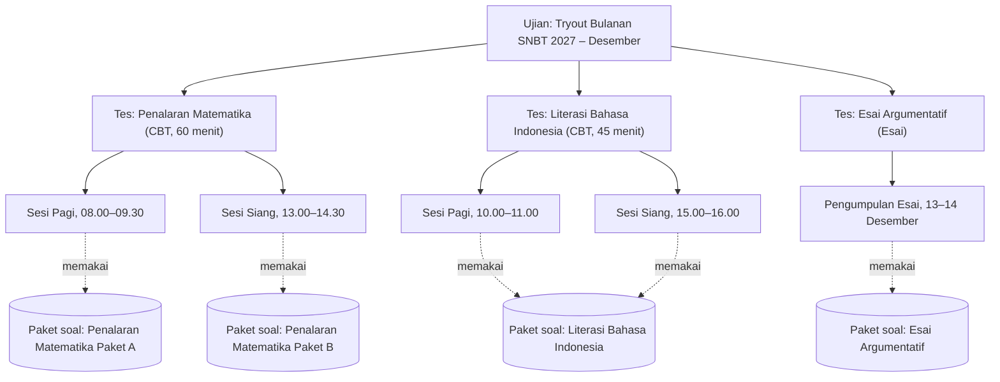
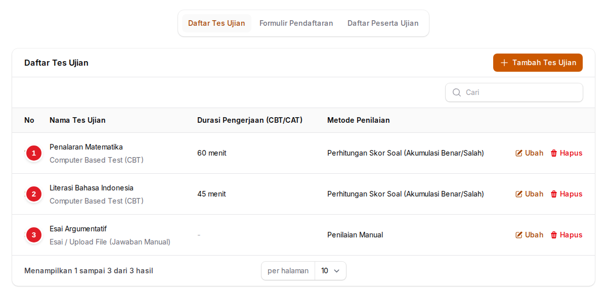
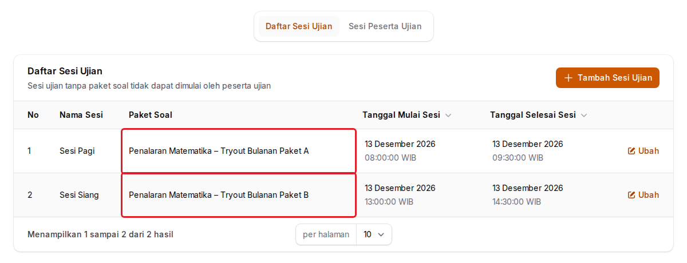
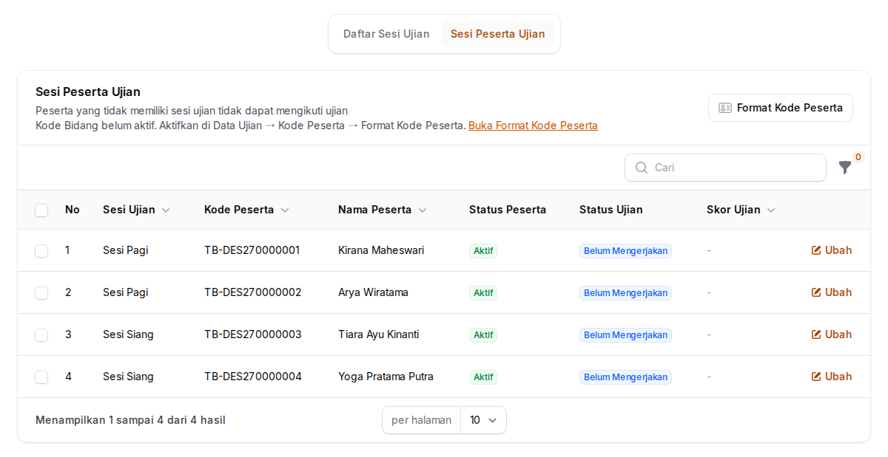

Sebelum membuat ujian pertama, ada baiknya Anda memahami lima bagian yang menyusun sebuah ujian di CBT Indolat: **paket soal**, **ujian**, **tes ujian**, **sesi ujian**, dan **peserta**. Halaman ini menjelaskan arti setiap bagian, hubungannya satu sama lain, dan aturan yang muncul dari hubungan tersebut. Langkah klik untuk membuat setiap bagian ada di halaman panduan yang ditautkan di akhir halaman.

<Info>
  **Lokasi menu:**

  - Paket soal: **Portal** → **Platform Ujian (CBT)** → **Manajemen Ujian** → **Data Paket Soal**.
  - Ujian, tes ujian, sesi ujian, dan peserta ujian: **Portal** → **Platform Ujian (CBT)** → **Manajemen Ujian** → **Data Ujian** → **Detail** pada ujian.
</Info>

## Lima bagian penyusun ujian

| Bagian | Arti sederhana | Contoh |
| --- | --- | --- |
| **Paket soal** (bank soal) | Kumpulan butir soal beserta kunci jawaban, pembahasan, dan bobot skornya. Paket soal berdiri sendiri dan belum terikat ke ujian mana pun. | **Penalaran Matematika – Tryout Bulanan Paket A**, berisi 5 soal pilihan ganda |
| **Ujian** | Acara yang diikuti peserta. Ujian memiliki nama, kode, rentang tanggal, tipe ujian (Standard atau Professional), cara pendaftaran dan pembayaran, serta cara menghitung nilai akhir. | **Tryout Bulanan SNBT 2027 – Desember**, kode **TB-DES27**, 1–31 Desember 2026 |
| **Tes ujian** (subtes) | Bagian atau mata uji di dalam ujian. Setiap tes memiliki jenis ujian (CBT, CAT, atau esai), metode penilaian, dan durasi pengerjaan sendiri. | **Penalaran Matematika**, CBT, 60 menit |
| **Sesi ujian** | Jadwal pelaksanaan satu tes, sekaligus penentu paket soal yang dikerjakan pada jadwal itu. Satu tes dapat memiliki beberapa sesi. | **Sesi Pagi**, 13 Desember 2026 pukul 08.00–09.30, memakai Paket A |
| **Peserta** | Akun yang terdaftar di ujian. Pada setiap tes, peserta dipasangkan ke tepat satu sesi. | **Kirana Maheswari**, mengikuti **Sesi Pagi** |

Istilah **jenis ujian** (CBT, CAT, atau esai) berlaku untuk setiap tes, sedangkan **tipe ujian** (**Ujian Standard (Paket Gratis)** atau **Ujian Professional (Paket Berbayar)**) berlaku untuk seluruh ujian. Perbedaan jenis ujian dijelaskan di [Perbedaan CBT, CAT, dan Esai/Upload File](/konsep/jenis-ujian-cbt-cat-esai).

## Analogi: tryout bulanan di sekolah

Bayangkan Bimbel Prestasi Nusantara menyelenggarakan tryout pada hari Minggu, 13 Desember 2026, di gedung sekolah:

- **Ujian** adalah acaranya: "Tryout Bulanan SNBT 2027 – Desember". Pengumuman, pendaftaran, dan rapor nilai akhir mengacu ke acara ini.
- **Tes ujian** adalah mata uji yang dikerjakan pada acara itu: Penalaran Matematika, Literasi Bahasa Indonesia, dan Esai Argumentatif.
- **Sesi ujian** adalah jadwal ruang dan jam: Penalaran Matematika dikerjakan pada gelombang pagi atau gelombang siang.
- **Paket soal** adalah naskah soal yang disimpan di lemari guru. Gelombang pagi menerima naskah Paket A dan gelombang siang menerima Paket B, sehingga soal pagi tidak bocor ke peserta siang. Naskah yang sama boleh dipakai lagi di tryout bulan berikutnya.
- **Peserta** adalah siswa yang mendaftar. Setiap siswa tahu ia masuk gelombang mana untuk setiap mata uji.

## Diagram hubungan

Garis tegas menunjukkan bagian yang dimiliki (ujian memiliki tes, tes memiliki sesi). Garis putus-putus menunjukkan paket soal yang **dipakai** sesi. Paket soal tidak dimiliki ujian, sehingga satu paket dapat dipakai banyak sesi dan banyak ujian.

Peserta terdaftar di tingkat ujian, lalu dipasangkan ke satu sesi pada setiap tes. Contoh jadwal dua peserta pada ujian di atas:

| Peserta | Penalaran Matematika | Literasi Bahasa Indonesia | Esai Argumentatif |
| --- | --- | --- | --- |
| Kirana Maheswari | Sesi Pagi (Paket A) | Sesi Pagi | Pengumpulan Esai |
| Tiara Ayu Kinanti | Sesi Siang (Paket B) | Sesi Siang | Pengumpulan Esai |

## Tampilannya di aplikasi

Halaman **Detail** ujian menampilkan semua tes pada bagian **Daftar Tes Ujian**. Pada contoh ini ujian memiliki tiga tes dengan jenis ujian yang berbeda:

<Frame>
  
</Frame>

1. **Penalaran Matematika**, **Computer Based Test (CBT)**, 60 menit.
2. **Literasi Bahasa Indonesia**, **Computer Based Test (CBT)**, 45 menit.
3. **Esai Argumentatif**, **Esai / Upload File (Jawaban Manual)**, tanpa durasi dan dinilai dengan **Penilaian Manual**.

Klik **Ubah** pada tes untuk membuka detail tes. Bagian **Daftar Sesi Ujian** menampilkan jadwal tes beserta paket soal setiap sesi. Tes **Penalaran Matematika** memakai paket berbeda pada sesi pagi dan sesi siang:

<Frame>
  
</Frame>

Bagian **Sesi Peserta Ujian** di bawahnya menampilkan sesi setiap peserta pada tes tersebut:

<Frame>
  
</Frame>

## Aturan yang mengikuti struktur ini

### Paket soal

- **Satu paket soal dapat dipakai berulang kali**, baik di beberapa sesi, beberapa tes, maupun beberapa ujian. Anda tidak perlu menyalin soal untuk setiap ujian.
- **Paket soal tidak disalin ke ujian.** Sesi hanya menunjuk ke paket soal, sehingga perubahan soal di paket berlaku untuk semua ujian yang memakainya. Jika satu ujian membutuhkan versi soal yang berbeda, gunakan **Duplikat Paket Soal** lalu ubah salinannya (lihat [Membuat Paket Soal](/paket-soal/membuat-paket-soal)).
- Selama ada peserta yang sedang mengerjakan ujian yang memakai sebuah paket soal CBT/CAT, paket tersebut terkunci dan tidak dapat diubah.
- Paket soal yang masih dipakai sesi ujian tidak dapat dihapus.
- **Jenis paket harus cocok dengan jenis tes.** Paket **CBT/CAT** hanya dapat dipilih untuk tes CBT dan CAT, sedangkan paket **Esai/Upload File (Jawaban Manual)** hanya untuk tes esai. Karena itu, ujian yang berisi soal pilihan ganda dan esai membutuhkan dua paket dan dua tes.

### Tes ujian

- Jenis ujian dan metode penilaian dipilih per tes, sehingga satu ujian boleh berisi tes CBT dan tes esai sekaligus, seperti contoh di atas.
- Jumlah tes dalam satu ujian dibatasi oleh tipe ujian: maksimal **4 tes** untuk **Ujian Standard (Paket Gratis)** dan **30 tes** untuk **Ujian Professional (Paket Berbayar)**.
- Tes **CAT** hanya dapat dipilih pada **Ujian Professional (Paket Berbayar)**.
- Secara bawaan peserta boleh mengerjakan tes dalam urutan apa pun. Jika urutan penting, aktifkan **Apakah Tes Ujian Harus Dikerjakan Secara Berurutan?** pada pengaturan ujian (lihat [Membuat Ujian](/data-ujian/membuat-ujian)).

### Sesi ujian

- **Satu tes dapat memakai paket soal yang berbeda di setiap sesi.** Contohnya Paket A untuk sesi pagi dan Paket B untuk sesi siang, agar soal sesi pagi tidak bocor ke peserta sesi siang. Paket soal sebuah sesi tidak dapat diganti setelah ada peserta yang memulai tes pada sesi itu.
- Jadwal sesi harus berada di dalam rentang tanggal ujian.
- Untuk tes CBT dan CAT, lama sesi tidak boleh lebih pendek dari **Durasi Pengerjaan (menit)** tes. Waktu pengerjaan peserta berhenti pada akhir durasi atau pada akhir sesi, mana yang lebih dulu. Peserta yang baru mulai 20 menit sebelum sesi berakhir hanya mendapat 20 menit.
- Tes esai tidak memiliki durasi. Peserta dapat mengerjakannya sampai sesi berakhir.
- Sesi tanpa paket soal tidak dapat dimulai peserta.

### Peserta

- Peserta didaftarkan ke ujian, bukan ke tes. Setelah terdaftar, peserta harus dipasangkan ke satu sesi pada **setiap** tes. Peserta tanpa sesi tidak dapat memulai tes tersebut.
- Sesi peserta boleh berbeda antar-tes, misalnya sesi pagi untuk Penalaran Matematika dan sesi siang untuk Literasi Bahasa Indonesia.
- Satu kredit ujian terpakai setiap kali seorang peserta memulai satu tes. Ujian dengan tiga tes yang diikuti 100 peserta dapat memakai hingga 300 kredit.

### Nilai

- Setiap tes menghasilkan skor tes sendiri sesuai metode penilaiannya. Skor semua tes lalu digabung menjadi nilai akhir ujian menurut **Jenis Skor Akhir** (dijumlahkan atau dirata-ratakan). Rumusnya ada di [Cara Perhitungan Metode Penilaian](/konsep/metode-penilaian#nilai-akhir-ujian).
- Skor IRT dihitung dari peserta yang sudah selesai mengerjakan tes yang sama dengan paket soal yang sama. Jika satu tes memakai Paket A dan Paket B, peserta Paket A dan peserta Paket B dihitung dalam kelompok terpisah.

## Ujian berjenjang (multi-level)

Untuk kompetisi atau seleksi bertahap, seperti babak penyisihan, semifinal, dan final, ujian dapat diatur sebagai **Ya (Multi-Level)**. Struktur dasarnya tetap sama (ujian, tes, sesi, paket soal, dan peserta), tetapi tes dikelompokkan ke dalam level. Peserta baru dapat mengerjakan tes pada level berikutnya setelah admin meloloskannya dari level sebelumnya, dan setiap level dapat memiliki biaya sendiri. Panduan lengkapnya ada di [Membuat Ujian Berjenjang](/data-ujian/membuat-ujian-berjenjang).

## Urutan membuat ujian

Urutan yang paling mudah mengikuti struktur di atas: siapkan paket soal, buat ujian, tambahkan tes, buat sesi, lalu tambahkan peserta.

<CardGroup cols={2}>
  <Card title="1. Membuat Paket Soal" icon="book-open" href="/paket-soal/membuat-paket-soal">
    Menyusun butir soal, kunci jawaban, dan bobot skor.
  </Card>
  <Card title="2. Membuat Ujian" icon="file-pen" href="/data-ujian/membuat-ujian">
    Mengatur nama, jadwal, tipe ujian, dan pendaftaran.
  </Card>
  <Card title="3. Membuat Tes Ujian" icon="list-check" href="/data-ujian/membuat-tes-ujian">
    Menentukan jenis ujian, metode penilaian, dan durasi.
  </Card>
  <Card title="4. Membuat Sesi Ujian" icon="calendar" href="/data-ujian/membuat-sesi-ujian">
    Menentukan jadwal dan paket soal setiap sesi.
  </Card>
  <Card title="5. Menambahkan Peserta Ujian" icon="users" href="/data-ujian/menambahkan-peserta-ujian">
    Mendaftarkan peserta dan memasangkannya ke sesi.
  </Card>
  <Card title="Ingin cepat?" icon="bolt" href="/membuat-ujian-pertama-anda-dalam-5-menit">
    Membuat ujian pertama Anda dalam 5 menit.
  </Card>
</CardGroup>
