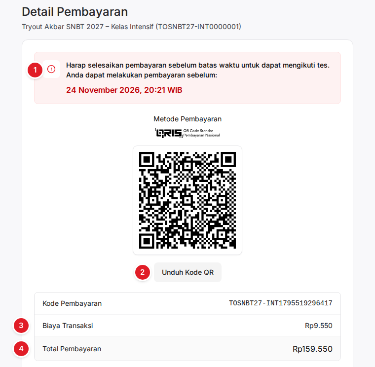
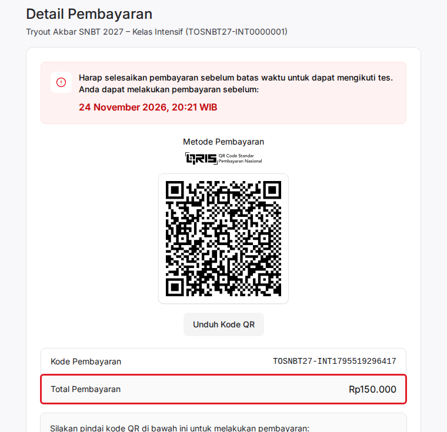
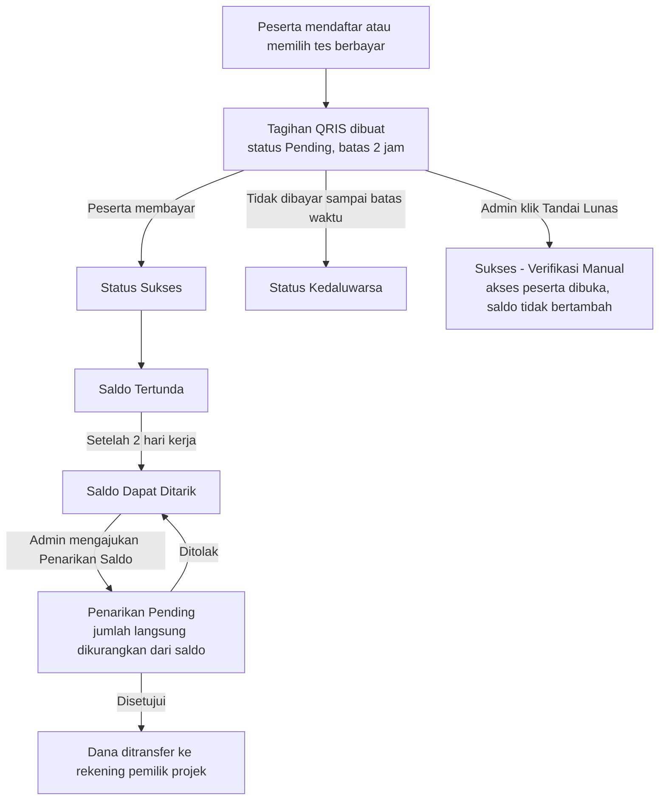
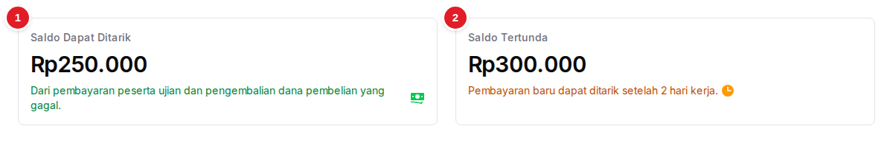

CBT Indolat dapat menagih biaya ujian langsung kepada peserta. Peserta membayar dengan QRIS, uangnya masuk ke **saldo projek** Anda, lalu Anda mencairkannya ke rekening bank pemilik projek. Halaman ini menjelaskan alur tersebut dari awal sampai akhir, lengkap dengan contoh angka, tanpa mengulang langkah klik yang sudah ada di halaman panduan.

<Info>
  **Lokasi pengaturan yang berkaitan:**

  - Tipe dan biaya ujian: **Portal** → **Platform Ujian (CBT)** → **Manajemen Ujian** → **Data Ujian** → **Detail** pada ujian → tab **Pendaftaran & Pembayaran**.
  - Siapa yang menanggung biaya transaksi: **Platform Ujian (CBT)** → **Lainnya** → **Pengaturan Aplikasi** → **Bebankan Biaya Transaksi ke Admin**.
  - Pembayaran peserta: **Platform Ujian (CBT)** → **Keuangan** → **Riwayat Transaksi**.
  - Saldo dan pencairan: **Administrasi Aplikasi** → **Keuangan** → **Penarikan Saldo**.
</Info>

## Syarat ujian berbayar

Ujian berbayar memerlukan add-on **Halaman Pendaftaran Ujian dan Pembayaran Otomatis** (Rp70.000 per tahun, atau bonus pada paket berlangganan tahunan). Tanpa add-on ini, tipe pembayaran selain **Gratis** tidak dapat disimpan dan label pengaturannya menampilkan **(Add-on Tidak Aktif)**. Add-on dibeli di [Langganan & Tagihan](/administrasi/langganan-dan-tagihan).

Biaya ujian minimal **Rp5.000**. Satu-satunya metode pembayaran untuk peserta adalah **QRIS**, sehingga peserta dapat membayar dengan aplikasi bank atau dompet digital apa pun yang mendukung QRIS.

<Note>
  Biaya ujian yang dibayar peserta terpisah dari **kredit ujian** yang dipakai projek Anda. Ujian berbayar tetap memakai kredit setiap kali peserta memulai tes. Lihat [Kredit Ujian, Ujian Standard, dan Ujian Professional](/konsep/kredit-dan-tipe-ujian).
</Note>

## Empat tipe pembayaran

**Tipe Pembayaran** dipilih pada tab **Pendaftaran & Pembayaran** setiap ujian (langkahnya di [Membuat Ujian](/data-ujian/membuat-ujian)).

| Tipe Pembayaran | Kapan peserta membayar | Tempat mengisi biaya | Contoh |
| --- | --- | --- | --- |
| **Gratis** | Tidak membayar | Tidak ada | Tryout promosi untuk umum |
| **Sekali Bayar** | Satu kali saat mendaftar sendiri lewat formulir pendaftaran, untuk seluruh tes | **Biaya Ujian Sekali Bayar (IDR)** pada tab **Pendaftaran & Pembayaran** | Tryout Rp150.000 untuk tiga subtes |
| **Berbayar per Tes Ujian** | Per tes, dari halaman **Daftar Tes** peserta, sebelum tes itu dikerjakan | **Biaya Tes Ujian** pada setiap tes | Paket latihan: peserta memilih subtes mana yang dibeli, masing-masing Rp25.000 |
| **Berbayar per Level (Multi-Level)** | Biaya level pertama saat mendaftar sendiri; biaya level berikutnya saat Anda meloloskan peserta ke level tersebut | Struktur level ujian | Kompetisi: babak penyisihan gratis, semifinal Rp30.000 |

Hal yang perlu diperhatikan:

- Pada **Sekali Bayar**, tagihan dibuat oleh pertanyaan **Metode Pembayaran** di formulir pendaftaran. Peserta yang Anda tambahkan langsung dari **Daftar Peserta Ujian** tidak ditagih. Lihat [Formulir Pendaftaran Peserta](/data-ujian/membuat-formulir-pendaftaran).
- Pada **Berbayar per Tes Ujian**, setiap tes yang memiliki biaya harus dibayar dulu oleh peserta yang terdaftar, termasuk peserta yang Anda tambahkan sendiri.
- Pada **Berbayar per Level (Multi-Level)**, batas waktu pembayaran level berikutnya Anda tentukan sendiri saat meloloskan peserta, paling lama 2 × 24 jam. Lihat [Membuat Ujian Berjenjang](/data-ujian/membuat-ujian-berjenjang).
- **Kode voucher** dapat memotong biaya pendaftaran untuk peserta tertentu. Jika potongan membuat biaya menjadi Rp0, tidak ada tagihan yang dibuat.

## Yang dialami peserta saat membayar

1. Peserta mendaftar atau memilih tes berbayar. Sistem membuat tagihan berstatus **Pending** dan menampilkan halaman **Detail Pembayaran**.
2. Peserta memindai kode QR (atau mengunduhnya dengan **Unduh Kode QR**) sebelum batas waktu, yaitu **2 jam** sejak tagihan dibuat.
3. Setelah membayar, peserta memuat ulang halaman. Status berubah menjadi **Sudah Dibayar** dan tes terbuka sesuai pengaturan sesi.

<Frame>
  
</Frame>

1. Batas waktu pembayaran.
2. Tombol untuk menyimpan kode QRIS.
3. **Biaya Transaksi**, hanya tampil jika biaya ditanggung peserta (lihat bagian berikutnya).
4. **Total Pembayaran** yang harus dibayar peserta.

Arti status transaksi:

| Status di **Riwayat Transaksi** (admin) | Yang dilihat peserta | Artinya |
| --- | --- | --- |
| **Pending** | **Menunggu Pembayaran** dan kode QR | Tagihan sudah dibuat, peserta belum membayar. |
| **Sukses** | **Sudah Dibayar** | Pembayaran QRIS diterima. Saldo projek bertambah. |
| **Sukses (Verifikasi Manual)** | **Sudah Dibayar** | Admin menandai lunas dengan **Tandai Lunas**. Akses peserta dibuka, saldo tidak bertambah. |
| **Kedaluwarsa** | **Waktu pembayaran telah habis.** | Batas 2 jam lewat tanpa pembayaran. |
| **Gagal** | - | Pembayaran ditolak. |

Jika tagihan kedaluwarsa:

- Pada **Sekali Bayar**, pendaftaran peserta dibatalkan otomatis, sehingga peserta dapat mendaftar ulang dan mendapat tagihan baru.
- Pada **Berbayar per Tes Ujian**, tes kembali ke keadaan belum dibayar dan peserta dapat membuat tagihan baru dari halaman **Daftar Tes**.

## Siapa yang menanggung biaya transaksi

Setiap pembayaran QRIS dikenai **biaya transaksi** sebesar:

```text
Biaya transaksi = 3,7% × biaya ujian (dibulatkan) + Rp4.000
```

Pengaturan **Bebankan Biaya Transaksi ke Admin** menentukan siapa yang menanggungnya. Pengaturan ini aktif secara bawaan pada projek baru. Langkah mengubahnya ada di [Login Peserta](/lainnya/login-peserta#pengaturan-lainnya).

| | **Aktif** (bawaan) | **Nonaktif** |
| --- | --- | --- |
| Yang dibayar peserta | Biaya ujian saja | Biaya ujian + biaya transaksi |
| Yang masuk ke saldo projek | Biaya ujian − biaya transaksi | Biaya ujian utuh |
| Baris **Biaya Transaksi** di halaman peserta | Tidak tampil | Tampil |

**Contoh:** biaya ujian **Rp150.000**.

```text
Biaya transaksi = 3,7% × 150.000 + 4.000 = 5.550 + 4.000 = Rp9.550
```

| | Peserta membayar | Saldo projek bertambah |
| --- | --- | --- |
| **Aktif** (ditanggung admin) | Rp150.000 | Rp150.000 − Rp9.550 = **Rp140.450** |
| **Nonaktif** (ditanggung peserta) | Rp150.000 + Rp9.550 = **Rp159.550** | **Rp150.000** |

Gambar di bagian sebelumnya adalah tampilan saat biaya ditanggung peserta. Saat biaya ditanggung admin, peserta hanya melihat **Total Pembayaran** sebesar biaya ujian:

<Frame>
  
</Frame>

<Note>
  Pengaturan dibaca saat tagihan dibuat. Mengubahnya tidak memengaruhi tagihan yang sudah berstatus **Pending**. Kolom **Total Pembayaran** di **Riwayat Transaksi** selalu menampilkan biaya ujian (setelah potongan voucher), bukan jumlah yang masuk ke saldo.
</Note>

## Perjalanan uang sampai ke rekening Anda



### Saldo Tertunda dan Saldo Dapat Ditarik

Setiap pembayaran yang berhasil masuk lebih dulu sebagai **Saldo Tertunda**. Setelah **2 hari kerja** (Senin sampai Jumat) sejak pembayaran diterima, sistem memindahkannya otomatis menjadi **Saldo Dapat Ditarik**. Sistem memeriksanya setiap beberapa menit, jadi Anda tidak perlu melakukan apa pun.

| Pembayaran diterima | Dapat ditarik mulai |
| --- | --- |
| Senin pukul 10.00 | Rabu sekitar pukul 10.00 |
| Kamis pukul 15.00 | Senin sekitar pukul 15.00 |
| Jumat pukul 10.00 | Selasa sekitar pukul 10.00 |

Kedua angka tampil di atas tabel **Penarikan Saldo**:

<Frame>
  
</Frame>

1. **Saldo Dapat Ditarik**: jumlah yang boleh Anda cairkan sekarang.
2. **Saldo Tertunda**: pembayaran baru yang masih menunggu 2 hari kerja.

### Aturan penarikan saldo

| Aturan | Keterangan |
| --- | --- |
| Rekening tujuan | Selalu rekening **pemilik projek**, yang diisi di **Informasi Rekening** pada profil pemilik |
| Jumlah minimal | **Rp10.000** |
| Jumlah maksimal | Sebesar **Saldo Dapat Ditarik** |
| Biaya | **Rp3.000** per penarikan ke bank selain **BNI**; ke BNI tanpa biaya |
| Jam proses | Hari kerja pukul **09.00–16.00 WIB**; pengajuan di luar jam tersebut diproses pada hari kerja berikutnya |
| Penarikan bersamaan | Hanya satu penarikan **Pending** pada satu waktu |
| Jika ditolak | Jumlahnya dikembalikan ke saldo, dengan alasan penolakan pada **Catatan** |

Langkah mengisi rekening dan mengajukan penarikan ada di [Transaksi & Penarikan Saldo](/lainnya/transaksi-dan-penarikan-saldo).

## Tandai Lunas: pembayaran di luar sistem

Jika peserta membayar dengan cara lain, misalnya tunai di kantor bimbel atau transfer langsung ke rekening lembaga, Anda dapat membuka aksesnya dengan **Tandai Lunas** pada transaksi berstatus **Pending** di **Riwayat Transaksi**. Statusnya menjadi **Sukses (Verifikasi Manual)**.

<Warning>
  **Tandai Lunas** tidak menambah saldo projek, karena uangnya tidak melewati sistem pembayaran CBT Indolat. Uang tersebut sudah Anda terima langsung dan tidak dapat ditarik melalui **Penarikan Saldo**. Tindakan ini tidak dapat dibatalkan.
</Warning>

## Contoh lengkap

**Bimbel Prestasi Nusantara** menjual **Tryout Akbar SNBT 2027 – Kelas Intensif** dengan tipe **Sekali Bayar** seharga **Rp150.000**. **Bebankan Biaya Transaksi ke Admin** aktif. Dalam satu pekan:

- 40 peserta membayar dengan QRIS.
- 5 peserta membayar tunai di kantor, lalu admin memakai **Tandai Lunas**.
- 3 peserta tidak membayar sampai batas waktu.

| Kelompok | Status | Saldo projek bertambah |
| --- | --- | --- |
| 40 peserta QRIS | **Sukses** | 40 × Rp140.450 = **Rp5.618.000** |
| 5 peserta tunai | **Sukses (Verifikasi Manual)** | Rp0 (uang Rp750.000 sudah diterima tunai) |
| 3 peserta tidak membayar | **Kedaluwarsa** | Rp0 |

Jika pembayaran terakhir masuk Jumat pukul 10.00, seluruh Rp5.618.000 menjadi **Saldo Dapat Ditarik** mulai Selasa sekitar pukul 10.00. Rina, pemilik projek, lalu mengajukan penarikan **Rp5.600.000**:

- ke rekening **BCA**: diterima **Rp5.597.000** (dipotong Rp3.000);
- ke rekening **BNI**: diterima **Rp5.600.000**.

Sisa saldo Rp18.000 tetap tersimpan dan dapat ditarik kemudian.

Jika **Bebankan Biaya Transaksi ke Admin** dinonaktifkan, setiap peserta membayar Rp159.550 dan saldo bertambah 40 × Rp150.000 = **Rp6.000.000**.
