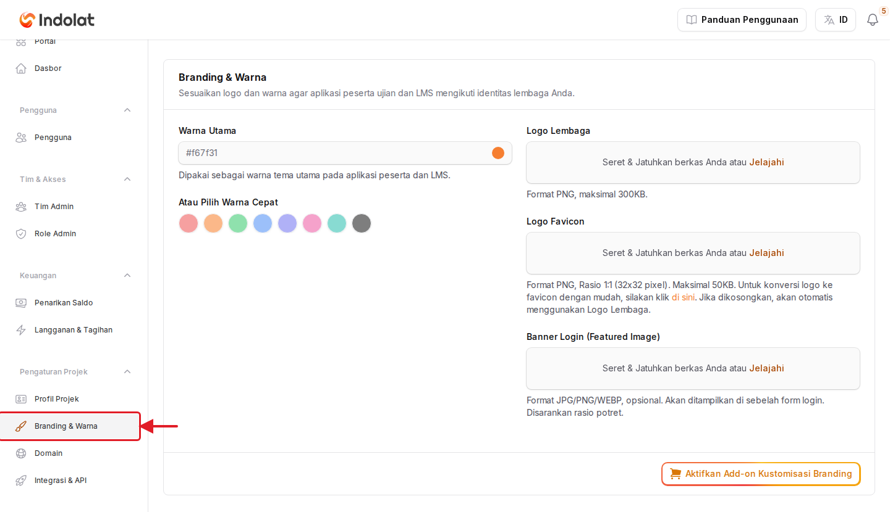
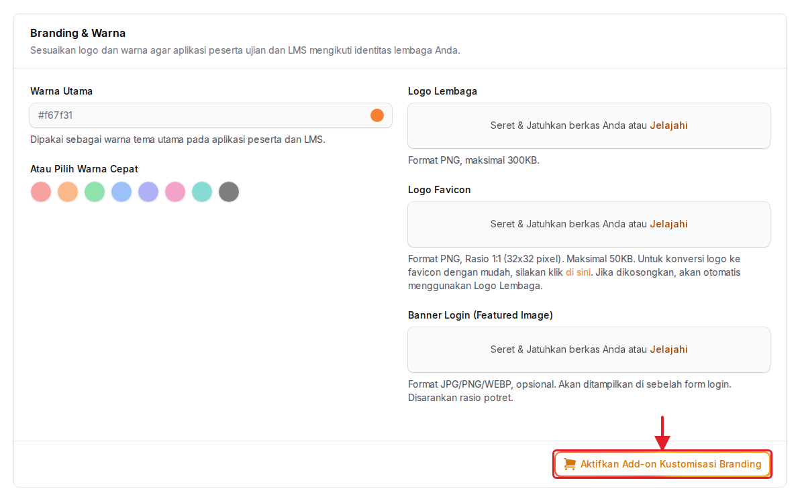
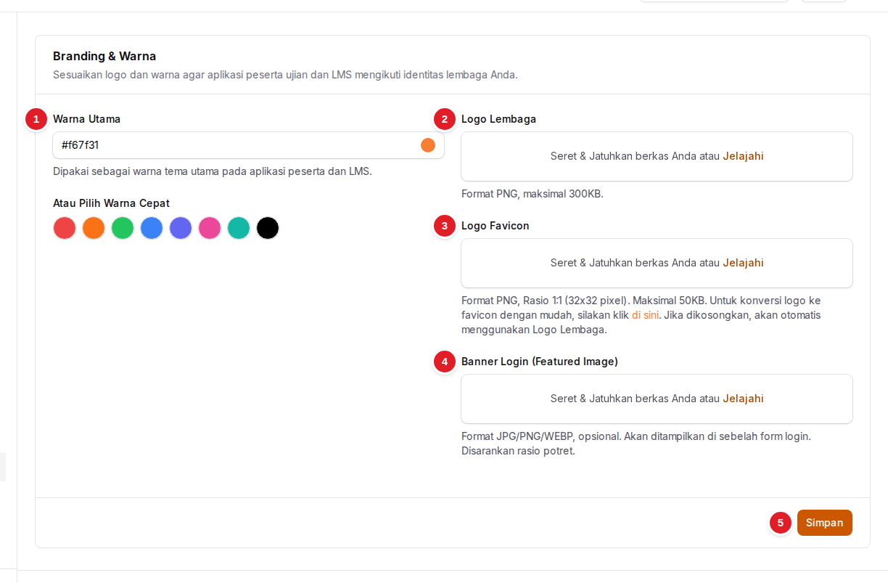
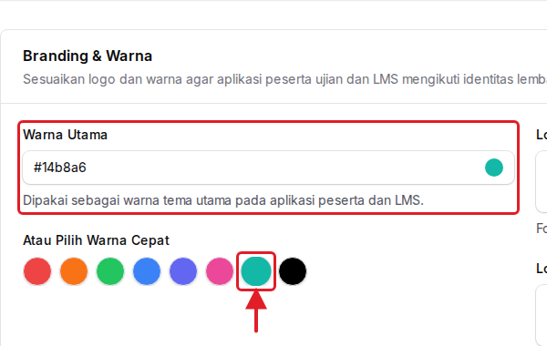
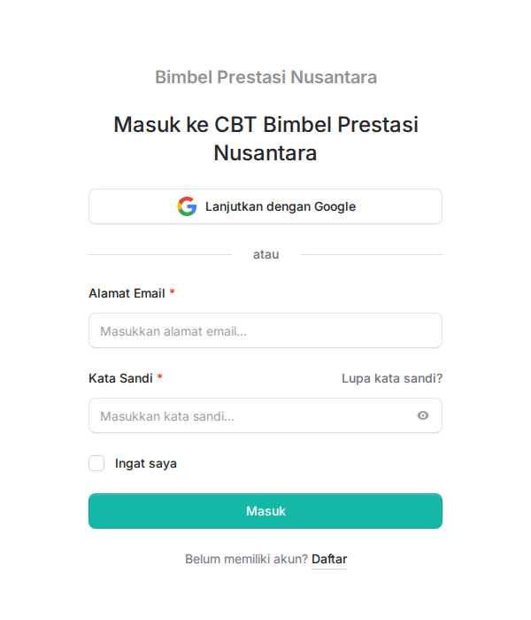
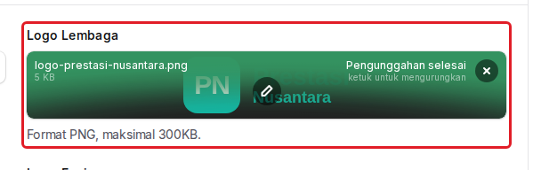
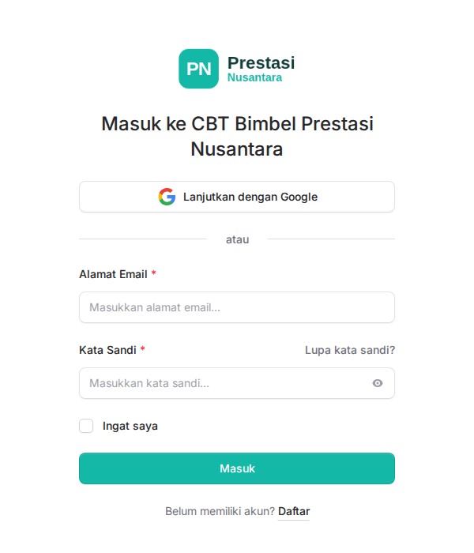
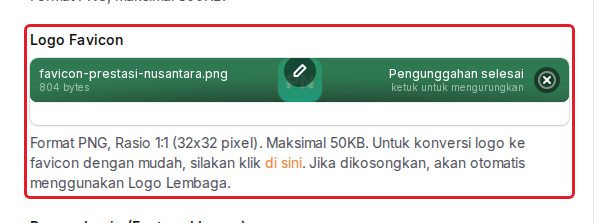
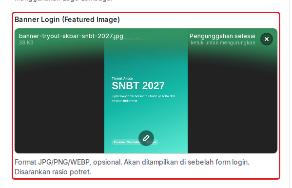
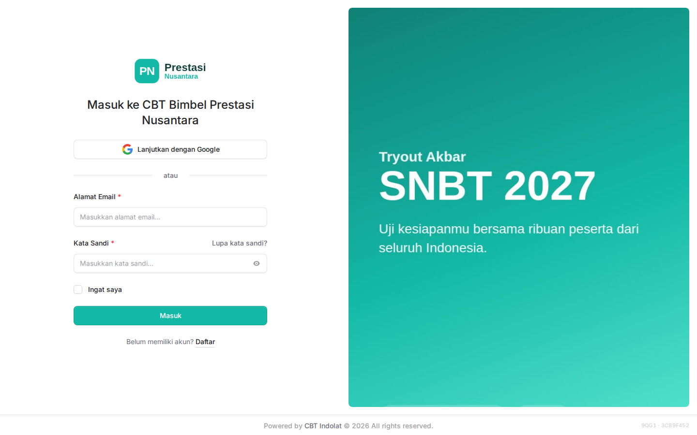

Anda dapat menyesuaikan tampilan aplikasi peserta agar sesuai dengan identitas lembaga, sehingga peserta yakin bahwa mereka membuka sistem ujian yang benar. Pengaturan ini mencakup warna utama, logo lembaga, favicon, dan banner di samping formulir login. Tampilan yang sama dipakai oleh aplikasi peserta ujian (CBT) dan LMS.

<Info>
  **Lokasi menu:** **Portal** → **Administrasi Aplikasi** → **Pengaturan Projek** → **Branding & Warna**

  **Peran yang dibutuhkan:** pemilik projek, atau admin dengan peran yang diberi akses ke modul **Branding & Warna**.

  **Syarat:** add-on **Kustomisasi Branding** aktif.
</Info>

Pengaturan cara peserta masuk (tombol Google dan pendaftaran mandiri) dibahas di [Login Peserta](/lainnya/login-peserta), sedangkan nama lembaga dan kode projek diatur di [Profil Projek](/administrasi/profil-projek).

<Frame>
  
</Frame>

## Mengaktifkan add-on Kustomisasi Branding

**Kustomisasi Branding** merupakan fitur add-on. Selama add-on ini belum aktif, kolom-kolom pada halaman **Branding & Warna** tidak dapat diubah, tombol **Simpan** tidak tampil, dan aplikasi peserta memakai tampilan bawaan Indolat.

<Frame>
  
</Frame>

Klik **Aktifkan Add-on Kustomisasi Branding** untuk membuka halaman konfirmasi pembelian add-on di **Administrasi Aplikasi** → **Keuangan** → **Langganan & Tagihan**. Setelah add-on aktif, kembali ke halaman **Branding & Warna**.

## Mengatur branding

<Steps>
  <Step title="Buka halaman Branding & Warna">
    Setelah add-on aktif, semua kolom dapat diisi dan tombol **Simpan** tampil di bagian bawah.

    <Frame>
      
    </Frame>

    1. **Warna Utama**
    2. **Logo Lembaga**
    3. **Logo Favicon**
    4. **Banner Login (Featured Image)**
    5. **Simpan**
  </Step>
  <Step title="Pilih Warna Utama">
    Warna utama dipakai sebagai warna tema pada aplikasi peserta dan LMS, misalnya pada tombol **Masuk** dan bilah atas halaman peserta. Masukkan kode warna (misalnya `#14b8a6`), pilih warna melalui pemilih warna, atau klik salah satu warna pada **Atau Pilih Warna Cepat**.

    Contohnya, Bimbel Prestasi Nusantara memakai warna hijau tosca.

    <Frame>
      
    </Frame>

    Berikut tampilan halaman login peserta setelah warna utama disimpan:

    <Frame>
      
    </Frame>
  </Step>
  <Step title="Unggah Logo Lembaga">
    Klik **Jelajahi** pada kolom **Logo Lembaga**, lalu pilih file logo. Setelah file terunggah, Anda dapat mengeklik ikon pensil pada pratinjau untuk memotong atau menyesuaikan gambar.

    <Frame>
      
    </Frame>

    Logo tampil di atas formulir login peserta, menggantikan teks nama lembaga.

    <Frame>
      
    </Frame>

    <Note>
      Gunakan gambar berformat **PNG** dengan ukuran maksimal **300 KB**. Logo dengan latar transparan akan terlihat paling rapi.
    </Note>
  </Step>
  <Step title="Unggah Logo Favicon (opsional)">
    Favicon adalah ikon kecil yang tampil pada tab browser, di sebelah judul halaman.

    <Frame>
      
    </Frame>

    <Note>
      Gunakan gambar berformat **PNG** dengan rasio **1:1** (32 × 32 piksel) dan ukuran maksimal **50 KB**. Jika kolom ini dikosongkan, sistem membuat favicon secara otomatis dari **Logo Lembaga**. Untuk mengubah logo menjadi favicon, Anda juga dapat memakai tautan **di sini** pada teks bantuan kolom tersebut.
    </Note>
  </Step>
  <Step title="Unggah Banner Login (opsional)">
    Banner login adalah gambar yang tampil di samping formulir login peserta. Bagian ini dapat dipakai untuk menampilkan informasi tryout, promosi lembaga, jadwal ujian, atau gambar identitas lembaga.

    <Frame>
      
    </Frame>

    Berikut tampilan halaman login peserta dengan warna utama, logo, dan banner yang sudah disimpan:

    <Frame>
      
    </Frame>

    <Note>
      Gunakan gambar berformat **JPG**, **PNG**, atau **WEBP** dengan ukuran maksimal **2 MB**, sebaiknya berorientasi potret. Banner diperbesar untuk memenuhi area di samping formulir sehingga bagian tepinya dapat terpotong; letakkan tulisan penting di tengah gambar. Banner hanya tampil pada layar lebar seperti laptop dan komputer, dan tidak tampil pada layar ponsel.
    </Note>
  </Step>
  <Step title="Klik Simpan">
    Setelah semua pilihan sesuai, klik **Simpan** di bagian bawah halaman (nomor 5 pada gambar formulir di atas). Perubahan langsung berlaku pada aplikasi peserta dan LMS.
  </Step>
</Steps>

<Info>
  **Branding & Warna** hanya mengubah tampilan. Tautan login peserta mengikuti kode projek di [Profil Projek](/administrasi/profil-projek), sedangkan pilihan cara peserta masuk diatur di **Platform Ujian (CBT)** → **Lainnya** → **Pengaturan Aplikasi** (lihat [Login Peserta](/lainnya/login-peserta)).
</Info>
