Halaman ini menjelaskan pengaturan yang menentukan cara peserta masuk ke aplikasi ujian: tautan login yang dibagikan kepada peserta, tombol login dengan Google, dan pendaftaran akun mandiri. Di bagian akhir terdapat langkah pendaftaran dan verifikasi email dari sisi peserta.

<Info>
  **Lokasi menu:** **Portal** → **Platform Ujian (CBT)** → **Lainnya** → **Pengaturan Aplikasi**

  **Peran yang dibutuhkan:** pemilik projek, atau admin dengan peran yang diberi akses ke modul **Pengaturan Aplikasi**.
</Info>

Sebagai contoh, Anda adalah admin **Bimbel Prestasi Nusantara** yang akan membagikan tautan **Tryout Akbar SNBT 2027** kepada peserta melalui WhatsApp atau media sosial. Peserta membuka tautan tersebut, lalu masuk dengan akun yang sudah disiapkan atau membuat akun sendiri.

<Note>
  Nama lembaga, kode projek, dan bahasa aplikasi peserta sekarang diatur di **Administrasi Aplikasi** → **Pengaturan Projek** → **Profil Projek**. Lihat [Profil Projek](/administrasi/profil-projek). Logo, warna, dan banner login diatur di **Branding & Warna**; lihat [Kustomisasi Tampilan Website](/lainnya/kustomisasi-tampilan-website).
</Note>

<Frame>
  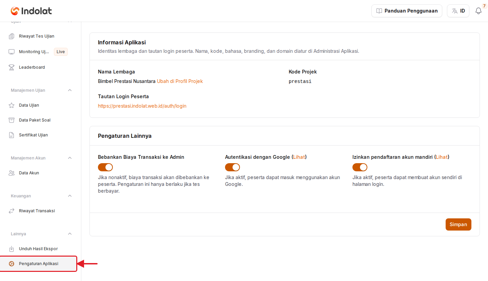
</Frame>

## Informasi Aplikasi

Kartu **Informasi Aplikasi** hanya menampilkan informasi dan tidak dapat diubah dari halaman ini.

<Frame>
  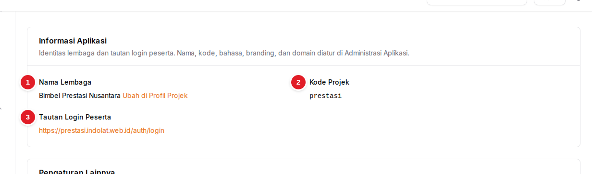
</Frame>

1. **Nama Lembaga**: nama yang tampil pada halaman login peserta, misalnya **Bimbel Prestasi Nusantara**. Sistem menambahkan kata **CBT** secara otomatis sehingga judul halaman login menjadi **Masuk ke CBT Bimbel Prestasi Nusantara**.
2. **Kode Projek**: kode singkat projek Anda, misalnya `prestasi`. Kode ini menjadi bagian alamat aplikasi peserta.
3. **Tautan Login Peserta**: alamat halaman login yang dibagikan kepada peserta, dengan format `https://<kode-projek>.indolat.web.id/auth/login`. Contohnya, `https://prestasi.indolat.web.id/auth/login`. Klik tautan ini untuk membukanya di tab baru.

Untuk mengganti nama lembaga, kode projek, atau bahasa aplikasi peserta, klik **Ubah di Profil Projek**. Anda akan diarahkan ke halaman [Profil Projek](/administrasi/profil-projek) di **Administrasi Aplikasi**.

<Frame>
  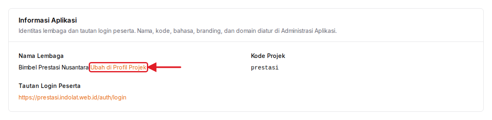
</Frame>

<Warning>
  Mengganti kode projek juga mengganti tautan login peserta. Tautan lama yang sudah dibagikan tidak lagi mengarah ke projek Anda, sehingga Anda perlu membagikan tautan yang baru.
</Warning>

## Pengaturan Lainnya

Kartu **Pengaturan Lainnya** berisi tiga pilihan yang dapat diaktifkan atau dinonaktifkan, lalu disimpan dengan tombol **Simpan**.

<Frame>
  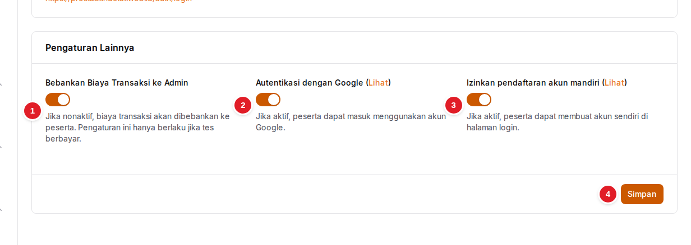
</Frame>

1. **Bebankan Biaya Transaksi ke Admin**
2. **Autentikasi dengan Google**
3. **Izinkan pendaftaran akun mandiri**
4. **Simpan**

<Steps>
  <Step title="Tentukan pihak yang menanggung biaya transaksi (opsional)">
    <Frame>
      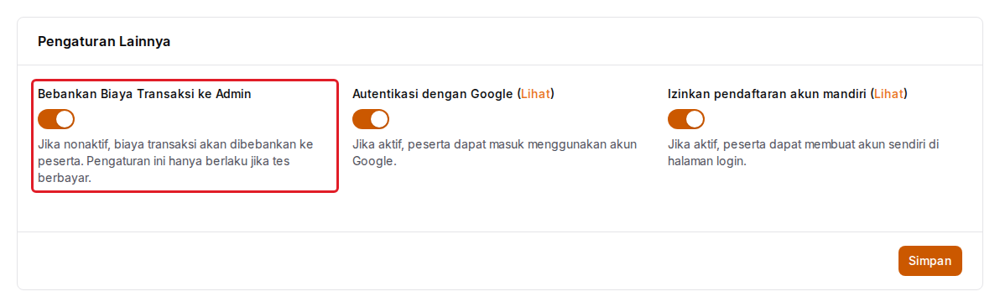
    </Frame>

    Pilihan **Bebankan Biaya Transaksi ke Admin** hanya berlaku untuk ujian berbayar.

    - Jika diaktifkan, biaya transaksi pembayaran ditanggung oleh Anda sebagai penyelenggara dan dipotong dari pembayaran peserta.
    - Jika dinonaktifkan, biaya transaksi ditambahkan ke tagihan peserta.

    Contohnya, biaya ujian **Rp50.000** dan biaya transaksi **Rp2.000**:

    | Pengaturan | Dibayar peserta | Diterima admin |
    | --- | --- | --- |
    | Diaktifkan | Rp50.000 | Rp48.000 |
    | Dinonaktifkan | Rp52.000 | Rp50.000 |
  </Step>
  <Step title="Atur Autentikasi dengan Google (opsional)">
    <Frame>
      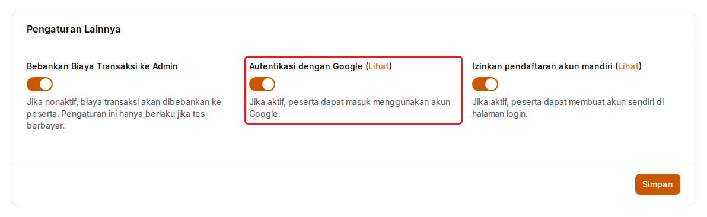
    </Frame>

    - Jika diaktifkan, tombol **Lanjutkan dengan Google** tampil pada halaman login peserta, dan tombol **Daftar dengan Google** tampil pada halaman pendaftaran. Peserta dapat masuk dengan akun Google tanpa perlu mengingat kata sandi baru.

      <Frame>
        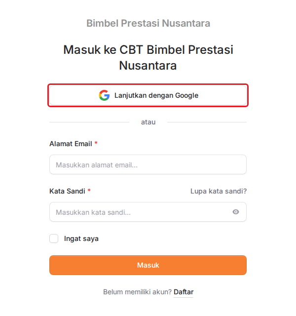
      </Frame>

    - Jika dinonaktifkan, tombol tersebut tidak tampil, dan peserta masuk dengan alamat email dan kata sandi.

      <Frame>
        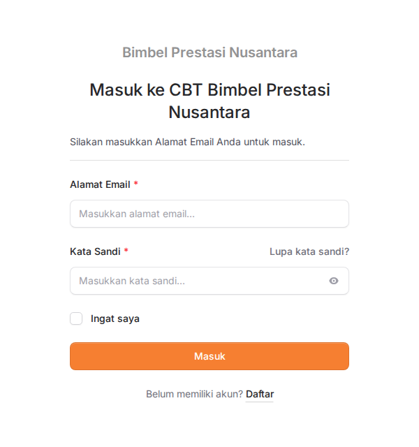
      </Frame>

    <Note>
      Tombol login dengan Google tidak ditampilkan saat halaman login dibuka melalui aplikasi seluler (native) Indolat, meskipun pilihan ini aktif.
    </Note>
  </Step>
  <Step title="Atur Izinkan pendaftaran akun mandiri (opsional)">
    <Frame>
      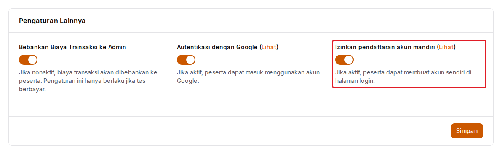
    </Frame>

    - Jika diaktifkan, tautan **Daftar** tampil di bawah tombol **Masuk** pada halaman login peserta, sehingga peserta dapat membuat akun sendiri.

      <Frame>
        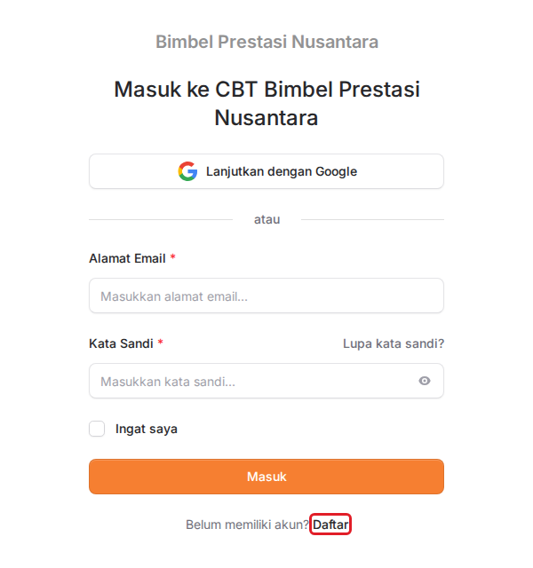
      </Frame>

    - Jika dinonaktifkan, tautan **Daftar** tidak tampil. Peserta hanya dapat masuk dengan akun yang sudah disiapkan admin melalui **Tambah Akun** atau **Import Akun** (lihat [Menambahkan Akun Peserta](/data-akun/menambahkan-akun-peserta)).

      <Frame>
        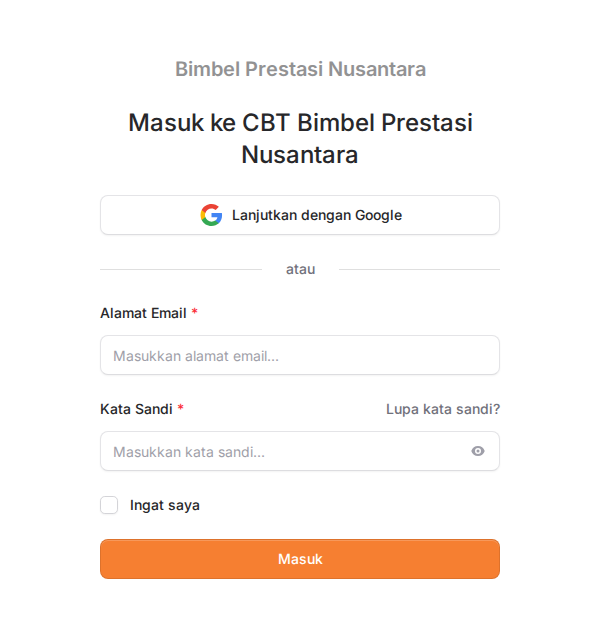
      </Frame>
  </Step>
  <Step title="Klik Simpan">
    <Frame>
      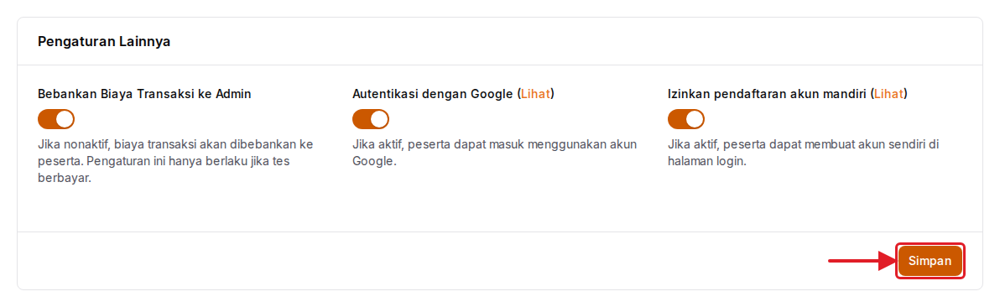
    </Frame>

    Setelah disimpan, muncul notifikasi **Berhasil Menyimpan Pengaturan**. Perubahan langsung berlaku pada halaman login peserta.
  </Step>
</Steps>

## Cara peserta mendaftar dan masuk

Langkah berikut berlaku jika **Izinkan pendaftaran akun mandiri** diaktifkan. Peserta yang sudah memiliki akun cukup mengisi **Alamat Email** dan **Kata Sandi** pada halaman login, lalu mengeklik **Masuk**.

<Steps>
  <Step title="Peserta membuka tautan login, lalu klik Daftar">
    <Frame>
      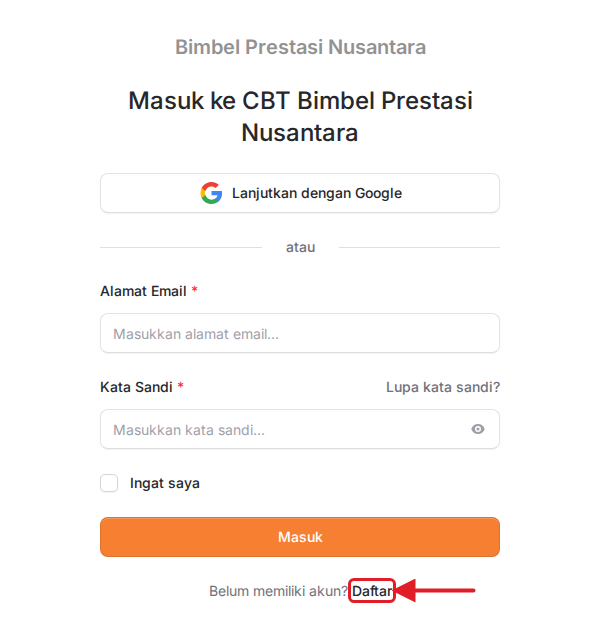
    </Frame>
  </Step>
  <Step title="Peserta mengisi formulir pendaftaran">
    <Frame>
      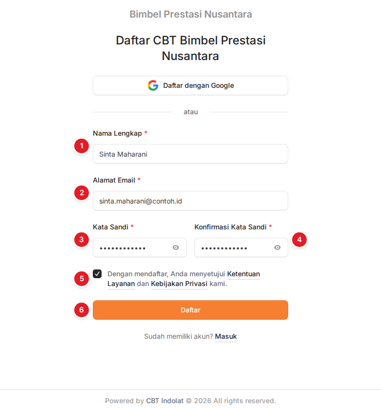
    </Frame>

    1. **Nama Lengkap**: nama peserta yang akan dipakai di dalam sistem, misalnya **Sinta Maharani**.
    2. **Alamat Email**: alamat email aktif milik peserta, misalnya `sinta.maharani@contoh.id`. Kode verifikasi dikirim ke alamat ini.
    3. **Kata Sandi**: minimal 8 karakter.
    4. **Konfirmasi Kata Sandi**: kata sandi yang sama dengan kolom sebelumnya.
    5. **Persetujuan**: centang pernyataan bahwa peserta menyetujui **Ketentuan Layanan** dan **Kebijakan Privasi**.
    6. **Daftar**: klik untuk membuat akun.

    <Note>
      Pendaftaran ditolak jika alamat email sudah terdaftar di projek yang sama, atau jika alamat email berasal dari layanan email sementara (_disposable_) atau email anonim.
    </Note>
  </Step>
  <Step title="Peserta membuka email verifikasi">
    Setelah pendaftaran berhasil, peserta diarahkan ke halaman **Verifikasi Email Anda**.

    <Frame>
      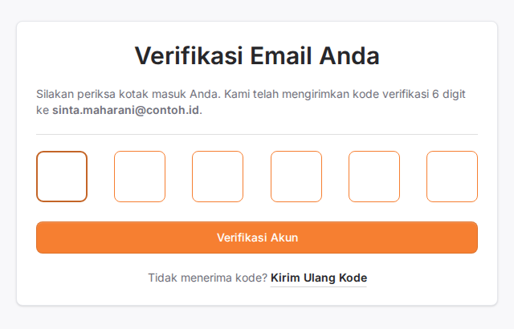
    </Frame>

    Sistem mengirimkan email dari **CBT Indolat** dengan subjek **Kode OTP Anda: [kode]**. Email berisi kode verifikasi 6 angka.

    <Frame>
      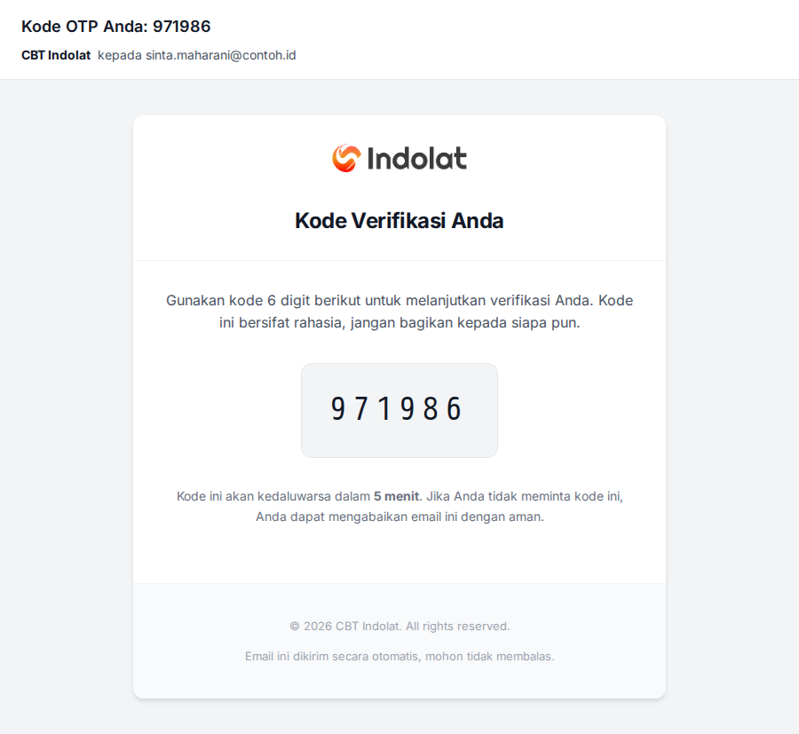
    </Frame>
  </Step>
  <Step title="Peserta memasukkan kode, lalu klik Verifikasi Akun">
    <Frame>
      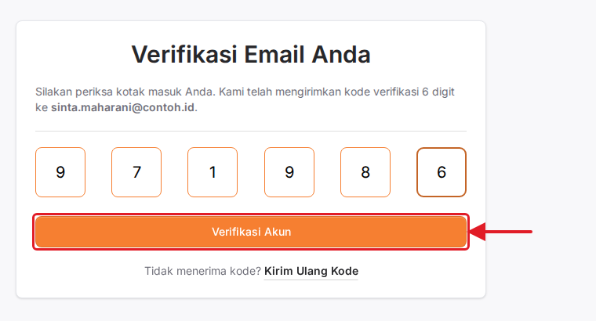
    </Frame>

    <Note>
      Kode verifikasi hanya berlaku selama **5 menit**. Jika kode belum diterima atau sudah kedaluwarsa, klik **Kirim Ulang Kode** untuk mendapatkan kode baru. Periksa juga folder spam.

      <Frame>
        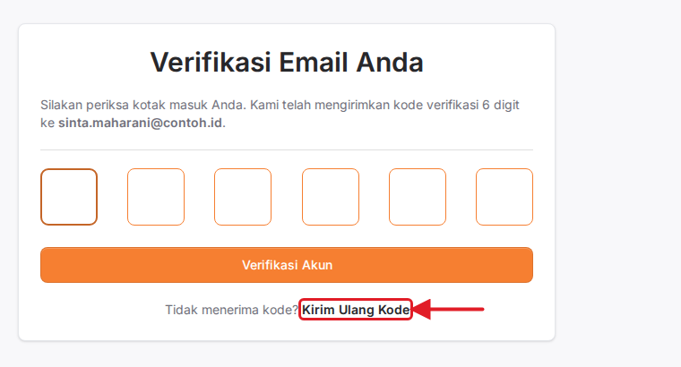
      </Frame>
    </Note>
  </Step>
  <Step title="Peserta masuk ke halaman Daftar Tes">
    <Frame>
      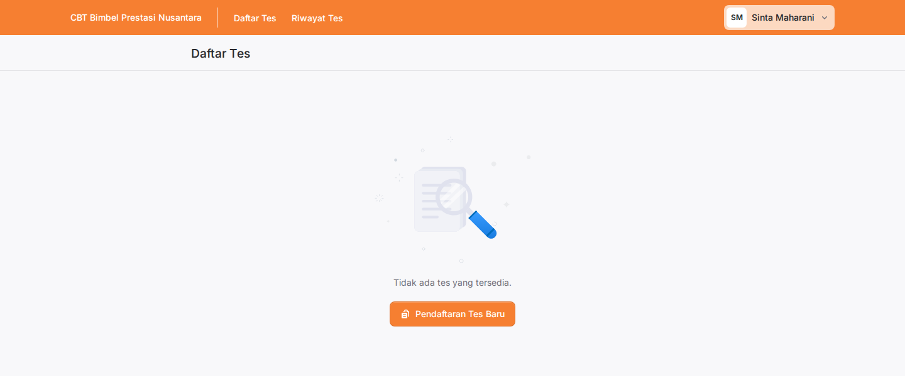
    </Frame>

    Setelah verifikasi berhasil, peserta masuk ke halaman **Daftar Tes**. Tombol **Pendaftaran Tes Baru** tampil jika ada ujian aktif yang sedang dalam masa berlangsung, sehingga peserta dapat mencari dan mendaftar ujian.

    <Info>
      Verifikasi email hanya diperlukan bagi peserta yang mendaftar sendiri. Akun yang ditambahkan admin melalui **Tambah Akun** atau **Import Akun** langsung terverifikasi. Jika peserta tidak menerima kode, admin dapat memverifikasi akun secara manual dengan tombol **Verifikasi Email** di daftar akun peserta.
    </Info>
  </Step>
</Steps>
