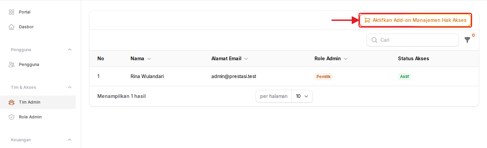
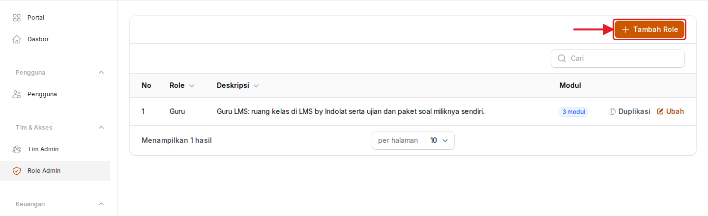
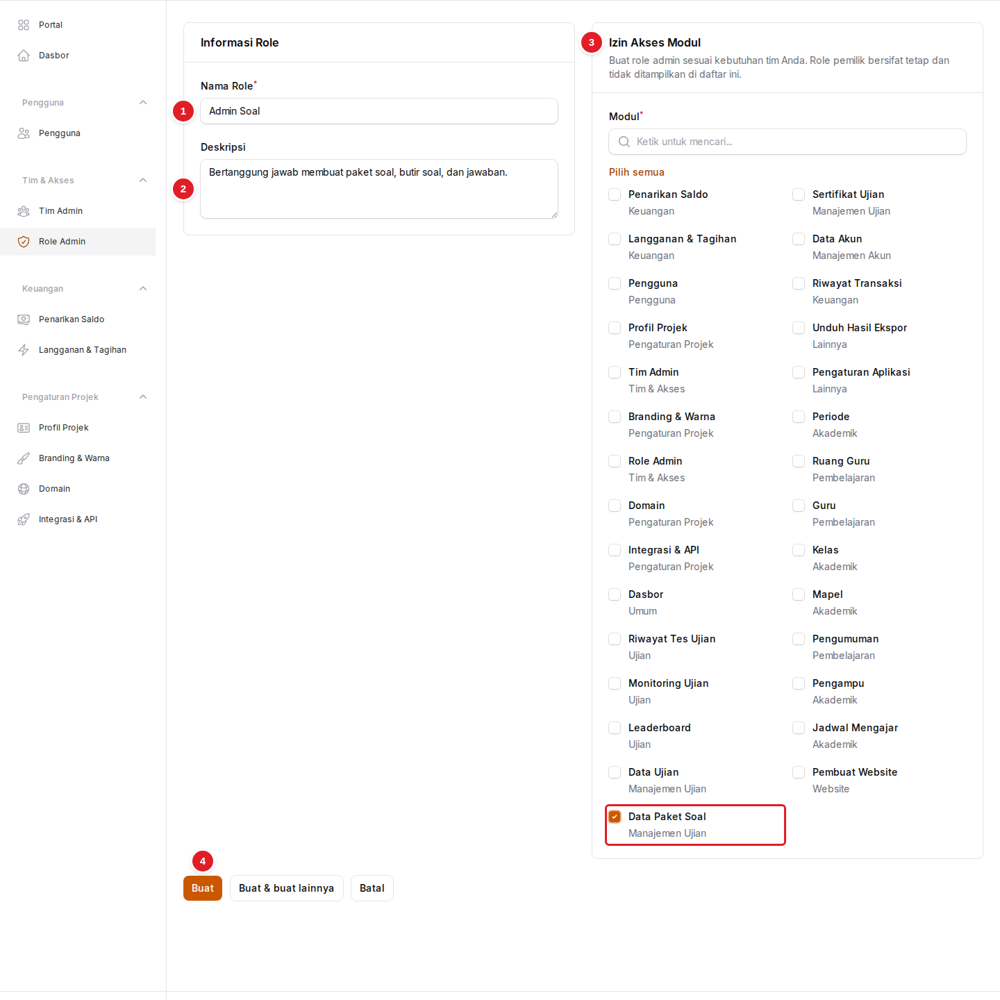
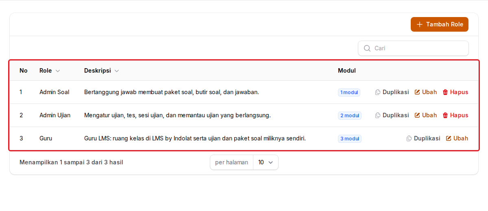
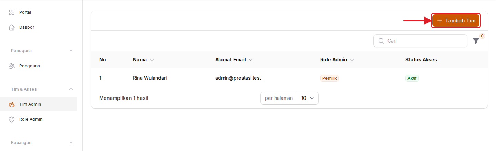
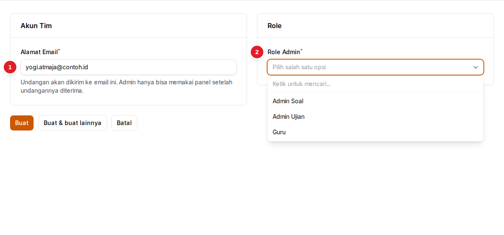
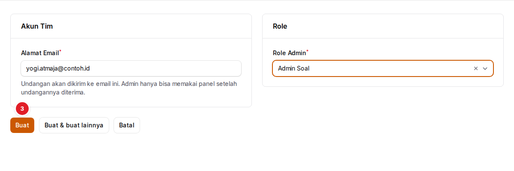
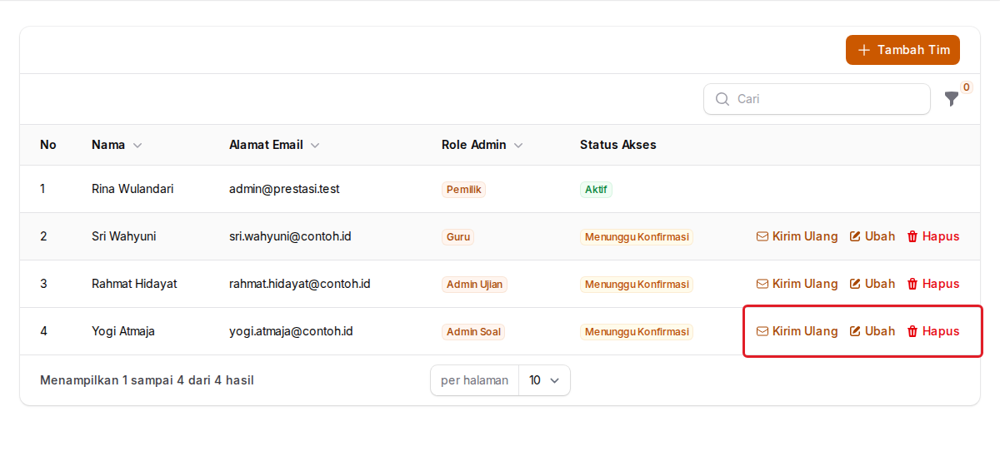
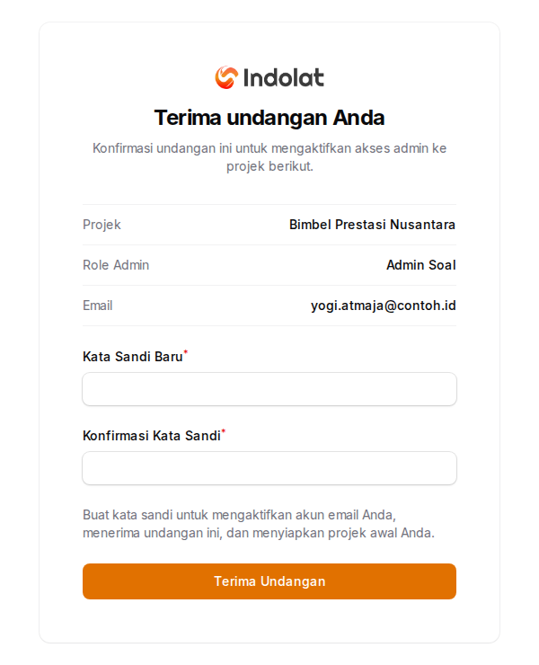

Agar pengelolaan projek tidak bertumpu pada satu orang, Anda dapat mengundang anggota tim dan menentukan modul yang boleh mereka buka. Pengaturan ini dilakukan dalam dua tahap: buat **Role Admin** sesuai tugas, lalu undang anggota melalui **Tim Admin** dengan role tersebut.

<Info>
  **Lokasi menu:** **Portal** → **Administrasi Aplikasi** → **Tim & Akses** → **Tim Admin** atau **Role Admin**.

  **Peran yang dibutuhkan:** pemilik projek, atau anggota tim yang role-nya mencakup modul **Tim Admin** dan **Role Admin**.
</Info>

Sebagai contoh, **Bimbel Prestasi Nusantara** memiliki dua petugas tambahan dan satu pengajar:

- **Yogi Atmaja** sebagai **Admin Soal**, bertugas menyusun paket soal, butir soal, dan jawaban.
- **Rahmat Hidayat** sebagai **Admin Ujian**, bertugas mengatur ujian, tes, dan sesi ujian serta memantau ujian yang berlangsung.
- **Sri Wahyuni** sebagai **Guru** yang mengajar di LMS.

Rina Wulandari, sebagai **Pemilik**, tetap dapat membuka seluruh modul.

## Add-on Manajemen Hak Akses

Mengundang anggota tim memerlukan add-on **Manajemen Hak Akses** yang aktif pada projek. Add-on ini sudah termasuk dalam paket **Rutin** dan **Intensif**, atau dapat dibeli terpisah melalui [Langganan & Tagihan](/administrasi/langganan-dan-tagihan).

Selama add-on belum aktif:

- pemilik projek tetap dapat menyiapkan **Role Admin**;
- tombol **Tambah Tim** tidak tampil, dan halaman menampilkan tombol **Aktifkan Add-on Manajemen Hak Akses** yang membuka halaman pembelian add-on;
- anggota tim selain pemilik tidak dapat membuka projek, kecuali anggota dengan role **Guru**.

<Frame>
  
</Frame>

## 1. Membuat Role Admin

**Role Admin** menentukan modul yang boleh dibuka dan dikelola oleh anggota tim. Satu role dapat dipakai oleh banyak anggota.

<Steps>
  <Step title="Klik Tambah Role">
    Buka **Administrasi Aplikasi** → **Tim & Akses** → **Role Admin**, lalu klik **Tambah Role**.

    <Frame>
      
    </Frame>
  </Step>
  <Step title="Isi data role dan pilih modul">
    <Frame>
      
    </Frame>

    1. **Nama Role**: nama peran yang mudah dikenali, misalnya `Admin Soal`.
    2. **Deskripsi** (opsional): tanggung jawab role, misalnya `Bertanggung jawab membuat paket soal, butir soal, dan jawaban.`
    3. **Izin Akses Modul**: centang modul yang boleh dibuka. Untuk **Admin Soal**, centang **Data Paket Soal**.
    4. Klik **Buat** untuk menyimpan, atau **Buat & buat lainnya** untuk langsung membuat role berikutnya.

    Daftar modul disusun per produk sesuai urutan di **Portal**: modul **Administrasi Aplikasi** terlebih dahulu, kemudian **Platform Ujian (CBT)**, **Learning Management System (LMS)**, dan **Pembuat Website**. Teks kecil di bawah setiap modul menunjukkan grup menunya di sidebar, misalnya **Data Paket Soal** berada di grup **Manajemen Ujian**.

    | Produk | Modul yang dapat dipilih |
    | --- | --- |
    | Administrasi Aplikasi | Penarikan Saldo, Langganan & Tagihan, Pengguna, Profil Projek, Tim Admin, Branding & Warna, Role Admin, Domain, Integrasi & API |
    | Platform Ujian (CBT) | Dasbor, Riwayat Tes Ujian, Monitoring Ujian, Leaderboard, Data Ujian, Data Paket Soal, Sertifikat Ujian, Data Akun, Riwayat Transaksi, Unduh Hasil Ekspor, Pengaturan Aplikasi |
    | Learning Management System (LMS) | Periode, Ruang Guru, Guru, Kelas, Mapel, Pengumuman, Pengampu, Jadwal Mengajar |
    | Pembuat Website | Pembuat Website |

    <Tip>
      Gunakan kolom pencarian di atas daftar untuk menemukan modul dengan cepat, atau **Pilih semua** untuk mencentang seluruh modul. Minimal satu modul wajib dipilih.
    </Tip>

    <Note>
      Anda hanya dapat memberikan modul yang Anda miliki sendiri. Jika role berisi modul di luar akses Anda, sistem menolak penyimpanan dengan pesan *Anda tidak dapat memberikan akses modul yang tidak Anda miliki.*
    </Note>
  </Step>
  <Step title="Periksa daftar role">
    Role yang dibuat tampil pada daftar **Role Admin** beserta jumlah modulnya.

    <Frame>
      
    </Frame>

    - **Duplikasi**: membuat salinan role dengan modul yang sama. Anda diminta mengisi **Nama Role Baru** (bawaannya nama role ditambah `Copy`).
    - **Ubah**: mengganti nama, deskripsi, atau modul role. Perubahan langsung berlaku bagi semua anggota yang memakai role tersebut.
    - **Hapus**: menghapus role. Tombol ini hanya tampil untuk role yang belum dipakai anggota tim; pindahkan atau hapus anggota yang memakainya terlebih dahulu.
  </Step>
</Steps>

### Role bawaan

- **Pemilik**: role tetap untuk pemilik projek dengan akses ke seluruh modul. Role ini tidak tampil di daftar dan tidak dapat diubah.
- **Guru**: role sistem untuk pengajar LMS dengan modul **Ruang Guru**, **Data Ujian**, dan **Data Paket Soal**. Guru hanya melihat ujian dan paket soal miliknya sendiri. Role ini dapat diubah dan diduplikasi, tetapi tidak dapat dihapus. Anggota dengan role **Guru** tetap dapat masuk meskipun add-on **Manajemen Hak Akses** belum aktif.

## 2. Mengundang anggota Tim Admin

<Steps>
  <Step title="Klik Tambah Tim">
    Buka **Administrasi Aplikasi** → **Tim & Akses** → **Tim Admin**, lalu klik **Tambah Tim**.

    <Frame>
      
    </Frame>
  </Step>
  <Step title="Isi email dan pilih role">
    <Frame>
      
    </Frame>

    1. **Alamat Email**: email anggota yang diundang, misalnya `yogi.atmaja@contoh.id`. Undangan dikirim ke alamat ini, jadi pastikan email benar dan aktif. Jika email tersebut sudah dipakai oleh akun admin lain, formulir menampilkan **Akun Terdeteksi** beserta nama pemiliknya.
    2. **Role Admin**: pilih role sesuai tugas anggota. Pilihan berasal dari daftar **Role Admin**, termasuk **Guru**.

    <Frame>
      
    </Frame>

    3. Klik **Buat**. Sistem mengirim undangan dan menampilkan notifikasi *Undangan admin berhasil dikirim.*

    <Note>
      Satu email hanya dapat diundang sekali per projek. Jika undangan sebelumnya belum diterima, sistem menampilkan pesan bahwa undangan masih menunggu persetujuan; gunakan **Kirim Ulang** pada daftar tim.
    </Note>
  </Step>
  <Step title="Pantau status undangan">
    Anggota yang diundang tampil di daftar **Tim Admin** dengan **Status Akses** **Menunggu Konfirmasi** sampai undangannya diterima, lalu berubah menjadi **Aktif**. Nama anggota diambil sementara dari bagian depan alamat emailnya.

    <Frame>
      
    </Frame>

    - **Kirim Ulang**: mengirim ulang email undangan. Tombol ini hanya tampil selama status masih **Menunggu Konfirmasi**. Tautan lama tidak berlaku lagi setelah undangan dikirim ulang.
    - **Ubah**: mengganti **Role Admin** anggota. Alamat email tidak dapat diubah.
    - **Hapus**: mencabut akses anggota dari projek.

    Gunakan filter **Role** untuk menampilkan anggota dengan role tertentu. Baris **Pemilik** tidak memiliki tombol aksi.
  </Step>
</Steps>

## 3. Menerima undangan

Anggota menerima email **Undangan Admin Projek** (atau **Undangan Mengajar di LMS** untuk role **Guru**). Tautan di email berlaku selama 7 hari dan membuka halaman **Terima undangan Anda** yang menampilkan nama projek, role, dan email.

<Frame>
  
</Frame>

- Jika email belum memiliki akun, anggota mengisi **Kata Sandi Baru** dan **Konfirmasi Kata Sandi**, lalu klik **Terima Undangan**. Akun anggota juga dibuatkan projek awal miliknya sendiri, sehingga ia dapat berpindah projek melalui **Ganti Projek** di Portal.
- Jika email sudah memiliki akun, anggota cukup klik **Terima Undangan**; kata sandi lamanya tidak berubah.

<Tip>
  Jika status masih **Menunggu Konfirmasi**, minta anggota memeriksa kotak masuk dan folder spam, atau klik **Kirim Ulang**.
</Tip>

Setelah undangan diterima, anggota masuk melalui halaman login panel dan memilih projek **Bimbel Prestasi Nusantara** di Portal. Sidebar setiap modul hanya menampilkan menu yang termasuk dalam role-nya.
