Fitur **Sertifikat Ujian** digunakan untuk membuat sertifikat yang dapat diunduh peserta setelah menyelesaikan ujian. Setiap template sertifikat dihubungkan ke satu ujian. Anda menentukan syarat penerbitan (misalnya nilai minimum), tampilan sertifikat, penandatangan, dan apakah sertifikat perlu disetujui admin sebelum dapat diunduh.

<Info>
  **Lokasi menu:** **Portal** → **Platform Ujian (CBT)** → **Manajemen Ujian** → **Sertifikat Ujian**.
</Info>

Contoh pada halaman ini memakai template **Sertifikat Tryout Mingguan Penalaran – Pekan 3** untuk ujian **Tryout Mingguan Penalaran – Pekan 3** (kode **TMP-P3**). Sertifikat diberikan kepada peserta yang menyelesaikan semua tes dengan nilai akhir minimal 12.

## Add-on Sertifikat Ujian

**Sertifikat Ujian** merupakan fitur add-on. Selama add-on belum aktif, tombol **Aktifkan Add-on Sertifikat Ujian** tampil di halaman **Sertifikat Ujian**. Klik tombol tersebut untuk membeli add-on melalui **Langganan & Tagihan**, lihat [Langganan dan Tagihan](/administrasi/langganan-dan-tagihan).

<Frame>
  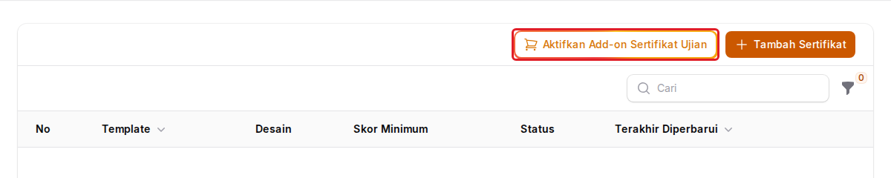
</Frame>

Selama add-on belum aktif, Anda tetap dapat menyiapkan template. Formulir menampilkan peringatan **Add-on Sertifikat Ujian belum aktif**, **Status** hanya dapat berupa **Draft**, dan **Tampilkan ke peserta** tidak dapat diaktifkan. Akibatnya, sertifikat belum dapat diajukan atau diunduh peserta.

<Frame>
  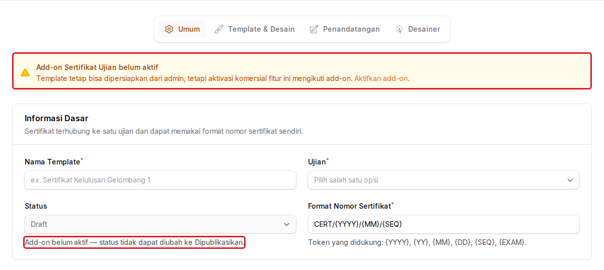
</Frame>

<Note>
  Jika add-on berakhir, peserta yang sertifikatnya sudah disetujui tetap dapat mengunduhnya. Sertifikat baru tidak dapat diterbitkan sampai add-on aktif kembali.
</Note>

## 1. Membuat template sertifikat

<Steps>
  <Step title="Klik Tambah Sertifikat">
    Buka menu **Sertifikat Ujian**, lalu klik **Tambah Sertifikat**.

    <Frame>
      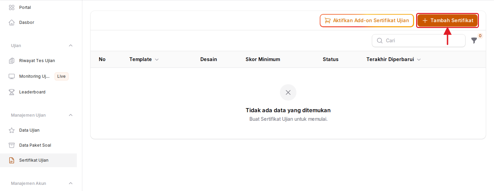
    </Frame>
  </Step>
  <Step title="Kenali tab formulir">
    Formulir sertifikat terdiri atas empat tab:

    <Frame>
      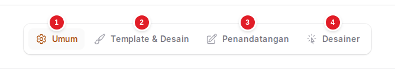
    </Frame>

    1. **Umum**: nama, ujian, status, nomor sertifikat, dan aturan penerbitan.
    2. **Template & Desain**: layout, ukuran halaman, desain, logo, dan warna.
    3. **Penandatangan**: pihak yang menandatangani sertifikat.
    4. **Desainer**: posisi dan isi setiap elemen sertifikat.

    Setelah template disimpan, tab **Sertifikat Terbit** juga muncul untuk mengelola sertifikat peserta.
  </Step>
</Steps>

### A. Tab Umum

**Informasi Dasar**

<Frame>
  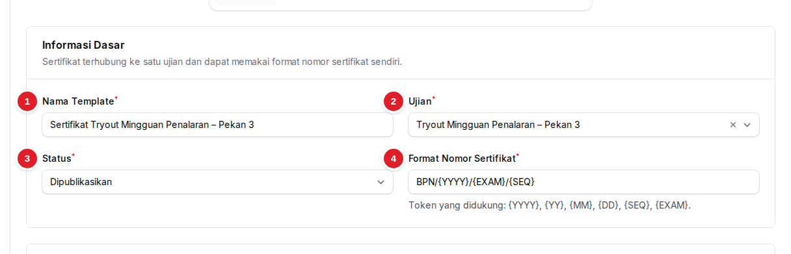
</Frame>

1. **Nama Template**: nama untuk membedakan template di daftar admin. Contoh: **Sertifikat Tryout Mingguan Penalaran – Pekan 3**.
2. **Ujian**: ujian yang memakai sertifikat ini. Satu template dihubungkan ke satu ujian. Klik kolom, ketik sebagian nama ujian untuk mencari, lalu klik ujiannya.

   <Frame>
     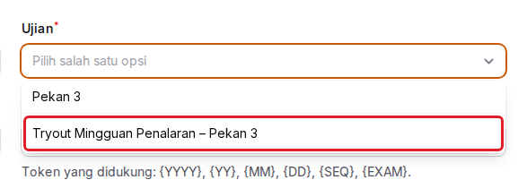
   </Frame>
3. **Status**:
   - **Draft**: template masih disiapkan dan belum berlaku untuk peserta.
   - **Dipublikasikan**: template berlaku. Pilihan ini hanya tersedia jika add-on aktif.
4. **Format Nomor Sertifikat**: susunan nomor yang dibuat otomatis saat sertifikat diterbitkan. Bawaannya `CERT/{YYYY}/{MM}/{SEQ}`.

   <Info>
     **Token yang didukung:**

     - `{YYYY}`: tahun empat angka, misalnya 2026
     - `{YY}`: tahun dua angka, misalnya 26
     - `{MM}`: bulan dua angka
     - `{DD}`: tanggal dua angka
     - `{SEQ}`: nomor urut sertifikat untuk template ini, enam angka, misalnya 000001
     - `{EXAM}`: kode ujian, hanya huruf dan angka, maksimal enam karakter
   </Info>

   Contoh: format `BPN/{YYYY}/{EXAM}/{SEQ}` pada ujian berkode `TMP-P3` menghasilkan `BPN/2026/TMPP3/000001`.

**Aturan Penerbitan** dan **Catatan**

<Frame>
  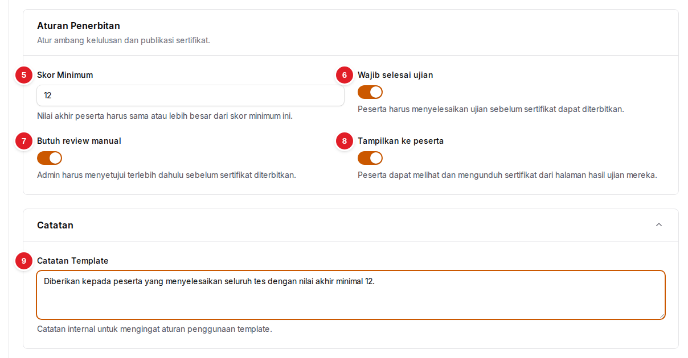
</Frame>

5. **Skor Minimum**: nilai akhir minimal agar peserta berhak menerima sertifikat. Nilai akhir peserta harus sama atau lebih besar dari angka ini. Kosongkan jika semua peserta yang selesai berhak menerima sertifikat.
6. **Wajib selesai ujian**: jika aktif (bawaan), sertifikat hanya tersedia setelah peserta menyelesaikan semua tes dalam ujian.
7. **Butuh review manual**: jika aktif, peserta harus mengajukan sertifikat terlebih dahulu dan admin menyetujuinya sebelum sertifikat dapat diunduh. Jika nonaktif, peserta yang memenuhi syarat langsung dapat mengunduh sertifikat.
8. **Tampilkan ke peserta**: aktifkan agar tombol sertifikat tampil di halaman **Riwayat Tes** peserta. Jika nonaktif, sertifikat tidak tampil kepada peserta. Pilihan ini hanya dapat diaktifkan jika add-on aktif.
9. **Catatan Template**: buka bagian **Catatan** untuk menulis catatan internal, misalnya aturan penggunaan template. Catatan ini hanya terlihat oleh admin.

<Tip>
  Pilih **Draft** dan nonaktifkan **Tampilkan ke peserta** selama desain masih disiapkan. Ubah ke **Dipublikasikan** dan aktifkan **Tampilkan ke peserta** setelah sertifikat siap.
</Tip>

### B. Tab Template & Desain

<Frame>
  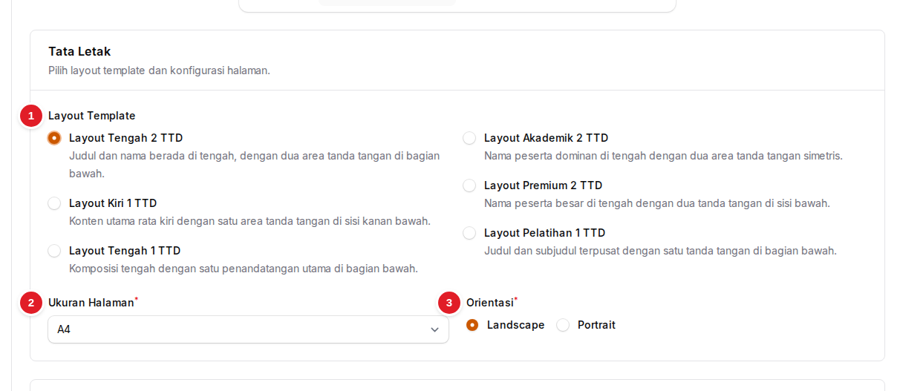
</Frame>

1. **Layout Template**: susunan awal elemen sertifikat. Pilihannya **Layout Tengah 2 TTD**, **Layout Kiri 1 TTD**, **Layout Tengah 1 TTD**, **Layout Akademik 2 TTD**, **Layout Premium 2 TTD**, dan **Layout Pelatihan 1 TTD**. Pilih layout yang jumlah tanda tangannya (TTD) sesuai jumlah penandatangan.
2. **Ukuran Halaman**: **A4** atau **Letter**.
3. **Orientasi**: **Landscape** (mendatar) atau **Portrait** (tegak).

<Note>
  Mengganti **Layout Template** mengembalikan posisi semua elemen ke susunan bawaan layout tersebut. Pilih layout sebelum mengatur elemen di tab **Desainer**.
</Note>

<Frame>
  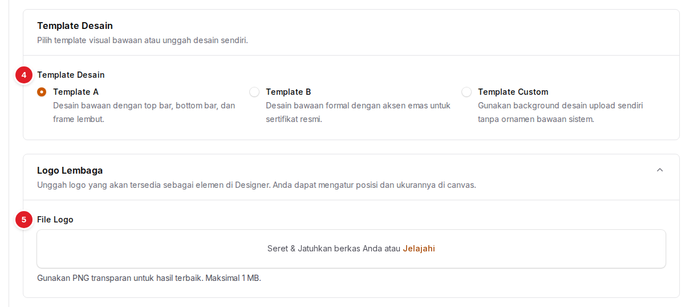
</Frame>

4. **Template Desain**:
   - **Template A**: desain bawaan dengan bilah atas, bilah bawah, dan bingkai lembut.
   - **Template B**: desain bawaan formal dengan aksen emas.
   - **Template Custom**: memakai desain Anda sendiri. Unggah gambar latar pada **Background Template Custom** (PNG, JPG, atau WEBP). Resolusi yang disarankan 3508 × 2480 px untuk landscape atau 2480 × 3508 px untuk portrait (A4, 300 DPI).
5. **Logo Lembaga** (opsional): unggah logo pada **File Logo**. Gunakan PNG transparan, maksimal 1 MB. Logo tersedia sebagai elemen **Logo Lembaga** di tab **Desainer**.

<Frame>
  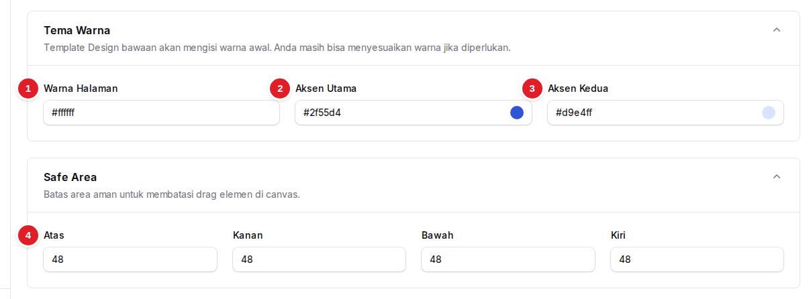
</Frame>

**Tema Warna** terisi otomatis sesuai template desain, tetapi dapat Anda ubah:

1. **Warna Halaman**: warna latar sertifikat.
2. **Aksen Utama**: warna bilah dan ornamen utama.
3. **Aksen Kedua**: warna ornamen pendukung.

**Safe Area** (4) adalah batas aman dalam piksel di sisi **Atas**, **Kanan**, **Bawah**, dan **Kiri**. Elemen di tab **Desainer** tidak dapat digeser melewati batas ini. Gunakan nilai bawaan jika tidak ada kebutuhan khusus.

### C. Tab Penandatangan

Formulir baru langsung menyediakan dua penandatangan. Isi data setiap penandatangan:

<Frame>
  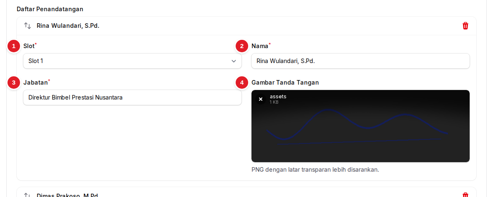
</Frame>

1. **Slot**: posisi tanda tangan di sertifikat, **Slot 1**, **Slot 2**, atau **Slot 3**. Slot ini dipakai elemen **Area Tanda Tangan**, **Nama Penandatangan**, dan **Jabatan Penandatangan** di tab **Desainer**.
2. **Nama**: nama lengkap penandatangan. Contoh: **Rina Wulandari, S.Pd.**
3. **Jabatan**: jabatan penandatangan. Contoh: **Direktur Bimbel Prestasi Nusantara**.
4. **Gambar Tanda Tangan**: unggah gambar tanda tangan. PNG dengan latar transparan memberi hasil paling rapi.

Klik **+ Tambah Penandatangan** untuk menambah penandatangan, atau ikon tempat sampah untuk menghapusnya. Ikon panah di kiri judul penandatangan dipakai untuk mengubah urutan.

<Frame>
  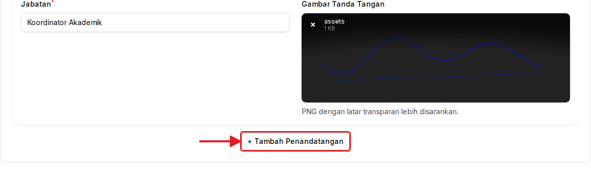
</Frame>

### D. Tab Desainer

Tab **Desainer** dipakai untuk mengatur posisi dan isi setiap elemen sertifikat.

<Frame>
  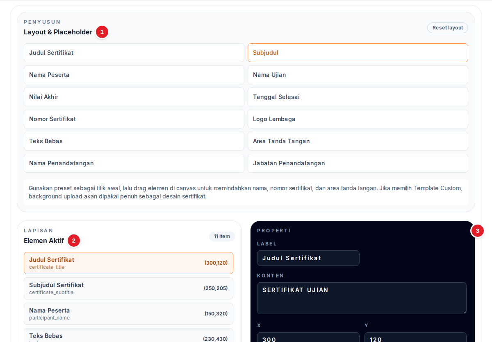
</Frame>

1. **Layout & Placeholder**: klik nama elemen untuk menambahkannya ke sertifikat. Elemen yang tersedia: **Judul Sertifikat**, **Subjudul**, **Nama Peserta**, **Nama Ujian**, **Nilai Akhir**, **Tanggal Selesai**, **Nomor Sertifikat**, **Logo Lembaga**, **Teks Bebas**, **Area Tanda Tangan**, **Nama Penandatangan**, dan **Jabatan Penandatangan**. Klik **Reset layout** untuk mengembalikan susunan bawaan layout.
2. **Elemen Aktif**: daftar elemen yang ada di sertifikat beserta posisinya. Klik elemen untuk memilihnya.
3. **Properti**: pengaturan elemen yang dipilih, yaitu **Label**, **Konten** (isi teks), posisi **X** dan **Y**, **Lebar**, **Tinggi**, **Font** (ukuran huruf), **Tebal**, **Align** (perataan), dan **Warna**. Klik **Duplikat** untuk menyalin elemen atau **Hapus** untuk menghapusnya. Untuk elemen tanda tangan, pilih juga **Slot** penandatangannya.

Pada **Konten** elemen teks, Anda dapat memakai penanda yang diganti otomatis dengan data peserta, misalnya `{{exam_name}}`, `{{final_score}}`, `{{completion_date}}`, dan `{{certificate_number}}`.

Bagian **Preview Interaktif** menampilkan gambaran sertifikat dengan contoh nama peserta. Geser elemen langsung di pratinjau untuk memindahkannya.

<Frame>
  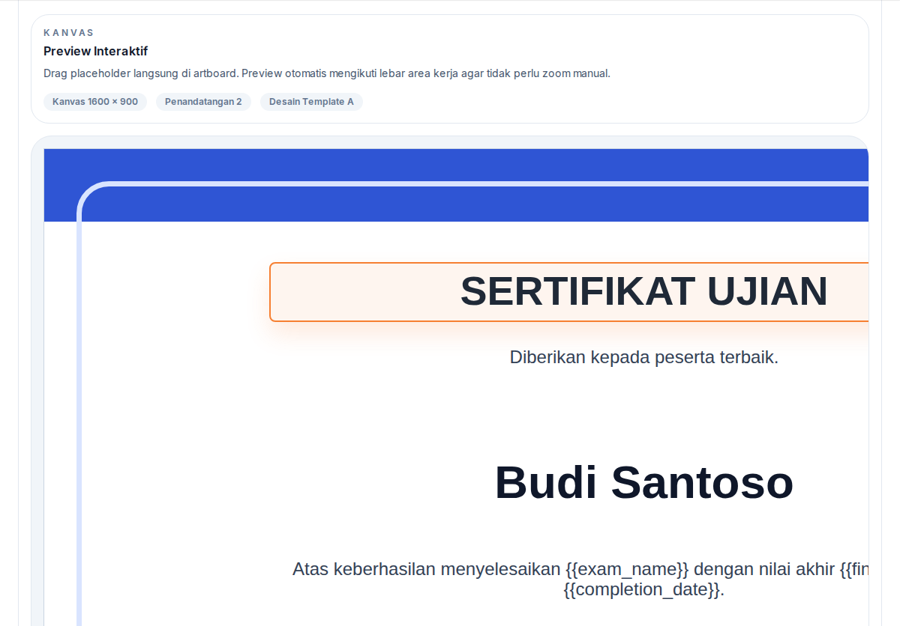
</Frame>

Periksa kembali posisi judul, nama peserta, nilai, nomor sertifikat, dan tanda tangan. Pastikan tidak ada tulisan yang bertumpuk, terpotong, atau terlalu dekat dengan tepi. Jika sudah sesuai, klik **Buat** untuk menyimpan template.

## 2. Mengelola template sertifikat

Template yang sudah dibuat tampil di daftar **Sertifikat Ujian** dengan kolom **Template** (beserta nama ujian), **Desain**, **Skor Minimum**, **Status**, dan **Terakhir Diperbarui**.

<Frame>
  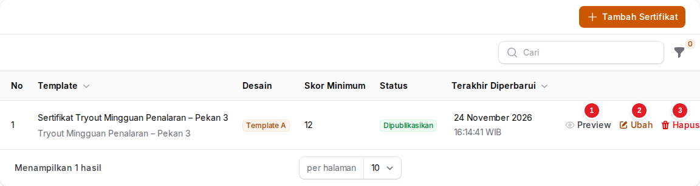
</Frame>

1. **Preview**: membuka pratinjau sertifikat dengan data contoh di tab baru.
2. **Ubah**: membuka halaman **Ubah Sertifikat Ujian**. Di halaman ini tersedia juga tombol **Preview** dan **Unduh PDF** (contoh sertifikat dalam PDF) di kanan atas, serta tab **Sertifikat Terbit**.
3. **Hapus**: menghapus template.

Gunakan filter **Ujian** dan **Status** untuk menyaring daftar.

## 3. Alur sertifikat di aplikasi peserta

Sertifikat tampil di halaman **Riwayat Tes** peserta, pada bagian **Skor Akhir**, jika:

- template berstatus **Dipublikasikan** dan **Tampilkan ke peserta** aktif,
- peserta sudah menyelesaikan semua tes (jika **Wajib selesai ujian** aktif), dan
- nilai akhir peserta memenuhi **Skor Minimum**.

Peserta yang belum memenuhi syarat tidak melihat tombol sertifikat. Pada contoh, Clarissa Anindya (nilai akhir 11) tidak melihat tombol, sedangkan Galih Prasetyo Utomo (nilai akhir 12) dan Adinda Maharani (nilai akhir 15) melihatnya.

<Steps>
  <Step title="Peserta membuka Riwayat Tes">
    Setelah masuk ke aplikasi peserta, peserta mengklik **Riwayat Tes** di menu atas. Cara peserta masuk dijelaskan di [Login Peserta](/lainnya/login-peserta).

    <Frame>
      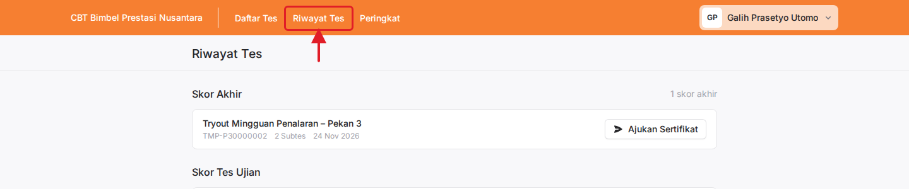
    </Frame>
  </Step>
</Steps>

### A. Tanpa persetujuan admin

Jika **Butuh review manual** nonaktif, tombol **Unduh Sertifikat** langsung tampil pada bagian **Skor Akhir**.

<Frame>
  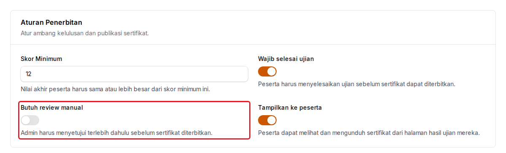
</Frame>

<Frame>
  
</Frame>

Saat peserta mengklik **Unduh Sertifikat**, sistem menerbitkan sertifikat dengan nomor berikutnya dan mengunduhnya dalam format PDF.

### B. Dengan persetujuan admin

Jika **Butuh review manual** aktif, alurnya sebagai berikut:

<Steps>
  <Step title="Peserta mengklik Ajukan Sertifikat">
    <Frame>
      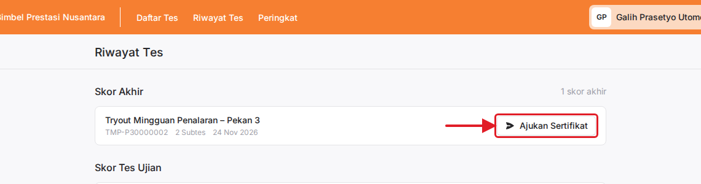
    </Frame>
  </Step>
  <Step title="Pengajuan menunggu persetujuan">
    Tombol berubah menjadi **Menunggu Persetujuan**. Sertifikat beserta nomornya sudah dibuat, tetapi belum dapat diunduh.

    <Frame>
      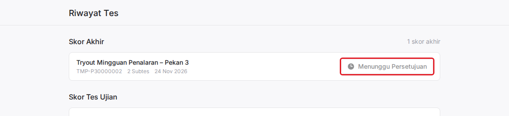
    </Frame>
  </Step>
  <Step title="Admin menyetujui pengajuan">
    Lihat bagian [4. Menyetujui pengajuan sertifikat](#4-menyetujui-pengajuan-sertifikat).
  </Step>
  <Step title="Peserta mengunduh sertifikat">
    Setelah disetujui dan halaman dimuat ulang, tombol berubah menjadi **Unduh Sertifikat**. Peserta mengklik tombol tersebut untuk mengunduh PDF.

    <Frame>
      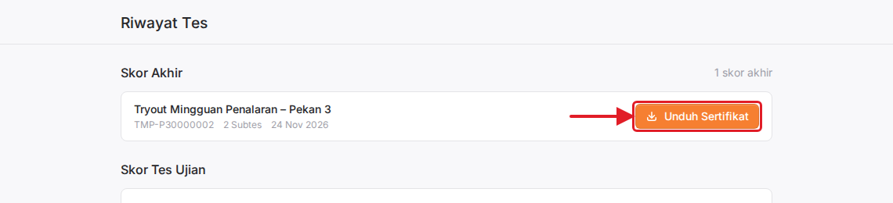
    </Frame>
  </Step>
</Steps>

<Info>
  Ringkasan tombol pada halaman peserta:

  - **Ajukan Sertifikat**: peserta memenuhi syarat dan belum mengajukan.
  - **Menunggu Persetujuan**: pengajuan sedang menunggu persetujuan admin.
  - **Unduh Sertifikat**: sertifikat siap diunduh.
</Info>

Contoh sertifikat PDF yang diterima peserta:

<Frame>
  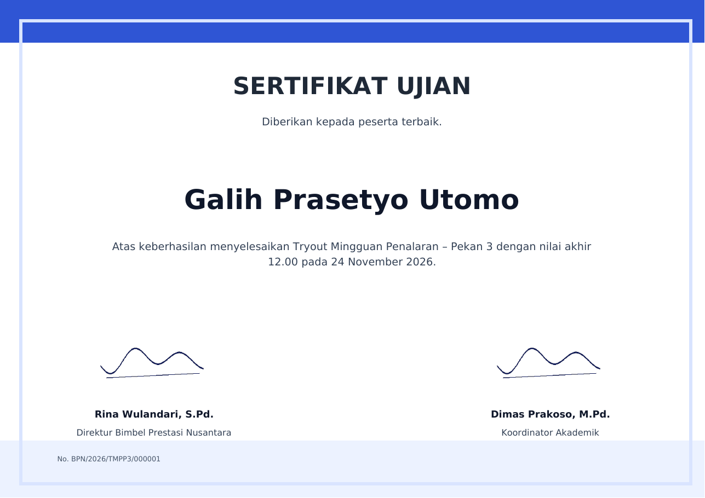
</Frame>

## 4. Menyetujui pengajuan sertifikat

<Steps>
  <Step title="Buka tab Sertifikat Terbit">
    Buka menu **Sertifikat Ujian**, klik **Ubah** pada template, lalu klik tab **Sertifikat Terbit**. Tabel berisi semua sertifikat yang sudah diajukan atau diterbitkan, dengan kolom **Nomor Sertifikat**, **Nama Peserta**, **Nilai**, dan **Tanggal Terbit**. Kolom **Tgl. Persetujuan** dapat ditampilkan melalui ikon kolom di kanan atas tabel.

    <Frame>
      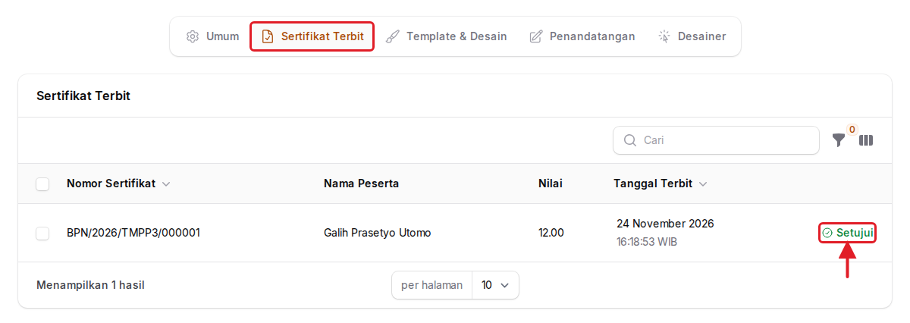
    </Frame>

    Gunakan filter **Status Persetujuan** (**Sudah Disetujui** atau **Belum Disetujui**) untuk menampilkan pengajuan yang belum diproses.
  </Step>
  <Step title="Klik Setujui">
    Klik **Setujui** pada baris peserta. Periksa nomor sertifikat dan nama peserta pada jendela konfirmasi, lalu klik **Konfirmasi**.

    <Frame>
      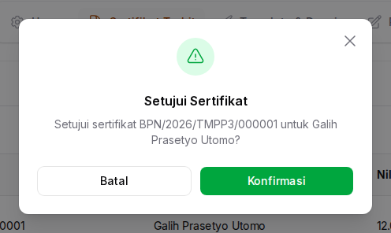
    </Frame>
  </Step>
  <Step title="Sertifikat disetujui">
    Tombol **Setujui** berganti menjadi **Unduh** dan **Cabut**. Klik **Unduh** untuk mengunduh sertifikat peserta tersebut dari panel admin.

    <Frame>
      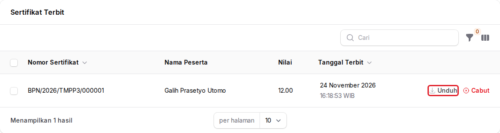
    </Frame>
  </Step>
</Steps>

Untuk menyetujui banyak pengajuan sekaligus, centang barisnya, lalu pilih **Setujui Semua** pada menu tindakan massal.

<Warning>
  **Cabut** (atau **Cabut Semua** untuk beberapa baris) membatalkan persetujuan. Selama **Butuh review manual** aktif, peserta kembali melihat **Menunggu Persetujuan** dan tidak dapat mengunduh sertifikat sampai disetujui lagi.
</Warning>
