Pembayaran ujian berbayar dari peserta tercatat di **Riwayat Transaksi** dan menambah saldo projek. Saldo tersebut dapat dicairkan ke rekening pemilik projek melalui **Penarikan Saldo**. Kedua menu berada di modul yang berbeda:

<Info>
  **Lokasi menu:**

  - **Riwayat Transaksi**: **Portal** → **Platform Ujian (CBT)** → **Keuangan** → **Riwayat Transaksi**.
  - **Penarikan Saldo**: **Portal** → **Administrasi Aplikasi** → **Keuangan** → **Penarikan Saldo**.

  **Peran yang dibutuhkan:** pemilik projek, atau anggota tim yang role-nya mencakup modul **Riwayat Transaksi** atau **Penarikan Saldo**.
</Info>

Alurnya sebagai berikut:

**Peserta membayar ujian → transaksi tercatat di Riwayat Transaksi → saldo masuk sebagai Saldo Tertunda → setelah 2 hari kerja menjadi Saldo Dapat Ditarik → admin mengajukan penarikan ke rekening pemilik projek.**

Sebagai contoh, **Bimbel Prestasi Nusantara** menjual **Try Out Intensif SNBT 2027** seharga **Rp150.000**. Pembayaran peserta seperti **Rosa Adinda** dan **Bagas Pratama** tercatat di **Riwayat Transaksi**, lalu Rina Wulandari, pemilik projek, mencairkan **Rp500.000** ke rekening BCA miliknya.

## 1. Memantau Riwayat Transaksi

Buka **Platform Ujian (CBT)** → **Keuangan** → **Riwayat Transaksi**. Transaksi terbaru tampil paling atas.

<Frame>
  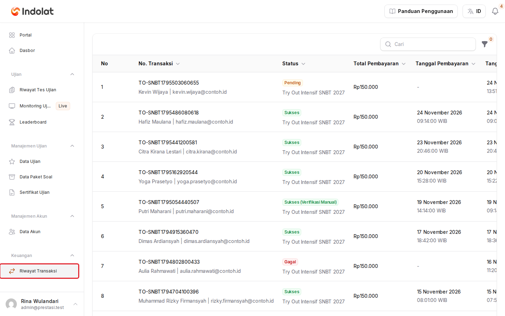
</Frame>

| Kolom | Isi |
| --- | --- |
| **No. Transaksi** | Nomor transaksi, misalnya `TO-SNBT1793756460174`, dengan nama dan email peserta di bawahnya. |
| **Status** | Status pembayaran, dengan nama ujian yang dibayar di bawahnya. |
| **Total Pembayaran** | Jumlah yang dibayar peserta. Jika peserta memakai voucher, kode voucher dan besar diskonnya tampil di bawah nominal. |
| **Tanggal Pembayaran** | Waktu pembayaran diterima. Kosong (`-`) bila belum dibayar. |
| **Tanggal Transaksi** | Waktu transaksi dibuat saat peserta mendaftar atau memilih bayar. |
| **Tanggal Kedaluwarsa** | Batas waktu pembayaran, yaitu 2 jam setelah transaksi dibuat. |

Status yang mungkin tampil:

- **Pending**: peserta belum menyelesaikan pembayaran.
- **Sukses**: pembayaran berhasil melalui sistem pembayaran dan saldo projek bertambah.
- **Sukses (Verifikasi Manual)**: transaksi ditandai lunas oleh admin melalui **Tandai Lunas**. Akses ujian peserta aktif, tetapi saldo projek tidak bertambah.
- **Gagal**: pembayaran ditolak.
- **Kedaluwarsa**: pembayaran tidak diselesaikan sampai batas waktunya.

Gunakan kolom **Cari** untuk mencari nomor transaksi atau email peserta, dan ikon filter untuk menyaring berdasarkan **Tanggal Transaksi** (rentang tanggal transaksi dibuat) dan **Nama Ujian**. Tabel cukup lebar; geser ke kanan untuk melihat kolom tanggal dan tombol aksi.

### Menandai transaksi lunas secara manual

Jika peserta membayar di luar sistem, misalnya tunai di kantor bimbel, Anda dapat mengaktifkan aksesnya tanpa menunggu pembayaran otomatis.

<Steps>
  <Step title="Klik Tandai Lunas">
    Tombol **Tandai Lunas** hanya tampil pada transaksi berstatus **Pending**.

    <Frame>
      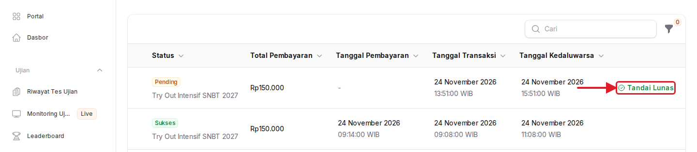
    </Frame>
  </Step>
  <Step title="Konfirmasi">
    Baca peringatan pada jendela **Konfirmasi Flagging Lunas Manual**, lalu klik **Ya, Flagging Lunas**.

    <Frame>
      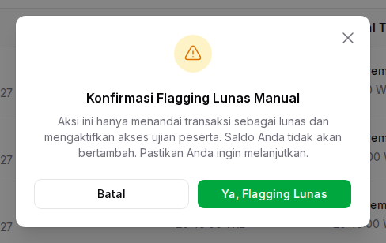
    </Frame>

    Status berubah menjadi **Sukses (Verifikasi Manual)** dan akses ujian peserta diproses.
  </Step>
</Steps>

<Warning>
  Transaksi yang ditandai lunas secara manual tidak menambah saldo projek dan tidak dapat dikembalikan ke status **Pending**.
</Warning>

### Rangkuman Total Dibayar

Di bagian bawah tabel tersedia **Rangkuman** untuk kolom **Total Pembayaran**. **Total Dibayar** menjumlahkan transaksi yang sudah lunas, yaitu **Sukses** dan **Sukses (Verifikasi Manual)**; transaksi **Pending**, **Gagal**, dan **Kedaluwarsa** tidak dihitung.

<Frame>
  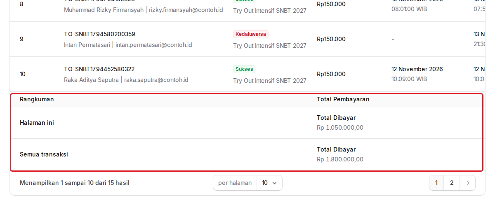
</Frame>

- **Halaman ini**: total dari transaksi yang sedang tampil. Baris ini hanya muncul bila data terbagi ke lebih dari satu halaman.
- **Semua transaksi**: total dari seluruh transaksi yang sesuai dengan pencarian dan filter aktif, termasuk di halaman lain.

Pada contoh, halaman pertama memuat tujuh transaksi lunas senilai Rp150.000, sehingga **Halaman ini** menunjukkan **Rp1.050.000**. **Semua transaksi** menunjukkan **Rp1.800.000** dari dua belas transaksi lunas.

<Note>
  **Total Dibayar** adalah total pembayaran peserta, bukan saldo yang dapat ditarik. Transaksi **Sukses (Verifikasi Manual)** ikut dijumlahkan, tetapi tidak menambah saldo. Untuk melihat saldo, buka **Penarikan Saldo**.
</Note>

## 2. Melihat saldo projek

Buka **Administrasi Aplikasi** → **Keuangan** → **Penarikan Saldo**. Saldo projek tampil di atas tabel riwayat penarikan.

<Frame>
  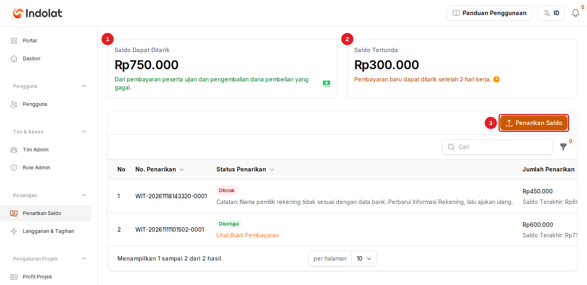
</Frame>

1. **Saldo Dapat Ditarik**: saldo yang sudah dapat dicairkan. Saldo ini berasal dari pembayaran peserta ujian dan dari pengembalian dana pembelian yang gagal, misalnya pembelian domain yang ditolak registrar.
2. **Saldo Tertunda**: pembayaran baru yang belum dapat ditarik. Pembayaran dapat ditarik setelah 2 hari kerja sejak diterima.
3. **Penarikan Saldo**: tombol untuk mengajukan penarikan.

> **Contoh:** Saldo Dapat Ditarik **Rp750.000** dan Saldo Tertunda **Rp300.000**. Saat ini Rina hanya dapat menarik paling banyak **Rp750.000**. Saldo Rp300.000 berasal dari dua pembayaran yang masuk kemarin dan hari ini.

## 3. Mengisi informasi rekening

Saldo selalu ditarik ke rekening **pemilik projek**. Sebelum penarikan pertama, pemilik projek perlu mengisi **Informasi Rekening** di profil akunnya. Jika rekening belum lengkap, penarikan ditolak dengan notifikasi **Informasi Rekening Diperlukan**.

<Frame>
  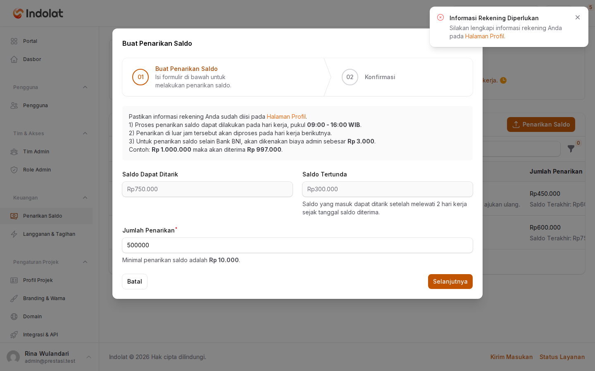
</Frame>

<Note>
  Jika Anda anggota **Tim Admin**, notifikasi meminta pemilik projek melengkapi rekeningnya. Rekening tidak dapat diisi dari akun anggota tim.
</Note>

<Steps>
  <Step title="Buka Profil dari menu akun">
    Klik nama akun Anda di pojok kiri bawah sidebar, lalu pilih **Profil**. Anda juga dapat mengklik tautan **Halaman Profil** pada jendela **Buat Penarikan Saldo**.

    <Frame>
      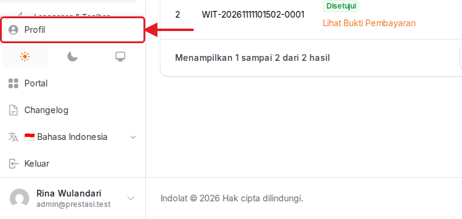
    </Frame>

    <Warning>
      Tombol **Halaman Profil** pada Portal membuka halaman **Profil** ringkas (nama, email, kata sandi, dan autentikasi dua faktor) yang tidak memuat **Informasi Rekening**. Gunakan menu **Profil** di sidebar.
    </Warning>
  </Step>
  <Step title="Isi Informasi Rekening">
    Gulir ke bagian **Informasi Rekening**, lalu isi data rekening.

    <Frame>
      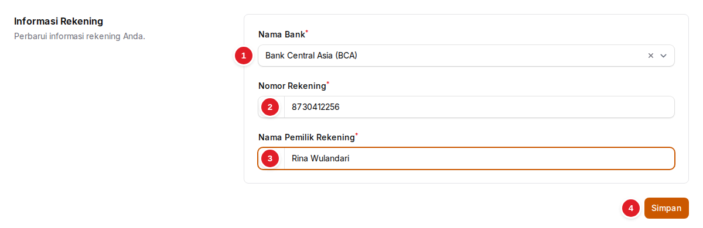
    </Frame>

    1. **Nama Bank**: pilih bank rekening Anda, misalnya **Bank Central Asia (BCA)**.
    2. **Nomor Rekening**: nomor rekening tujuan, hanya angka, misalnya `8730412256`.
    3. **Nama Pemilik Rekening**: nama sesuai buku tabungan, misalnya `Rina Wulandari`.
    4. Klik **Simpan** di bawah bagian **Informasi Rekening**. Notifikasi *Informasi profil Anda telah berhasil disimpan.* muncul.

    <Tip>
      Pastikan nama pemilik rekening sama persis dengan data bank. Nama yang berbeda dapat membuat penarikan ditolak.
    </Tip>
  </Step>
</Steps>

## 4. Mengajukan penarikan saldo

<Steps>
  <Step title="Buka formulir penarikan">
    Pada halaman **Penarikan Saldo**, klik tombol **Penarikan Saldo**.
  </Step>
  <Step title="Isi jumlah penarikan">
    <Frame>
      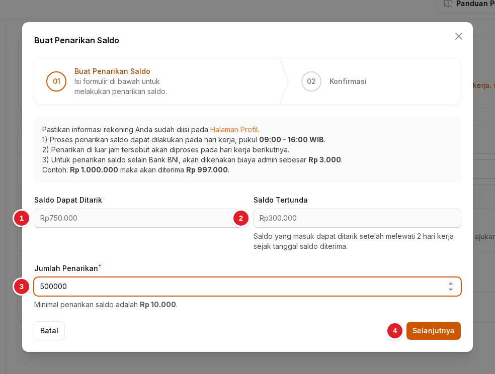
    </Frame>

    1. **Saldo Dapat Ditarik**: saldo yang dapat dicairkan (hanya baca).
    2. **Saldo Tertunda**: saldo yang masih tertahan (hanya baca).
    3. **Jumlah Penarikan**: nominal yang ingin dicairkan, tanpa titik, misalnya `500000`. Minimal **Rp10.000** dan tidak boleh melebihi **Saldo Dapat Ditarik**.
    4. Klik **Selanjutnya**.

    Ketentuan penarikan yang tampil di formulir:

    - Penarikan diproses pada hari kerja pukul **09.00–16.00 WIB**; penarikan di luar jam tersebut diproses pada hari kerja berikutnya.
    - Penarikan ke bank selain **BNI** dikenakan biaya admin **Rp3.000**. Contoh: penarikan Rp1.000.000 diterima Rp997.000.
  </Step>
  <Step title="Periksa dan buat penarikan">
    Sistem menampilkan **Jenis Bank**, **Rekening Tujuan**, **Atas Nama**, dan **Jumlah Penarikan**. Periksa kembali, lalu klik **Buat Penarikan**. Klik **Sebelumnya** bila perlu mengubah jumlah.

    <Frame>
      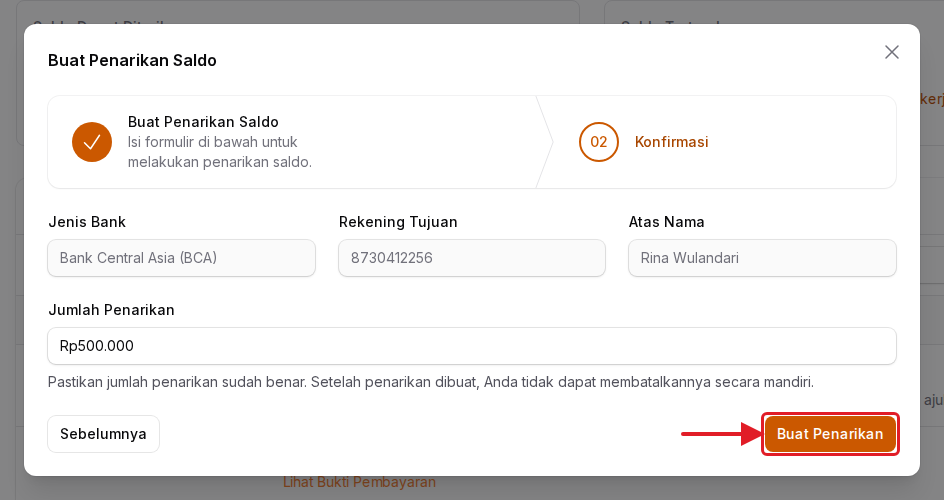
    </Frame>

    Notifikasi **Penarikan Saldo Berhasil** muncul dan jumlah penarikan langsung dikurangkan dari saldo.

    <Warning>
      Penarikan yang sudah dibuat tidak dapat dibatalkan sendiri. Pastikan rekening dan jumlahnya benar sebelum mengklik **Buat Penarikan**.
    </Warning>
  </Step>
</Steps>

<Note>
  Penarikan baru tidak dapat dibuat selama masih ada penarikan berstatus **Pending**. Sistem menampilkan pesan *Anda masih memiliki penarikan saldo yang sedang diproses.*
</Note>

## 5. Memantau status penarikan

Setiap pengajuan tercatat pada tabel di halaman **Penarikan Saldo**, lengkap dengan **No. Penarikan**, **Status Penarikan**, **Jumlah Penarikan** beserta **Saldo Terakhir** sebelum penarikan, **Tanggal Pembayaran**, dan **Tanggal Penarikan**. Gunakan filter **Tanggal Penarikan** untuk menyaring berdasarkan periode.

<Frame>
  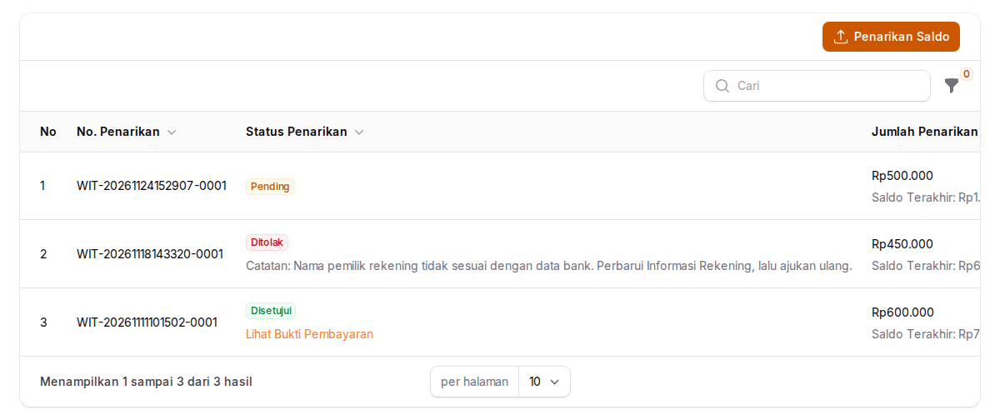
</Frame>

- **Pending**: penarikan sudah diajukan dan sedang diproses.
- **Disetujui**: dana sudah ditransfer. Klik **Lihat Bukti Pembayaran** untuk membuka bukti transfer; **Tanggal Pembayaran** menunjukkan waktu transfer.
- **Ditolak**: penarikan dibatalkan dan jumlahnya dikembalikan ke saldo. Alasan penolakan tampil sebagai **Catatan**, misalnya nama pemilik rekening tidak sesuai. Perbaiki data yang diminta, lalu ajukan penarikan baru.
