Modul **Learning Management System (LMS)** dipakai sekolah atau lembaga untuk mengelola kegiatan belajar: periode akademik, kelas, mata pelajaran, guru pengampu, jadwal mengajar, dan pengumuman. Halaman ini memberi gambaran umum setiap menu dan hubungan antarmenu di Panel. Materi, tugas, dan penilaian oleh guru dikerjakan di aplikasi **LMS by Indolat** dan tidak dibahas di sini.

<Info>
  Lokasi menu: **Portal** → **Learning Management System (LMS)**.

  LMS dapat diaktifkan oleh pemilik projek atau admin yang memiliki akses ke **Langganan & Tagihan**.
</Info>

Contoh di halaman ini memakai projek **SMA Harapan Bangsa** dengan periode **2026/2027 Ganjil**.

## Mengaktifkan LMS

LMS perlu diaktifkan satu kali untuk setiap projek. Aktivasi memasang **Paket LMS Standard** gratis dengan penyimpanan 100 MB dan kuota 50 siswa aktif.

<Steps>
  <Step title="Buka modul LMS dari Portal">
    Pilih ubin **Learning Management System (LMS)** di Portal. Ubin ini diberi lencana **BARU**.

    <Frame>
      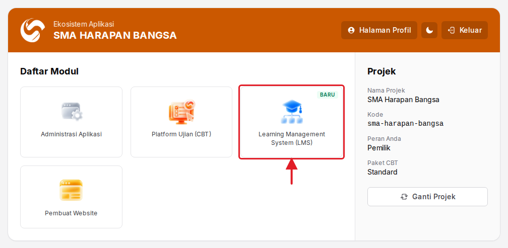
    </Frame>
  </Step>
  <Step title="Pilih Aktifkan LMS by Indolat">
    Selama LMS belum aktif, **Dasbor** menampilkan kartu **LMS by Indolat belum diaktifkan** beserta ringkasan fiturnya. Pilih **Aktifkan LMS by Indolat**.

    <Frame>
      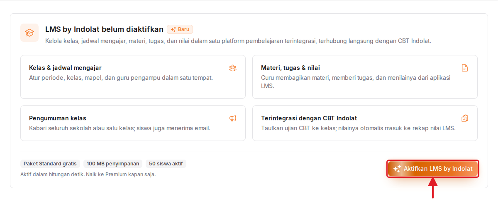
    </Frame>

    Menu LMS lain juga terkunci dan menampilkan tombol yang sama. Data yang sudah pernah dibuat tetap terlihat, tetapi tidak dapat diubah selama LMS belum aktif.

    <Frame>
      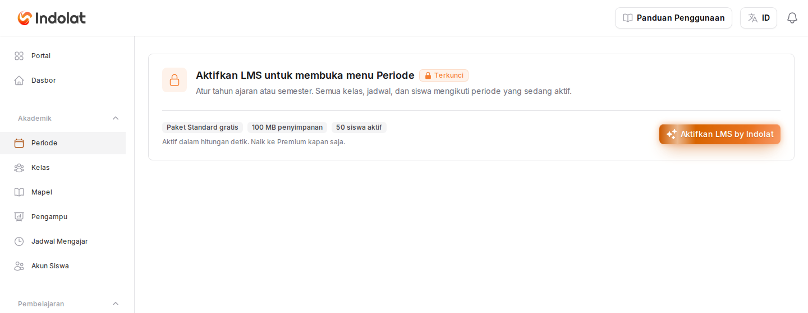
    </Frame>
  </Step>
  <Step title="Konfirmasi aktivasi">
    Pilih **Aktifkan** pada jendela konfirmasi.

    <Frame>
      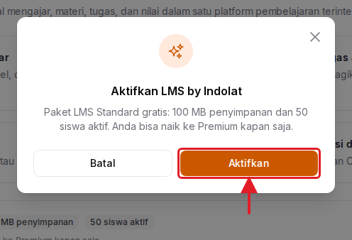
    </Frame>

    Notifikasi **LMS by Indolat aktif** muncul dan semua menu LMS terbuka.
  </Step>
</Steps>

## Dasbor

Setelah LMS aktif, **Dasbor** menampilkan paket LMS, pemakaian penyimpanan, dan jumlah siswa aktif dibandingkan kuotanya. Tombol **Kelola di Administrasi** membuka **Administrasi Aplikasi** → **Keuangan** → **Langganan & Tagihan** untuk menaikkan paket.

<Frame>
  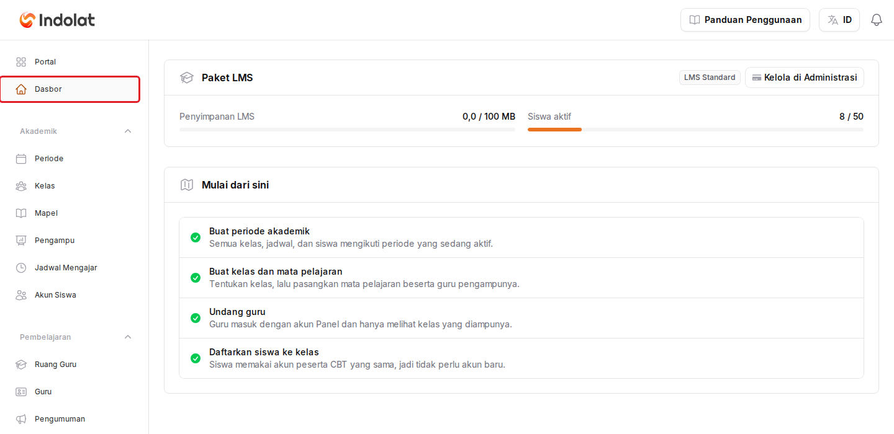
</Frame>

Bagian **Mulai dari sini** berisi empat langkah awal yang tercentang otomatis begitu datanya ada: membuat periode akademik, membuat kelas dan mata pelajaran, mengundang guru, dan mendaftarkan siswa ke kelas.

## Urutan menyiapkan LMS

Menu LMS saling bergantung. Urutan berikut paling mudah diikuti:

1. Buat **Periode**, lalu jadikan satu periode aktif.
2. Tambahkan daftar **Mapel**.
3. Undang **Guru**.
4. Buat **Kelas** pada periode aktif, lalu tambahkan siswa dari **Akun Siswa**.
5. Tetapkan **Pengampu** (guru untuk setiap mapel di setiap kelas).
6. Susun **Jadwal Mengajar**.
7. Kirim **Pengumuman** bila diperlukan.

## Akademik

### Periode

Periode adalah tahun ajaran atau semester, misalnya **2026/2027 Ganjil**. Setiap kelas dibuat di dalam sebuah periode.

<Frame>
  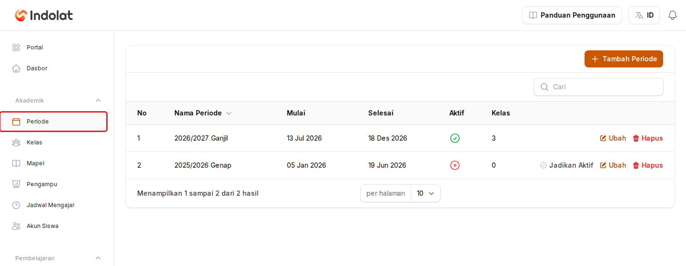
</Frame>

Pilih **Tambah Periode**, lalu isi **Nama Periode**, **Mulai**, dan **Selesai**. Hanya satu periode yang dapat aktif. Pilih **Jadikan Aktif** pada periode lain untuk berpindah periode. Kuota siswa aktif dihitung dari kelas pada periode aktif.

### Kelas

Kelas dibuat pada sebuah periode, misalnya **X IPA 1** dengan tingkat **X**. Daftar kelas menampilkan wali kelas, jumlah siswa aktif, dan jumlah mapel.

<Frame>
  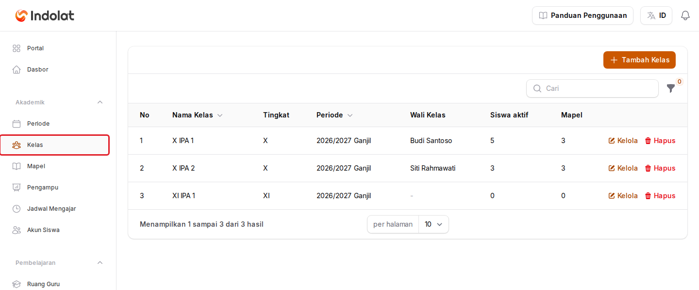
</Frame>

Pilih **Tambah Kelas**, lalu isi **Periode**, **Nama Kelas**, **Tingkat**, dan **Wali Kelas**. Pilihan **Wali Kelas** berisi pemilik projek dan guru yang sudah menerima undangan. Pilih **Kelola** pada sebuah kelas untuk mengatur isinya.

<Frame>
  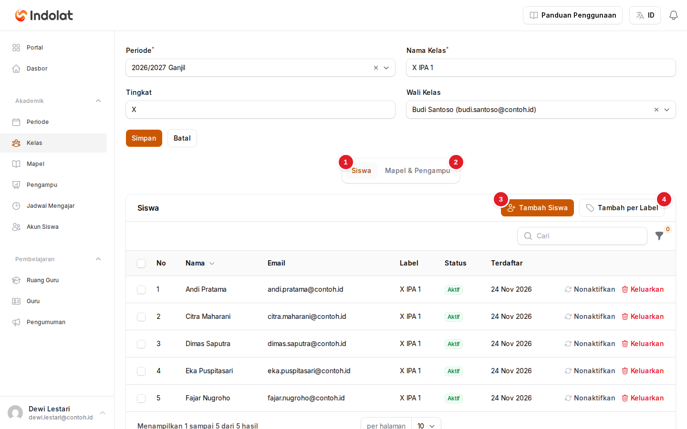
</Frame>

1. **Siswa**: daftar siswa di kelas ini beserta statusnya. Pilih **Nonaktifkan** untuk menonaktifkan siswa tanpa mengeluarkannya, atau **Keluarkan** untuk mengeluarkannya dari kelas.
2. **Mapel & Pengampu**: mapel yang diajarkan di kelas ini beserta gurunya. Mapel dapat ditambahkan langsung dari tab ini.
3. **Tambah Siswa**: cari akun siswa berdasarkan nama atau email, lalu pilih satu atau beberapa siswa.
4. **Tambah per Label**: tambahkan sekaligus semua akun siswa yang memiliki label tertentu, misalnya label **X IPA 1**.

Siswa yang ditambahkan ke kelas menerima pemberitahuan melalui email. Bila kuota siswa aktif paket LMS sudah penuh, siswa baru tidak dapat ditambahkan sampai paket dinaikkan.

### Mapel

Mapel adalah daftar mata pelajaran beserta kodenya, misalnya **Matematika** dengan kode **MTK**. Satu mapel dapat diajarkan di banyak kelas.

<Frame>
  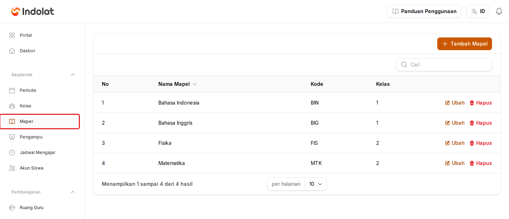
</Frame>

Pilih **Tambah Mapel**, lalu isi **Nama Mapel** dan **Kode** (opsional). Kolom **Kelas** menunjukkan jumlah kelas yang memakai mapel tersebut.

### Pengampu

Pengampu adalah pasangan kelas dan mapel beserta guru yang mengajarnya, misalnya **Matematika** di **X IPA 1** diampu **Budi Santoso**.

<Frame>
  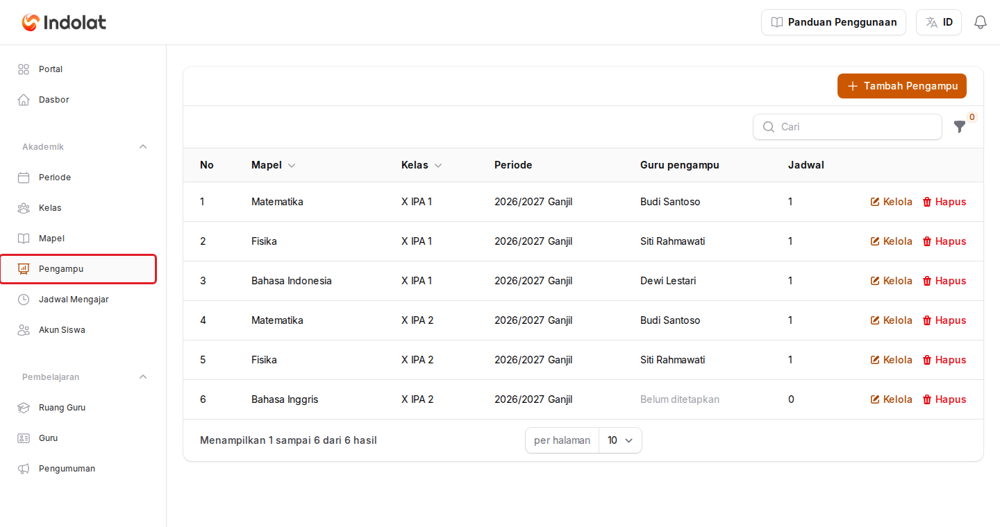
</Frame>

Pilih **Tambah Pengampu**, lalu pilih **Kelas**, **Mapel**, dan **Guru pengampu**. Pasangan yang belum memiliki guru ditandai **Belum ditetapkan**. Pilih **Kelola** untuk membuka detail pengampu.

<Frame>
  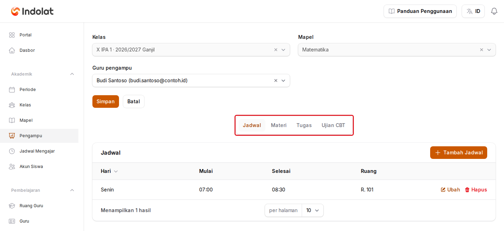
</Frame>

- **Jadwal**: jadwal pelajaran untuk mapel di kelas ini.
- **Materi** dan **Tugas**: materi dan tugas yang dibuat guru di aplikasi LMS. Di Panel, keduanya hanya dapat dilihat dan dihapus.
- **Ujian CBT**: tautkan ujian dari **Platform Ujian (CBT)** dengan **Tautkan Ujian**, atau buat ujian baru dengan **Buat Ujian Baru**. Nilai ujian yang ditautkan masuk ke rekap nilai LMS.

### Jadwal Mengajar

Jadwal Mengajar adalah jadwal pelajaran mingguan untuk semua kelas. Guru dan siswa melihat jadwal ini di aplikasi LMS.

<Frame>
  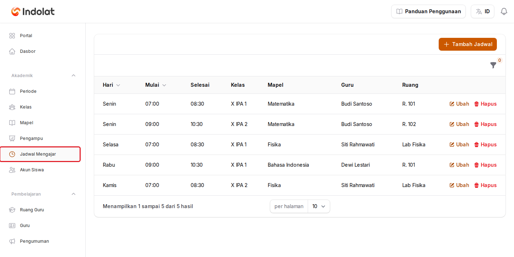
</Frame>

Pilih **Tambah Jadwal**, lalu pilih **Kelas & Mapel**, **Hari**, **Mulai**, **Selesai**, dan **Ruang**. Jam selesai harus setelah jam mulai. Jadwal yang sama juga dapat ditambahkan dari tab **Jadwal** pada detail pengampu.

### Akun Siswa

Akun siswa adalah akun peserta yang sama dengan **Data Akun** di CBT dan **Pengguna** di Administrasi Aplikasi. Siswa cukup memiliki satu akun untuk mengikuti kelas di LMS dan ujian di CBT.

<Frame>
  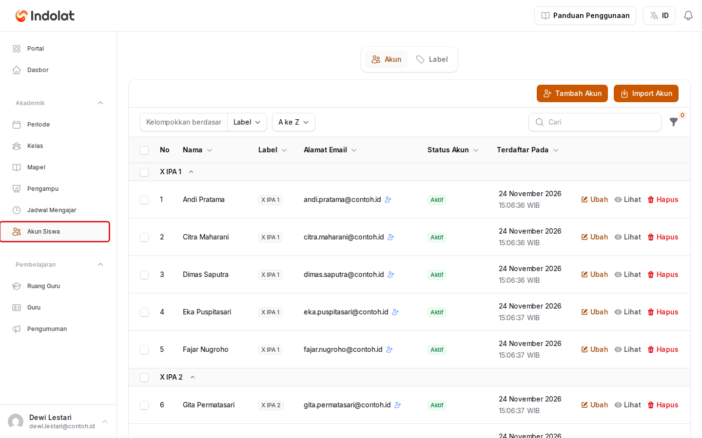
</Frame>

Di menu ini Anda dapat **Tambah Akun**, **Import Akun**, dan mengelola label pada tab **Label**. Beri label sesuai kelas agar siswa dapat dimasukkan ke kelas sekaligus dengan **Tambah per Label**. Cara lengkapnya ada di [Menambahkan Akun Peserta](/data-akun/menambahkan-akun-peserta).

## Pembelajaran

### Ruang Guru

Ruang Guru menampilkan kelas dan mapel yang Anda ampu beserta periodenya. Pilih **Buka LMS by Indolat** untuk masuk ke aplikasi LMS, tempat materi, tugas, penilaian, dan ujian kelas dikelola.

<Frame>
  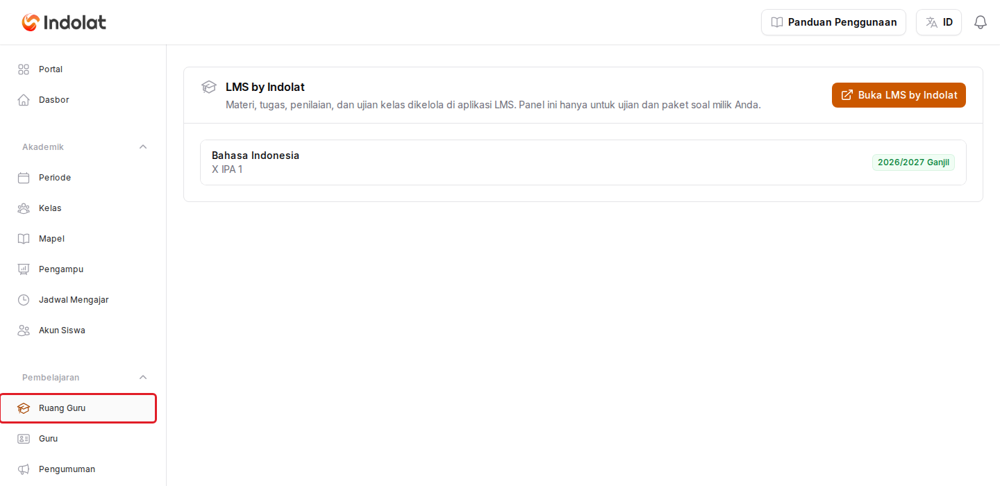
</Frame>

### Guru

Guru diundang melalui email dan masuk ke Panel dengan akunnya sendiri. Guru hanya melihat kelas yang diampunya di LMS, serta ujian dan paket soal miliknya sendiri di CBT. Jumlah guru tidak dibatasi di paket mana pun.

<Frame>
  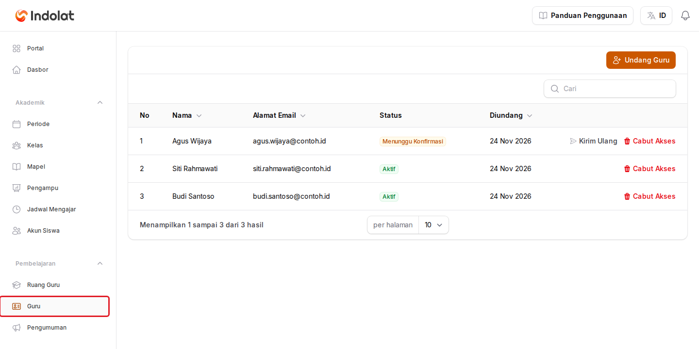
</Frame>

Pilih **Undang Guru**, lalu isi **Alamat Email** dan **Nama Guru** (opsional, dipakai bila akun dengan email tersebut belum ada). Status **Menunggu Konfirmasi** berubah menjadi **Aktif** setelah guru menerima undangan. Pilih **Kirim Ulang** untuk mengirim ulang undangan, atau **Cabut Akses** untuk menghentikan akses guru ke projek. Guru baru dapat dipilih sebagai wali kelas atau pengampu setelah statusnya **Aktif**.

### Pengumuman

Pengumuman dapat ditujukan ke seluruh sekolah atau ke satu kelas. Siswa juga menerima pemberitahuan melalui email.

<Frame>
  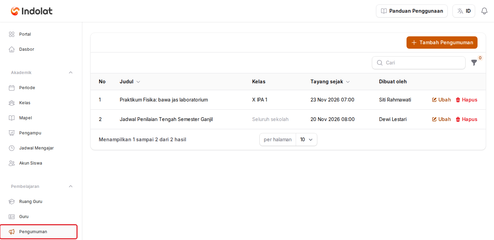
</Frame>

Pilih **Tambah Pengumuman**, lalu isi **Judul**, **Kelas** (kosongkan untuk seluruh sekolah), **Tayang sejak**, dan **Isi**. Pengumuman tampil di aplikasi LMS mulai waktu **Tayang sejak**.
