Panduan cepat (_quick start_) ini menuntun Anda membuat satu ujian dari awal sampai selesai: menyiapkan paket soal, membuat ujian, tes, dan sesi, menambahkan peserta, mencoba ujian dari sisi peserta, lalu memantau dan mengunduh hasilnya. Pengaturan lanjutan tidak dibahas di sini; setiap bagian menautkan halaman panduan yang lebih lengkap.

<Info>
  **Lokasi menu:** **Portal** → **Platform Ujian (CBT)**. Semua langkah admin di halaman ini dilakukan di modul Platform Ujian (CBT).

  **Peran:** pemilik projek, atau admin yang diberi akses ke menu **Data Paket Soal**, **Data Ujian**, dan menu **Ujian** lainnya (lihat [Manajemen Akses Admin](/lainnya/manajemen-akses-admin)).
</Info>

## Gambaran alur

Sebuah ujian di CBT Indolat tersusun dari beberapa bagian berikut.

| Bagian | Fungsi | Contoh di panduan ini |
| --- | --- | --- |
| **Paket Soal** | Bank soal berisi butir soal dan kunci jawabannya. | **Paket Penalaran Matematika** (kode **PM-TOAKBAR27**), 3 soal pilihan ganda |
| **Ujian** | Acara utama yang diikuti peserta. | **Tryout Akbar SNBT 2027 – Gelombang 1** (kode **TOAKBAR27-G1**) |
| **Tes Ujian** | Mata ujian (subtes) di dalam ujian, dengan durasi dan metode penilaian sendiri. | **Penalaran Matematika**, 30 menit |
| **Sesi Ujian** | Jadwal pengerjaan sebuah tes sekaligus paket soal yang dipakai. | **Sesi 1**, 24 November 2026 pukul 13.00 sampai 30 November 2026 pukul 21.00 |
| **Peserta** | Akun yang terdaftar pada ujian dan dihubungkan ke sesi. | 5 siswa yang diimpor dari Excel, misalnya **Dimas Pratama** |

Urutannya: buat paket soal, buat ujian, tambahkan tes, buat sesi untuk tes tersebut, tambahkan peserta, lalu hubungkan peserta ke sesi. Peserta baru dapat mengerjakan tes jika keempat hal itu sudah lengkap.

## 1. Membuka Platform Ujian (CBT)

<Steps>
  <Step title="Masuk dan buka modul Platform Ujian (CBT)">
    <Frame>
      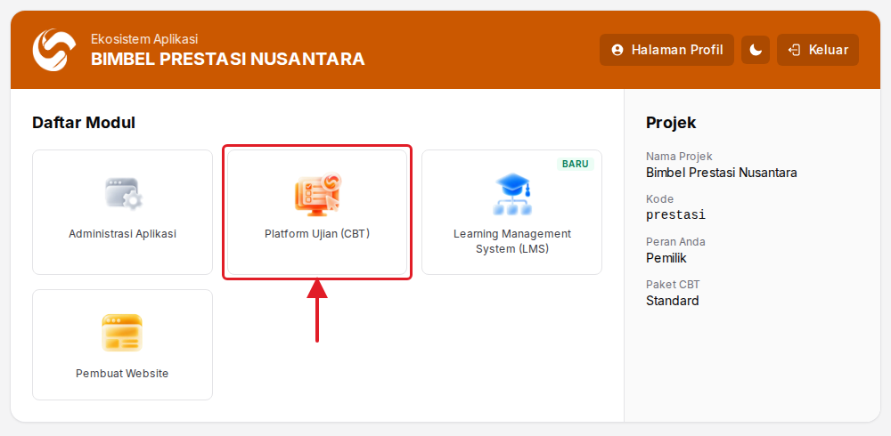
    </Frame>

    Setelah masuk ke panel admin, Anda berada di halaman **Portal**. Pada bagian **Daftar Modul**, klik **Platform Ujian (CBT)**. Semua menu yang dipakai di panduan ini ada di sidebar modul tersebut.
  </Step>
</Steps>

## 2. Membuat paket soal

<Steps>
  <Step title="Buka Data Paket Soal, lalu klik Tambah Paket Soal">
    <Frame>
      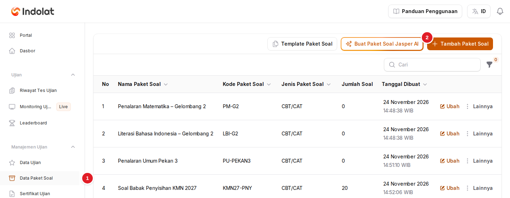
    </Frame>

    1. Di sidebar, klik **Manajemen Ujian** → **Data Paket Soal**.
    2. Klik **Tambah Paket Soal**.
  </Step>
  <Step title="Isi informasi paket soal">
    <Frame>
      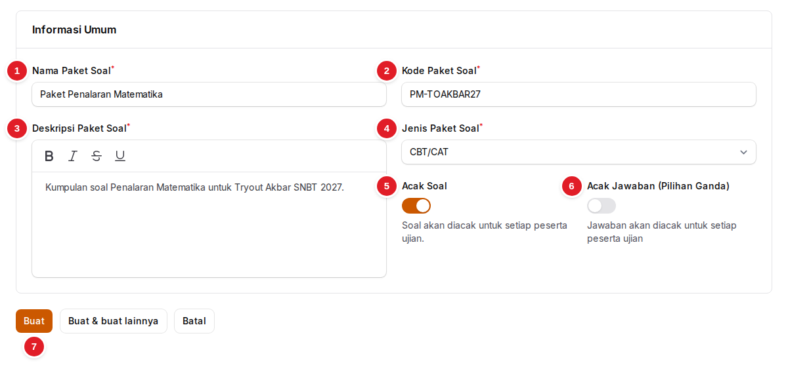
    </Frame>

    1. **Nama Paket Soal**: nama yang mudah dikenali, misalnya **Paket Penalaran Matematika**.
    2. **Kode Paket Soal**: kode unik di projek Anda, misalnya **PM-TOAKBAR27**. Kode yang sudah dipakai paket lain akan ditolak.
    3. **Deskripsi Paket Soal**: penjelasan singkat isi paket (maksimal 1.000 karakter).
    4. **Jenis Paket Soal**: pilih **CBT/CAT** agar peserta menjawab langsung di layar dan dinilai otomatis. Jenis ini tidak dapat diubah setelah paket disimpan.
    5. **Acak Soal**: aktifkan agar urutan soal berbeda untuk setiap peserta.
    6. **Acak Jawaban (Pilihan Ganda)**: aktifkan agar urutan pilihan jawaban berbeda untuk setiap peserta.
    7. Klik **Buat**. Halaman paket soal terbuka dan Anda dapat langsung menambahkan butir soal.

    <Note>
      Pilih **Esai/Upload File (Jawaban Manual)** jika peserta menulis uraian atau mengunggah berkas jawaban yang dinilai manual. Paket jenis ini tidak dapat dipakai untuk tes CBT/CAT, dan sebaliknya. Penjelasannya ada di [Membuat Paket Soal](/paket-soal/membuat-paket-soal).
    </Note>
  </Step>
</Steps>

<Tip>
  Selain mengisi soal satu per satu, Anda dapat memakai **Template Paket Soal**, [mengimpor soal dari Excel](/paket-soal/import-paket-soal), atau [membuat soal dengan Jasper AI](/paket-soal/generate-soal-ai).
</Tip>

## 3. Menambahkan butir soal

<Steps>
  <Step title="Klik Tambah Soal">
    <Frame>
      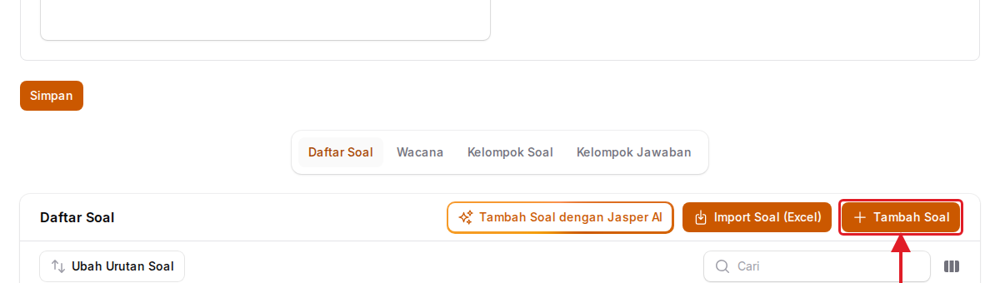
    </Frame>

    Gulir ke bagian **Daftar Soal**, lalu klik **Tambah Soal**. Jendela **Tambah Soal** terbuka dengan tab **Soal**, **Jawaban**, **Pembahasan**, dan **Penilaian**.

    Untuk membuka paket ini lagi nanti, buka **Data Paket Soal**, lalu klik **Ubah** pada paket tersebut.
  </Step>
  <Step title="Isi tab Soal">
    <Frame>
      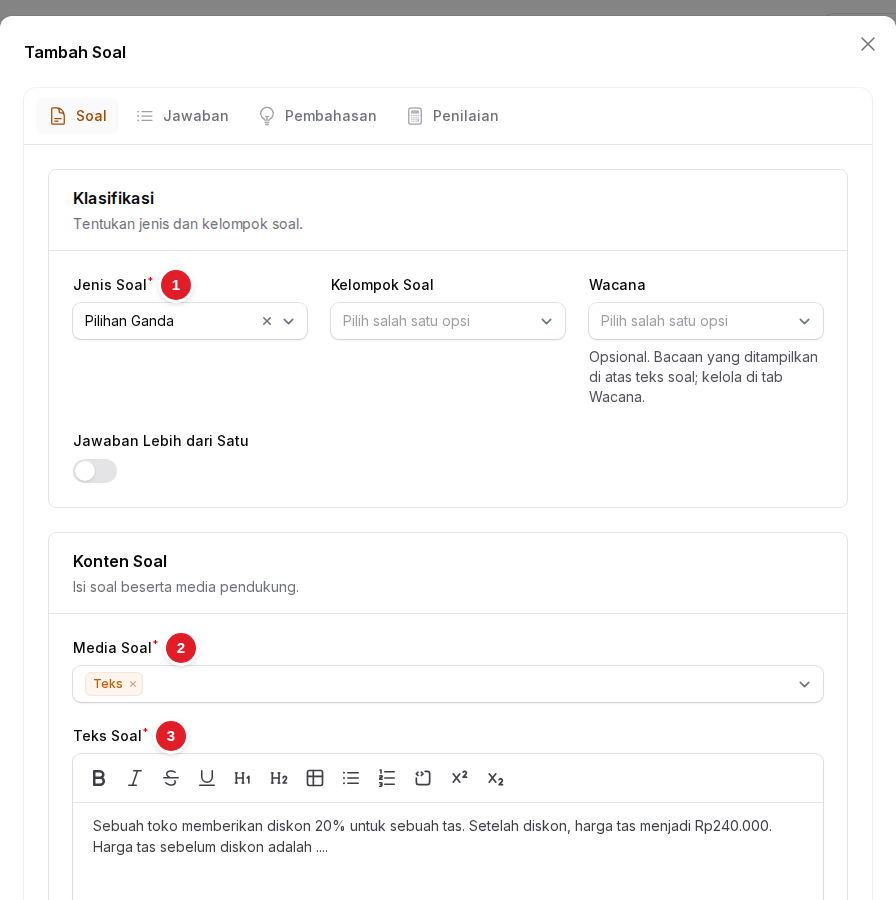
    </Frame>

    1. **Jenis Soal**: pilih **Pilihan Ganda**.
    2. **Media Soal**: pilih **Teks**. Anda dapat memilih lebih dari satu media, misalnya teks dan gambar.
    3. **Teks Soal**: tulis pertanyaannya, misalnya _Sebuah toko memberikan diskon 20% untuk sebuah tas. Setelah diskon, harga tas menjadi Rp240.000. Harga tas sebelum diskon adalah ...._

    **Kelompok Soal**, **Wacana**, dan **Jawaban Lebih dari Satu** boleh dibiarkan kosong untuk soal yang berdiri sendiri. Jenis soal lain (**Jawaban Singkat**, **Majemuk Kompleks**, **Menjodohkan**) dijelaskan di [Membuat Paket Soal](/paket-soal/membuat-paket-soal).
  </Step>
  <Step title="Isi pilihan jawaban di tab Jawaban">
    <Frame>
      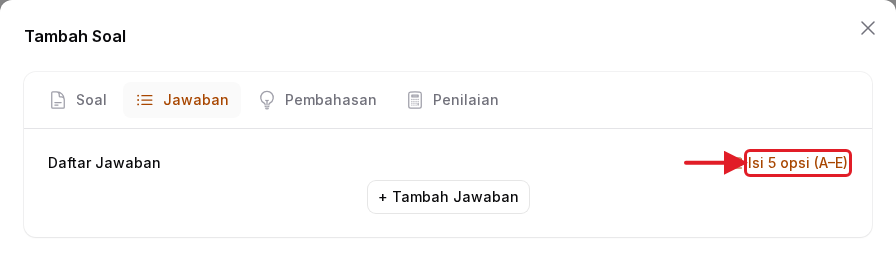
    </Frame>

    Buka tab **Jawaban**, lalu klik **Isi 5 opsi (A–E)** untuk membuat lima pilihan jawaban sekaligus dengan media **Teks**. Gunakan **+ Tambah Jawaban** jika butuh pilihan tambahan.

    <Frame>
      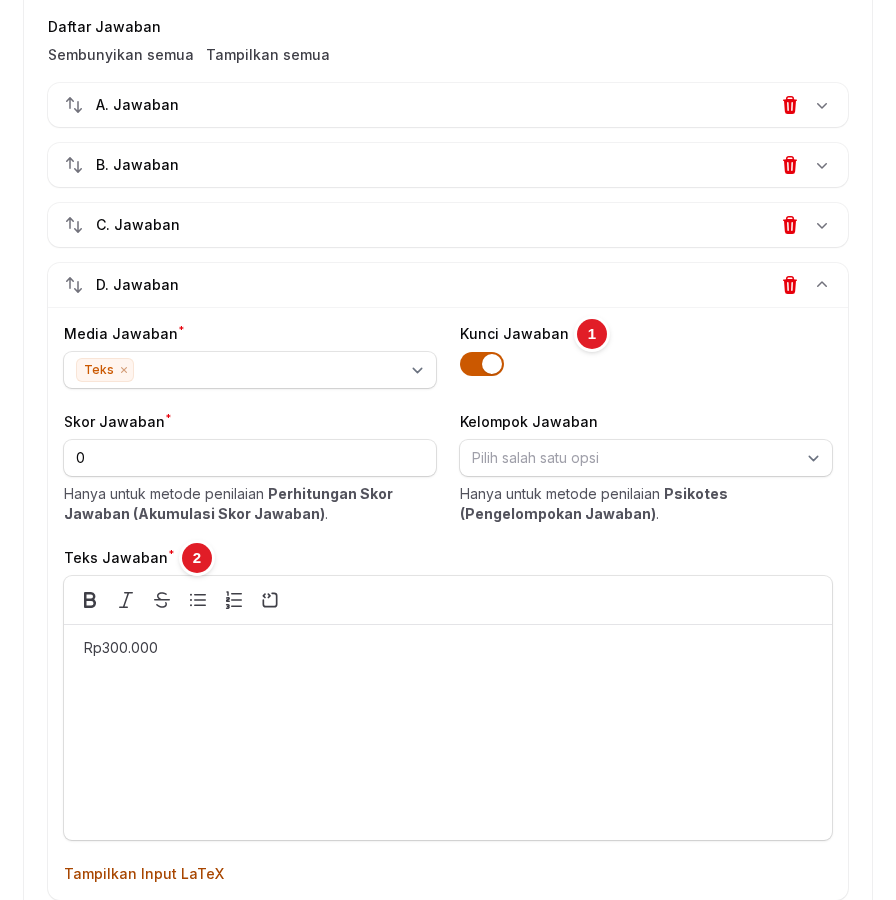
    </Frame>

    Pada setiap pilihan jawaban:

    1. **Kunci Jawaban**: aktifkan hanya pada pilihan yang benar, pada contoh ini pilihan D.
    2. **Teks Jawaban**: tulis pilihan yang dilihat peserta, misalnya **Rp300.000**.

    **Skor Jawaban** dan **Kelompok Jawaban** hanya dipakai pada metode penilaian tertentu dan dapat dibiarkan apa adanya. Klik **Buat** untuk menyimpan soal, atau **Buat & buat lainnya** untuk langsung menambah soal berikutnya.
  </Step>
  <Step title="Periksa daftar soal">
    <Frame>
      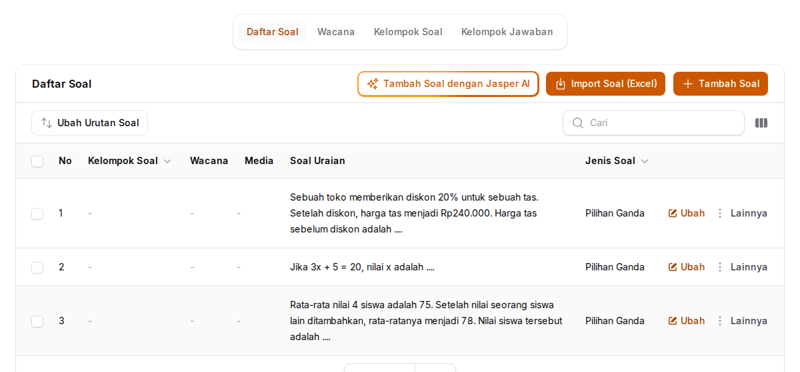
    </Frame>

    Ulangi langkah di atas sampai semua soal masuk. Contoh ini memakai tiga soal Penalaran Matematika.
  </Step>
  <Step title="Atur skor soal">
    <Frame>
      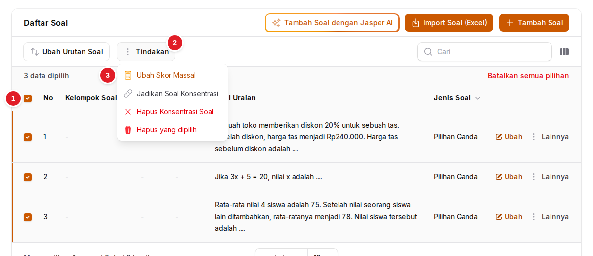
    </Frame>

    Tentukan berapa poin yang didapat peserta untuk setiap soal:

    1. Centang kotak di kepala tabel untuk memilih semua soal.
    2. Klik **Tindakan**.
    3. Pilih **Ubah Skor Massal**.

    <Frame>
      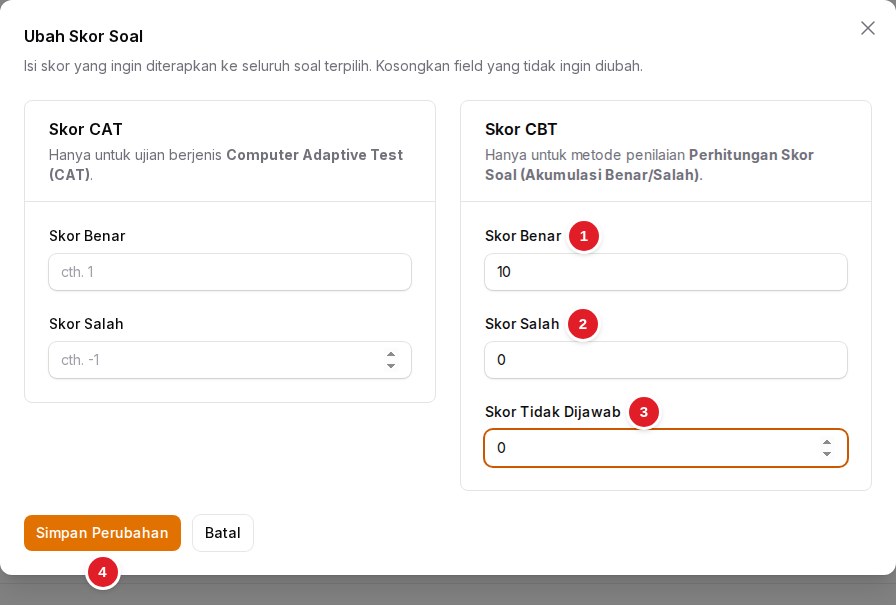
    </Frame>

    Pada bagian **Skor CBT**, isi:

    1. **Skor Benar**: misalnya **10**.
    2. **Skor Salah**: misalnya **0** (isi angka negatif jika jawaban salah dikurangi nilai).
    3. **Skor Tidak Dijawab**: misalnya **0**.
    4. Klik **Simpan Perubahan**.

    Dengan pengaturan ini, peserta yang menjawab benar ketiga soal mendapat nilai **30**. Skor juga dapat diatur per soal di tab **Penilaian** pada jendela soal.

    <Warning>
      Pada metode penilaian **Perhitungan Skor Soal (Akumulasi Benar/Salah)**, nilai peserta adalah jumlah skor soal. Jika **Skor Benar** tidak diisi, semua peserta mendapat nilai **0** walaupun jawabannya benar. Skor soal tidak dapat diubah selama ada peserta yang sedang mengerjakan paket soal ini.
    </Warning>
  </Step>
</Steps>

## 4. Membuat ujian

<Steps>
  <Step title="Buka Data Ujian, lalu klik Tambah Ujian">
    <Frame>
      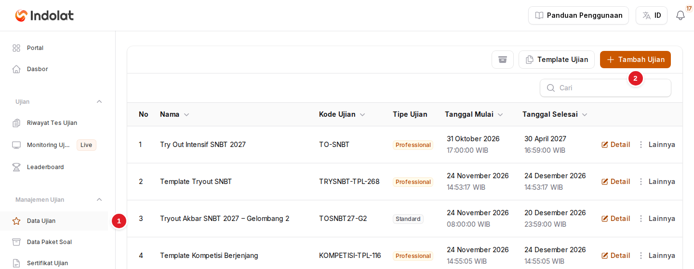
    </Frame>

    1. Di sidebar, klik **Manajemen Ujian** → **Data Ujian**.
    2. Klik **Tambah Ujian**.
  </Step>
  <Step title="Isi informasi ujian">
    <Frame>
      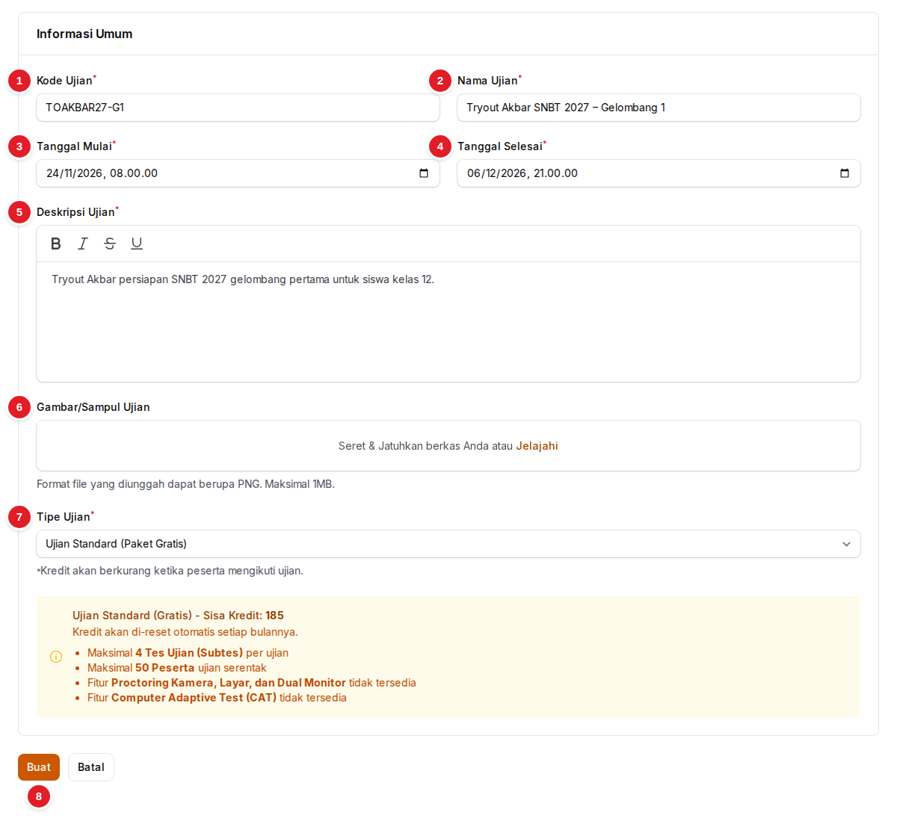
    </Frame>

    1. **Kode Ujian**: kode unik berisi huruf, angka, tanda hubung (-), atau tanda pagar (#), misalnya **TOAKBAR27-G1**. Kode otomatis ditulis dengan huruf kapital dan menjadi awalan **Kode Peserta**.
    2. **Nama Ujian**: nama yang dilihat peserta, misalnya **Tryout Akbar SNBT 2027 – Gelombang 1**.
    3. **Tanggal Mulai**: awal periode ujian, misalnya 24 November 2026 pukul 08.00.
    4. **Tanggal Selesai**: akhir periode ujian, misalnya 6 Desember 2026 pukul 21.00. Tanggal ini paling lambat satu tahun dari hari ini.
    5. **Deskripsi Ujian**: penjelasan singkat tentang ujian.
    6. **Gambar/Sampul Ujian** (opsional): berkas PNG, maksimal 1 MB.
    7. **Tipe Ujian**: pilih **Ujian Standard (Paket Gratis)** untuk ujian sederhana. Kotak informasi di bawahnya menampilkan sisa kredit dan batasannya: maksimal 4 tes ujian per ujian, maksimal 50 peserta mengerjakan serentak, tanpa pengawasan kamera, layar, dan dual monitor, serta tanpa CAT. **Ujian Professional (Paket Berbayar)** membuka batas hingga 30 tes ujian dan 1.000 peserta serentak beserta fitur tersebut.
    8. Klik **Buat**.

    <Note>
      Kredit ujian berkurang ketika peserta mengikuti ujian. Jika Anda memilih **Ujian Professional (Paket Berbayar)** tanpa kredit ujian profesional, sistem menampilkan peringatan dan peserta tidak dapat memulai ujian sampai kredit tersedia.
    </Note>
  </Step>
  <Step title="Kenali halaman detail ujian">
    <Frame>
      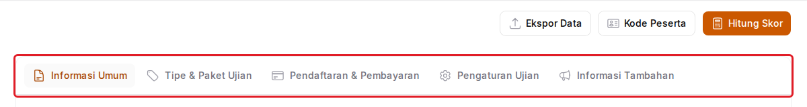
    </Frame>

    Setelah ujian dibuat, halaman detail ujian terbuka. Pengaturannya terbagi dalam tab **Informasi Umum**, **Tipe & Paket Ujian**, **Pendaftaran & Pembayaran**, **Pengaturan Ujian**, dan **Informasi Tambahan**. Di bawahnya ada tab **Daftar Tes Ujian**, **Formulir Pendaftaran**, dan **Daftar Peserta Ujian**.

    Untuk panduan cepat ini, pengaturan bawaan sudah cukup: ujian gratis, satu tahap (bukan multi-level), dan peserta tidak mendaftar sendiri. Penjelasan setiap tab ada di [Membuat Ujian](/data-ujian/membuat-ujian).

    Untuk membuka halaman ini lagi nanti, buka **Data Ujian**, lalu klik **Detail** pada ujian tersebut.
  </Step>
</Steps>

## 5. Menambahkan tes ujian

<Steps>
  <Step title="Klik Tambah Tes Ujian">
    <Frame>
      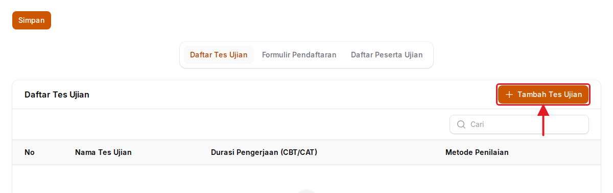
    </Frame>

    Gulir ke tab **Daftar Tes Ujian**, lalu klik **Tambah Tes Ujian**.
  </Step>
  <Step title="Isi informasi tes">
    <Frame>
      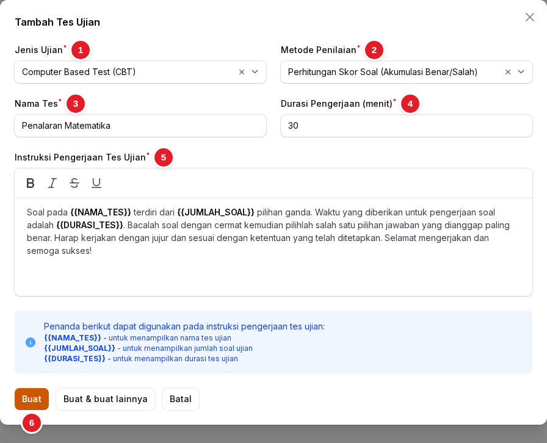
    </Frame>

    1. **Jenis Ujian**: biarkan **Computer Based Test (CBT)**.
    2. **Metode Penilaian**: pilih **Perhitungan Skor Soal (Akumulasi Benar/Salah)**, yaitu nilai dihitung dari skor setiap soal yang Anda atur di langkah sebelumnya.
    3. **Nama Tes**: misalnya **Penalaran Matematika**.
    4. **Durasi Pengerjaan (menit)**: misalnya **30**.
    5. **Instruksi Pengerjaan Tes Ujian**: sudah terisi teks bawaan. Penanda `{{NAMA_TES}}`, `{{JUMLAH_SOAL}}`, dan `{{DURASI_TES}}` otomatis diganti nama tes, jumlah soal, dan durasi.
    6. Klik **Buat**.

    Metode penilaian lain (Psikotes, IRT, dan sebagainya) dijelaskan di [Membuat Tes Ujian](/data-ujian/membuat-tes-ujian).
  </Step>
  <Step title="Buka tes yang baru dibuat">
    <Frame>
      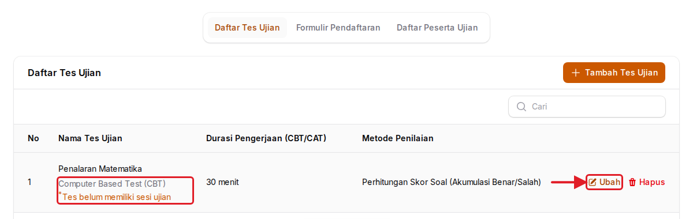
    </Frame>

    Tes baru tampil dengan keterangan **\*Tes belum memiliki sesi ujian**. Artinya tes belum bisa dikerjakan. Klik **Ubah** untuk membuka halaman tes.
  </Step>
  <Step title="Tampilkan skor kepada peserta">
    <Frame>
      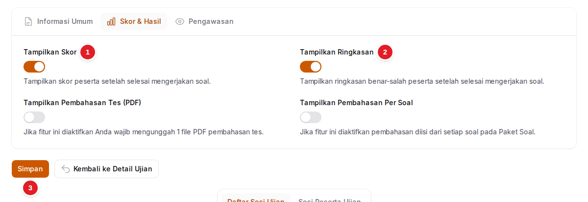
    </Frame>

    Buka tab **Skor & Hasil**, lalu:

    1. Aktifkan **Tampilkan Skor** agar peserta melihat nilainya setelah selesai.
    2. Aktifkan **Tampilkan Ringkasan** agar peserta melihat jumlah jawaban benar dan salah.
    3. Klik **Simpan**.

    Tab **Pengawasan** berisi pengaturan seperti **Deteksi Pindah Tab**; lihat [Membuat Tes Ujian](/data-ujian/membuat-tes-ujian).
  </Step>
</Steps>

## 6. Membuat sesi ujian

<Steps>
  <Step title="Klik Tambah Sesi Ujian">
    <Frame>
      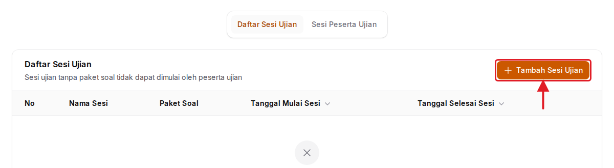
    </Frame>

    Masih di halaman tes, gulir ke tab **Daftar Sesi Ujian**, lalu klik **Tambah Sesi Ujian**.
  </Step>
  <Step title="Isi jadwal dan paket soal">
    <Frame>
      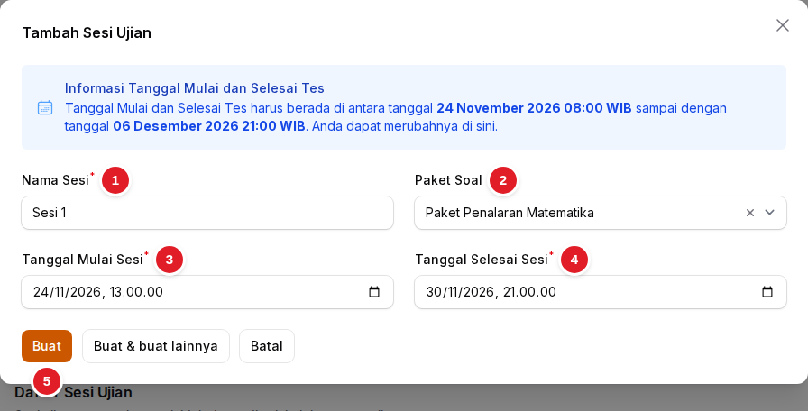
    </Frame>

    1. **Nama Sesi**: misalnya **Sesi 1**.
    2. **Paket Soal**: pilih **Paket Penalaran Matematika**. Hanya paket berjenis **CBT/CAT** yang muncul untuk tes CBT.
    3. **Tanggal Mulai Sesi**: misalnya 24 November 2026 pukul 13.00.
    4. **Tanggal Selesai Sesi**: misalnya 30 November 2026 pukul 21.00.
    5. Klik **Buat**.

    Kotak informasi di atas formulir menampilkan rentang tanggal ujian. Tanggal sesi harus berada di dalam rentang tersebut.

    <Warning>
      Sesi tanpa paket soal tidak dapat dimulai oleh peserta. Pastikan **Paket Soal** dipilih.
    </Warning>

    Jika peserta dibagi ke beberapa jadwal, buat beberapa sesi. Lihat [Membuat Sesi Ujian](/data-ujian/membuat-sesi-ujian).
  </Step>
</Steps>

## 7. Menambahkan peserta

Pada contoh ini, akun peserta disiapkan oleh admin melalui impor Excel. Cara lain dijelaskan di bagian bawah.

<Steps>
  <Step title="Buka Daftar Peserta Ujian, lalu klik Import Peserta">
    <Frame>
      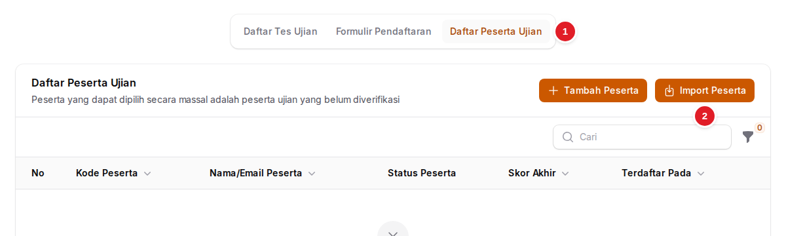
    </Frame>

    Kembali ke halaman detail ujian (klik **Kembali ke Detail Ujian** di halaman tes).

    1. Klik tab **Daftar Peserta Ujian**.
    2. Klik **Import Peserta**.
  </Step>
  <Step title="Unduh template dan isi data peserta">
    <Frame>
      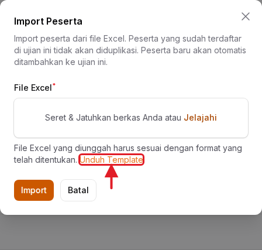
    </Frame>

    Klik **Unduh Template** untuk mendapatkan berkas Excel, lalu isi satu baris per peserta:

    | Nama | Alamat Email | Kata Sandi | Label |
    | --- | --- | --- | --- |
    | Dimas Pratama | dimas.pratama@contoh.id | (kata sandi peserta) | Gelombang 1 |
    | Siti Rahmawati | siti.rahmawati@contoh.id | (kata sandi peserta) | Gelombang 1 |

    - **Nama**, **Alamat Email**, dan **Kata Sandi** wajib diisi. Baris yang tidak lengkap dilewati.
    - **Label** boleh kosong; gunakan untuk mengelompokkan peserta, misalnya **Gelombang 1** atau **Kelas 12 IPA**.
    - Email dipakai peserta untuk masuk. Sistem tidak memeriksa apakah email benar-benar aktif, jadi Anda boleh memakai email khusus ujian, asalkan setiap peserta berbeda.
  </Step>
  <Step title="Unggah berkas dan klik Import">
    <Frame>
      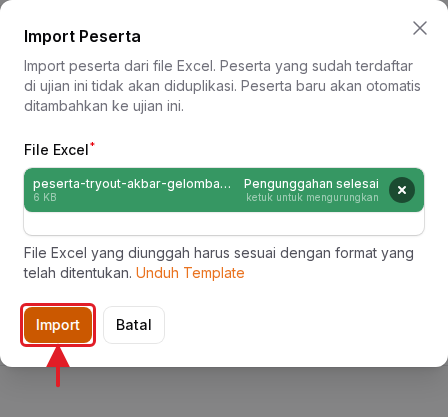
    </Frame>

    Seret berkas ke kolom **File Excel** atau klik **Jelajahi**. Setelah muncul keterangan **Pengunggahan selesai**, klik **Import**.

    <Frame>
      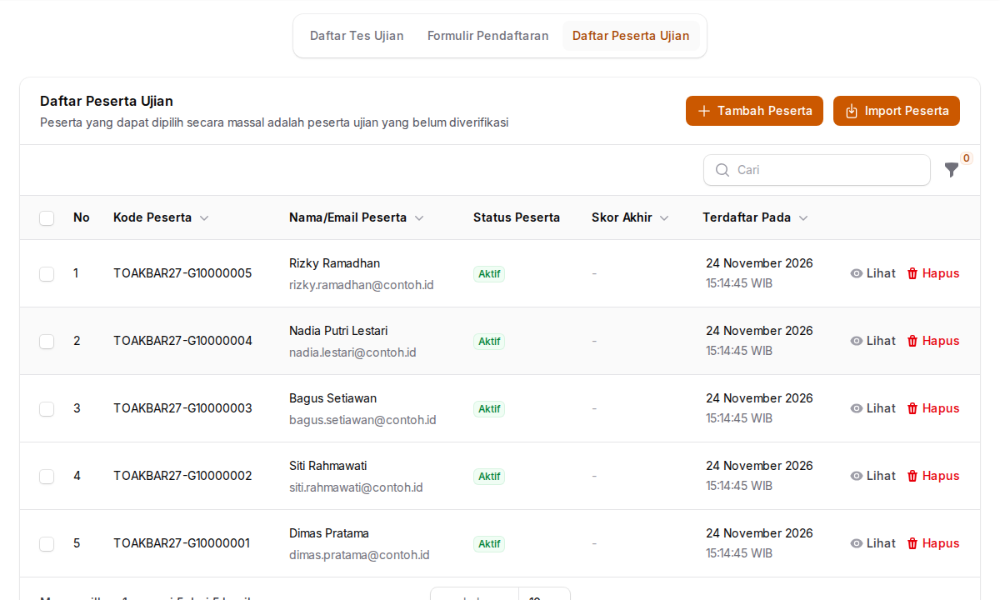
    </Frame>

    Impor berjalan di latar belakang dan kemajuannya tampil di bagian atas halaman. Akun yang belum ada dibuat otomatis, lalu semua peserta ditambahkan ke ujian dengan **Kode Peserta** seperti **TOAKBAR27-G10000001**. Peserta yang sudah terdaftar di ujian ini tidak diduplikasi.
  </Step>
</Steps>

<AccordionGroup>
  <Accordion title="Menambahkan akun yang sudah ada">
    Jika akun peserta sudah ada di **Manajemen Akun** → **Data Akun**, klik **Tambah Peserta** pada tab **Daftar Peserta Ujian**, centang akun yang diinginkan, lalu klik **Tambahkan Peserta**. Cara membuat akun dijelaskan di [Menambahkan Akun Peserta](/data-akun/menambahkan-akun-peserta).
  </Accordion>
  <Accordion title="Peserta mendaftar sendiri">
    Untuk ujian yang dibuka untuk umum, peserta dapat membuat akun dan mendaftar ujian sendiri:

    1. Aktifkan **Izinkan pendaftaran akun mandiri** di **Lainnya** → **Pengaturan Aplikasi** agar tombol **Daftar** muncul di halaman login peserta.
    2. Aktifkan **Apakah Pendaftaran Ujian Dibuka?** di tab **Pendaftaran & Pembayaran** pada detail ujian (membutuhkan add-on halaman pendaftaran). Peserta lalu mendaftar melalui tombol **Pendaftaran Tes Baru** di aplikasi peserta.
    3. Atur **Tipe Pembayaran**, formulir pendaftaran, dan verifikasi peserta sesuai kebutuhan.

    Langkah lengkapnya ada di [Membuat Formulir Pendaftaran](/data-ujian/membuat-formulir-pendaftaran) dan [Menambahkan Peserta Ujian](/data-ujian/menambahkan-peserta-ujian). Peserta yang mendaftar sendiri juga harus dihubungkan ke sesi, kecuali **Set Sesi Otomatis Setelah Pendaftaran** diaktifkan.
  </Accordion>
</AccordionGroup>

## 8. Menghubungkan peserta ke sesi

Peserta yang terdaftar di ujian belum bisa mengerjakan tes sebelum dihubungkan ke sebuah sesi.

<Steps>
  <Step title="Buka Sesi Peserta Ujian pada halaman tes">
    <Frame>
      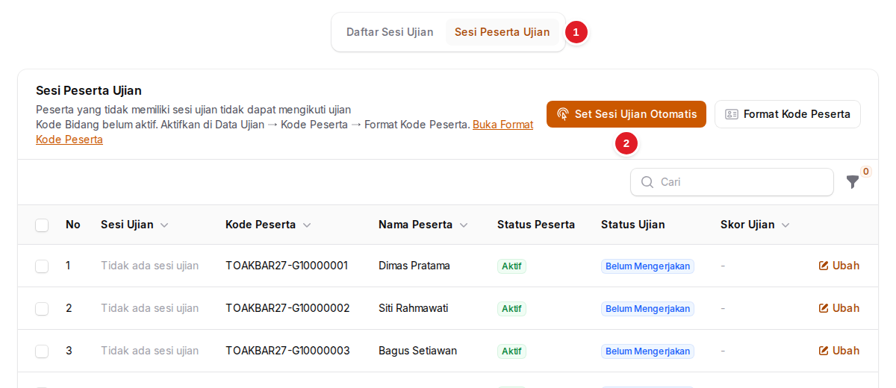
    </Frame>

    Buka halaman tes (tab **Daftar Tes Ujian** → **Ubah** pada **Penalaran Matematika**), lalu:

    1. Klik tab **Sesi Peserta Ujian**. Peserta yang belum punya sesi bertanda **Tidak ada sesi ujian**.
    2. Klik **Set Sesi Ujian Otomatis**.
  </Step>
  <Step title="Konfirmasi pembagian sesi">
    <Frame>
      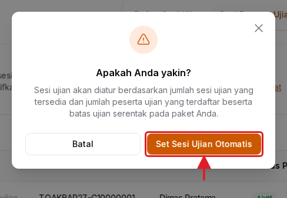
    </Frame>

    Klik **Set Sesi Ujian Otomatis** pada jendela konfirmasi. Sistem membagi peserta secara merata ke sesi yang tersedia; dengan satu sesi, semua peserta masuk ke **Sesi 1**.

    <Frame>
      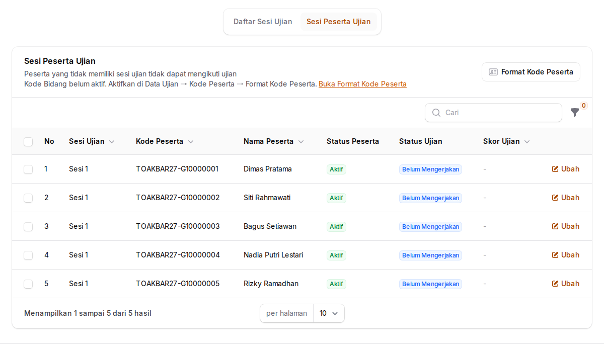
    </Frame>
  </Step>
</Steps>

<Tip>
  Untuk memilih sesi sendiri, centang peserta, klik **Tindakan**, lalu pilih **Set Sesi Ujian Kolektif**. Untuk satu peserta, klik **Ubah** pada barisnya. Tombol **Set Sesi Ujian Otomatis** hanya muncul jika masih ada peserta tanpa sesi dan tidak ada peserta yang sedang mengerjakan.
</Tip>

## 9. Membagikan tautan login peserta

<Steps>
  <Step title="Salin Tautan Login Peserta">
    <Frame>
      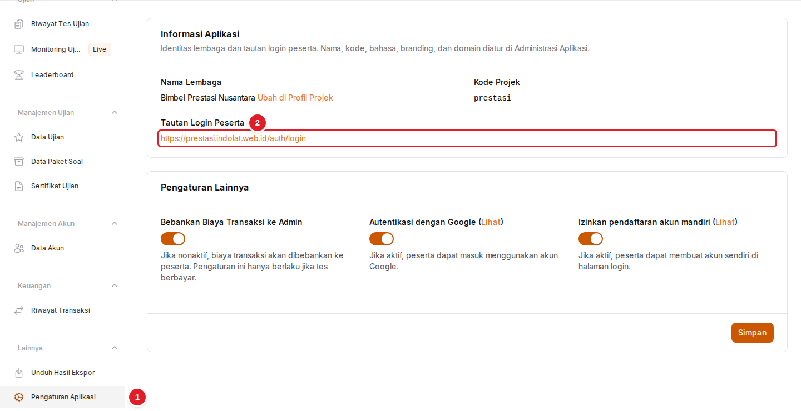
    </Frame>

    1. Di sidebar, klik **Lainnya** → **Pengaturan Aplikasi**.
    2. Salin **Tautan Login Peserta** pada kartu **Informasi Aplikasi**, misalnya `https://prestasi.indolat.web.id/auth/login`, lalu bagikan kepada peserta bersama email dan kata sandi masing-masing.

    Alamat ini dibentuk dari kode projek. Nama lembaga, kode, dan domain diubah di **Administrasi Aplikasi** → **Pengaturan Projek**. Lihat juga [Login Peserta](/lainnya/login-peserta).
  </Step>
</Steps>

## 10. Peserta mengerjakan ujian

Bagian ini menunjukkan tampilan dari sisi peserta. Cobalah sendiri dengan salah satu akun peserta sebelum ujian dibuka untuk semua orang.

<Steps>
  <Step title="Masuk ke aplikasi peserta">
    <Frame>
      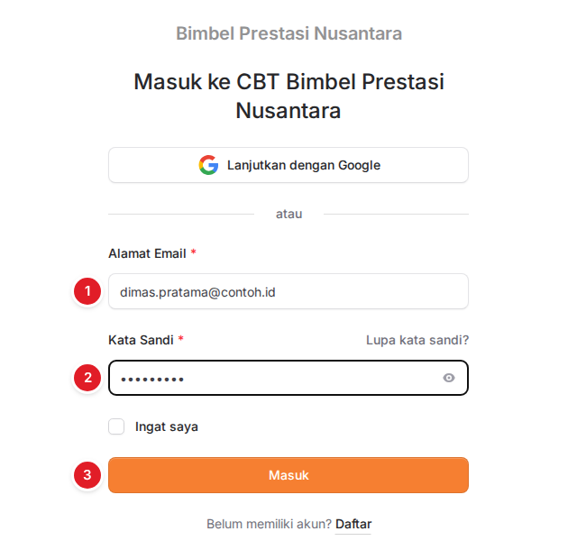
    </Frame>

    1. Buka tautan login, lalu isi **Alamat Email**.
    2. Isi **Kata Sandi**.
    3. Klik **Masuk**.
  </Step>
  <Step title="Pilih tes di Daftar Tes">
    <Frame>
      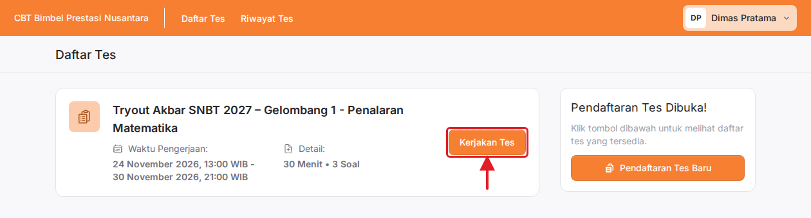
    </Frame>

    Halaman **Daftar Tes** menampilkan tes yang dapat dikerjakan beserta waktu pengerjaan (jadwal sesi), durasi, dan jumlah soal. Klik **Kerjakan Tes**.
  </Step>
  <Step title="Baca instruksi, lalu mulai">
    <Frame>
      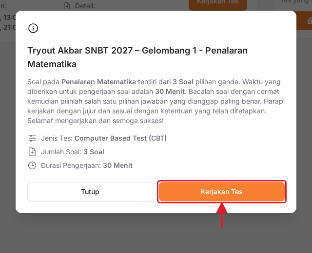
    </Frame>

    Jendela instruksi menampilkan **Instruksi Pengerjaan Tes Ujian** yang Anda tulis, jenis tes, jumlah soal, dan durasi. Klik **Kerjakan Tes**.

    <Frame>
      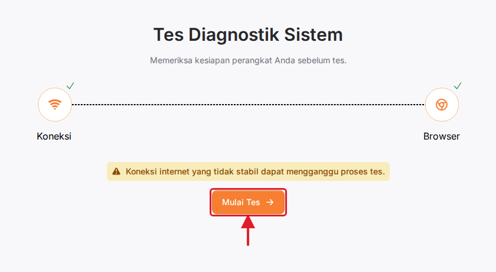
    </Frame>

    Halaman **Tes Diagnostik Sistem** memeriksa koneksi dan browser peserta. Setelah pemeriksaan selesai, klik **Mulai Tes**. Waktu pengerjaan mulai berjalan.
  </Step>
  <Step title="Jawab soal">
    <Frame>
      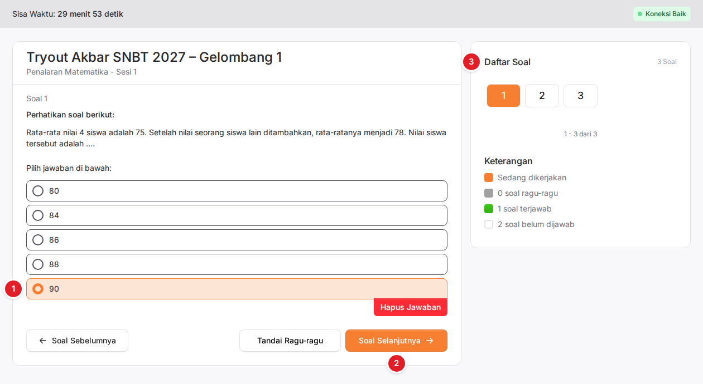
    </Frame>

    1. Klik pilihan jawaban. Gunakan **Hapus Jawaban** untuk membatalkan pilihan.
    2. Klik **Soal Selanjutnya** untuk berpindah soal. **Tandai Ragu-ragu** menandai soal yang ingin diperiksa lagi.
    3. Panel **Daftar Soal** menunjukkan nomor yang sudah dijawab dan dapat diklik untuk melompat ke soal tertentu.

    Sisa waktu tampil di bagian atas. Karena **Acak Soal** aktif, urutan soal setiap peserta berbeda.
  </Step>
  <Step title="Selesaikan tes">
    <Frame>
      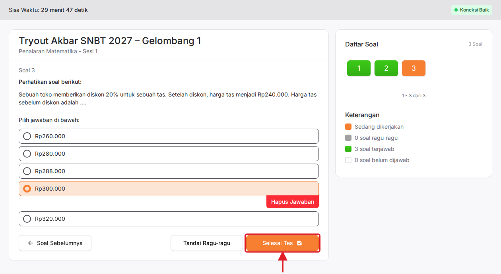
    </Frame>

    Pada soal terakhir, klik **Selesai Tes**.

    <Frame>
      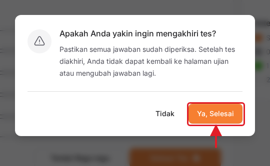
    </Frame>

    Klik **Ya, Selesai**. Setelah tes diakhiri, peserta tidak dapat kembali ke halaman ujian atau mengubah jawaban.

    <Frame>
      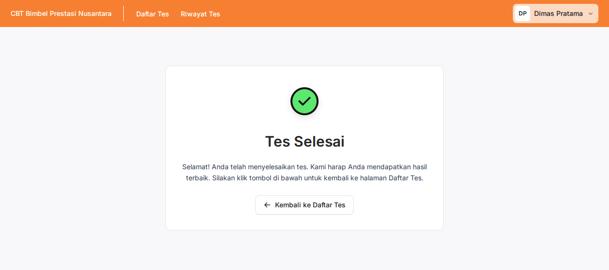
    </Frame>
  </Step>
  <Step title="Lihat nilai di Riwayat Tes">
    <Frame>
      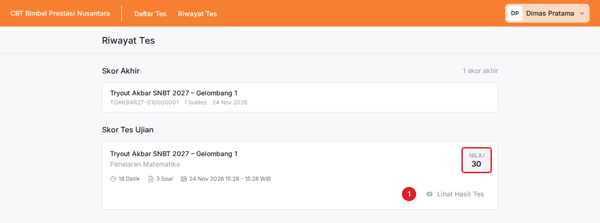
    </Frame>

    Di menu **Riwayat Tes**, peserta melihat **Nilai** tesnya karena **Tampilkan Skor** aktif. Klik **Lihat Hasil Tes** untuk melihat lembar jawaban dan ringkasan benar-salah (tampil karena **Tampilkan Ringkasan** aktif).
  </Step>
</Steps>

## 11. Memantau dan melihat hasil

### Pantau peserta yang sedang mengerjakan

<Frame>
  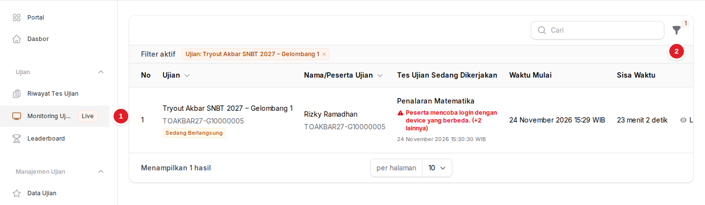
</Frame>

1. Di sidebar, klik **Ujian** → **Monitoring Ujian**. Halaman ini diperbarui otomatis setiap 10 detik.
2. Klik ikon filter untuk memilih **Ujian**, **Status Ujian** (sedang atau belum mengerjakan), atau **Terdeteksi Kecurangan**, lalu klik **Terapkan filter**.

Daftar ini menampilkan peserta yang belum menyelesaikan ujiannya, beserta tes yang sedang dikerjakan, waktu mulai, sisa waktu, dan peringatan, misalnya **Peserta mencoba login dengan device yang berbeda**. Peserta yang sudah selesai pindah ke **Riwayat Tes Ujian**.

### Lihat hasil peserta

<Frame>
  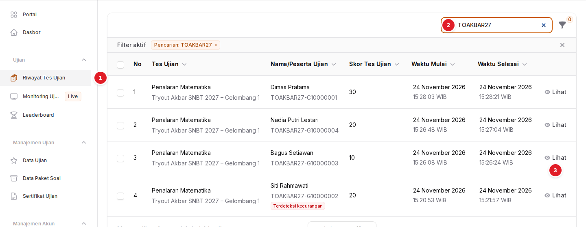
</Frame>

1. Di sidebar, klik **Ujian** → **Riwayat Tes Ujian**.
2. Cari dengan nama atau kode peserta. Karena kode peserta diawali kode ujian, mengetik **TOAKBAR27** menampilkan semua peserta ujian ini. Anda juga dapat memakai filter **Tes Ujian** atau **Tanggal Pengerjaan**. Tabel menampilkan **Skor Tes Ujian**, **Waktu Mulai**, dan **Waktu Selesai** setiap peserta; label **Terdeteksi kecurangan** muncul jika sistem mencatat pelanggaran.
3. Klik **Lihat** untuk membuka detail hasil peserta.

<Frame>
  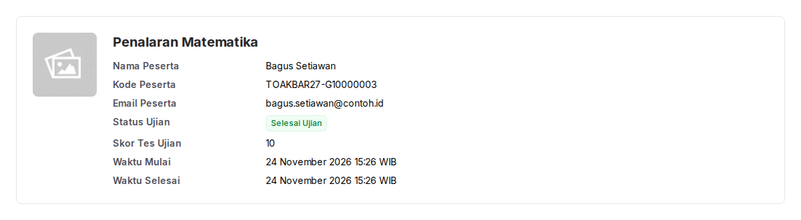
</Frame>

<Frame>
  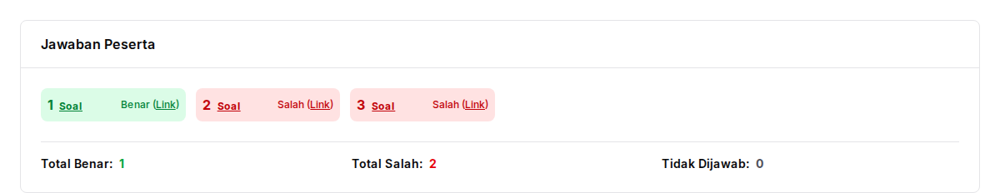
</Frame>

Halaman detail memuat ringkasan peserta, **Log Peserta & Ujian** (kapan mulai, selesai, dan kejadian lain), serta **Jawaban Peserta** dengan status benar atau salah per soal. Tautan **Soal** membuka butir soal tersebut, sedangkan **Link** membuka pilihan jawaban yang dipilih peserta, masing-masing di tab baru.

<Tip>
  Jika Anda mengubah skor soal setelah peserta selesai, hitung ulang nilainya melalui **Hitung Skor** → **Perhitungan Skor Ujian** di halaman detail ujian, atau **Hitung Ulang Skor** di tab **Sesi Peserta Ujian** pada halaman tes. Tes dengan metode IRT dihitung melalui **Hitung Skor** → **Perhitungan IRT** setelah semua peserta selesai.
</Tip>

### Unduh laporan hasil ujian

<Steps>
  <Step title="Ekspor hasil tes ujian">
    <Frame>
      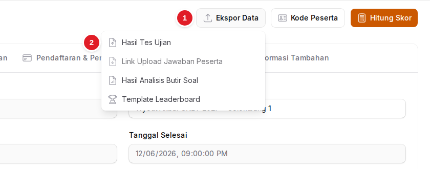
    </Frame>

    Di halaman detail ujian:

    1. Klik **Ekspor Data**.
    2. Pilih **Hasil Tes Ujian**, lalu klik **Konfirmasi**.

    Berkas Excel diproses di latar belakang, dan Anda mendapat notifikasi setelah berkas siap. Berkas ini berisi dua lembar kerja: rekap skor setiap peserta, dan rincian peserta beserta waktu pengerjaan dan data kecurangan.
  </Step>
  <Step title="Unduh berkas">
    <Frame>
      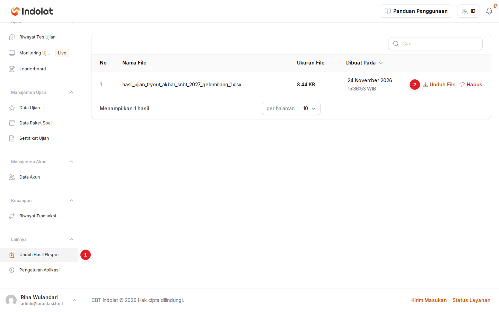
    </Frame>

    1. Di sidebar, klik **Lainnya** → **Unduh Hasil Ekspor**.
    2. Klik **Unduh File** pada berkas hasil ekspor, misalnya **hasil_ujian_tryout_akbar_snbt_2027_gelombang_1.xlsx**.

    <Check>
      Selesai. Anda sudah membuat paket soal, ujian, tes, dan sesi, menambahkan peserta, mencoba ujian dari sisi peserta, serta memantau dan mengunduh hasilnya.
    </Check>
  </Step>
</Steps>
