Halaman ini memandu Anda dari pembuatan akun admin sampai siap bekerja di tampilan baru: masuk ke Panel, melengkapi profil, mengenal **Portal**, membuka setiap modul, dan memahami ke mana menu lama dipindahkan.

<Info>
  Tampilan baru dibuka melalui `app.indolat.com/web`. Setelah masuk, Anda mendarat di **Portal**. Wizard **Lengkapi Profil**, **Panduan Menu**, dan daftar **Mulai cepat** hanya tampil untuk pemilik projek.
</Info>

<Note>
  Mulai **30 November 2026**, semua admin memakai tampilan baru ini dan tampilan lama tidak dapat dipilih kembali. Data, ujian, dan peserta Anda tetap utuh. Yang berubah hanya tampilan dan letak menu.
</Note>

Contoh di halaman ini memakai admin **Dewi Lestari** (`dewi.lestari@contoh.id`) yang mendaftarkan sekolahnya, **SMA Harapan Bangsa**.

## Membuat akun admin

<Steps>
  <Step title="Buka halaman pendaftaran">
    Buka `app.indolat.com/web/register`, atau pilih **Daftar** di bawah tombol **Masuk** pada halaman masuk.
  </Step>
  <Step title="Isi formulir Daftar Akun">
    <Frame>
      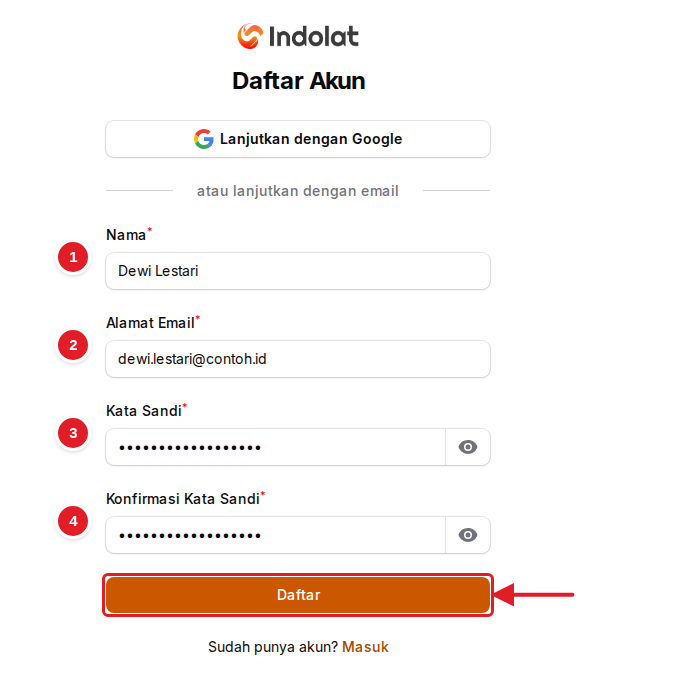
    </Frame>

    1. **Nama**: nama Anda sebagai admin, misalnya **Dewi Lestari**.
    2. **Alamat Email**: email aktif yang akan dipakai untuk masuk. Email sekali pakai (_disposable email_) dan email yang sudah terdaftar akan ditolak.
    3. **Kata Sandi**: minimal 8 karakter.
    4. **Konfirmasi Kata Sandi**: ketik ulang kata sandi yang sama.

    Pilih **Daftar**. Bila muncul kotak verifikasi keamanan, selesaikan terlebih dahulu.

    <Tip>
      Anda juga dapat memilih **Lanjutkan dengan Google**. Akun Google yang belum terdaftar langsung dibuatkan akun admin beserta projeknya, dan emailnya dianggap sudah terverifikasi.
    </Tip>
  </Step>
  <Step title="Verifikasi alamat email">
    Setelah mendaftar, notifikasi **Akun Berhasil Dibuat** menyatakan bahwa **Paket Standard** sudah aktif. Panel lalu meminta Anda memverifikasi email.

    <Frame>
      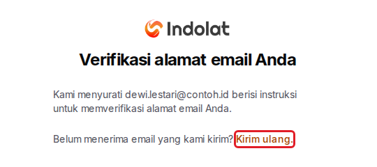
    </Frame>

    Buka email berjudul **Verifikasi Alamat Email**, lalu pilih tombol **Verifikasi Alamat Email**. Bila email tidak masuk, periksa folder spam atau pilih **Kirim ulang** di halaman verifikasi.

    <Frame>
      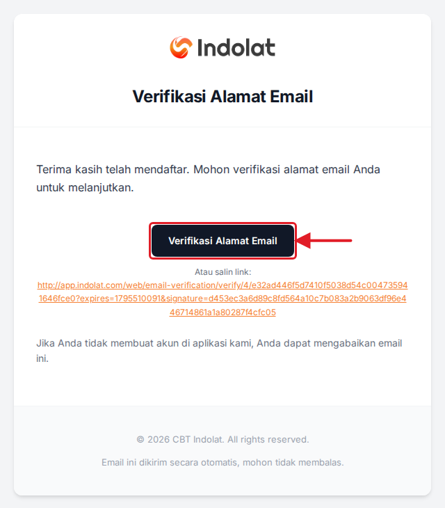
    </Frame>
  </Step>
</Steps>

Setiap akun baru otomatis mendapat satu projek dengan **Paket Standard**. Nama projek akan diganti dengan nama lembaga yang Anda isi di wizard **Lengkapi Profil**, sedangkan kodenya dibuat otomatis (misalnya `cl-1795506490`).

<Tip>
  Kode projek menjadi bagian dari tautan login peserta (`kode-projek.indolat.web.id`). Ganti kode bawaan dengan kode yang mudah diingat melalui **Portal** → **Administrasi Aplikasi** → **Pengaturan Projek** → **Profil Projek**. Contoh di halaman ini memakai kode `sma-harapan-bangsa`.
</Tip>

## Melengkapi profil

Begitu email terverifikasi, wizard **Lengkapi Profil** terbuka. Selama profil belum lengkap, jatah gratis Anda **50 kredit** ujian per bulan. Setelah keempat langkah selesai, jatah bertambah **150 kredit** menjadi **200 kredit** per bulan.

<Steps>
  <Step title="Langkah 1: Identitas Anda">
    <Frame>
      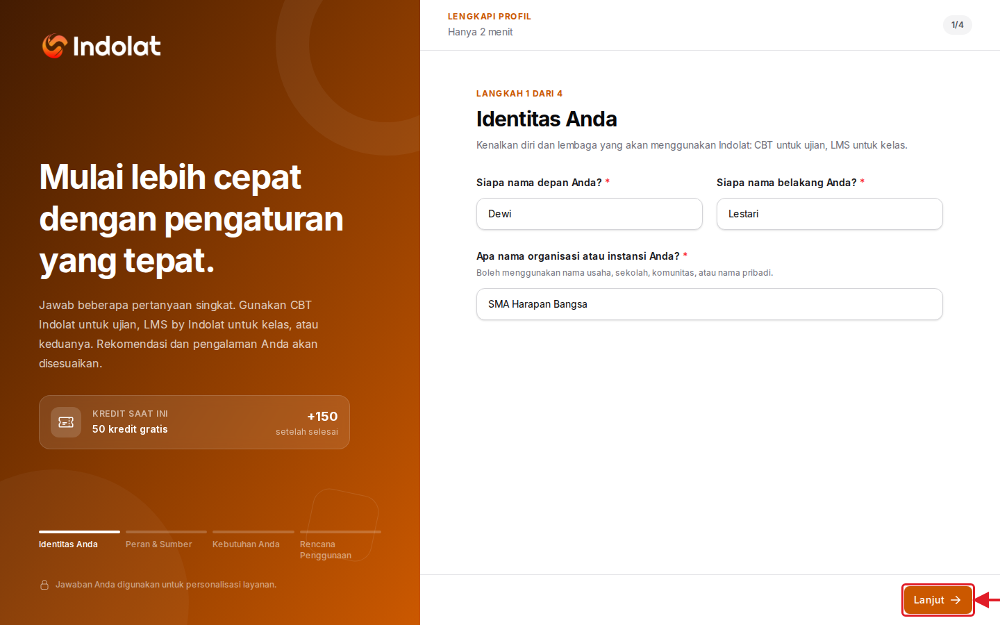
    </Frame>

    Nama depan dan nama belakang terisi dari nama akun. Isi **Apa nama organisasi atau instansi Anda?** dengan nama lembaga, misalnya **SMA Harapan Bangsa**. Nama ini menjadi nama projek dan tampil di Portal serta aplikasi peserta. Pilih **Lanjut**.
  </Step>
  <Step title="Langkah 2: Peran & Sumber">
    <Frame>
      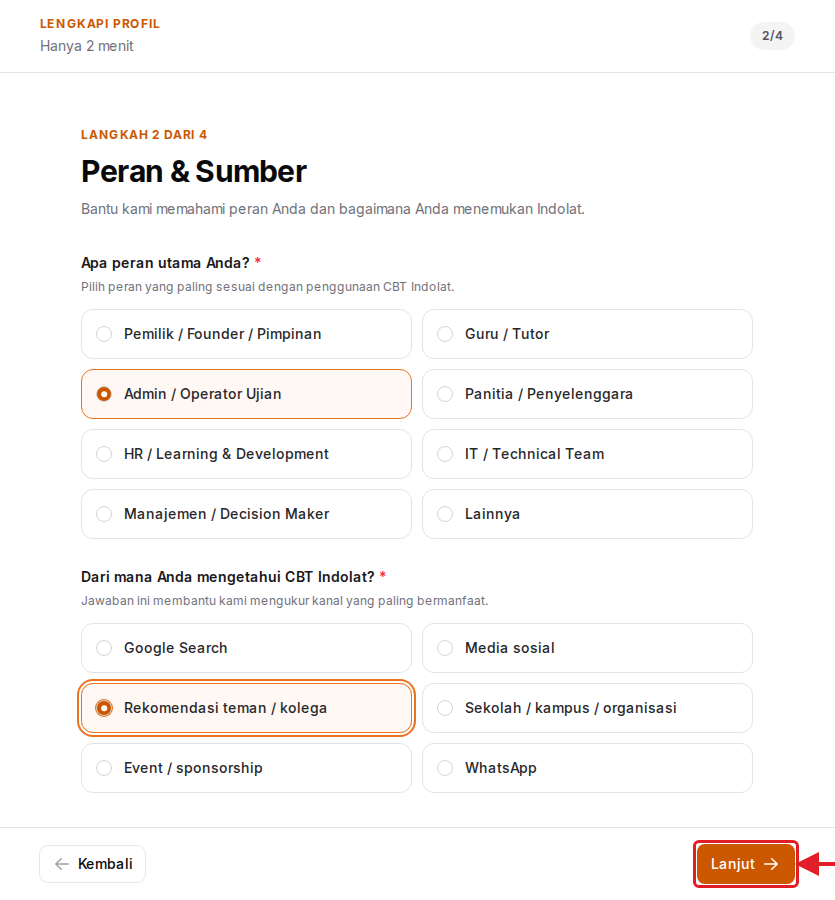
    </Frame>

    Pilih peran utama Anda (misalnya **Admin / Operator Ujian**) dan dari mana Anda mengetahui CBT Indolat. Bila memilih **Lainnya**, tuliskan jawabannya pada kolom yang muncul. Pilih **Lanjut**.
  </Step>
  <Step title="Langkah 3: Kebutuhan Anda">
    <Frame>
      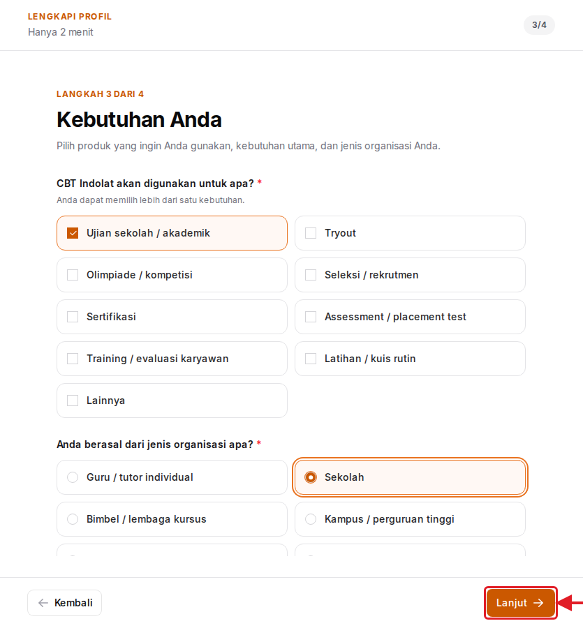
    </Frame>

    Pilih satu atau beberapa kebutuhan (misalnya **Ujian sekolah / akademik**) dan jenis organisasi Anda (misalnya **Sekolah**). Pilih **Lanjut**.
  </Step>
  <Step title="Langkah 4: Rencana Penggunaan">
    <Frame>
      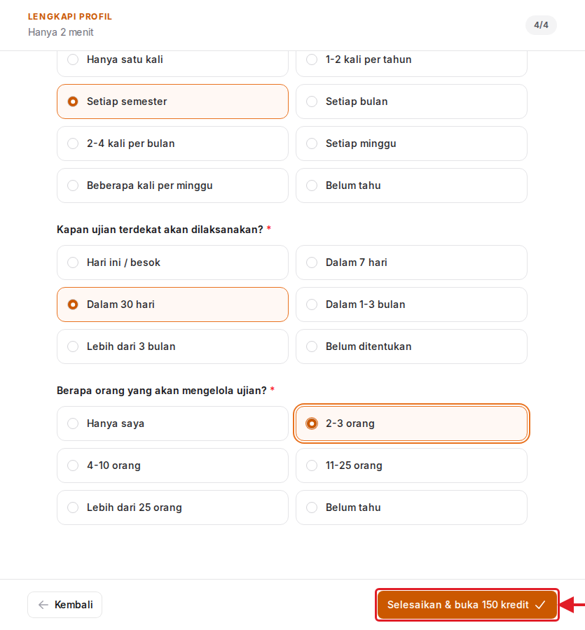
    </Frame>

    Jawab perkiraan jumlah peserta, frekuensi ujian, waktu ujian terdekat, dan jumlah pengelola ujian. Pilih **Selesaikan & buka 150 kredit**.
  </Step>
  <Step title="Masuk ke Portal">
    <Frame>
      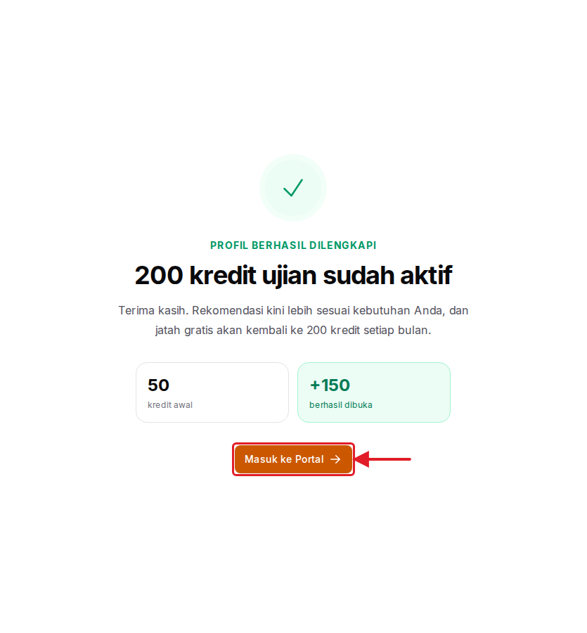
    </Frame>

    Halaman **Profil berhasil dilengkapi** menampilkan 50 kredit awal dan tambahan 150 kredit yang terbuka. Pilih **Masuk ke Portal**.
  </Step>
</Steps>

Semua pertanyaan wajib dijawab. Gunakan **Kembali** untuk memperbaiki jawaban di langkah sebelumnya.

## Masuk ke Panel

<Frame>
  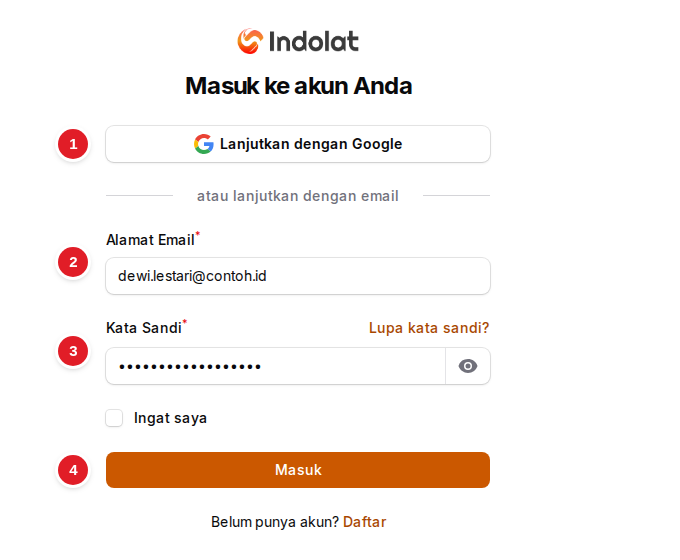
</Frame>

1. **Lanjutkan dengan Google**: masuk dengan akun Google yang emailnya sama dengan akun admin Anda.
2. **Alamat Email**: email akun admin.
3. **Kata Sandi**: kata sandi akun. Pilih **Lupa kata sandi?** bila Anda lupa, lalu ikuti tautan yang dikirim ke email. Centang **Ingat saya** agar tidak perlu masuk ulang di perangkat yang sama.
4. Pilih **Masuk**.

Tombol bahasa di pojok kanan atas (**ID**) mengganti bahasa halaman masuk ke bahasa Inggris dan sebaliknya.

Bila Anda hanya memiliki satu projek, Anda langsung mendarat di Portal. Bila Anda memiliki akses ke lebih dari satu projek, pilih projek dari daftar **Pilih Projek** terlebih dahulu.

<Frame>
  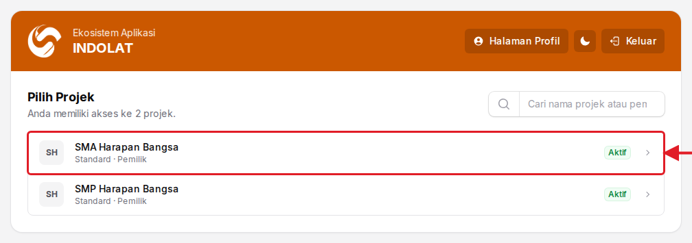
</Frame>

Setiap baris menampilkan nama projek, paket, peran Anda, dan status projek. Gunakan kolom **Cari nama projek atau pemilik…** bila daftarnya panjang.

## Mengenal Portal

**Portal** adalah halaman pertama setelah masuk. Dari sini Anda memilih modul yang ingin dibuka.

<Frame>
  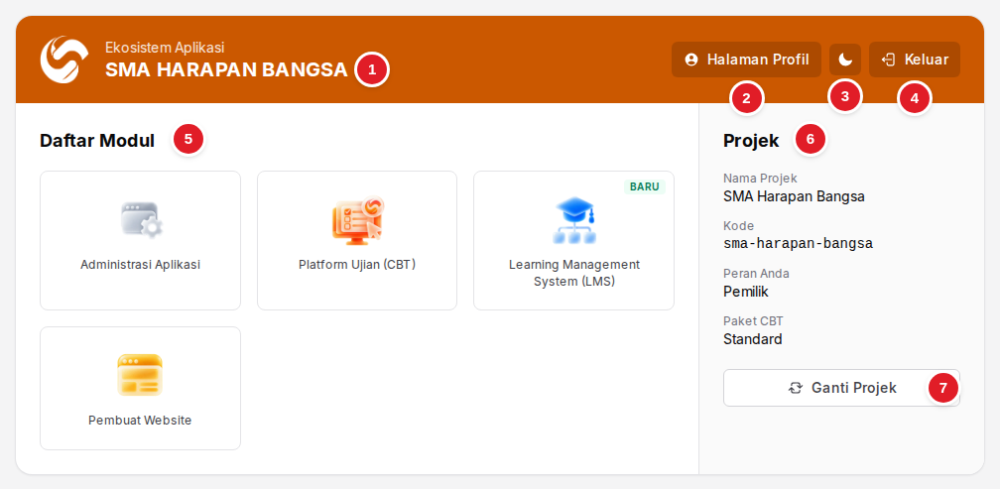
</Frame>

1. **Pita identitas**: nama lembaga dari projek yang sedang dibuka.
2. **Halaman Profil**: membuka halaman **Profil** untuk mengubah nama, alamat email, dan kata sandi akun Anda.
3. **Ubah tema**: beralih antara mode terang dan mode gelap.
4. **Keluar**: keluar dari akun.
5. **Daftar Modul**: ubin modul yang dapat Anda buka. Arahkan kursor ke ubin untuk melihat penjelasan singkatnya. Ubin hanya tampil untuk modul yang diizinkan oleh peran Anda.
6. **Projek**: nama projek, kode, peran Anda di projek ini (misalnya **Pemilik**), dan paket CBT.
7. **Ganti Projek**: tampil bila Anda memiliki akses ke lebih dari satu projek.

<Frame>
  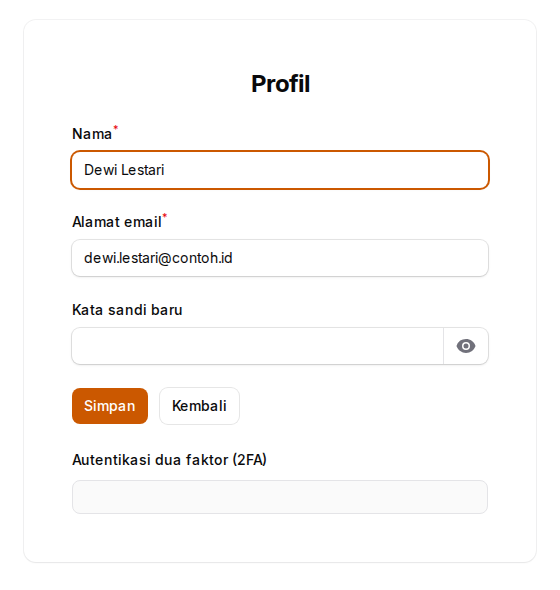
</Frame>

Pada halaman **Profil**, kosongkan **Kata sandi baru** bila Anda tidak ingin mengganti kata sandi. Pilih **Simpan** untuk menyimpan perubahan atau **Kembali** untuk kembali ke halaman sebelumnya.

<Frame>
  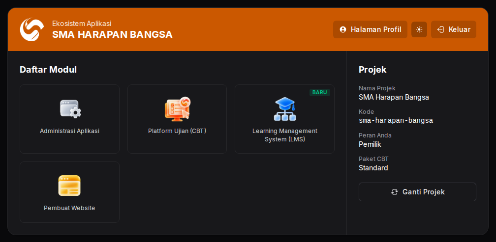
</Frame>

### Ganti Projek

Bila Anda mengelola lebih dari satu lembaga, misalnya SMA dan SMP dalam satu yayasan, pilih **Ganti Projek** pada panel **Projek**.

<Frame>
  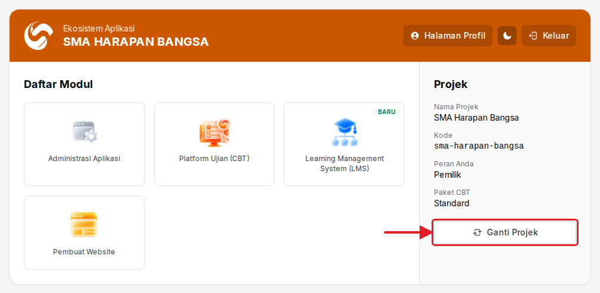
</Frame>

Portal kembali menampilkan daftar **Pilih Projek**. Pilih projek yang ingin dibuka. Semua modul yang Anda buka sesudahnya bekerja pada projek tersebut.

## Modul yang tersedia

| Ubin di Portal | Kegunaan |
| --- | --- |
| **Administrasi Aplikasi** | Mengelola projek secara keseluruhan: pengguna, tim dan role admin, penarikan saldo, langganan dan tagihan, profil projek, branding, domain, serta integrasi API. |
| **Platform Ujian (CBT)** | Menyelenggarakan ujian dan asesmen: paket soal, data ujian, monitoring, hasil, leaderboard, sertifikat, dan riwayat pembayaran ujian. |
| **Learning Management System (LMS)** | Mengelola kelas, jadwal mengajar, materi, tugas, dan nilai. Lihat [Mengenal LMS](/lms/mengenal-lms). |
| **Pembuat Website** | Membuat dan menerbitkan website lembaga tanpa menulis kode. Lihat [Membuat Website](/web-builder/membuat-website). |

Setiap modul memiliki sidebar sendiri. Menu **Portal** selalu berada di paling atas sidebar, jadi Anda dapat kembali ke Portal dan berpindah modul dengan satu klik.

<Tabs>
  <Tab title="Administrasi Aplikasi">
    <Frame>
      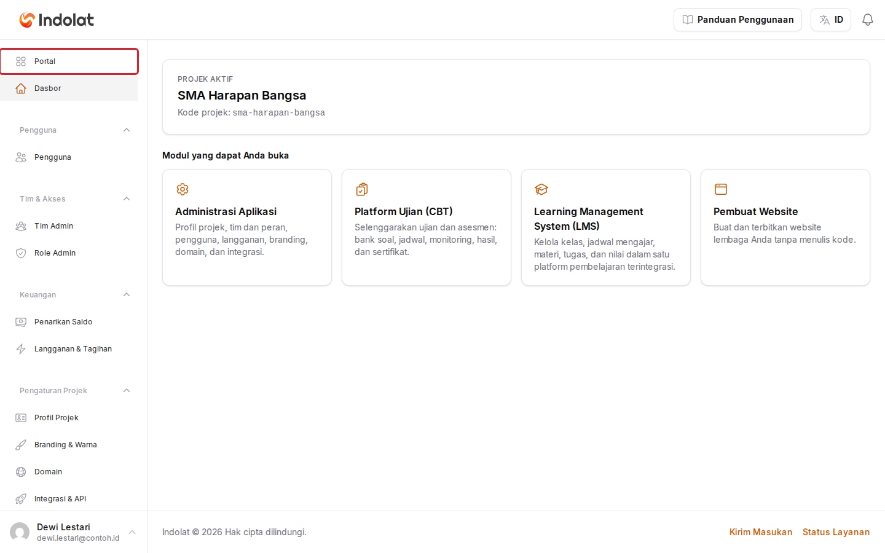
    </Frame>

    Sidebar: **Dasbor**; **Pengguna**: **Pengguna**; **Tim & Akses**: **Tim Admin**, **Role Admin**; **Keuangan**: **Penarikan Saldo**, **Langganan & Tagihan**; **Pengaturan Projek**: **Profil Projek**, **Branding & Warna**, **Domain**, **Integrasi & API**. Dasbor menampilkan projek aktif dan modul yang dapat Anda buka.
  </Tab>
  <Tab title="Platform Ujian (CBT)">
    <Frame>
      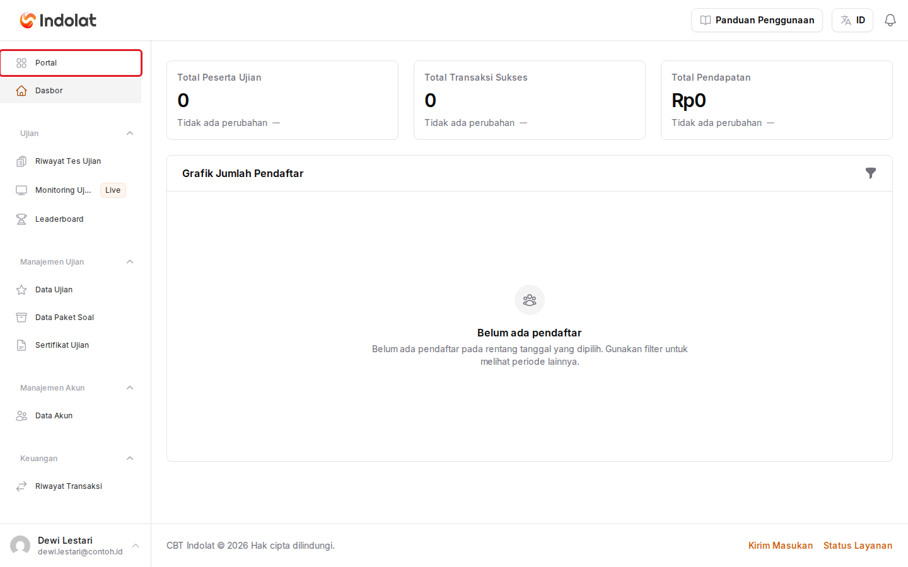
    </Frame>

    Sidebar: **Dasbor**; **Ujian**: **Riwayat Tes Ujian**, **Monitoring Ujian**, **Leaderboard**; **Manajemen Ujian**: **Data Ujian**, **Data Paket Soal**, **Sertifikat Ujian**; **Manajemen Akun**: **Data Akun**; **Keuangan**: **Riwayat Transaksi**; **Lainnya**: **Unduh Hasil Ekspor**, **Pengaturan Aplikasi**.
  </Tab>
  <Tab title="Learning Management System (LMS)">
    <Frame>
      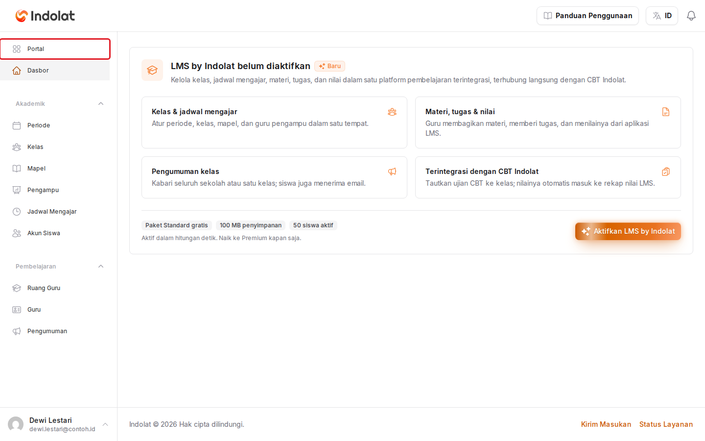
    </Frame>

    Sidebar: **Dasbor**; **Akademik**: **Periode**, **Kelas**, **Mapel**, **Pengampu**, **Jadwal Mengajar**, **Akun Siswa**; **Pembelajaran**: **Ruang Guru**, **Guru**, **Pengumuman**. LMS perlu diaktifkan sekali sebelum dipakai.
  </Tab>
  <Tab title="Pembuat Website">
    <Frame>
      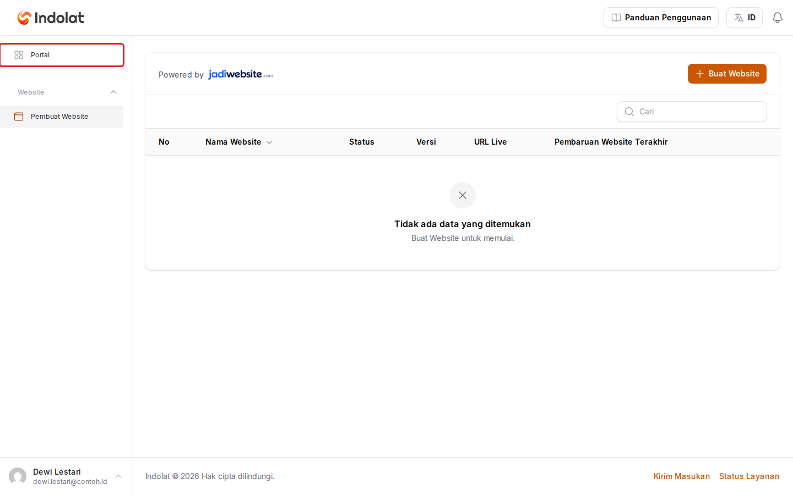
    </Frame>

    Sidebar: **Website**: **Pembuat Website**.
  </Tab>
</Tabs>

## Bilah atas dan menu akun

<Frame>
  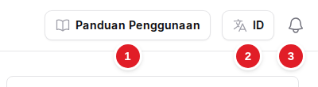
</Frame>

1. **Panduan Penggunaan**: membuka dokumentasi ini.
2. **Pilihan bahasa** (**ID**): mengganti bahasa tampilan Panel antara **Bahasa Indonesia** dan **English**.
3. **Notifikasi** (ikon lonceng): membuka daftar pemberitahuan untuk akun Anda.

<Frame>
  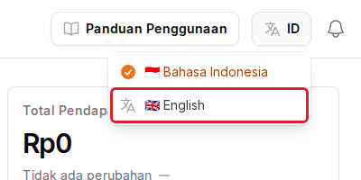
</Frame>

Pilih nama Anda di bagian bawah sidebar untuk membuka menu akun.

<Frame>
  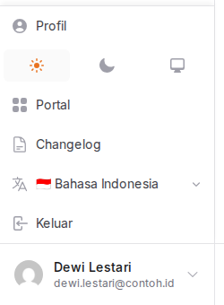
</Frame>

Menu akun berisi **Profil**, pilihan tema (terang, gelap, atau mengikuti sistem), **Portal**, **Changelog** (catatan pembaruan aplikasi), pilihan bahasa, dan **Keluar**. Di bagian bawah halaman juga tersedia tautan **Kirim Masukan** dan **Status Layanan**.

## Panduan Menu

Saat pemilik projek pertama kali membuka sebuah modul, **Panduan Menu** berjalan otomatis. Tur ini menyorot setiap menu di sidebar satu per satu dan menjelaskan kegunaannya.

<Frame>
  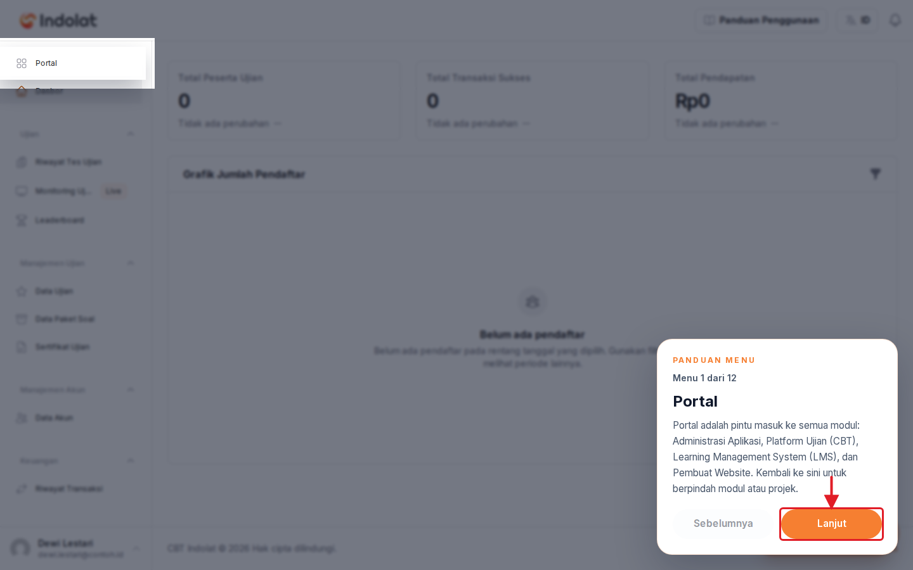
</Frame>

- Pilih **Lanjut** untuk ke menu berikutnya dan **Sebelumnya** untuk kembali.
- Pada beberapa langkah, tombol berubah menjadi **Klik menu yang disorot**. Klik menu yang disorot di sidebar untuk melanjutkan tur ke halaman tersebut.

<Frame>
  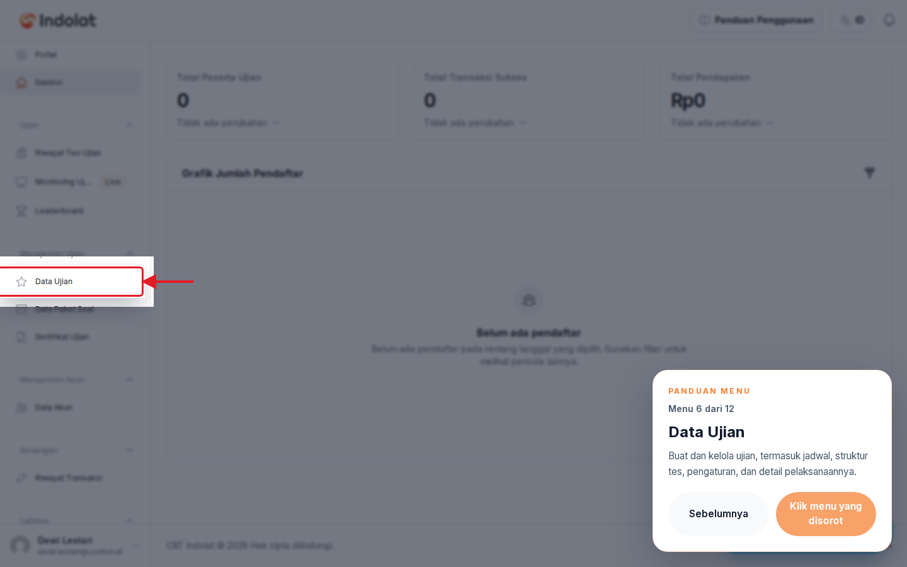
</Frame>

- Tur di **Platform Ujian (CBT)** memiliki 12 menu dan diakhiri dengan tombol **Panduan Penggunaan**. Pilih **Selesai** pada langkah terakhir.
- Tur di **Administrasi Aplikasi**, **LMS**, dan **Pembuat Website** lebih singkat dan dapat dilewati dengan tombol **Lewati**.

<Frame>
  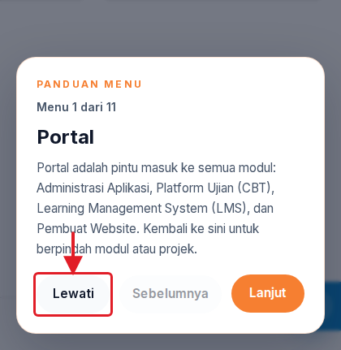
</Frame>

Setiap tur hanya berjalan satu kali per modul untuk setiap projek.

## Mulai cepat

Di modul **Platform Ujian (CBT)**, tombol **Mulai cepat** di pojok kanan bawah menampilkan tiga tugas pertama untuk menyiapkan ujian.

<Frame>
  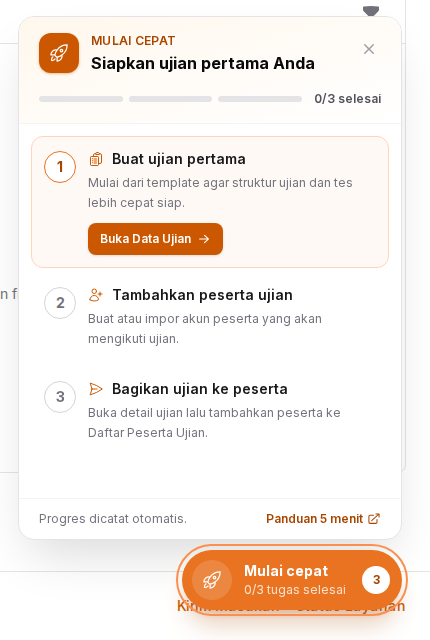
</Frame>

1. **Buat ujian pertama**: tombol **Buka Data Ujian** membawa Anda ke menu **Data Ujian**.
2. **Tambahkan peserta ujian**: buat atau impor akun peserta melalui **Data Akun**.
3. **Bagikan ujian ke peserta**: buka detail ujian, lalu tambahkan peserta ke daftar peserta ujian.

Progres dicatat otomatis dari data Anda, jadi tugas tercentang sendiri begitu selesai. Tautan **Panduan 5 menit** membuka panduan [Membuat Ujian Pertama Anda dalam 5 Menit](/membuat-ujian-pertama-anda-dalam-5-menit). Daftar ini hanya tampil untuk pemilik projek yang sudah melengkapi profil dan hilang setelah ketiga tugas selesai.

## Perubahan dari tampilan lama

Di tampilan lama, semua menu berada dalam satu sidebar di `/web`. Di tampilan baru, menu yang berlaku untuk seluruh projek dipindahkan ke **Administrasi Aplikasi**, dan **Pembuat Website** menjadi modul tersendiri.

| Tampilan lama (sidebar `/web`) | Tampilan baru |
| --- | --- |
| **Manajemen Paket** | **Administrasi Aplikasi** → **Keuangan** → **Langganan & Tagihan** |
| **Penarikan Saldo** | **Administrasi Aplikasi** → **Keuangan** → **Penarikan Saldo**. Saldo yang dapat ditarik dan saldo tertunda kini tampil di atas tabel. |
| **Riwayat Transaksi** | Tetap di **Platform Ujian (CBT)** → **Keuangan** → **Riwayat Transaksi** |
| **Tim Admin** dan **Role Admin** | **Administrasi Aplikasi** → **Tim & Akses** → **Tim Admin** dan **Role Admin** |
| **Pembuat Website** | Modul **Pembuat Website** → **Website** → **Pembuat Website** |
| **Data Akun** | Data utama ada di **Administrasi Aplikasi** → **Pengguna** → **Pengguna**. Menu **Data Akun** tetap ada di **Platform Ujian (CBT)** → **Manajemen Akun** dan menampilkan data yang sama. Di LMS, data yang sama tampil sebagai **Akun Siswa**. |
| **Pengaturan Aplikasi**, tab **Informasi Umum** (nama, kode, bahasa) | **Administrasi Aplikasi** → **Pengaturan Projek** → **Profil Projek** |
| **Pengaturan Aplikasi**, tab **Kustomisasi Branding** | **Administrasi Aplikasi** → **Pengaturan Projek** → **Branding & Warna** |
| **Pengaturan Aplikasi**, tab **Kustom Domain** | **Administrasi Aplikasi** → **Pengaturan Projek** → **Domain** |
| **Pengaturan Aplikasi**, tab **Integrasi API** | **Administrasi Aplikasi** → **Pengaturan Projek** → **Integrasi & API** |
| **Pengaturan Aplikasi**, tab **Pengaturan Lainnya** | Tetap di **Platform Ujian (CBT)** → **Lainnya** → **Pengaturan Aplikasi** |

Halaman **Pengaturan Aplikasi** di CBT kini berisi dua kartu:

- **Informasi Aplikasi**: nama lembaga (hanya baca, dengan tautan **Ubah di Profil Projek**), **Kode Projek**, dan **Tautan Login Peserta**.
- **Pengaturan Lainnya**: **Bebankan Biaya Transaksi ke Admin**, **Autentikasi dengan Google**, dan **Izinkan pendaftaran akun mandiri**.

Menu lain di CBT (**Dasbor**, **Riwayat Tes Ujian**, **Monitoring Ujian**, **Leaderboard**, **Data Ujian**, **Data Paket Soal**, **Sertifikat Ujian**, dan **Unduh Hasil Ekspor**) tetap berada di **Platform Ujian (CBT)**.
