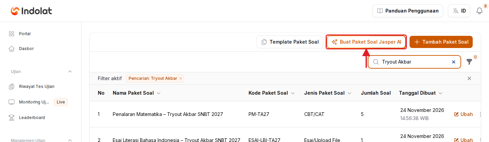
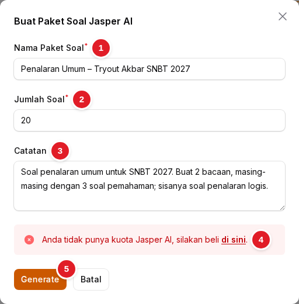
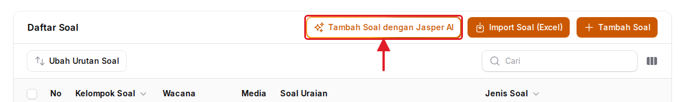
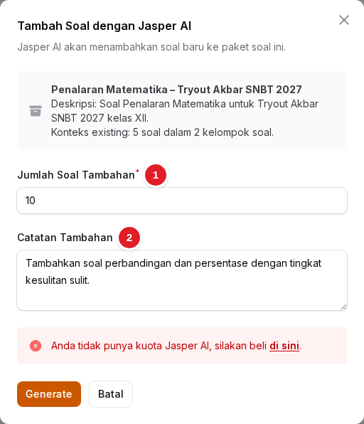

**Jasper AI** membuat butir soal beserta pilihan jawaban, kunci, pembahasan, tingkat kesulitan, dan skornya secara otomatis berdasarkan nama paket dan arahan yang Anda tulis. Fitur ini cocok untuk menyiapkan bahan soal dalam waktu singkat, yang kemudian Anda periksa dan sempurnakan.

<Info>
  **Lokasi menu:**

  - Paket baru: **Portal** → **Platform Ujian (CBT)** → **Manajemen Ujian** → **Data Paket Soal** → **Buat Paket Soal Jasper AI**.
  - Paket yang sudah ada: **Data Paket Soal** → **Ubah** pada paket soal → **Daftar Soal** → **Tambah Soal dengan Jasper AI**.

  Jasper AI hanya membuat soal untuk paket **CBT/CAT** dan memakai **kuota Jasper AI** projek Anda: satu soal mengurangi satu kuota.
</Info>

## Kuota Jasper AI

Sisa kuota tampil di bagian bawah formulir Jasper AI, misalnya **Sisa kuota Jasper AI: 100 soal**. Kuota dipotong sesuai **Jumlah Soal** saat proses dimulai. Jika kuota habis, formulir menampilkan **Anda tidak punya kuota Jasper AI, silakan beli di sini**; tautan **di sini** membuka pembelian add-on Jasper AI di **Administrasi Aplikasi** → **Keuangan** → **Langganan & Tagihan**.

Jika jumlah soal yang diminta melebihi sisa kuota, proses tidak dimulai dan muncul pesan **Kuota Jasper AI Tidak Cukup** beserta sisa kuota Anda.

## Membuat paket soal baru dengan Jasper AI

Sebagai contoh, Anda menyiapkan paket **Penalaran Umum – Tryout Akbar SNBT 2027** berisi 20 soal sebagai bahan awal.

<Steps>
  <Step title="Klik Buat Paket Soal Jasper AI">
    Buka **Data Paket Soal**, lalu klik **Buat Paket Soal Jasper AI**.

    <Frame>
      
    </Frame>
  </Step>
  <Step title="Isi formulir">
    <Frame>
      
    </Frame>

    1. **Nama Paket Soal**: nama paket yang akan dibuat. Nama ini juga menjadi petunjuk materi bagi Jasper AI, jadi gunakan nama yang jelas, misalnya **Penalaran Umum – Tryout Akbar SNBT 2027**.
    2. **Jumlah Soal**: jumlah soal yang dibuat, minimal 1, misalnya **20**.
    3. **Catatan** (opsional): arahan tambahan tentang materi, jenjang, bentuk soal, tingkat kesulitan, atau bahasa. Contoh: _Soal penalaran umum untuk SNBT 2027. Buat 2 bacaan, masing-masing dengan 3 soal pemahaman; sisanya soal penalaran logis._
    4. Informasi sisa kuota Jasper AI. Pada contoh, projek belum memiliki kuota sehingga formulir menampilkan tautan pembelian.
    5. Klik **Generate**.
  </Step>
  <Step title="Tunggu proses selesai">
    Muncul notifikasi **Proses Pembuatan Soal Dimulai**. Soal dibuat bertahap di latar belakang (paling banyak 20 soal per tahap), sehingga Anda dapat meninggalkan halaman.

    Selama proses berjalan, tombol **Buat Paket Soal Jasper AI** berganti menjadi **Sedang Membuat Paket Soal... (x/y)** yang menunjukkan jumlah soal yang sudah tersimpan. Klik tombol tersebut untuk melihat progresnya. Setelah selesai, Anda menerima notifikasi **Soal berhasil dibuat** dan paket baru tampil di daftar.

    <Note>
      Dalam satu projek hanya satu proses Jasper AI yang dapat berjalan pada satu waktu. Jika Anda memulai proses baru sebelum proses sebelumnya selesai, muncul pesan **Pembuatan Soal Sedang Berjalan**.
    </Note>

    Jika salah satu tahap gagal setelah dicoba ulang beberapa kali, Anda menerima notifikasi **Pembuatan soal Jasper AI terhenti** yang menyebutkan berapa soal yang sudah tersimpan.
  </Step>
  <Step title="Periksa paket hasil Jasper AI">
    Klik **Ubah** pada paket baru, lalu periksa informasi paket serta setiap soalnya. Paket hasil Jasper AI memiliki ketentuan berikut:

    - Jenis paket **CBT/CAT** dengan kode yang dibuat otomatis (inisial nama paket diikuti **-AI-** dan lima karakter acak). Ganti kode dan deskripsi bila perlu, lalu klik **Simpan**.
    - **Acak Soal** aktif. **Acak Jawaban (Pilihan Ganda)** aktif, kecuali untuk paket psikotes.
    - Soal berjenis **Pilihan Ganda** atau **Jawaban Singkat** (jawaban angka), masing-masing dengan pembahasan, **Tingkat Kesulitan**, serta **Skor CBT** dan **Skor CAT**. Rumus matematika ditulis dengan LaTeX.
    - Soal dikelompokkan ke **Kelompok Soal** sesuai subtopik.
    - Bacaan, tabel, atau kasus yang dipakai beberapa soal ditulis satu kali sebagai **wacana** di tab **Wacana** dan tampil di atas teks setiap soalnya saat ujian. Anda dapat meminta soal berbasis bacaan secara khusus di **Catatan**.
    - Jika nama paket atau catatan menunjukkan tes kepribadian atau psikotes (misalnya DISC, MBTI, minat karier), Jasper AI membuat soal pilihan ganda tanpa jawaban benar, lengkap dengan **Kelompok Jawaban** untuk metode penilaian **Psikotes (Pengelompokan Jawaban)**.
    - Soal ditulis dalam bahasa Indonesia, kecuali Anda meminta bahasa lain di **Catatan**.

    Cara mengubah soal, wacana, dan kelompok soal dijelaskan di [Membuat Paket Soal](/paket-soal/membuat-paket-soal).
  </Step>
</Steps>

## Menambah soal ke paket yang sudah ada

Gunakan cara ini untuk menambah soal buatan Jasper AI ke paket CBT/CAT yang sudah berisi soal, misalnya menambah 10 soal ke paket **Penalaran Matematika – Tryout Akbar SNBT 2027**.

<Steps>
  <Step title="Klik Tambah Soal dengan Jasper AI">
    Buka paket soal dengan **Ubah**, lalu klik **Tambah Soal dengan Jasper AI** pada bagian **Daftar Soal**.

    <Frame>
      
    </Frame>

    Tombol ini tidak tampil selama ada peserta yang sedang mengerjakan ujian yang memakai paket ini atau selama proses Jasper AI lain sedang berjalan.
  </Step>
  <Step title="Isi formulir lalu klik Generate">
    <Frame>
      
    </Frame>

    Bagian atas formulir menampilkan nama paket, deskripsinya, serta jumlah soal dan kelompok soal yang sudah ada. Jasper AI memakai informasi ini dan contoh soal yang sudah ada sebagai konteks agar soal baru sejalan dengan isi paket dan tidak mengulang soal lama.

    1. **Jumlah Soal Tambahan**: jumlah soal baru, minimal 1.
    2. **Catatan Tambahan** (opsional): arahan untuk soal tambahan, maksimal 2.000 karakter, misalnya _Tambahkan soal perbandingan dan persentase dengan tingkat kesulitan sulit._

    Klik **Generate**. Muncul notifikasi **Proses Penambahan Soal Dimulai**, dan tombol berganti menjadi **Sedang Menambah Soal... (x/y)** selama proses berjalan. Soal baru ditambahkan di akhir **Daftar Soal**.
  </Step>
</Steps>

## Tips menulis catatan

- Sebutkan jenjang dan tujuan, misalnya _kelas XII persiapan SNBT 2027_.
- Sebutkan materi yang ingin diperbanyak atau dihindari.
- Sebutkan bentuk soal, misalnya _soal jawaban singkat berupa angka_ atau _3 bacaan, masing-masing 4 soal pemahaman_.
- Sebutkan tingkat kesulitan yang diinginkan, misalnya _sedang hingga sulit_.

<Warning>
  Hasil Jasper AI tetap harus diperiksa sebelum dipakai dalam ujian. Pastikan pertanyaan, pilihan jawaban, kunci jawaban, pembahasan, dan skornya sesuai dengan materi serta tingkat kesulitan yang diinginkan. Gunakan **Preview Soal** untuk melihat tampilannya dari sisi peserta.
</Warning>
