Gunakan **Import Soal (Excel)** jika soal sudah disiapkan di Excel dan ingin dimasukkan sekaligus ke paket soal. Anda mengunduh template dari aplikasi, mengisinya, lalu mengunggahnya kembali. Cara ini lebih cepat daripada menambahkan soal satu per satu melalui [formulir soal](/paket-soal/membuat-paket-soal).

<Info>
  **Lokasi menu:** **Portal** → **Platform Ujian (CBT)** → **Manajemen Ujian** → **Data Paket Soal** → **Ubah** pada paket soal → **Daftar Soal** → **Import Soal (Excel)**.

  Impor hanya tersedia untuk paket soal jenis **CBT/CAT** dan tidak dapat dilakukan selama ada peserta yang sedang mengerjakan ujian yang memakai paket tersebut.
</Info>

Sebagai contoh, tim pengajar menyiapkan lima soal **Pengetahuan Kuantitatif** untuk **Tryout Akbar SNBT 2027**: dua soal pilihan ganda, dua soal jawaban singkat, dan satu soal majemuk kompleks, dengan satu wacana berisi data nilai rata-rata kelas. Soal tersebut diimpor ke paket baru **Pengetahuan Kuantitatif – Tryout Akbar SNBT 2027** (kode **PK-TA27**).

<Info>
  Soal dapat diimpor ke paket yang masih kosong maupun yang sudah berisi soal. Soal hasil impor ditambahkan setelah soal yang sudah ada, dan soal lama tidak berubah. Kolom **No Soal** pada sheet **Data Jawaban** selalu merujuk ke urutan baris soal pada sheet **Data Soal** di file yang sama, bukan ke urutan soal di paket.
</Info>

<Steps>
  <Step title="Klik Ubah pada paket soal">
    Buka **Data Paket Soal**, lalu klik **Ubah** pada paket yang ingin diisi. Kolom **Jumlah Soal** menunjukkan apakah paket masih kosong. Jika belum ada paket, buat dulu paket jenis **CBT/CAT** seperti dijelaskan di [Membuat Paket Soal](/paket-soal/membuat-paket-soal).

    <Frame>
      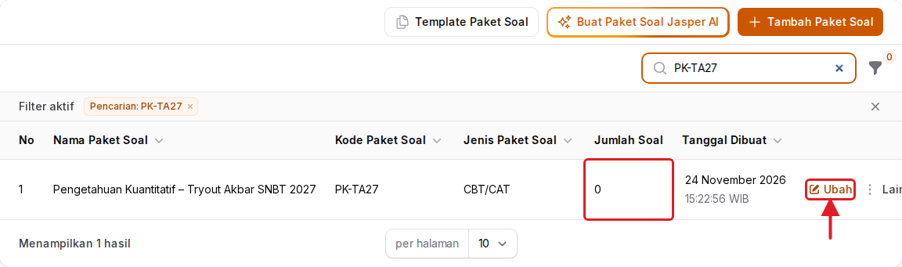
    </Frame>
  </Step>
  <Step title="Klik Import Soal (Excel)">
    <Frame>
      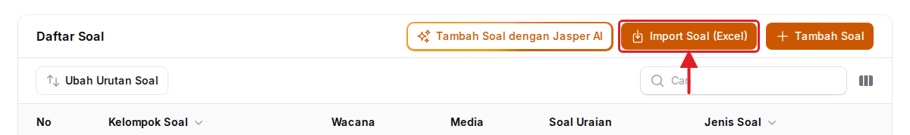
    </Frame>
  </Step>
  <Step title="Klik Unduh Template">
    Pada jendela **Import Soal (Excel)**, klik tautan **Unduh Template**. Berkas **template-import-soal-….xlsx** terunduh.

    <Frame>
      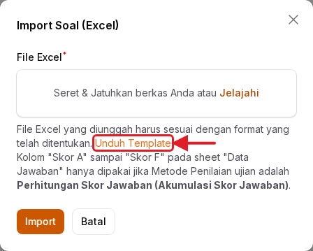
    </Frame>

    Selalu gunakan template terbaru dari aplikasi. Versi template saat ini adalah **1.3.0**; berkas dari template versi 1.0.0, 1.1.0, dan 1.2.0 masih dapat diimpor, tetapi kolom yang belum ada di versi tersebut dianggap kosong.
  </Step>
  <Step title="Pelajari isi template">
    Template berisi empat sheet: **Panduan**, **Data Soal**, **Data Jawaban**, dan **Data Wacana**.

    Sheet **Panduan** berisi petunjuk pengisian, informasi versi template, dan **Referensi Data Master** (kode jenis soal, kode media, nilai tingkat kesulitan, dan nilai **Jawaban Lebih dari Satu**). Sheet ini dikunci dan tidak perlu diubah.

    <Frame>
      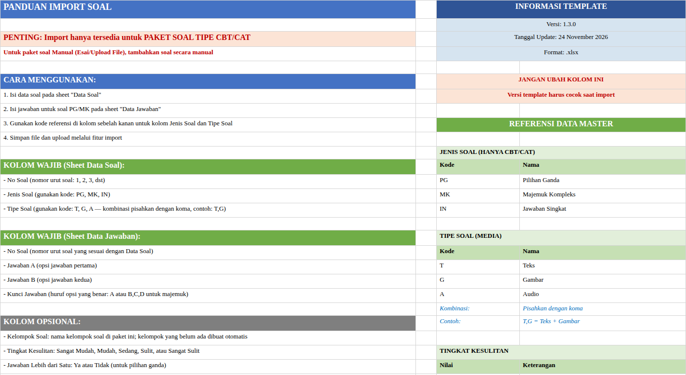
    </Frame>

    <Note>
      - Jangan mengubah nama sheet, judul kolom, atau isi kolom informasi template pada sheet **Panduan**. Sheet **Data Soal** dan **Data Jawaban** wajib ada.
      - Template yang baru diunduh sudah berisi **baris contoh** pada sheet **Data Soal**, **Data Jawaban**, dan **Data Wacana**. Hapus atau timpa baris contoh tersebut; baris yang tertinggal ikut diimpor.
      - Setiap sel memiliki petunjuk singkat dan beberapa kolom memiliki pilihan dropdown. Catatan di sisi kanan setiap sheet merangkum aturan pengisiannya.
    </Note>
  </Step>
  <Step title="Isi sheet Data Soal">
    Setiap baris adalah satu soal. Kolom bertanda bintang wajib diisi.

    <Frame>
      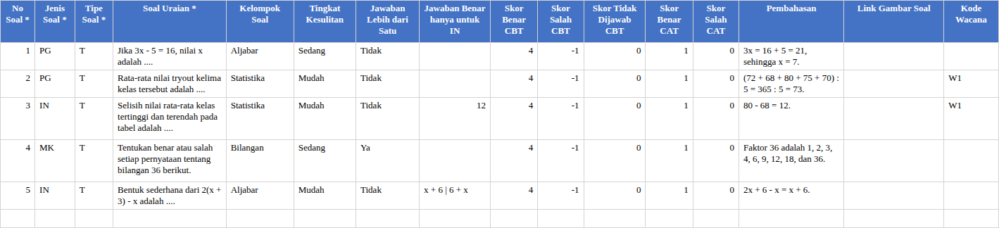
    </Frame>

    | Kolom | Isi |
    | --- | --- |
    | **No Soal \*** | Nomor urut soal: 1, 2, 3, dan seterusnya. Soal disimpan sesuai urutan baris. |
    | **Jenis Soal \*** | **PG** (Pilihan Ganda), **MK** (Majemuk Kompleks), atau **IN** (Jawaban Singkat). Soal menjodohkan belum dapat diimpor; tambahkan melalui formulir soal. |
    | **Tipe Soal \*** | Media soal: **T** (Teks), **G** (Gambar), **A** (Audio). Gabungkan dengan koma, misalnya **T,G**. |
    | **Soal Uraian \*** | Teks soal, maksimal 5.000 karakter. Boleh kosong jika soal hanya berupa gambar dari **Link Gambar Soal**. |
    | **Kelompok Soal** | Nama kelompok soal, maksimal 255 karakter. Kelompok yang belum ada di paket dibuat otomatis. |
    | **Tingkat Kesulitan** | **Sangat Mudah**, **Mudah**, **Sedang**, **Sulit**, atau **Sangat Sulit**. Wajib diisi jika paket soal dipakai tes CAT. |
    | **Jawaban Lebih dari Satu** | **Ya** atau **Tidak**. Isi **Ya** untuk soal pilihan ganda yang memiliki lebih dari satu jawaban benar. |
    | **Jawaban Benar hanya untuk IN** | Wajib untuk soal **IN** dan harus kosong untuk jenis lain. Isi angka atau teks; pisahkan beberapa jawaban benar dengan **\|**, misalnya `x + 6 \| 6 + x` atau `0,5 \| 1/2` (maksimal 21 jawaban, masing-masing maksimal 255 karakter). Jawaban pertama menjadi kunci utama. |
    | **Skor Benar CBT**, **Skor Salah CBT**, **Skor Tidak Dijawab CBT** | Skor untuk metode penilaian **Perhitungan Skor Soal (Akumulasi Benar/Salah)**, misalnya 4, -1, dan 0. |
    | **Skor Benar CAT**, **Skor Salah CAT** | Skor untuk ujian berjenis CAT. |
    | **Pembahasan** | Penjelasan jawaban (opsional). |
    | **Link Gambar Soal** | Link gambar soal (opsional). Beberapa gambar ditulis satu link per baris di dalam sel yang sama, maksimal 10 gambar. Lihat **Ketentuan link gambar** di bawah. |
    | **Kode Wacana** | Kode wacana dari sheet **Data Wacana**, misalnya **W1**, jika soal memakai bacaan bersama (opsional). |

    Untuk soal **IN**, format jawaban ditentukan otomatis: jika semua jawaban benar berupa angka, peserta hanya dapat mengetik angka; jika ada jawaban berupa teks, peserta dapat mengetik teks bebas.

    <Tip>
      Teks soal, jawaban, dan pembahasan dapat memakai HTML sederhana (misalnya `<b>`, `<i>`, `<u>`, ``, ``, `<table>`, dan daftar) serta rumus LaTeX di antara tanda dolar, misalnya `$\frac{1}{2}$`. Pisahkan paragraf dengan baris baru di dalam sel (**Alt+Enter**).
    </Tip>
  </Step>
  <Step title="Isi sheet Data Jawaban">
    Sheet ini berisi pilihan jawaban untuk soal **PG** dan **MK** saja. Soal **IN** tidak perlu diisi di sheet ini.

    <Frame>
      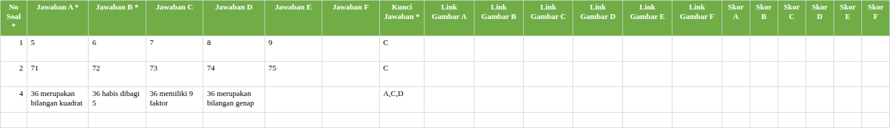
    </Frame>

    | Kolom | Isi |
    | --- | --- |
    | **No Soal \*** | Nomor urut soal pada sheet **Data Soal**. Pada contoh, soal nomor 3 dan 5 (IN) dilewati. |
    | **Jawaban A \*** sampai **Jawaban F** | Teks setiap pilihan. Minimal **Jawaban A** dan **Jawaban B**, maksimal enam pilihan (A sampai F). Pilihan yang tidak dipakai dikosongkan. |
    | **Kunci Jawaban \*** | Huruf pilihan yang benar, A sampai F. Untuk beberapa jawaban, pisahkan dengan koma tanpa spasi, misalnya **A,C,D**. |
    | **Link Gambar A** sampai **Link Gambar F** | Satu link gambar untuk setiap pilihan (opsional). Pilihan boleh berupa teks, gambar, atau keduanya. |
    | **Skor A** sampai **Skor F** | Skor setiap pilihan (opsional), antara -1.000 dan 1.000, boleh desimal atau negatif. Hanya dipakai pada metode penilaian **Perhitungan Skor Jawaban (Akumulasi Skor Jawaban)**; kosongkan untuk skor 0. |

    Untuk soal **MK**, setiap pilihan menjadi satu pernyataan dengan label **Benar/Salah**: pilihan yang tercantum di **Kunci Jawaban** dianggap **Benar**, sisanya **Salah**. Pada contoh, soal nomor 4 berisi empat pernyataan tentang bilangan 36 dengan kunci **A,C,D**. Untuk memakai pasangan label lain, misalnya **Fakta/Opini**, ubah soal setelah impor.
  </Step>
  <Step title="Isi sheet Data Wacana (opsional)">
    Isi sheet ini hanya jika beberapa soal memakai bacaan yang sama.

    <Frame>
      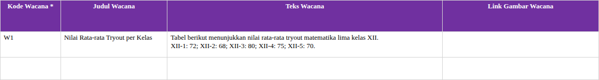
    </Frame>

    | Kolom | Isi |
    | --- | --- |
    | **Kode Wacana \*** | Kode unik setiap wacana, misalnya **W1**, **W2**. Tulis kode yang sama di kolom **Kode Wacana** sheet **Data Soal** untuk setiap soal yang memakai wacana tersebut. |
    | **Judul Wacana** | Judul yang hanya terlihat oleh admin, maksimal 255 karakter. Jika kosong, judulnya **Wacana** diikuti kode. |
    | **Teks Wacana** | Teks bacaan, maksimal 20.000 karakter. Pisahkan paragraf dengan **Alt+Enter**. Boleh kosong jika wacana berupa gambar. |
    | **Link Gambar Wacana** | Link gambar wacana (opsional), satu link per baris, maksimal 10 gambar. |

    Pada contoh, soal nomor 2 dan 3 memakai wacana **W1**, sehingga saat ujian keduanya menampilkan data nilai rata-rata yang sama di atas teks soal.
  </Step>
  <Step title="Unggah berkas lalu klik Import">
    Simpan berkas Excel (format .xlsx). Kembali ke paket soal, klik **Import Soal (Excel)**, seret berkas ke kolom **File Excel** atau klik **Jelajahi**, tunggu hingga tertulis **Pengunggahan selesai**, lalu klik **Import**.

    <Frame>
      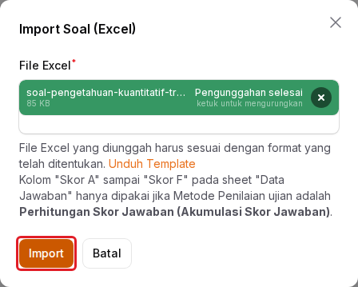
    </Frame>

    Muncul notifikasi **Impor Soal Sedang Diproses**. Impor berjalan di latar belakang, dan progresnya tampil sebagai kotak **Mengimpor Soal & Jawaban** di bagian atas halaman.

    <Frame>
      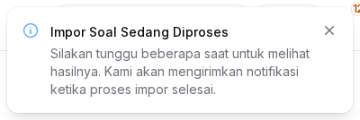
    </Frame>

    <Frame>
      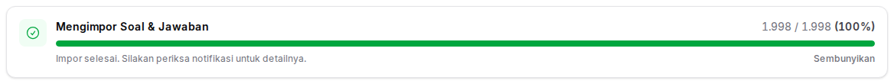
    </Frame>
  </Step>
  <Step title="Periksa hasil impor">
    Setelah selesai, Anda menerima notifikasi **Berhasil Mengimpor Soal dan Jawaban** beserta jumlah soal yang diimpor (klik ikon lonceng untuk melihatnya). Muat ulang halaman paket untuk melihat soal pada **Daftar Soal**.

    <Frame>
      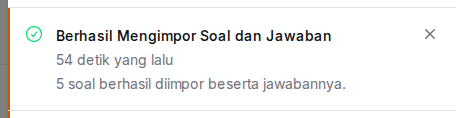
    </Frame>

    <Frame>
      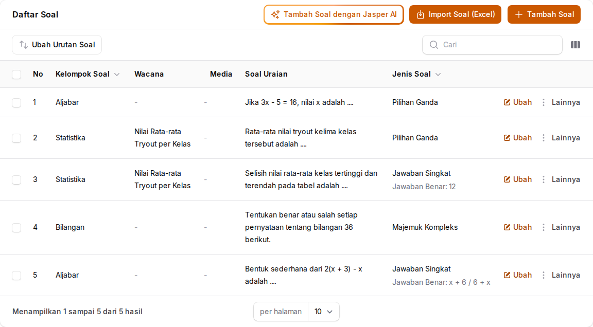
    </Frame>

    Soal ditambahkan di akhir daftar. Kelompok soal dan wacana baru tampil di tab **Kelompok Soal** dan **Wacana**. Periksa setiap soal dengan **Ubah** atau **Preview Soal**, lalu tambahkan audio jika diperlukan karena audio dan video tidak dapat diimpor.
  </Step>
</Steps>

## Ketentuan link gambar

- Gunakan link lengkap yang diawali `https://` dan langsung mengarah ke file gambar **JPG, PNG, GIF, atau WebP** dengan ukuran maksimal **5 MB**. Cara mudah memeriksanya: saat link dibuka di browser, yang tampil hanya gambarnya.
- Link halaman, misalnya halaman berbagi Google Drive atau halaman web yang memuat gambar, bukan link gambar dan akan ditolak.
- Gambar **diunduh dan disimpan di penyimpanan projek Anda**, bukan ditautkan ke link aslinya. Soal tetap utuh walaupun link aslinya berubah atau dihapus, dan ukuran gambar dihitung dalam kuota penyimpanan. Jika kuota penyimpanan penuh, impor dibatalkan.
- Demi keamanan, sistem hanya mengunduh dari server publik di internet dan memeriksa bahwa isi file benar-benar gambar.
- Maksimal 300 link gambar per berkas. Jika satu gambar gagal diunduh, **seluruh impor dibatalkan** dan notifikasi menyebutkan baris yang perlu diperbaiki.

## Jika impor gagal

Seluruh isi berkas diperiksa sebelum ada data yang disimpan. Jika ditemukan satu kesalahan, tidak ada soal yang diimpor dan Anda menerima notifikasi **Gagal Mengimpor Soal** yang menyebutkan sheet dan baris yang bermasalah. Perbaiki berkas, lalu impor ulang. Penyebab yang sering terjadi:

| Pesan | Perbaikan |
| --- | --- |
| Berkas tidak memiliki sheet yang diperlukan | Gunakan template dari aplikasi dan jangan mengganti nama sheet **Data Soal** dan **Data Jawaban**. |
| Versi template tidak sesuai | Unduh template terbaru melalui **Unduh Template**, lalu salin isinya ke template tersebut. |
| Kode "Jenis Soal" atau "Tipe Soal" tidak valid | Gunakan kode **PG**, **MK**, **IN** dan **T**, **G**, **A** sesuai **Referensi Data Master**. |
| Kolom "Jawaban Benar" wajib diisi untuk jenis soal "IN" / harus kosong untuk jenis soal selain "IN" | Isi kolom **Jawaban Benar hanya untuk IN** hanya pada soal **IN**. |
| Kode Wacana tidak ada di sheet "Data Wacana" | Pastikan kode pada **Data Soal** sama persis dengan kode di **Data Wacana**. |
| Nomor soal tidak ditemukan di sheet "Data Soal" / bukan jenis Pilihan Ganda atau Majemuk Kompleks | Periksa kolom **No Soal** pada **Data Jawaban** dan pastikan soalnya berjenis **PG** atau **MK**. |
| Kunci jawaban tidak valid | Isi huruf A sampai F, dipisahkan koma tanpa spasi. |
| Kolom "Tingkat Kesulitan" wajib diisi | Paket dipakai tes CAT; isi tingkat kesulitan setiap soal. |

<Tip>
  Setelah impor, nilai **Skor CBT** dan **Skor CAT** dapat diubah sekaligus untuk banyak soal melalui **Tindakan** → **Ubah Skor Massal** pada **Daftar Soal**. Lihat [Membuat Paket Soal](/paket-soal/membuat-paket-soal).
</Tip>
