Halaman ini menjelaskan cara membuat paket soal dan mengisinya dengan butir soal. **Paket soal** adalah kumpulan soal yang nantinya dipakai pada tes ujian. Satu paket soal dapat berisi banyak butir soal, dan satu paket soal dapat dipakai di lebih dari satu ujian.

<Info>
  **Lokasi menu:** **Portal** → **Platform Ujian (CBT)** → **Manajemen Ujian** → **Data Paket Soal**.

  Admin dengan peran **Guru** hanya melihat dan mengelola paket soal yang dibuatnya sendiri.
</Info>

Sebagai contoh, halaman ini memakai lembaga bimbingan belajar yang menyiapkan **Tryout Akbar SNBT 2027**. Untuk ujian tersebut dibuat paket soal **Penalaran Matematika – Tryout Akbar SNBT 2027** (kode **PM-TA27**) yang berisi soal pilihan ganda, jawaban singkat, majemuk kompleks, dan menjodohkan.

Secara garis besar, prosesnya terdiri dari dua bagian:

1. Membuat **paket soal** (nama, kode, deskripsi, dan jenisnya).
2. Mengisi paket tersebut dengan **butir soal dan jawaban**, secara manual, melalui [impor Excel](/paket-soal/import-paket-soal), atau dengan [Jasper AI](/paket-soal/generate-soal-ai).

## Mengenal halaman Data Paket Soal

Buka **Data Paket Soal** pada sidebar modul **Platform Ujian (CBT)**.

<Frame>
  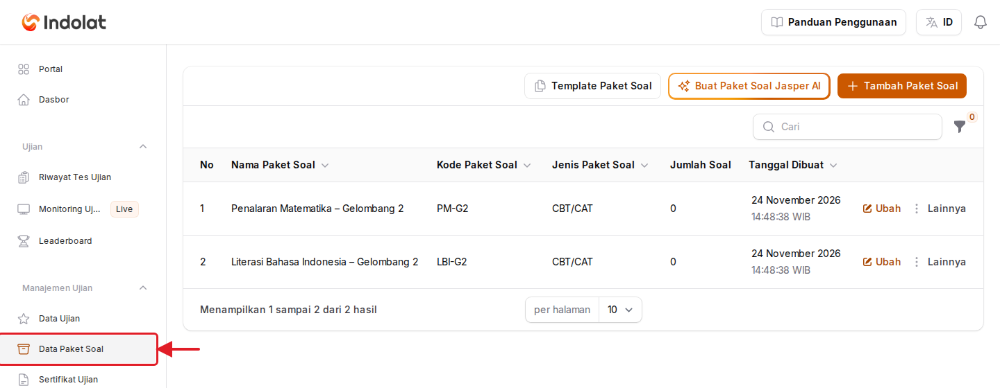
</Frame>

Tabel pada halaman ini menampilkan seluruh paket soal dengan kolom **Nama Paket Soal**, **Kode Paket Soal**, **Jenis Paket Soal**, **Jumlah Soal**, dan **Tanggal Dibuat**. Gunakan kolom **Cari** untuk mencari paket berdasarkan nama atau kode, dan ikon filter untuk menyaring berdasarkan **Jenis Paket Soal**.

<Frame>
  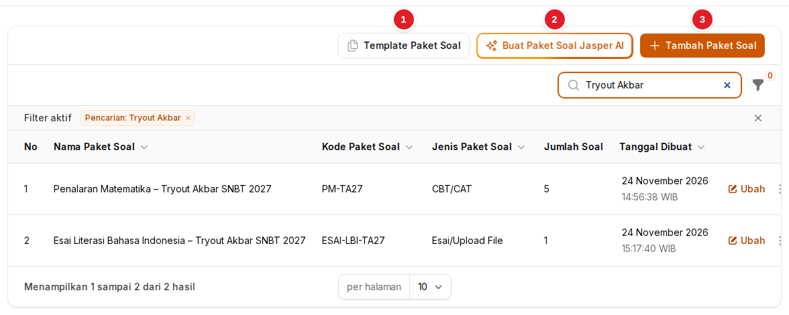
</Frame>

Ada tiga cara membuat paket soal, sesuai nomor pada gambar:

1. **Template Paket Soal**: membuat paket dari template yang sudah berisi soal. Tombol ini hanya tampil bila template tersedia.
2. **Buat Paket Soal Jasper AI**: membuat paket beserta soalnya secara otomatis dengan AI. Lihat [Generate Soal dengan Jasper AI](/paket-soal/generate-soal-ai).
3. **Tambah Paket Soal**: membuat paket kosong secara manual, lalu mengisi soalnya sendiri.

Setiap baris paket memiliki tombol **Ubah** untuk membuka paket dan menu **Lainnya** yang berisi:

- **Duplikat Paket Soal**: menyalin paket beserta kelompok soal, kelompok jawaban, soal, jawaban, dan berkas medianya. Penyalinan diproses di latar belakang, dan Anda menerima notifikasi setelah selesai.
- **Hapus**: menghapus paket soal.

<Frame>
  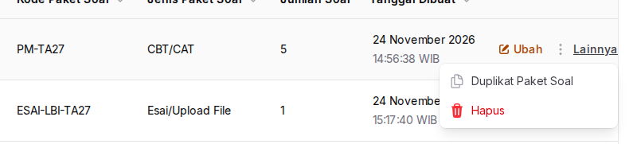
</Frame>

<Warning>
  Paket soal yang sudah dipakai pada sesi ujian yang masih ada tidak dapat dihapus. Sistem menampilkan pesan **Gagal Menghapus Paket Soal**. Hapus atau ganti paket soal pada ujian tersebut terlebih dahulu.
</Warning>

## Membuat paket soal secara manual

Pilih jenis paket soal sesuai cara peserta menjawab:

| Jenis Paket Soal | Kegunaan |
| --- | --- |
| **CBT/CAT** | Peserta menjawab langsung di aplikasi ujian dan jawabannya dinilai otomatis. Cocok untuk tryout UTBK-SNBT, olimpiade, dan ujian berbasis komputer lainnya. Mendukung pilihan ganda, jawaban singkat, majemuk kompleks, menjodohkan, wacana, impor Excel, dan Jasper AI. |
| **Esai/Upload File (Jawaban Manual)** | Peserta menulis jawaban uraian atau mengunggah berkas jawaban, lalu penilai memeriksanya secara manual. |

<Note>
  Kedua jenis ini tidak dapat digabungkan dalam satu paket. Jika ujian membutuhkan keduanya, buat dua paket soal, misalnya **Penalaran Matematika – Tryout Akbar SNBT 2027** (CBT/CAT) dan **Esai Literasi Bahasa Indonesia – Tryout Akbar SNBT 2027** (Esai/Upload File), lalu tambahkan masing-masing sebagai tes ujian yang terpisah. **Jenis Paket Soal** tidak dapat diubah setelah paket dibuat.
</Note>

<Steps>
  <Step title="Klik Tambah Paket Soal">
    <Frame>
      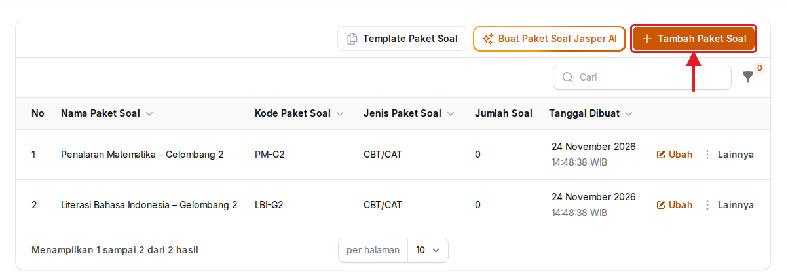
    </Frame>
  </Step>
  <Step title="Lengkapi bagian Informasi Umum">
    <Frame>
      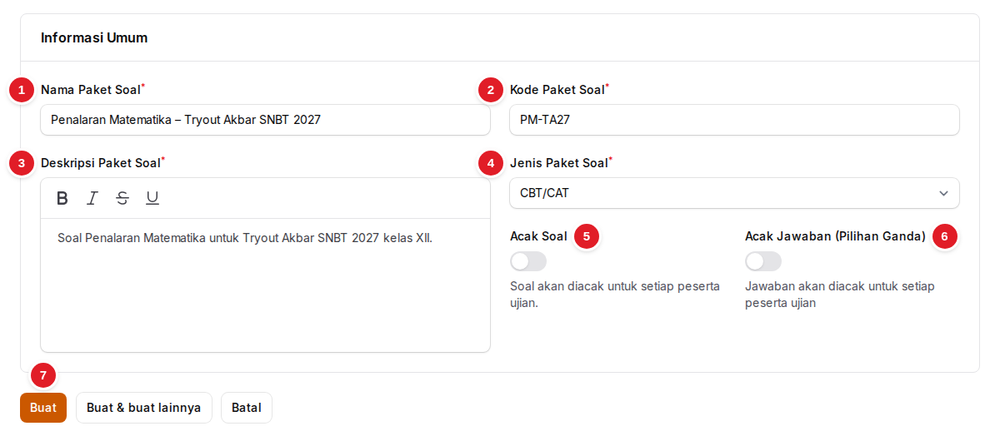
    </Frame>

    1. **Nama Paket Soal**: nama yang mudah dikenali, misalnya **Penalaran Matematika – Tryout Akbar SNBT 2027**.
    2. **Kode Paket Soal**: kode singkat yang unik di projek Anda, misalnya **PM-TA27**. Jika kode sudah dipakai paket lain, muncul pesan **Kode paket soal sudah digunakan.**
    3. **Deskripsi Paket Soal**: penjelasan singkat isi paket, maksimal 1.000 karakter. Deskripsi ini juga dipakai Jasper AI sebagai konteks saat menambah soal.
    4. **Jenis Paket Soal**: pilih **CBT/CAT** atau **Esai/Upload File (Jawaban Manual)**.
    5. **Acak Soal** (khusus CBT/CAT): urutan soal diacak untuk setiap peserta.
    6. **Acak Jawaban (Pilihan Ganda)** (khusus CBT/CAT): urutan pilihan jawaban soal pilihan ganda diacak untuk setiap peserta.
    7. Klik **Buat**. Gunakan **Buat & buat lainnya** jika ingin langsung membuat paket berikutnya, atau **Batal** untuk kembali tanpa menyimpan.

    Jika Anda memilih **Esai/Upload File (Jawaban Manual)**, pilihan acak tidak ditampilkan dan muncul keterangan bahwa paket ini tidak dapat digunakan untuk ujian jenis CBT/CAT.

    <Frame>
      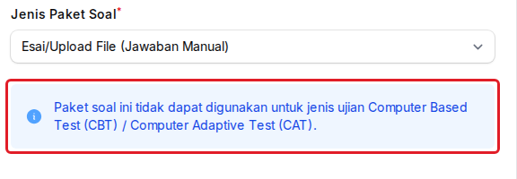
    </Frame>
  </Step>
  <Step title="Lanjutkan ke halaman Ubah Paket Soal">
    Setelah paket tersimpan, sistem membuka halaman **Ubah Paket Soal**. Di halaman inilah Anda menambahkan butir soal. Penjelasannya ada di bagian berikut.
  </Step>
</Steps>

## Membuat paket soal dari template

Template berisi paket soal contoh lengkap dengan soal dan jawabannya. Paket yang dibuat dari template sepenuhnya menjadi milik Anda dan dapat diubah.

<Steps>
  <Step title="Klik Template Paket Soal">
    Pada halaman **Data Paket Soal**, klik **Template Paket Soal**.
  </Step>
  <Step title="Pilih template lalu klik Gunakan Template">
    <Frame>
      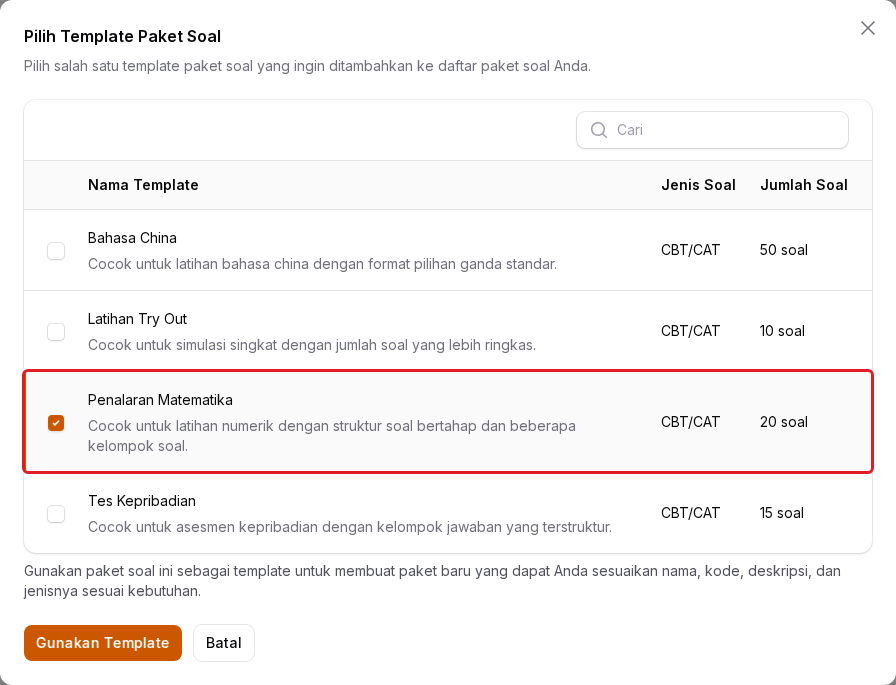
    </Frame>

    Daftar template menampilkan **Nama Template** beserta ringkasannya, **Jenis Soal**, dan **Jumlah Soal**. Klik baris template yang diinginkan, lalu klik **Gunakan Template**. Muncul notifikasi **Template Paket Soal Berhasil Ditambahkan**, dan paket baru tampil di daftar dengan nama template tersebut serta kode yang dibuat otomatis.
  </Step>
  <Step title="Sesuaikan nama, kode, dan isi paket">
    Klik **Ubah** pada paket baru. Ganti **Nama Paket Soal** dan **Kode Paket Soal** sesuai kebutuhan, lalu klik **Simpan**.

    <Frame>
      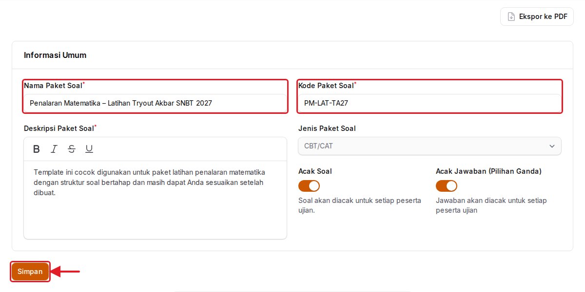
    </Frame>

    Template dapat sudah mengaktifkan **Acak Soal** dan **Acak Jawaban (Pilihan Ganda)** serta berisi wacana dan kelompok soal. Periksa kembali pengaturan dan setiap soalnya sebelum dipakai dalam ujian.
  </Step>
</Steps>

## Mengenal halaman Ubah Paket Soal

Klik **Ubah** pada paket soal untuk membuka halaman berikut.

<Frame>
  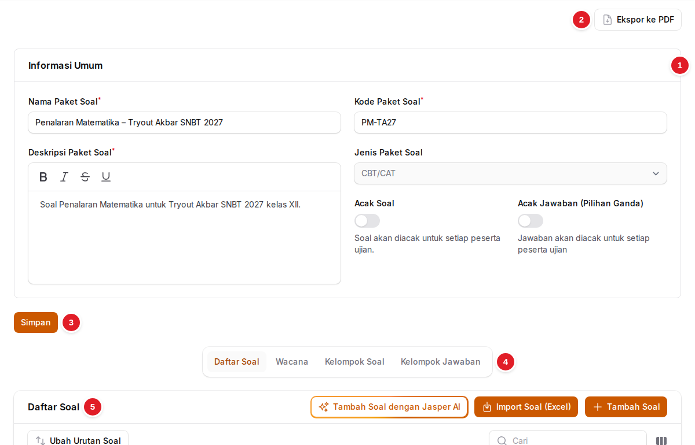
</Frame>

1. **Informasi Umum**: nama, kode, deskripsi, dan pengaturan acak. **Jenis Paket Soal** hanya ditampilkan dan tidak dapat diubah.
2. **Ekspor ke PDF** (khusus CBT/CAT): membuat berkas PDF paket soal. Pilih **PDF dengan jawaban & pembahasan** untuk pemeriksaan internal atau **PDF soal murni** untuk dibagikan kepada peserta, lalu klik **Proses Ekspor**. Ekspor diproses di latar belakang, dan Anda menerima notifikasi setelah berkasnya siap.
3. **Simpan**: menyimpan perubahan pada **Informasi Umum**.
4. Tab pengelolaan isi paket (khusus CBT/CAT): **Daftar Soal**, **Wacana**, **Kelompok Soal**, dan **Kelompok Jawaban**. Paket Esai/Upload File hanya memiliki **Daftar Soal**.
5. **Daftar Soal**: daftar butir soal beserta tombol **Tambah Soal dengan Jasper AI**, **Import Soal (Excel)**, dan **Tambah Soal**.

<Frame>
  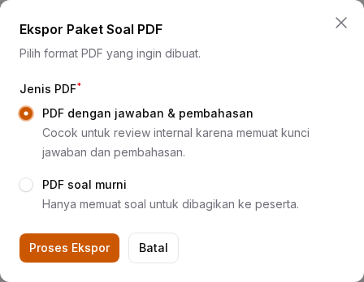
</Frame>

## Menambahkan soal ke paket CBT/CAT

Bagian ini memakai paket **Penalaran Matematika – Tryout Akbar SNBT 2027**. Jika soal memakai bacaan bersama atau ingin dikelompokkan per topik, siapkan dulu [wacana](#mengelola-wacana) dan [kelompok soal](#mengelola-kelompok-soal) agar dapat langsung dipilih saat membuat soal.

<Steps>
  <Step title="Klik Tambah Soal">
    <Frame>
      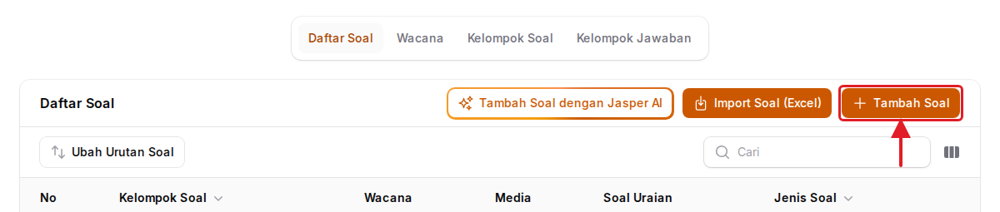
    </Frame>

    Jendela **Tambah Soal** terbuka dengan tab **Soal**, **Jawaban**, **Pembahasan**, dan **Penilaian**. Tab **Jawaban** hanya muncul untuk soal **Pilihan Ganda** dan **Majemuk Kompleks**.
  </Step>
  <Step title="Isi bagian Klasifikasi">
    <Frame>
      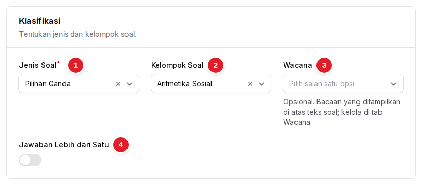
    </Frame>

    1. **Jenis Soal**: bentuk soal. Jenis soal tidak dapat diubah setelah soal disimpan. Pilihannya dijelaskan pada bagian **Jenis soal CBT/CAT** di bawah.
    2. **Kelompok Soal** (opsional): topik atau subtes soal, misalnya **Aritmetika Sosial**. Daftarnya diambil dari tab **Kelompok Soal**.
    3. **Wacana** (opsional): bacaan bersama yang ditampilkan di atas teks soal. Daftarnya diambil dari tab **Wacana**.
    4. **Jawaban Lebih dari Satu**: aktifkan jika peserta harus memilih lebih dari satu jawaban benar. Pengaturan ini hanya tampil untuk soal **Pilihan Ganda**.

    <Frame>
      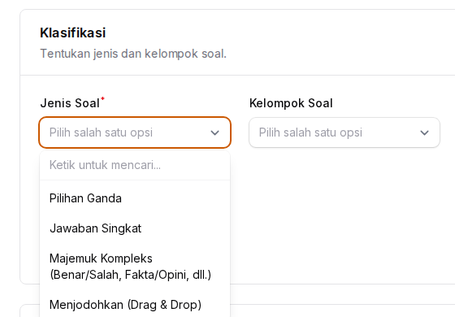
    </Frame>
  </Step>
  <Step title="Isi bagian Konten Soal">
    <Frame>
      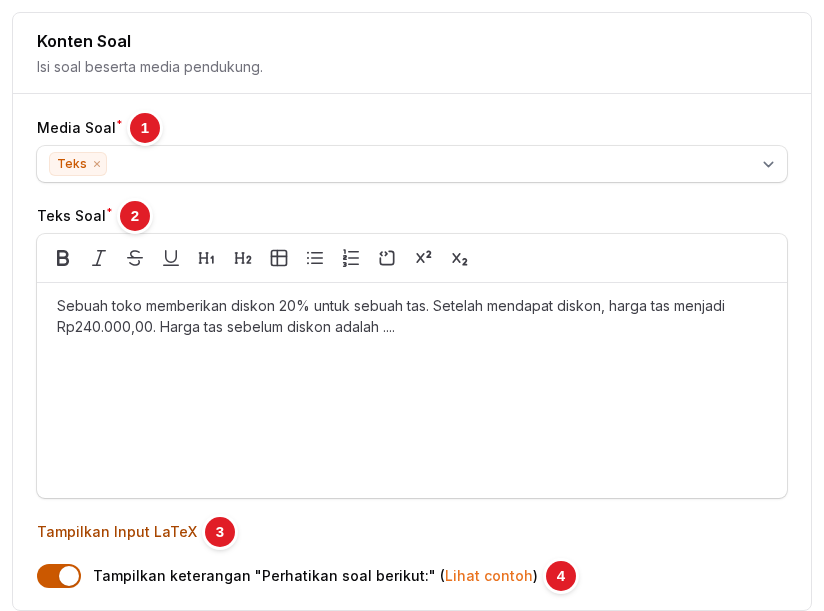
    </Frame>

    1. **Media Soal**: pilih satu atau beberapa media, yaitu **Teks**, **Gambar**, dan **Audio**. Isian berikutnya menyesuaikan media yang dipilih.
    2. **Teks Soal** (media Teks): tulis pertanyaan, maksimal 5.000 karakter. Gunakan toolbar untuk huruf tebal, miring, coret, garis bawah, judul (H1, H2), tabel, daftar berpoin atau bernomor, blok kode, superskrip, dan subskrip.
    3. **Tampilkan Input LaTeX**: membuka kolom bantu untuk menulis rumus matematika. Lihat [Menulis rumus matematika (LaTeX)](#menulis-rumus-matematika-latex).
    4. **Tampilkan keterangan "Perhatikan soal berikut:"**: jika aktif, kalimat tersebut tampil di atas teks soal saat ujian. Klik **Lihat contoh** untuk melihat tampilannya.

    Jika memilih media **Gambar**, unggah satu atau beberapa gambar (JPG, PNG, atau GIF) pada **Berkas Gambar**; urutannya dapat diatur dengan diseret. Tersedia juga pengaturan **Tampilkan keterangan "Perhatikan gambar berikut:"**. Jika memilih **Audio**, unggah berkas MP3, WAV, atau OGG pada **Berkas Audio**.

    Contoh teks soal: _Sebuah toko memberikan diskon 20% untuk sebuah tas. Setelah mendapat diskon, harga tas menjadi Rp240.000,00. Harga tas sebelum diskon adalah ...._
  </Step>
  <Step title="Isi pilihan jawaban pada tab Jawaban">
    Untuk soal **Pilihan Ganda**, buka tab **Jawaban**. Klik **Isi 5 opsi (A–E)** untuk membuat lima pilihan sekaligus dengan media Teks, atau **+ Tambah Jawaban** untuk menambah satu per satu (termasuk opsi F dan seterusnya). Tautan **Isi 5 opsi (A–E)** hanya muncul selama daftar jawaban masih kosong.

    <Frame>
      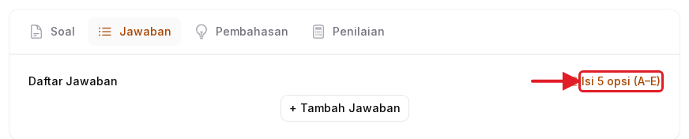
    </Frame>

    Lengkapi setiap pilihan jawaban:

    <Frame>
      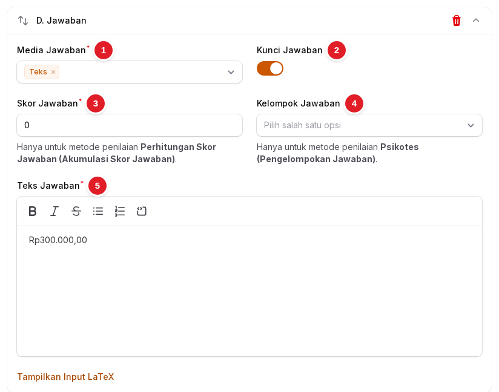
    </Frame>

    1. **Media Jawaban**: **Teks**, **Gambar**, **Audio**, atau gabungannya.
    2. **Kunci Jawaban**: aktifkan hanya pada pilihan yang benar, pada contoh ini **Rp300.000,00**. Jika **Jawaban Lebih dari Satu** aktif, aktifkan pada setiap pilihan yang benar.
    3. **Skor Jawaban**: skor pilihan ini. Hanya dipakai pada metode penilaian **Perhitungan Skor Jawaban (Akumulasi Skor Jawaban)**; pada metode lain biarkan **0**.
    4. **Kelompok Jawaban**: hanya untuk metode penilaian **Psikotes (Pengelompokan Jawaban)**. Daftarnya diambil dari tab **Kelompok Jawaban**.
    5. **Teks Jawaban**: teks pilihan yang dilihat peserta. Kolom ini juga memiliki **Tampilkan Input LaTeX**. Jika memilih media Gambar atau Audio, unggah berkasnya (gambar JPG, PNG, atau GIF; audio MP3, WAV, atau OGG).

    Setiap pilihan diberi huruf A, B, C, dan seterusnya sesuai urutannya. Seret ikon panah untuk mengubah urutan, atau klik ikon tempat sampah untuk menghapus pilihan.

    <Frame>
      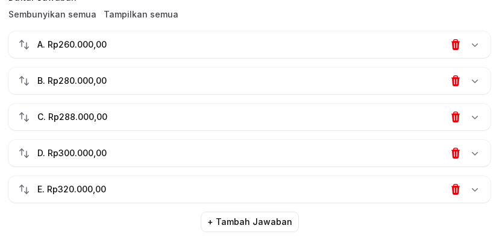
    </Frame>
  </Step>
  <Step title="Tulis pembahasan (opsional)">
    Buka tab **Pembahasan**. Pada **Format Pembahasan**, pilih **Teks** untuk menulis pembahasan di **Isi Pembahasan** (dengan toolbar dan input LaTeX yang sama seperti teks soal), atau **Unggah Berkas (PDF / Gambar)** untuk mengunggah berkas PDF, JPG, atau PNG.

    <Frame>
      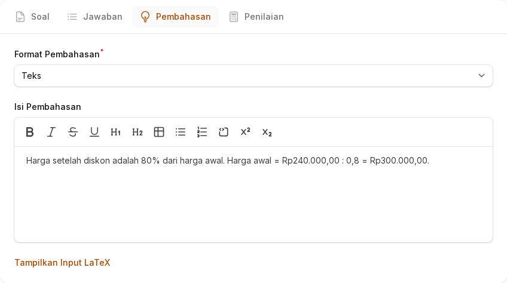
    </Frame>

    <Note>
      Saat paket diekspor ke PDF, hanya pembahasan berupa teks atau gambar yang disematkan.
    </Note>
  </Step>
  <Step title="Atur skor pada tab Penilaian">
    <Frame>
      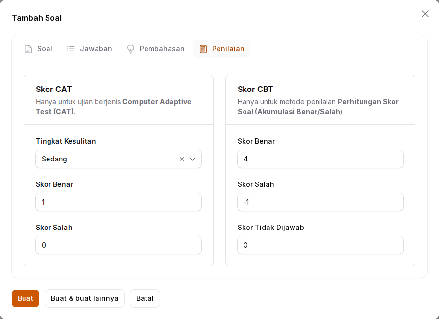
    </Frame>

    - **Skor CAT**: dipakai hanya pada ujian berjenis **Computer Adaptive Test (CAT)**. Isi **Tingkat Kesulitan** (**Sangat Mudah**, **Mudah**, **Sedang**, **Sulit**, atau **Sangat Sulit**), **Skor Benar**, dan **Skor Salah**. **Tingkat Kesulitan** wajib diisi jika paket soal ini dipakai tes CAT.
    - **Skor CBT**: dipakai hanya pada metode penilaian **Perhitungan Skor Soal (Akumulasi Benar/Salah)**. Isi **Skor Benar**, **Skor Salah**, dan **Skor Tidak Dijawab**, misalnya 4, -1, dan 0.

    Metode penilaian dipilih saat menyusun tes ujian. Lihat [Membuat Tes Ujian](/data-ujian/membuat-tes-ujian).
  </Step>
  <Step title="Simpan soal">
    Klik **Buat** untuk menyimpan, atau **Buat & buat lainnya** untuk menyimpan lalu langsung membuat soal berikutnya. Soal baru ditambahkan di akhir daftar.

    <Warning>
      Jika teks soal melebihi 5.000 karakter, soal tidak tersimpan dan muncul pesan **Gagal Menyimpan Soal** beserta jumlah karakternya.
    </Warning>
  </Step>
</Steps>

### Jenis soal CBT/CAT

| Jenis Soal | Cara peserta menjawab | Tempat mengisi kunci |
| --- | --- | --- |
| **Pilihan Ganda** | Memilih satu jawaban, atau beberapa jawaban bila **Jawaban Lebih dari Satu** aktif. | Tab **Jawaban**, tombol **Kunci Jawaban**. |
| **Jawaban Singkat** | Mengetik jawaban berupa angka atau teks. | Bagian **Kunci Jawaban** pada tab **Soal**. |
| **Majemuk Kompleks (Benar/Salah, Fakta/Opini, dll.)** | Memilih salah satu dari dua label untuk setiap pernyataan. | Tab **Jawaban**, kolom **Jawaban Benar** pada setiap pernyataan. |
| **Menjodohkan (Drag & Drop)** | Menyeret jawaban di sisi kanan ke pernyataan yang sesuai di sisi kiri. | Bagian **Pasangan Menjodohkan** pada tab **Soal**. |

#### Jawaban Singkat

Setelah memilih **Jawaban Singkat**, muncul bagian **Kunci Jawaban**. Contoh soal: _Persentase kenaikan jumlah buku tulis yang terjual dari bulan Januari ke bulan Februari adalah ... %_, dengan kunci **20**.

<Frame>
  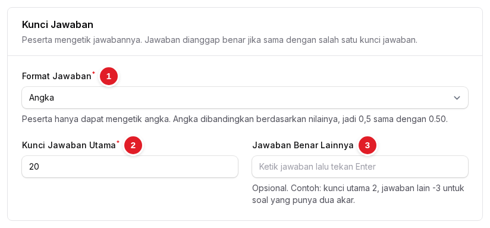
</Frame>

1. **Format Jawaban**:
   - **Angka**: peserta hanya dapat mengetik angka. Angka dibandingkan berdasarkan nilainya, jadi 0,5 sama dengan 0.50. Kunci boleh diawali tanda minus dan memakai koma atau titik sebagai pemisah desimal, misalnya 250, 0, -3, atau 1,5.
   - **Teks**: peserta dapat mengetik teks bebas. Huruf besar/kecil dan spasi berlebih diabaikan; angka tetap dibandingkan berdasarkan nilainya.
2. **Kunci Jawaban Utama**: jawaban yang benar, maksimal 255 karakter.
3. **Jawaban Benar Lainnya** (opsional): jawaban lain yang juga dianggap benar, misalnya **Jakarta** untuk kunci utama **DKI Jakarta**, atau -3 untuk soal yang memiliki dua akar. Ketik jawaban lalu tekan Enter; maksimal 20 jawaban.

Kunci jawaban tampil di bawah jenis soal pada **Daftar Soal**, misalnya **Jawaban Benar: 20**.

#### Majemuk Kompleks

Setelah memilih **Majemuk Kompleks (Benar/Salah, Fakta/Opini, dll.)**, muncul bagian **Label Kolom Pernyataan**. Pada **Pasangan Label**, pilih **Benar / Salah**, **Fakta / Opini**, **Sesuai / Tidak Sesuai**, **Setuju / Tidak Setuju**, atau **Ya / Tidak**. Pilih **Label lain (isi sendiri)** untuk menulis **Label Kolom Pertama** dan **Label Kolom Kedua** sendiri (maksimal 50 karakter dan keduanya harus berbeda).

<Frame>
  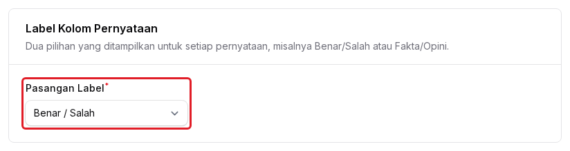
</Frame>

Pada tab **Jawaban**, setiap item berisi satu pernyataan. Pilih label yang benar untuk pernyataan tersebut pada kolom **Jawaban Benar**. Contoh untuk soal `Diketahui fungsi $f(x)=2x+3$. Tentukan benar atau salah setiap pernyataan berikut.`:

- `Nilai $f(2)=7$`: **Benar**
- Grafik fungsi f memotong sumbu Y di titik (0, 3): **Benar**
- Fungsi f merupakan fungsi kuadrat: **Salah**

<Frame>
  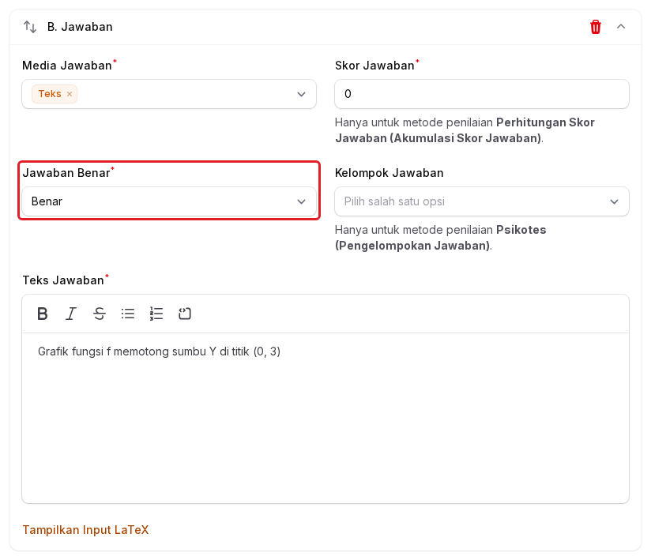
</Frame>

Saat ujian, pernyataan tampil sebagai tabel dengan dua kolom label:

<Frame>
  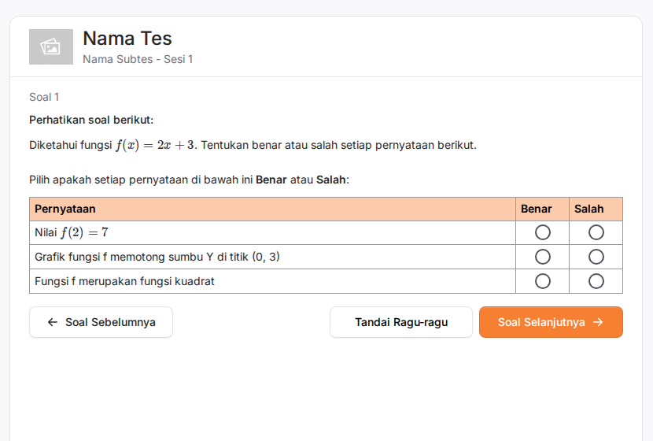
</Frame>

#### Menjodohkan

Setelah memilih **Menjodohkan (Drag & Drop)**, muncul bagian **Pasangan Menjodohkan** dengan dua pasangan awal. Isi **Pernyataan (Kiri)** dan **Jawaban (Kanan)** untuk setiap pasangan, lalu klik **+ Tambah Pasangan** untuk menambah pasangan. Minimal harus ada dua pasangan. Sisi kanan diacak saat ujian, dan peserta mencocokkannya dengan seret dan lepas.

<Frame>
  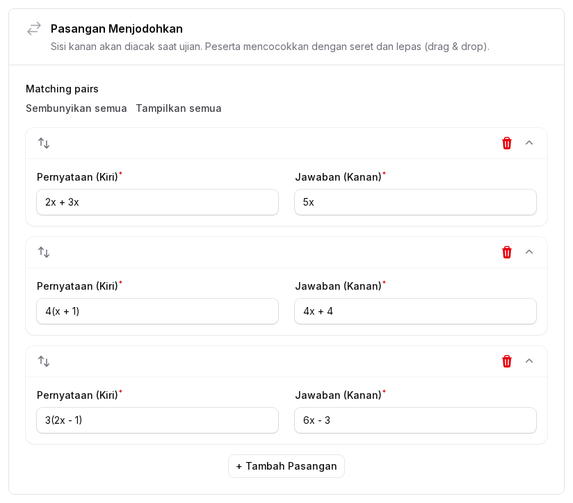
</Frame>

### Menulis rumus matematika (LaTeX)

Rumus ditulis dalam format LaTeX di antara dua tanda dolar, misalnya `$f(x)=2x+3$` atau `$\frac{1}{2}$`. Anda dapat mengetiknya langsung di teks soal, teks jawaban, pembahasan, atau teks wacana, atau memakai kolom bantu:

1. Klik **Tampilkan Input LaTeX** di bawah editor.
2. Ketik rumus pada kolom yang muncul. Rumus langsung tampil dalam bentuk matematika.
3. Klik **Salin**. Rumus disalin lengkap dengan tanda dolarnya.
4. Tempelkan ke posisi yang diinginkan di editor.

<Frame>
  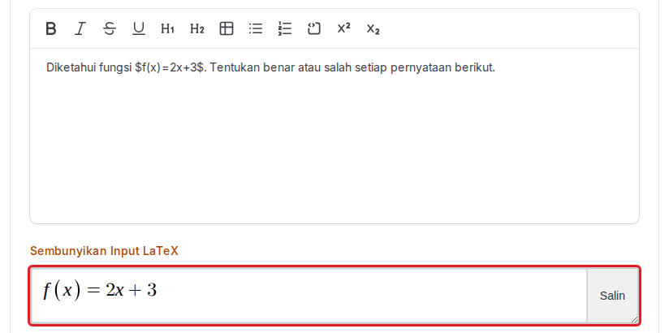
</Frame>

Di editor dan di **Daftar Soal**, rumus tetap terlihat sebagai teks LaTeX (pada **Daftar Soal** ditampilkan tebal). Saat ujian dan pada **Preview Soal**, rumus tampil dalam bentuk matematika.

## Mengelola daftar soal

<Frame>
  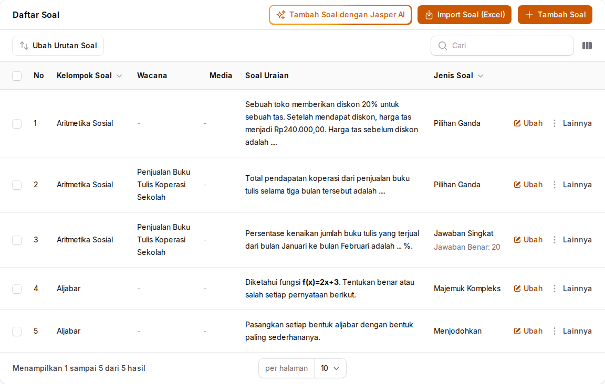
</Frame>

**Daftar Soal** menampilkan nomor, **Kelompok Soal**, **Wacana**, **Media**, **Soal Uraian**, dan **Jenis Soal**. Untuk jawaban singkat, kunci jawabannya tampil di bawah jenis soal; untuk majemuk kompleks, pasangan labelnya. Gunakan **Cari** untuk mencari soal, dan ikon kolom untuk menampilkan atau menyembunyikan kolom **Wacana**. Tabel menampilkan 10 atau 25 soal per halaman.

### Mengubah urutan soal

Klik **Ubah Urutan Soal**, seret soal melalui ikon di sisi kiri ke posisi yang diinginkan, lalu klik **Selesai Mengurutkan**.

<Frame>
  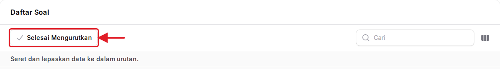
</Frame>

<Note>
  Urutan ini dipakai saat ujian jika **Acak Soal** tidak aktif. Jika **Acak Soal** aktif, soal diacak untuk setiap peserta; soal yang memakai wacana yang sama tetap berurutan sesuai urutan di paket soal.
</Note>

### Tindakan massal

Centang beberapa soal (atau kotak di judul kolom untuk memilih semua), lalu klik **Tindakan**:

<Frame>
  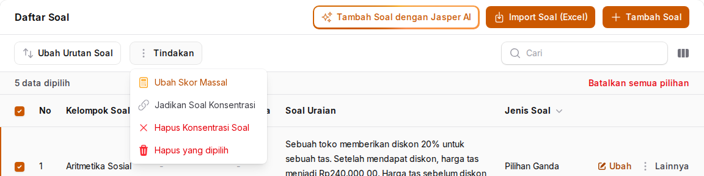
</Frame>

- **Ubah Skor Massal** (khusus CBT/CAT): mengisi **Skor CAT** dan **Skor CBT** untuk semua soal terpilih sekaligus. Kosongkan isian yang tidak ingin diubah, lalu klik **Simpan Perubahan**.
- **Jadikan Soal Konsentrasi**: menandai soal terpilih dengan satu warna yang sama. Soal berwarna sama dipakai untuk menilai konsistensi jawaban peserta (Analisa Konsentrasi) pada detail hasil ujian, misalnya pada tes psikologi.
- **Hapus Konsentrasi Soal**: menghapus warna konsentrasi dari soal terpilih.
- **Hapus yang dipilih**: menghapus soal terpilih.

<Frame>
  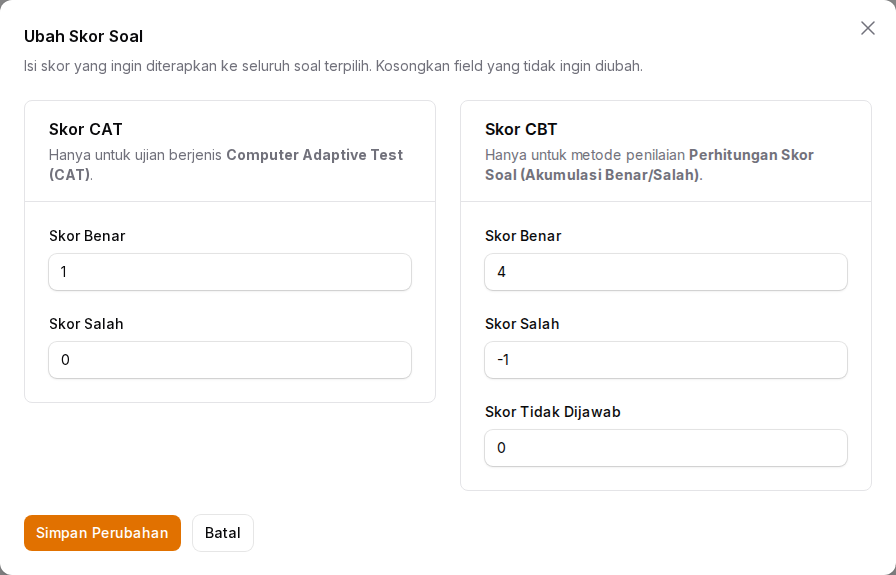
</Frame>

### Mengubah, menduplikat, dan meninjau soal

Klik **Ubah** pada soal untuk membuka jendela **Ubah Soal** dengan isian yang sama seperti saat menambah soal (kecuali **Jenis Soal**, yang tidak dapat diubah). Selain **Simpan**, bagian bawah jendela berisi:

- **Preview Soal**: membuka tampilan soal seperti yang dilihat peserta di tab baru (khusus CBT/CAT).
- **Buka Halaman Detail**: membuka soal di halaman tersendiri pada tab baru.
- **Hapus**: menghapus soal. Tindakan ini tidak dapat dibatalkan.

<Frame>
  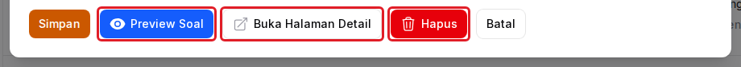
</Frame>

Menu **Lainnya** pada setiap soal berisi **Duplikat Soal** (menyalin soal beserta jawaban dan berkas medianya ke paket yang sama), **Preview Soal**, dan **Hapus**.

<Frame>
  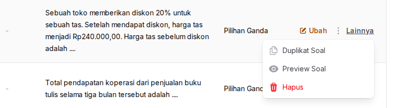
</Frame>

<Frame>
  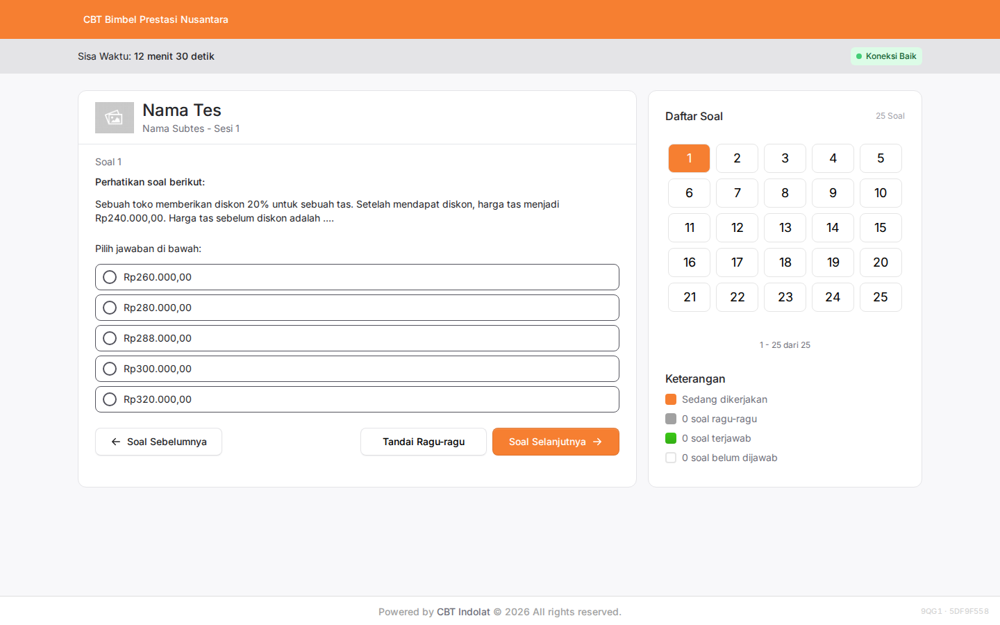
</Frame>

## Mengelola wacana

Wacana adalah bacaan, grafik, tabel, atau rekaman yang dipakai beberapa soal sekaligus, misalnya satu data penjualan untuk dua soal. Wacana cukup ditulis sekali, lalu dipilih pada setiap soal yang memakainya. Tab **Wacana** hanya tersedia pada paket CBT/CAT.

<Steps>
  <Step title="Buka tab Wacana lalu klik Tambah Wacana">
    <Frame>
      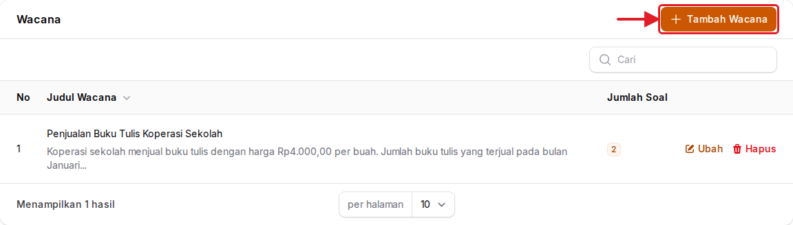
    </Frame>

    Kolom **Jumlah Soal** menunjukkan berapa soal yang memakai wacana tersebut.
  </Step>
  <Step title="Lengkapi isi wacana">
    <Frame>
      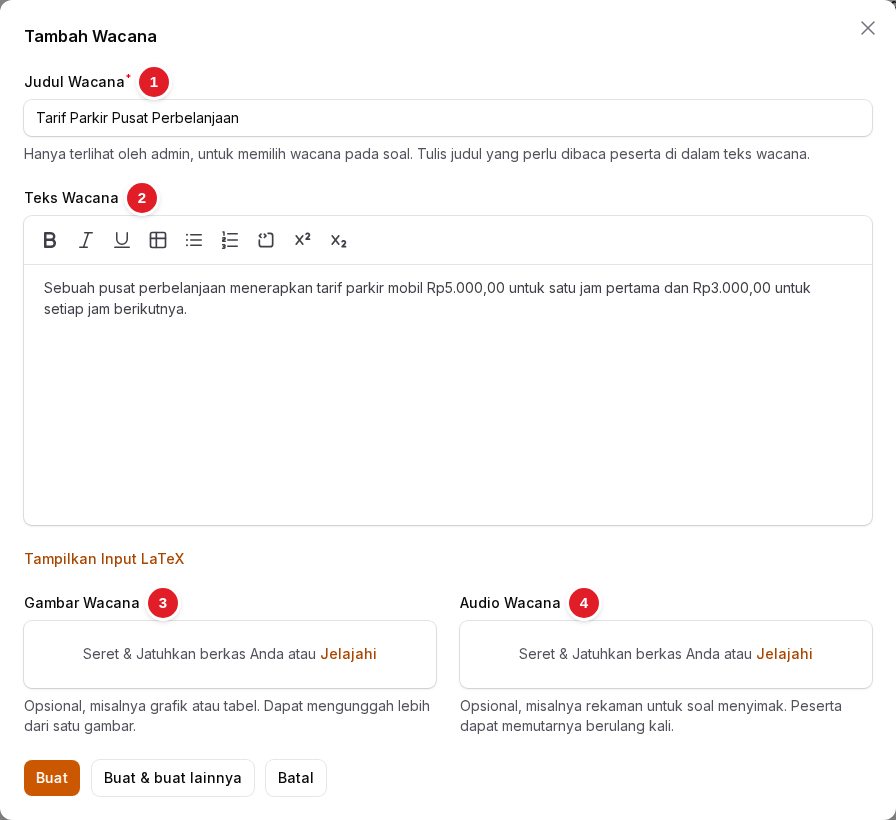
    </Frame>

    1. **Judul Wacana**: nama untuk memilih wacana pada soal. Judul hanya terlihat oleh admin; jika peserta perlu membaca judul, tulis judul tersebut di dalam teks wacana.
    2. **Teks Wacana**: teks bacaan, maksimal 20.000 karakter, dengan toolbar dan input LaTeX seperti teks soal.
    3. **Gambar Wacana** (opsional): misalnya grafik atau tabel. Dapat lebih dari satu gambar.
    4. **Audio Wacana** (opsional): misalnya rekaman untuk soal menyimak. Peserta dapat memutarnya berulang kali; jika audio hanya boleh diputar sekali, pasang audio tersebut pada soal.

    Minimal salah satu dari teks, gambar, atau audio harus diisi. Klik **Buat**.
  </Step>
  <Step title="Pilih wacana pada soal">
    Saat menambah atau mengubah soal, pilih wacana pada kolom **Wacana** di bagian **Klasifikasi**. Lakukan pada setiap soal yang memakai bacaan tersebut.
  </Step>
</Steps>

<Info>
  Saat ujian, wacana tampil sebagai bagian dari soal: gambar wacana tampil lebih dulu bersama gambar soal, lalu teks wacana tepat di atas teks soal. Jika soal diacak, soal-soal dengan wacana yang sama tetap berurutan sehingga peserta cukup membaca wacana sekali.
</Info>

<Note>
  Wacana yang masih dipakai soal tidak dapat dihapus (muncul pesan **Gagal Menghapus Wacana**); lepaskan dulu wacana dari soal-soal tersebut. Selama ujian berlangsung, wacana tidak dapat diubah.
</Note>

## Mengelola kelompok soal

Kelompok soal mengelompokkan soal berdasarkan topik atau subtes, misalnya **Aritmetika Sosial** dan **Aljabar**. Kelompok soal tidak menampilkan bacaan kepada peserta; untuk bacaan bersama, gunakan [wacana](#mengelola-wacana).

Buka tab **Kelompok Soal**, klik **Tambah Kelompok Soal**, isi **Nama**, lalu klik **Buat**. Kelompok soal juga dibuat otomatis saat [impor Excel](/paket-soal/import-paket-soal) jika namanya belum ada.

<Frame>
  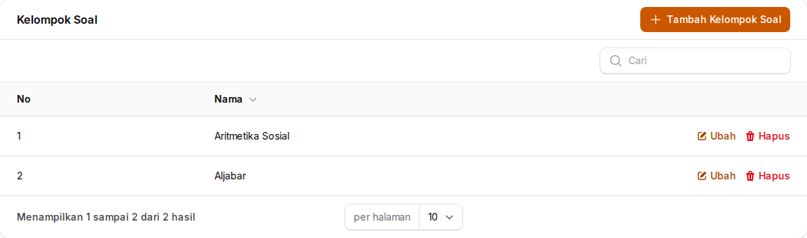
</Frame>

<Note>
  Kelompok soal yang sudah berisi soal tidak dapat dihapus.
</Note>

## Mengelola kelompok jawaban

Kelompok jawaban dipakai pada metode penilaian **Psikotes (Pengelompokan Jawaban)**, misalnya untuk tes kepribadian. Setiap pilihan jawaban dihubungkan ke satu kelompok melalui kolom **Kelompok Jawaban** di tab **Jawaban**, dan hasil peserta dihitung per kelompok.

<Frame>
  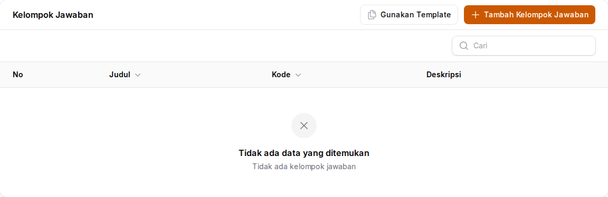
</Frame>

- **Tambah Kelompok Jawaban**: isi **Judul**, **Kode**, **Deskripsi**, dan **Warna**.
- **Gunakan Template**: menambahkan kelompok jawaban siap pakai, misalnya **DISC Personality**, **MBTI Dimensi**, **Big Five Personality (OCEAN)**, **Holland Code (RIASEC) — Minat Karir**, atau **Gaya Belajar (VARK)**. Pilih template, lalu klik **Terapkan Template**.

<Frame>
  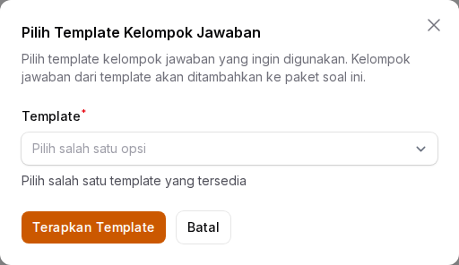
</Frame>

## Menambahkan soal ke paket Esai/Upload File

Paket **Esai/Upload File (Jawaban Manual)** hanya memiliki bagian **Daftar Soal** dengan tombol **Tambah Soal**. Impor Excel, Jasper AI, wacana, kelompok soal, penilaian otomatis, Preview Soal, dan Ekspor ke PDF tidak tersedia untuk jenis ini.

Klik **Tambah Soal**, lalu lengkapi tab **Soal**:

<Frame>
  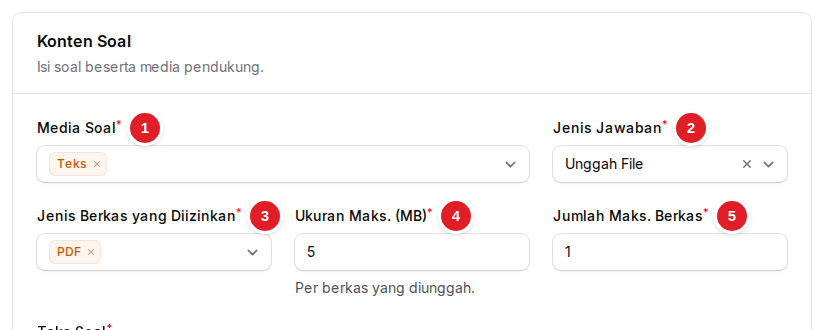
</Frame>

1. **Media Soal**: **Teks**, **Gambar**, **File**, atau gabungannya. Jika memilih **File**, isi **Nama Berkas** dan unggah **Berkas Lampiran** (PDF, DOCX, XLSX, PPTX, JPG, PNG, GIF, ZIP, atau RAR), misalnya naskah soal dalam bentuk PDF.
2. **Jenis Jawaban**: **Jawaban Uraian** (peserta menulis jawaban di aplikasi) atau **Unggah File** (peserta mengunggah berkas jawaban). Jenis jawaban tidak dapat diubah setelah soal disimpan.
3. **Jenis Berkas yang Diizinkan** (Unggah File): PDF, Gambar (JPG, PNG, GIF), MS Word (DOCX), MS Excel (XLSX), MS PowerPoint (PPTX), CSV, ZIP, atau RAR.
4. **Ukuran Maks. (MB)** (Unggah File): ukuran maksimal setiap berkas, 1–100 MB.
5. **Jumlah Maks. Berkas** (Unggah File): jumlah berkas yang boleh diunggah, 1–10.

Lalu tulis **Teks Soal**, misalnya _Tulislah esai argumentatif sepanjang 300–500 kata tentang manfaat membaca buku cetak bagi pelajar. Unggah jawaban Anda dalam format PDF._

Bagian **Panduan Pengerjaan** (opsional) menambahkan tautan atau berkas panduan untuk peserta. Klik judul bagian untuk membukanya, klik **+ Tambah Panduan**, pilih **Jenis Panduan** (**Tautan** atau **Berkas**), isi **Judul**, lalu isi **Tautan** atau unggah **Berkas**.

<Frame>
  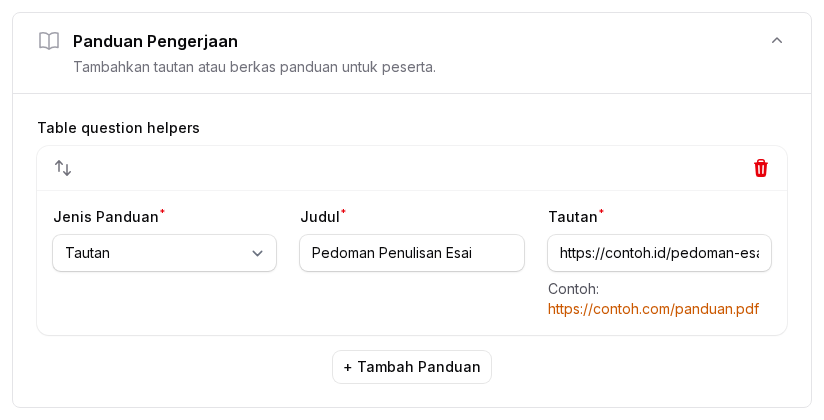
</Frame>

Tab **Pembahasan** sama seperti pada paket CBT/CAT. Klik **Buat** untuk menyimpan. Pada **Daftar Soal**, jenis jawaban tampil di kolom **Tipe Jawaban**.

<Frame>
  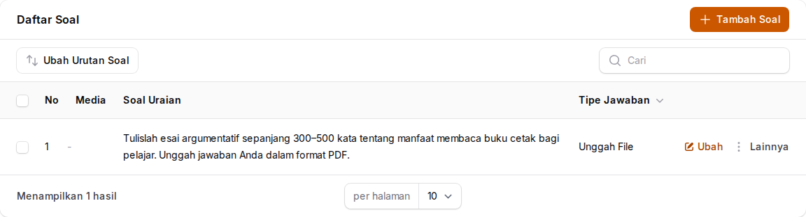
</Frame>

## Perubahan saat ujian sedang berlangsung

Selama ada peserta yang sedang mengerjakan ujian yang memakai paket soal ini:

- **Paket CBT/CAT**: paket, soal, wacana, dan kelompok soal tidak dapat diubah, ditambah, atau dihapus. Halaman paket menampilkan pesan **Paket soal ini tidak dapat diubah karena ujian sedang berlangsung.** Tombol **Tambah Soal**, **Import Soal (Excel)**, dan **Tambah Soal dengan Jasper AI** disembunyikan.
- **Paket Esai/Upload File**: soal masih dapat diubah, tetapi tidak dapat ditambah atau dihapus.

Paket soal yang dibuat melalui impor API hanya dapat dibaca. Gunakan **Duplikat Paket Soal** untuk membuat salinan yang dapat diubah.

<Tip>
  Setelah paket soal siap, tambahkan paket tersebut ke ujian melalui [Membuat Tes Ujian](/data-ujian/membuat-tes-ujian).
</Tip>
