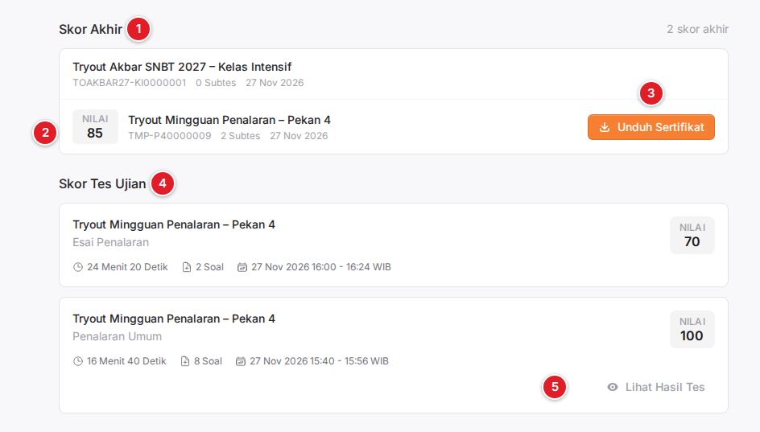
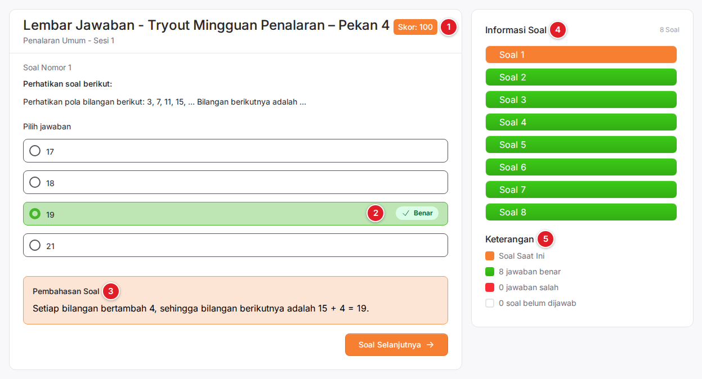
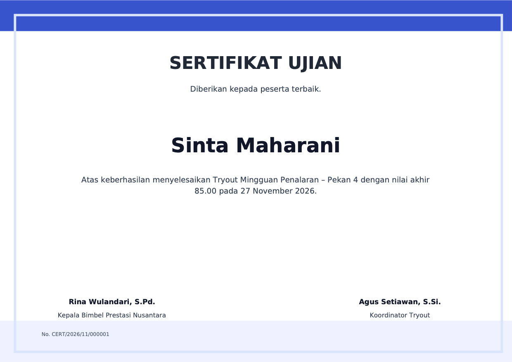
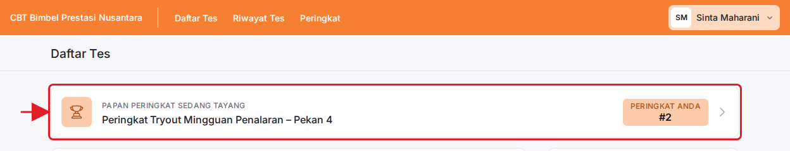
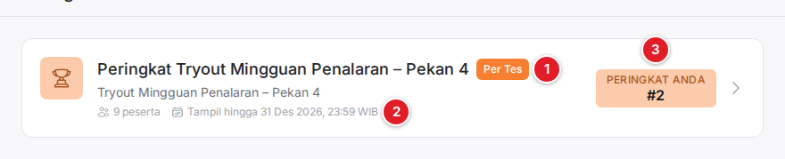
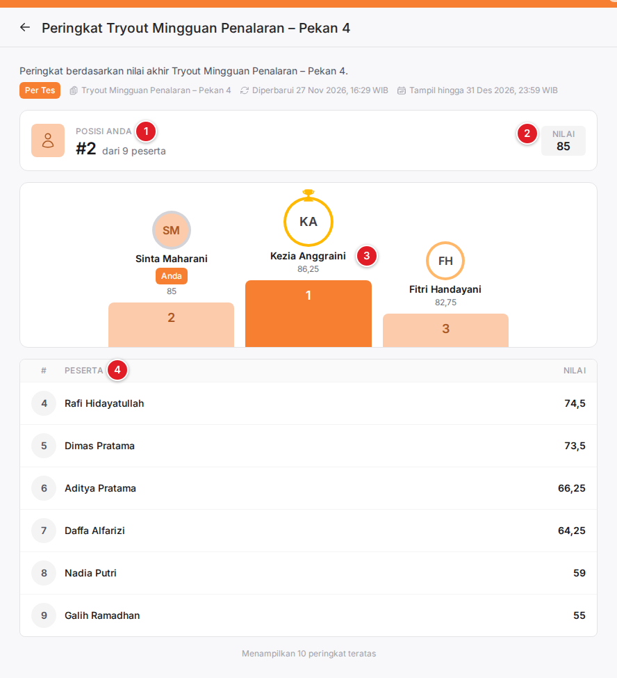
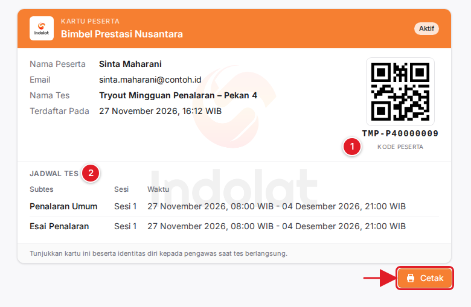

Setelah tes selesai, Anda dapat melihat nilai, membuka lembar jawaban beserta pembahasannya, mengunduh sertifikat, dan melihat posisi Anda di papan peringkat. Halaman ini juga menjelaskan Kartu Peserta. Apa saja yang terlihat bergantung pada pengaturan penyelenggara, sehingga beberapa bagian mungkin tidak tampil di akun Anda.

<Info>
  **Lokasi menu:** aplikasi peserta → **Riwayat Tes** untuk nilai, lembar jawaban, dan sertifikat; **Peringkat** untuk papan peringkat; nama Anda di kanan atas → **Kartu Peserta**.
</Info>

## Riwayat Tes

<Frame>
  
</Frame>

1. **Skor Akhir**: daftar ujian yang Anda ikuti beserta kode peserta, jumlah subtes yang sudah dikerjakan, dan tanggal pendaftaran. Ujian yang belum dikerjakan juga tampil, tanpa nilai.
2. **NILAI**: nilai akhir ujian, gabungan nilai semua tesnya. Contoh: **85**.
3. **Unduh Sertifikat**: mengunduh sertifikat ujian. Lihat [Sertifikat](#sertifikat).
4. **Skor Tes Ujian**: nilai setiap tes, lengkap dengan durasi pengerjaan, jumlah soal, dan waktu pengerjaan.
5. **Lihat Hasil Tes**: membuka lembar jawaban tes tersebut.

<Note>
  - Nilai, lembar jawaban, dan pembahasan hanya tampil jika penyelenggara mengizinkannya. Jika semuanya disembunyikan, Anda hanya melihat bahwa tes sudah selesai.
  - Nilai tes esai atau unggah file baru tampil setelah penyelenggara memeriksanya. Pada contoh ini, **Esai Penalaran** sudah dinilai **70**.
  - Pada ujian dengan penilaian IRT, nilai baru tampil setelah penyelenggara menghitungnya, biasanya setelah semua peserta selesai.
</Note>

## Lembar jawaban

Klik **Lihat Hasil Tes** untuk membuka lembar jawaban.

<Frame>
  
</Frame>

1. **Skor** tes Anda.
2. Jawaban Anda beserta hasilnya. Jawaban benar berwarna hijau dengan label **Benar**; jawaban salah berwarna merah, dan kunci jawabannya ditandai hijau.
3. **Pembahasan Soal**: penjelasan jawaban dari penyelenggara.
4. **Informasi Soal**: nomor semua soal. Hijau berarti benar, merah berarti salah, dan putih berarti tidak dijawab. Klik nomor untuk membuka soal tersebut.
5. **Keterangan**: jumlah jawaban benar, jawaban salah, dan soal yang belum dijawab.

Jika penyelenggara menyediakan pembahasan dalam bentuk PDF, lembar jawaban menampilkan **Pembahasan Tes** dengan tombol **Buka PDF Pembahasan**.

## Sertifikat

Jika penyelenggara menyediakan sertifikat, tombol **Unduh Sertifikat** tampil pada bagian **Skor Akhir** setelah Anda memenuhi syaratnya, misalnya menyelesaikan semua tes dan mencapai nilai minimum. Sertifikat diunduh dalam format PDF.

<Frame>
  
</Frame>

Desain dan isi sertifikat ditentukan penyelenggara. Jika sertifikat memerlukan persetujuan penyelenggara, alurnya seperti berikut:

1. Klik **Ajukan Sertifikat**. Muncul pesan **Permintaan sertifikat telah diajukan. Silakan menunggu persetujuan admin.**
2. Tombol berubah menjadi **Menunggu Persetujuan**.
3. Setelah disetujui, tombol berubah menjadi **Unduh Sertifikat**.

Jika tombol sertifikat tidak tampil, berarti ujian tersebut tidak memiliki sertifikat, atau Anda belum memenuhi syaratnya.

## Peringkat

Jika penyelenggara menayangkan papan peringkat, **Daftar Tes** menampilkan kartu **Papan peringkat sedang tayang** beserta posisi Anda. Klik kartu tersebut untuk langsung membuka papan peringkatnya.

<Frame>
  
</Frame>

Semua papan peringkat yang tersedia untuk Anda tampil di menu **Peringkat**.

<Frame>
  
</Frame>

1. Jenis papan peringkat: **Per Tes** (nilai akhir satu ujian), **Gabungan Tes** (beberapa ujian), **Per Subtes** (setiap tes), atau **Per Papan** (peringkat yang diunggah penyelenggara dari file).
2. Jumlah peserta dan batas waktu tayang, misalnya **Tampil hingga 31 Des 2026, 23:59 WIB**.
3. **Peringkat Anda**. Jika Anda belum termasuk, tertulis **Belum masuk peringkat**.

Klik papan peringkat untuk melihat detailnya.

<Frame>
  
</Frame>

1. **Posisi Anda**, misalnya **#2** dari 9 peserta.
2. **Nilai** Anda.
3. Podium tiga besar. Posisi Anda ditandai label **Anda**.
4. Daftar peringkat berikutnya.

<Note>
  - Peringkat tidak berubah langsung saat Anda selesai. Urutan baru terlihat setelah penyelenggara memperbarui papan peringkat.
  - Penyelenggara dapat menampilkan urutan saja tanpa nilai, atau membatasi jumlah peringkat yang tampil, misalnya **Menampilkan 10 peringkat teratas**.
</Note>

## Kartu Peserta

Kartu Peserta memuat data diri, kode peserta, dan jadwal tes untuk satu ujian. Buka dengan mengklik nama Anda di kanan atas, lalu pilih **Kartu Peserta**.

<Frame>
  
</Frame>

1. **Kode Peserta** beserta kode QR-nya, misalnya **TMP-P40000009**.
2. **Jadwal Tes**: setiap tes beserta sesi dan waktunya. Jika sesi belum diatur, tertulis **Belum dijadwalkan**.

Klik **Cetak** di bawah kartu untuk mencetak atau menyimpannya sebagai PDF. Jika Anda terdaftar di beberapa ujian, setiap ujian memiliki kartunya sendiri.

<Tip>
  Untuk ujian tatap muka, bawa Kartu Peserta beserta kartu identitas dan tunjukkan kepada pengawas. Kartu baru tersedia setelah pendaftaran Anda diverifikasi penyelenggara.
</Tip>
