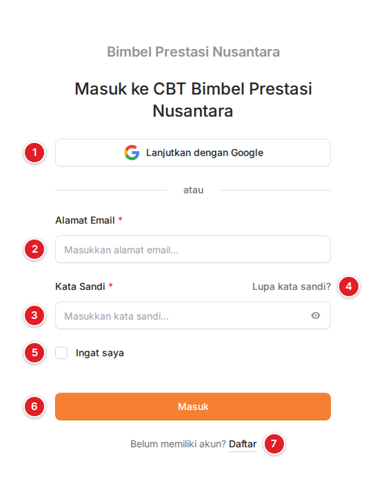
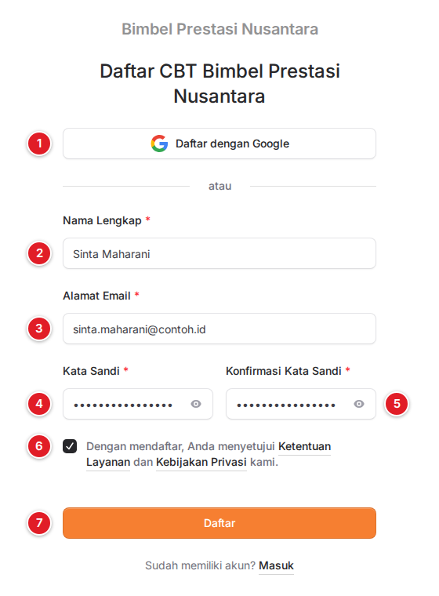
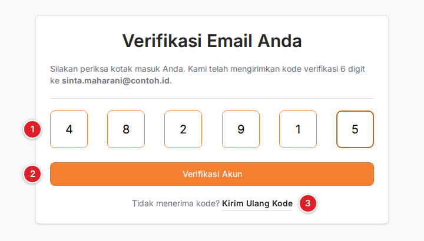
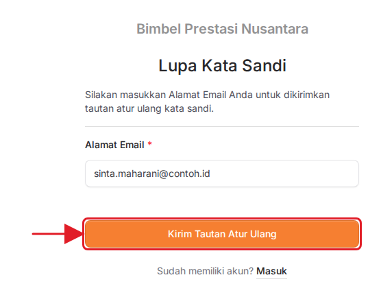
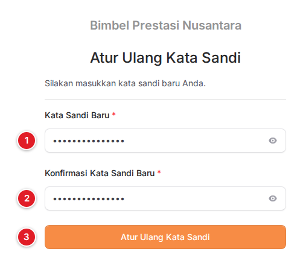
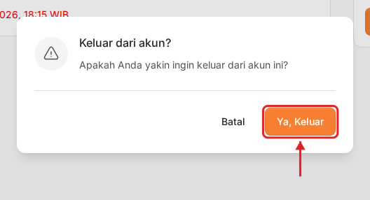

Untuk mengikuti ujian, Anda perlu masuk ke aplikasi peserta milik penyelenggara. Halaman ini menjelaskan cara masuk, membuat akun sendiri, memverifikasi email, mengatur ulang kata sandi yang terlupa, dan keluar dari akun.

<Info>
  **Lokasi menu:** alamat aplikasi peserta dari penyelenggara, misalnya `https://prestasi.indolat.web.id`. Halaman masuk tampil otomatis jika Anda belum masuk.
</Info>

Akun peserta berlaku untuk satu penyelenggara. Akun di Bimbel Prestasi Nusantara tidak dapat dipakai untuk masuk ke aplikasi peserta penyelenggara lain, walaupun emailnya sama.

## Masuk ke aplikasi

Pakai cara ini jika Anda sudah memiliki akun, baik yang dibuatkan penyelenggara maupun yang Anda buat sendiri.

<Frame>
  
</Frame>

1. **Lanjutkan dengan Google**: masuk dengan akun Google yang emailnya sudah terdaftar. Tombol ini hanya tampil jika penyelenggara mengaktifkannya.
2. **Alamat Email**: email akun Anda.
3. **Kata Sandi**: kata sandi akun Anda. Klik ikon mata untuk melihat kata sandi yang diketik.
4. **Lupa kata sandi?**: mengatur ulang kata sandi, lihat [Lupa kata sandi](#lupa-kata-sandi).
5. **Ingat saya**: tetap masuk di browser ini walaupun browser ditutup. Jangan centang pada perangkat bersama.
6. **Masuk**: masuk ke aplikasi. Anda diarahkan ke **Daftar Tes**.
7. **Daftar**: membuat akun baru. Tautan ini hanya tampil jika penyelenggara membuka pendaftaran akun.

Halaman masuk, daftar, dan lupa kata sandi dapat menampilkan kotak verifikasi keamanan dari Cloudflare di atas tombol. Tunggu sampai verifikasi selesai sebelum mengklik tombol. Jika verifikasi gagal, muncul pesan **Verifikasi keamanan gagal. Selesaikan verifikasi lalu coba lagi.**

<Note>
  - Pesan **Alamat email atau kata sandi tidak valid** berarti email atau kata sandi salah, atau akun Anda sedang dinonaktifkan penyelenggara.
  - Setelah 5 kali gagal masuk dalam satu menit, Anda harus menunggu sebentar sebelum mencoba lagi.
  - Akun hanya aktif di satu perangkat. Jika Anda masuk di perangkat lain, perangkat sebelumnya otomatis keluar.
</Note>

## Membuat akun sendiri

Jika penyelenggara membuka pendaftaran akun, Anda dapat membuat akun sendiri dari halaman masuk.

<Steps>
  <Step title="Klik Daftar">
    Pada halaman masuk, klik **Daftar** di bawah tombol **Masuk**.
  </Step>
  <Step title="Isi formulir pendaftaran">
    <Frame>
      
    </Frame>

    1. **Daftar dengan Google**: membuat akun memakai akun Google, tanpa mengisi formulir dan tanpa kode verifikasi.
    2. **Nama Lengkap**: nama yang akan tampil di aplikasi, kartu peserta, dan sertifikat. Contoh: **Sinta Maharani**.
    3. **Alamat Email**: email aktif milik Anda, misalnya `sinta.maharani@contoh.id`. Kode verifikasi dikirim ke alamat ini.
    4. **Kata Sandi**: kata sandi untuk masuk.
    5. **Konfirmasi Kata Sandi**: ketik ulang kata sandi yang sama.
    6. Centang persetujuan **Ketentuan Layanan** dan **Kebijakan Privasi**.
    7. Klik **Daftar**.

    <Note>
      Email sementara (*disposable email*) dan layanan email anonim tidak dapat dipakai untuk mendaftar. Jika email sudah pernah didaftarkan, muncul pesan **Alamat email ini sudah terdaftar**; masuk dengan email tersebut atau atur ulang kata sandinya.
    </Note>
  </Step>
  <Step title="Masukkan kode verifikasi">
    Buka email Anda. Kode verifikasi 6 digit dikirim dengan subjek **Kode OTP Anda: …**. Masukkan kodenya, lalu klik **Verifikasi Akun**.

    <Frame>
      
    </Frame>

    1. Kotak kode verifikasi.
    2. **Verifikasi Akun**: memeriksa kode.
    3. **Kirim Ulang Kode**: meminta kode baru jika email tidak sampai.

    Setelah berhasil, muncul pesan **Email berhasil diverifikasi** dan Anda diarahkan ke **Daftar Tes**.
  </Step>
</Steps>

<Note>
  - Kode verifikasi berlaku 5 menit. Jika kode sudah kedaluwarsa saat dimasukkan, sistem otomatis mengirim kode baru ke email Anda.
  - Selama kode sebelumnya masih berlaku, **Kirim Ulang Kode** menampilkan pesan **OTP sebelumnya masih berlaku.** Periksa folder spam atau promosi lebih dulu, lalu coba lagi setelah beberapa menit.
  - Akun yang belum diverifikasi selalu diarahkan ke halaman verifikasi setiap kali masuk.
</Note>

## Lupa kata sandi

<Steps>
  <Step title="Klik Lupa kata sandi?">
    Pada halaman masuk, klik **Lupa kata sandi?** di samping kolom **Kata Sandi**.
  </Step>
  <Step title="Kirim tautan atur ulang">
    Isi **Alamat Email** akun Anda, lalu klik **Kirim Tautan Atur Ulang**.

    <Frame>
      
    </Frame>

    Tautan dikirim ke email Anda dengan subjek **Atur Ulang Kata Sandi Anda**. Jika muncul pesan **Alamat email ini belum terdaftar.**, periksa kembali penulisan email Anda.
  </Step>
  <Step title="Buat kata sandi baru">
    Buka email tersebut, lalu klik **Atur Ulang Kata Sandi**. Halaman atur ulang kata sandi terbuka di browser.

    <Frame>
      
    </Frame>

    1. **Kata Sandi Baru**: kata sandi baru Anda.
    2. **Konfirmasi Kata Sandi Baru**: ketik ulang kata sandi yang sama.
    3. Klik **Atur Ulang Kata Sandi**.

    Setelah muncul pesan **Kata sandi berhasil diatur ulang**, masuk dengan kata sandi baru.
  </Step>
</Steps>

<Note>
  - Tautan atur ulang berlaku 1 jam dan hanya dapat dipakai sekali. Tautan yang sudah dipakai atau kedaluwarsa menampilkan pesan **Token reset kata sandi ini tidak valid atau telah kedaluwarsa.**; minta tautan baru.
  - Jika Anda mendaftar dengan **Daftar dengan Google**, cukup masuk lagi dengan **Lanjutkan dengan Google**.
  - Penyelenggara juga dapat mengganti kata sandi akun Anda jika email tidak dapat diterima.
</Note>

## Keluar dari akun

Klik nama Anda di kanan atas, pilih **Keluar**, lalu klik **Ya, Keluar** pada jendela konfirmasi.

<Frame>
  
</Frame>

Selalu keluar dari akun jika Anda memakai komputer bersama, misalnya di laboratorium sekolah.
