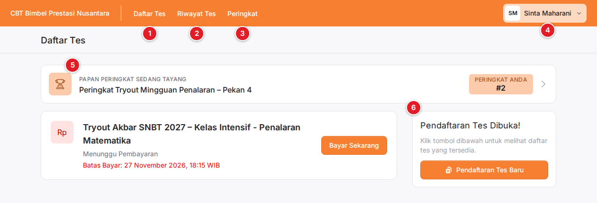
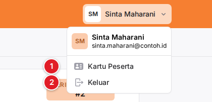
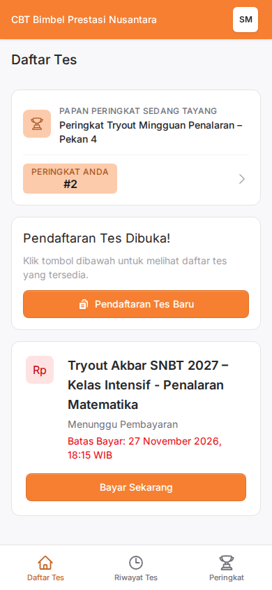

Panduan Peserta ditulis untuk Anda yang akan mengikuti ujian, tes, atau tryout di CBT Indolat, misalnya siswa, peserta bimbel, atau calon karyawan. Halaman ini menjelaskan hal yang perlu disiapkan, cara membuka aplikasi peserta, dan isi menu utamanya.

<Info>
  **Lokasi aplikasi:** setiap penyelenggara ujian memiliki alamat aplikasi peserta sendiri, biasanya `https://<kode-projek>.indolat.web.id`. Contoh: peserta **Bimbel Prestasi Nusantara** membuka `https://prestasi.indolat.web.id`. Penyelenggara juga dapat memakai domain sendiri. Alamat ini Anda terima dari sekolah, bimbel, atau lembaga yang mengadakan ujian.
</Info>

Contoh di Panduan Peserta memakai peserta **Sinta Maharani** dari **Bimbel Prestasi Nusantara** yang mengikuti ujian **Tryout Mingguan Penalaran – Pekan 4**. Ujian ini berisi dua tes: **Penalaran Umum** (soal pilihan dengan waktu 20 menit) dan **Esai Penalaran** (jawaban esai dan unggah file).

## Yang perlu disiapkan

- **Perangkat:** laptop, komputer, ponsel, atau tablet.
- **Browser:** Google Chrome, Chromium, Microsoft Edge, atau Safari. Anda juga dapat memakai aplikasi CBT Indolat untuk ponsel.
- **Koneksi internet yang stabil.** Jawaban dikirim ke server setiap kali Anda menjawab, sehingga koneksi yang sering terputus dapat mengganggu pengerjaan.
- **Akun:** email dan kata sandi dari penyelenggara, atau akun yang Anda buat sendiri jika penyelenggara membuka pendaftaran.
- **Kamera:** hanya jika ujian diawasi kamera. Pastikan kamera berfungsi dan izinkan browser memakainya.

## Alur mengikuti ujian

<CardGroup cols={2}>
  <Card title="1. Membuat Akun dan Masuk" icon="right-to-bracket" href="/peserta/membuat-akun-dan-masuk">
    Masuk dengan akun dari penyelenggara atau buat akun sendiri.
  </Card>
  <Card title="2. Mendaftar Tes" icon="file-pen" href="/peserta/mendaftar-tes">
    Daftar ujian yang dibuka penyelenggara, termasuk ujian berbayar.
  </Card>
  <Card title="3. Mengerjakan Tes" icon="pen-to-square" href="/peserta/mengerjakan-tes">
    Mulai tes, jawab soal, lalu selesaikan tes sebelum waktu habis.
  </Card>
  <Card title="4. Melihat Nilai, Sertifikat, dan Peringkat" icon="trophy" href="/peserta/melihat-hasil">
    Lihat nilai, lembar jawaban, sertifikat, dan posisi Anda di papan peringkat.
  </Card>
</CardGroup>

Jika Anda sudah didaftarkan ke ujian oleh penyelenggara, langkah kedua dapat dilewati: tes Anda langsung tampil di **Daftar Tes** setelah masuk.

## Mengenal tampilan aplikasi

Setelah masuk, Anda berada di halaman **Daftar Tes**.

<Frame>
  
</Frame>

1. **Daftar Tes**: tes yang dapat Anda kerjakan. Tes yang sudah selesai pindah ke **Riwayat Tes**.
2. **Riwayat Tes**: tes yang sudah selesai beserta nilai, lembar jawaban, dan sertifikat.
3. **Peringkat**: papan peringkat yang sedang ditayangkan penyelenggara. Menu ini hanya muncul jika ada papan peringkat untuk Anda.
4. Nama Anda: membuka menu akun.
5. **Papan peringkat sedang tayang**: posisi Anda di papan peringkat. Klik kartu ini untuk membuka papan peringkat.
6. **Pendaftaran Tes Dibuka!**: tombol **Pendaftaran Tes Baru** untuk mendaftar ujian lain. Kartu ini hanya tampil jika ada ujian yang pendaftarannya dibuka.

Klik nama Anda di kanan atas untuk membuka menu akun.

<Frame>
  
</Frame>

1. **Kartu Peserta**: kartu berisi kode peserta dan jadwal tes. Lihat [Melihat Nilai, Sertifikat, dan Peringkat](/peserta/melihat-hasil#kartu-peserta).
2. **Keluar**: keluar dari akun. Lihat [Membuat Akun dan Masuk](/peserta/membuat-akun-dan-masuk#keluar-dari-akun).

Tampilan aplikasi berbahasa Indonesia atau Inggris, sesuai pengaturan penyelenggara.

## Mengikuti ujian dari ponsel

Di ponsel, menu **Daftar Tes**, **Riwayat Tes**, dan **Peringkat** pindah ke bilah bawah layar, dan menu akun dibuka melalui inisial nama Anda di kanan atas.

<Frame>
  
</Frame>

Hal yang perlu diperhatikan saat memakai ponsel:

- Isi baterai dan matikan notifikasi aplikasi lain. Pada ujian dengan deteksi pindah tab, berpindah ke aplikasi lain tercatat sebagai pindah tab.
- Ujian yang mewajibkan berbagi layar tidak dapat dikerjakan dari browser ponsel. Pakai aplikasi CBT Indolat.
- Tombol **Lanjutkan dengan Google** tidak tersedia di aplikasi CBT Indolat. Masuk dengan email dan kata sandi.
