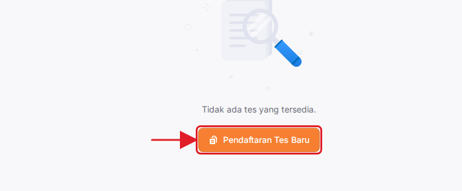
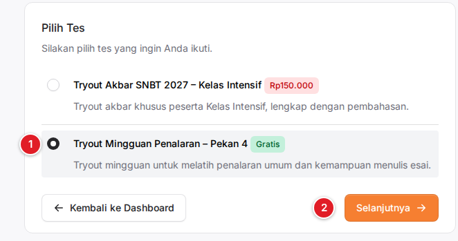
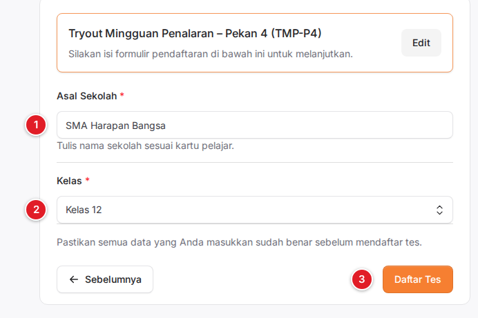
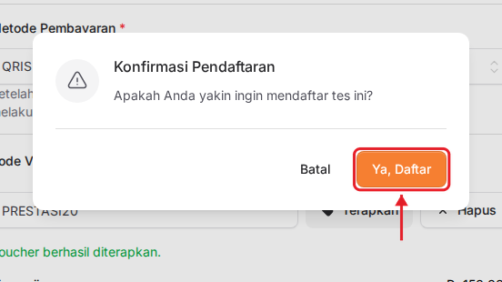
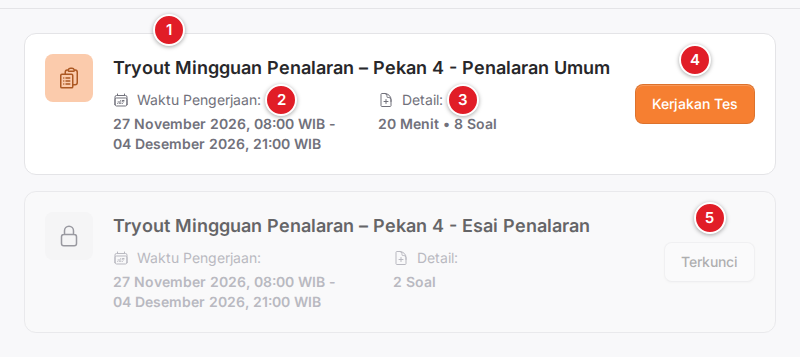
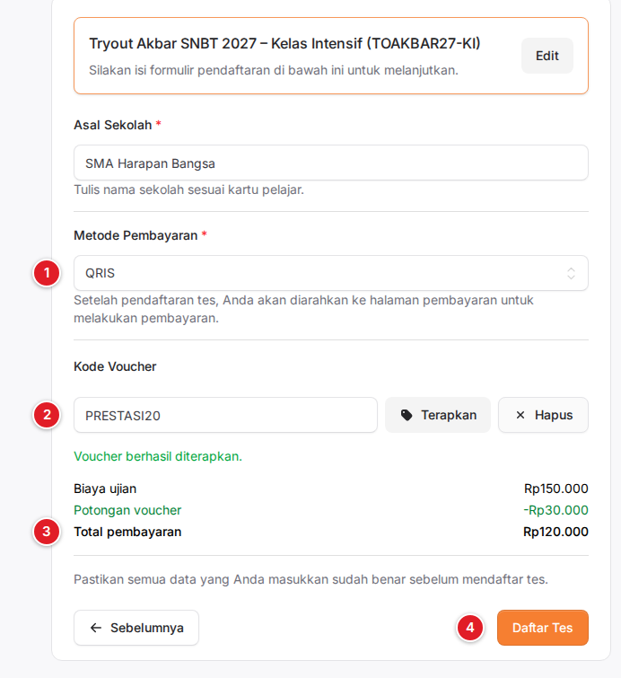
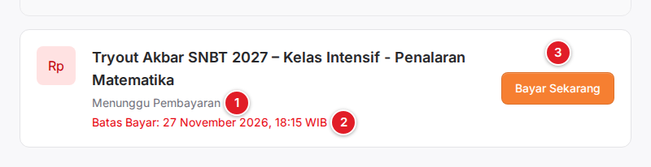
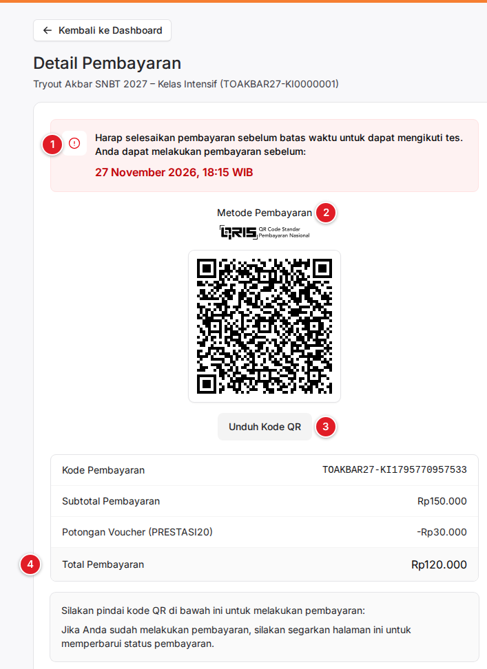

Jika penyelenggara membuka pendaftaran, Anda dapat mendaftar ujian sendiri dari aplikasi peserta. Halaman ini menjelaskan cara mendaftar ujian gratis, mengisi formulir pendaftaran, mendaftar ujian berbayar dengan kode voucher, dan membayar melalui QRIS.

<Info>
  **Lokasi menu:** aplikasi peserta → **Daftar Tes** → **Pendaftaran Tes Baru**. Jika penyelenggara sudah mendaftarkan Anda ke ujian, tesnya langsung tampil di **Daftar Tes** dan Anda tidak perlu mendaftar lagi.
</Info>

## Mendaftar ujian

Sebagai contoh, Sinta Maharani mendaftar ujian gratis **Tryout Mingguan Penalaran – Pekan 4**.

<Steps>
  <Step title="Klik Pendaftaran Tes Baru">
    Pada **Daftar Tes**, klik **Pendaftaran Tes Baru**. Jika Anda sudah memiliki tes, tombol ini berada di kartu **Pendaftaran Tes Dibuka!** di sebelah kanan.

    <Frame>
      
    </Frame>

    Tombol ini hanya tampil jika ada ujian yang pendaftarannya sedang dibuka.
  </Step>
  <Step title="Pilih ujian">
    <Frame>
      
    </Frame>

    1. Pilih ujian yang ingin diikuti. Label di samping nama ujian menunjukkan biayanya: **Gratis** atau nominal, misalnya **Rp150.000**.
    2. Klik **Selanjutnya**.

    Ujian yang sudah Anda daftarkan berlabel **Terdaftar**. Jika ujian itu dipilih lagi, muncul pesan **Anda sudah terdaftar pada tes ini**.
  </Step>
  <Step title="Isi formulir pendaftaran">
    Isi pertanyaan yang diminta penyelenggara. Kolom bertanda bintang merah wajib diisi.

    <Frame>
      
    </Frame>

    1. **Asal Sekolah**: contoh pertanyaan isian. Petunjuk pengisian tampil di bawah kolom.
    2. **Kelas**: contoh pertanyaan pilihan. Contoh: **Kelas 12**.
    3. Klik **Daftar Tes**.

    Jika ujian tidak memakai formulir, tampil pesan **Tidak ada formulir pendaftaran yang diperlukan. Anda dapat langsung mendaftar tes.** Klik **Edit** atau **Sebelumnya** untuk mengganti ujian.
  </Step>
  <Step title="Konfirmasi pendaftaran">
    Pada jendela **Konfirmasi Pendaftaran**, klik **Ya, Daftar**.

    <Frame>
      
    </Frame>

    Muncul pemberitahuan **Anda telah berhasil mendaftar tes.**, lalu tes ujian tersebut tampil di **Daftar Tes**.
  </Step>
</Steps>

## Membaca kartu tes

Setiap tes dalam ujian tampil sebagai satu kartu di **Daftar Tes**.

<Frame>
  
</Frame>

1. Nama ujian dan nama tes, misalnya **Tryout Mingguan Penalaran – Pekan 4 - Penalaran Umum**.
2. **Waktu Pengerjaan**: jadwal sesi Anda. Tes hanya dapat dimulai di dalam rentang ini.
3. **Detail**: durasi pengerjaan dan jumlah soal.
4. **Kerjakan Tes**: memulai tes. Lihat [Mengerjakan Tes](/peserta/mengerjakan-tes).
5. **Terkunci**: tes belum dapat dikerjakan. Pada contoh ini, **Esai Penalaran** baru terbuka setelah **Penalaran Umum** selesai karena penyelenggara mewajibkan tes dikerjakan berurutan.

Keadaan tombol pada kartu:

| Tombol atau label | Artinya |
| --- | --- |
| **Kerjakan Tes** | Tes siap dikerjakan sesuai jadwal sesi. |
| **Terkunci** | Tes sebelumnya harus diselesaikan dahulu, jadwal sesi Anda belum diatur, atau tes masih menunggu pembayaran. |
| **Proses Verifikasi** | Pendaftaran Anda sedang diperiksa penyelenggara. Tes terbuka setelah pendaftaran disetujui. |
| **Bayar Sekarang** | Pendaftaran menunggu pembayaran. Lihat [Membayar ujian berbayar](#membayar-ujian-berbayar). |

<Tip>
  Jika tombol tetap **Terkunci** padahal tes sebelumnya sudah selesai dan jadwal sesi sudah tiba, hubungi penyelenggara untuk memastikan Anda sudah dimasukkan ke sesi ujian.
</Tip>

## Membayar ujian berbayar

Ujian berbayar memakai pertanyaan **Metode Pembayaran** pada formulir pendaftaran. Sebagai contoh, Sinta mendaftar **Tryout Akbar SNBT 2027 – Kelas Intensif** seharga **Rp150.000** dan memakai voucher **PRESTASI20**.

<Steps>
  <Step title="Isi formulir dan terapkan voucher">
    Pilih ujian berbayar pada halaman **Pilih Tes**, klik **Selanjutnya**, lalu isi formulir.

    <Frame>
      
    </Frame>

    1. **Metode Pembayaran**: pilih **QRIS**.
    2. **Kode Voucher** (jika Anda memilikinya): ketik kodenya, lalu klik **Terapkan**. Muncul pesan **Voucher berhasil diterapkan.** Klik **Hapus** untuk membatalkan voucher.
    3. Rincian biaya: **Biaya ujian**, **Potongan voucher**, dan **Total pembayaran** yang harus dibayar. Pada contoh ini, potongan 20% membuat totalnya **Rp120.000**.
    4. Klik **Daftar Tes**, lalu **Ya, Daftar** pada jendela konfirmasi.

    Kolom **Kode Voucher** hanya tampil jika penyelenggara menyediakan voucher untuk ujian tersebut. Voucher yang tidak dapat dipakai menampilkan alasannya, misalnya **Kode voucher tidak valid.** atau **Kuota penggunaan voucher sudah habis.**
  </Step>
  <Step title="Buka halaman pembayaran">
    Setelah Anda mengklik **Ya, Daftar**, aplikasi langsung membuka halaman **Detail Pembayaran**. Jika halaman itu tertutup, buka lagi dari **Daftar Tes**: tes berstatus **Menunggu Pembayaran**, lalu klik **Bayar Sekarang**.

    <Frame>
      
    </Frame>

    1. **Menunggu Pembayaran**: status pendaftaran Anda.
    2. **Batas Bayar**: batas waktu pembayaran, 2 jam sejak Anda mendaftar.
    3. **Bayar Sekarang**: membuka halaman **Detail Pembayaran**.
  </Step>
  <Step title="Bayar dengan QRIS">
    Pindai kode QR dengan aplikasi bank atau dompet digital yang mendukung QRIS, lalu bayar sesuai **Total Pembayaran**.

    <Frame>
      
    </Frame>

    1. Batas waktu pembayaran.
    2. **Metode Pembayaran** dan kode QR QRIS.
    3. **Unduh Kode QR**: menyimpan kode QR sebagai gambar, misalnya untuk dibayar dari ponsel lain.
    4. **Total Pembayaran**: nominal yang harus dibayar. Jika penyelenggara membebankan biaya transaksi kepada peserta, baris **Biaya Transaksi** juga tampil.
  </Step>
  <Step title="Muat ulang halaman setelah membayar">
    Setelah membayar, muat ulang halaman **Detail Pembayaran**. Jika pembayaran diterima, tampil pesan **Pembayaran Anda telah diterima dengan sukses. Terima kasih!** dan status **Sudah Dibayar**. Tes Anda terbuka sesuai jadwal sesinya.
  </Step>
</Steps>

<Warning>
  Bayar sebelum **Batas Bayar**. Jika batas waktu lewat, halaman pembayaran menampilkan **Waktu pembayaran telah habis.** Kode QR tersebut tidak dapat dipakai lagi. Pada ujian yang dibayar sekali di awal, pendaftaran Anda dibatalkan otomatis sehingga Anda perlu mendaftar ulang untuk mendapat kode QR baru. Hubungi penyelenggara jika Anda sudah membayar tetapi statusnya belum berubah.
</Warning>
