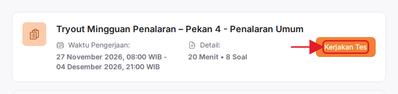
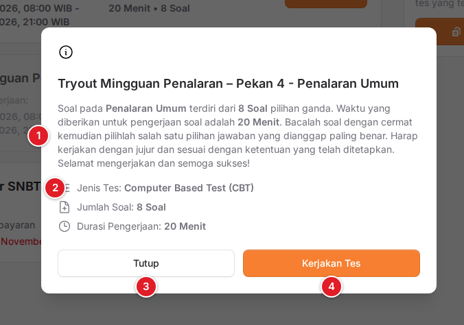
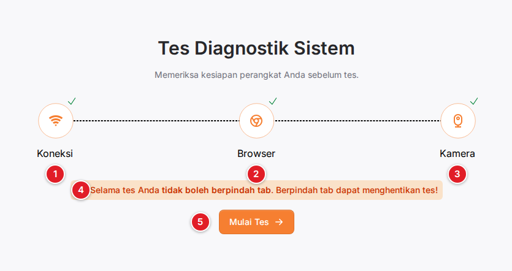
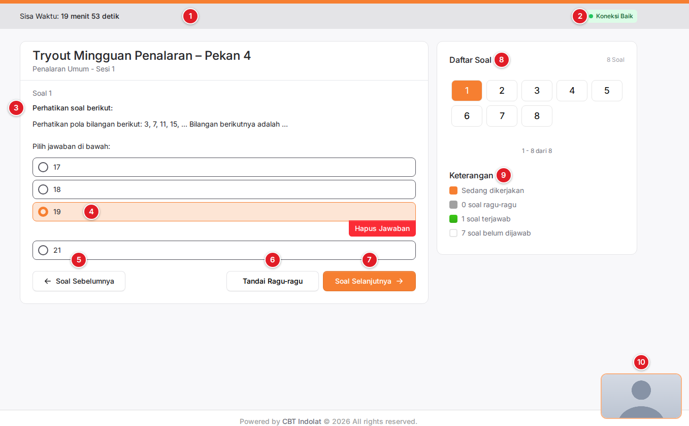
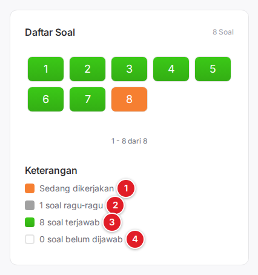
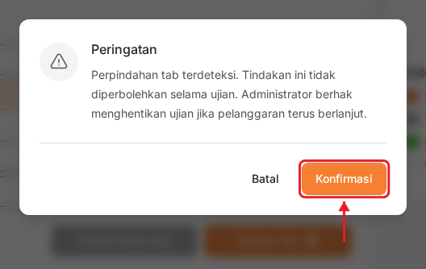
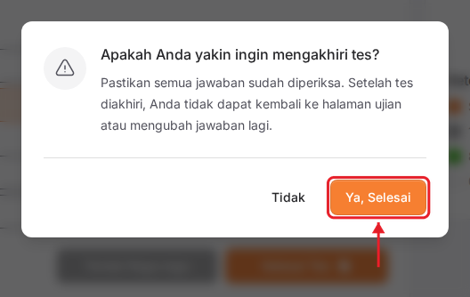
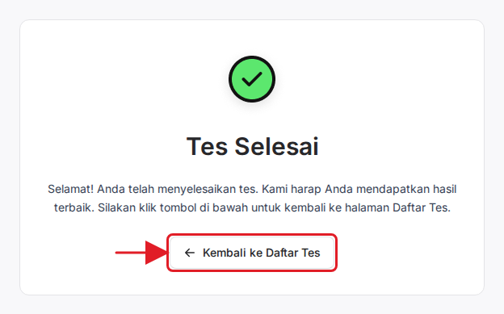

Halaman ini menjelaskan langkah mengerjakan tes dari awal sampai selesai: membaca petunjuk, melewati pemeriksaan perangkat, menjawab soal, memeriksa jawaban, dan mengakhiri tes. Cara menjawab setiap jenis soal dijelaskan di [Cara Menjawab Setiap Jenis Soal](/peserta/menjawab-soal).

<Info>
  **Lokasi menu:** aplikasi peserta → **Daftar Tes** → **Kerjakan Tes** pada kartu tes.
</Info>

<Warning>
  Waktu pengerjaan mulai berjalan saat Anda mengklik **Mulai Tes** dan dihitung oleh server, bukan oleh perangkat Anda. Waktu tetap berjalan walaupun browser ditutup atau perangkat mati. Jika Anda mulai mendekati akhir jadwal sesi, waktu Anda berakhir bersama sesi walaupun durasi tes belum habis.
</Warning>

## Memulai tes

<Steps>
  <Step title="Klik Kerjakan Tes">
    Pada **Daftar Tes**, klik **Kerjakan Tes** pada kartu tes. Tombol ini hanya dapat diklik di dalam **Waktu Pengerjaan** sesi Anda.

    <Frame>
      
    </Frame>
  </Step>
  <Step title="Baca petunjuk tes">
    <Frame>
      
    </Frame>

    1. Petunjuk pengerjaan dari penyelenggara.
    2. **Jenis Tes**, **Jumlah Soal**, dan **Durasi Pengerjaan**.
    3. **Tutup**: kembali ke **Daftar Tes** tanpa memulai tes.
    4. **Kerjakan Tes**: lanjut ke pemeriksaan perangkat.
  </Step>
  <Step title="Tunggu Tes Diagnostik Sistem">
    Sistem memeriksa kesiapan perangkat Anda. Setiap pemeriksaan yang lolos diberi tanda centang hijau.

    <Frame>
      
    </Frame>

    1. **Koneksi**: perangkat terhubung ke server dan kapasitas peserta serentak belum penuh.
    2. **Browser**: browser Anda didukung (Google Chrome, Chromium, Microsoft Edge, Safari, atau aplikasi CBT Indolat).
    3. **Kamera**: browser diizinkan memakai kamera. Pemeriksaan ini hanya muncul jika ujian diawasi kamera. Saat browser meminta izin kamera, pilih **Izinkan**.
    4. Peringatan bahwa Anda tidak boleh berpindah tab. Peringatan ini muncul jika ujian mendeteksi perpindahan tab.
    5. **Mulai Tes**: memulai tes. Tombol ini aktif setelah semua pemeriksaan lolos.

    Sesuai pengaturan ujian, pemeriksaan **Bagikan Layar** (Anda harus membagikan seluruh layar, bukan satu tab atau jendela) dan **Monitor Ganda** (hanya satu layar yang boleh tersambung) juga dapat muncul.
  </Step>
  <Step title="Klik Mulai Tes">
    Halaman soal terbuka dan **Sisa Waktu** mulai berjalan.
  </Step>
</Steps>

<Note>
  Tes esai atau unggah file tidak memakai Tes Diagnostik Sistem. Tes langsung dimulai saat Anda mengklik **Kerjakan Tes** pada jendela petunjuk, dan **Sisa Waktu** dihitung sampai jadwal sesi berakhir. Lihat [Cara Menjawab Setiap Jenis Soal](/peserta/menjawab-soal#jawaban-esai).
</Note>

## Halaman soal

<Frame>
  
</Frame>

1. **Sisa Waktu**: hitung mundur waktu pengerjaan.
2. Indikator koneksi: **Koneksi Baik**, **Koneksi Lambat**, atau **Koneksi Buruk**.
3. Nomor soal dan isi soal.
4. Jawaban yang Anda pilih. Jawaban tersimpan otomatis setiap kali Anda menjawab; tanda **Menyimpan jawaban...** tampil sebentar. Klik **Hapus Jawaban** untuk mengosongkan jawaban soal ini.
5. **Soal Sebelumnya**: kembali ke soal sebelumnya.
6. **Tandai Ragu-ragu**: menandai soal yang ingin Anda periksa lagi. Soal yang ditandai ragu-ragu tetap dinilai jika sudah dijawab.
7. **Soal Selanjutnya**: pindah ke soal berikutnya. Pada soal terakhir, tombol ini berganti menjadi **Selesai Tes**.
8. **Daftar Soal**: nomor semua soal. Klik nomor untuk langsung membuka soal tersebut.
9. **Keterangan**: jumlah soal yang ragu-ragu, terjawab, dan belum dijawab.
10. Pratinjau kamera. Tampil jika ujian diawasi kamera.

Pada tes CAT (*Computer Adaptive Test*), soal berikutnya dipilih berdasarkan jawaban sebelumnya, sehingga tombol **Soal Sebelumnya** dan **Tandai Ragu-ragu** tidak tersedia.

## Memeriksa jawaban sebelum selesai

Warna nomor pada **Daftar Soal** membantu Anda memeriksa pekerjaan.

<Frame>
  
</Frame>

1. **Sedang dikerjakan** (oranye): soal yang sedang dibuka.
2. **Soal ragu-ragu** (abu-abu): soal yang Anda tandai ragu-ragu.
3. **Soal terjawab** (hijau): soal yang sudah dijawab. Soal menjodohkan baru dihitung terjawab setelah semua pasangannya ditempatkan.
4. **Soal belum dijawab** (putih): soal yang masih kosong.

Sebelum mengakhiri tes, pastikan tidak ada soal yang belum dijawab, lalu buka lagi soal yang ragu-ragu.

## Aturan selama tes

- **Satu tes dalam satu waktu.** Selama tes berjalan, membuka halaman lain di aplikasi selalu mengembalikan Anda ke halaman soal dengan pesan **Silakan selesaikan tes yang sedang berlangsung.**
- **Urutan soal dan pilihan jawaban dapat diacak** oleh penyelenggara, sehingga soal nomor 1 Anda bisa berbeda dengan peserta lain.
- **Jika koneksi terputus**, jawaban yang sudah tersimpan tidak hilang. Setelah koneksi pulih, muat ulang halaman jika diminta, lalu periksa **Daftar Soal** untuk memastikan jawaban terakhir Anda berwarna hijau.
- **Jika browser tertutup**, buka lagi alamat aplikasi peserta dan masuk. Tes yang sedang berjalan langsung terbuka dengan sisa waktu yang sudah berkurang.

## Pengawasan ujian

Penyelenggara dapat mengaktifkan satu atau beberapa pengawasan berikut. Setiap pelanggaran tercatat dan dapat dilihat penyelenggara.

| Pengawasan | Yang perlu Anda lakukan |
| --- | --- |
| Deteksi pindah tab | Tetap di halaman tes. Membuka tab lain, berpindah ke aplikasi lain, atau meminimalkan browser memunculkan peringatan. |
| Kamera | Biarkan kamera menyala dan izin kamera tetap aktif sampai tes selesai. Jika izin dicabut, muncul pesan **Akses kamera tidak tersedia**. |
| Bagikan layar | Bagikan seluruh layar dan jangan menghentikan berbagi layar. Fitur ini tidak tersedia di browser ponsel; pakai aplikasi CBT Indolat. |
| Satu layar | Lepaskan monitor kedua sebelum mulai. Jika terdeteksi, muncul pesan **Monitor ganda terdeteksi**. |

Saat perpindahan tab terdeteksi, muncul jendela **Peringatan**. Klik **Konfirmasi** untuk kembali ke soal.

<Frame>
  
</Frame>

<Warning>
  Penyelenggara berhak menghentikan tes jika pelanggaran terus berlanjut. Tes yang dihentikan tidak dapat dilanjutkan tanpa bantuan penyelenggara.
</Warning>

## Menyelesaikan tes

<Steps>
  <Step title="Klik Selesai Tes">
    Pada soal terakhir, klik **Selesai Tes**. Pada jendela konfirmasi, klik **Ya, Selesai**, atau **Tidak** jika masih ingin memeriksa jawaban.

    <Frame>
      
    </Frame>
  </Step>
  <Step title="Kembali ke Daftar Tes">
    Halaman **Tes Selesai** tampil. Klik **Kembali ke Daftar Tes**.

    <Frame>
      
    </Frame>

    Jika Anda membuka tes dari aplikasi lain milik penyelenggara, tombolnya dapat berupa **Lanjutkan** yang membawa Anda kembali ke aplikasi tersebut.
  </Step>
</Steps>

Setelah selesai, tes tidak dapat dibuka lagi dan jawabannya tidak dapat diubah. Tes berikutnya yang tadinya **Terkunci** terbuka, dan hasilnya pindah ke **Riwayat Tes**. Lihat [Melihat Nilai, Sertifikat, dan Peringkat](/peserta/melihat-hasil).

### Jika waktu habis

Saat **Sisa Waktu** mencapai nol, tes diakhiri otomatis dengan pemberitahuan **Waktu Habis** (**Waktu tes telah habis.**), lalu halaman **Tes Selesai** tampil. Semua jawaban yang sudah tersimpan tetap dinilai; soal yang belum dijawab dihitung tidak dijawab.
