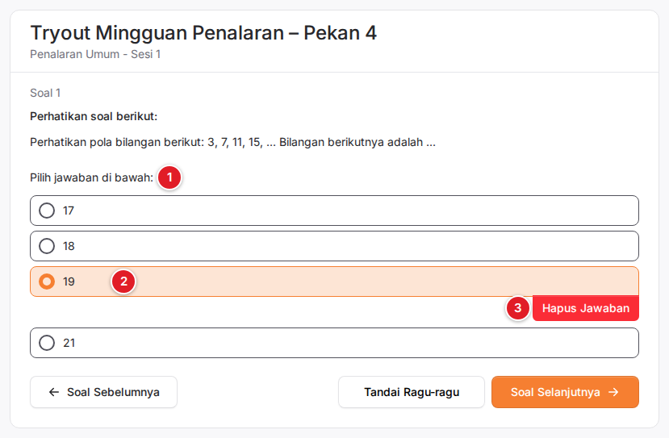
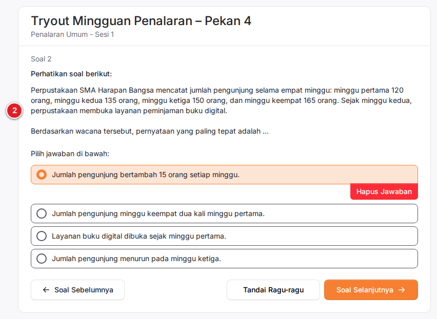
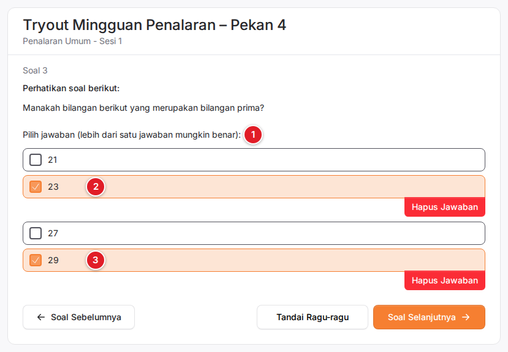
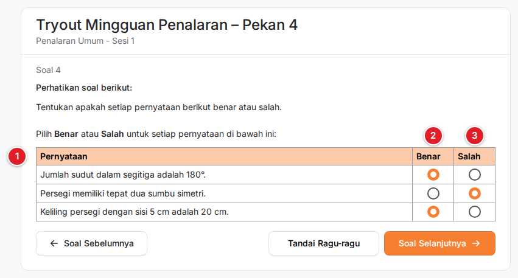
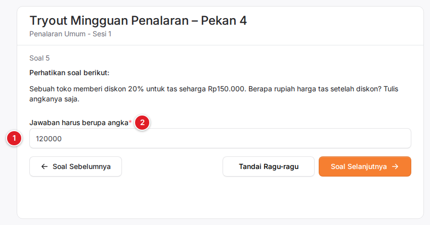
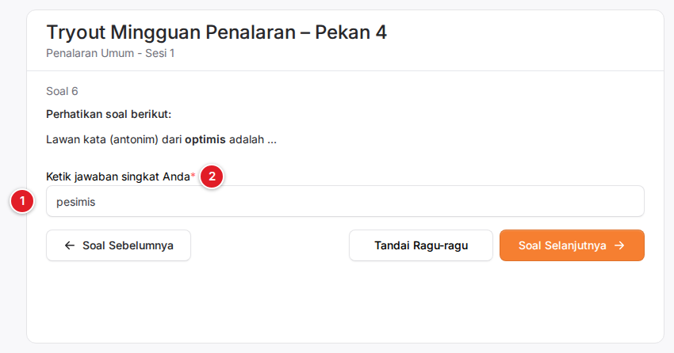
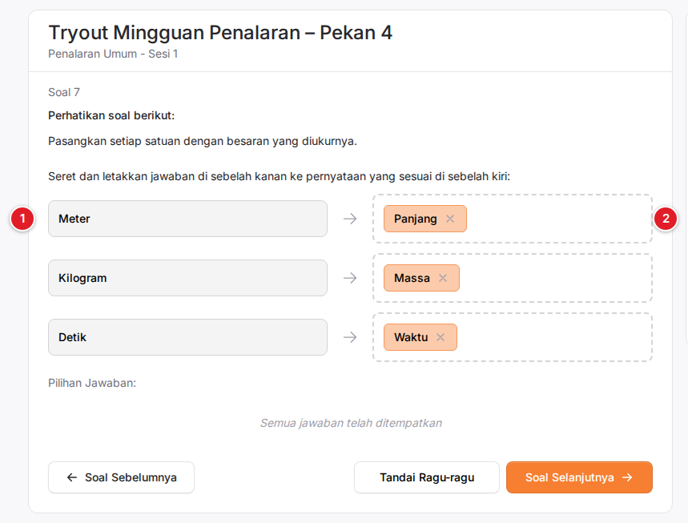
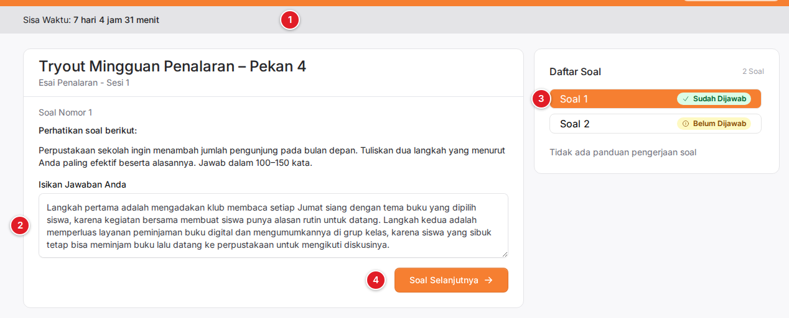
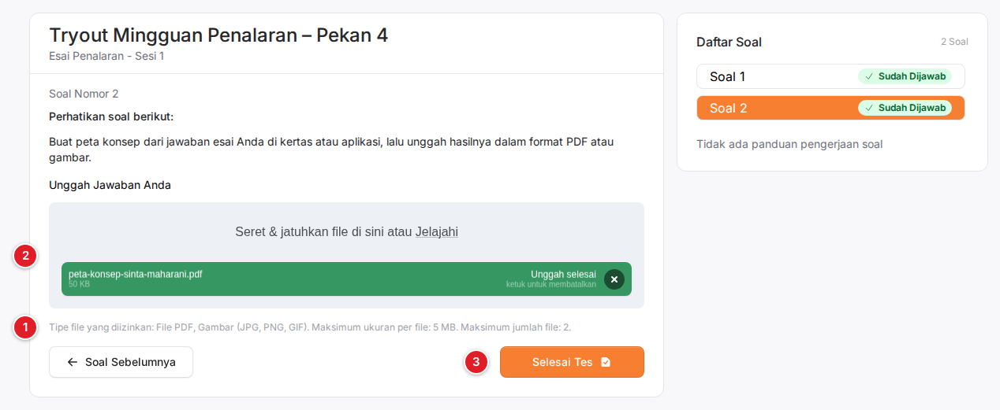

Satu tes dapat berisi beberapa jenis soal. Halaman ini menjelaskan cara menjawab setiap jenis soal yang mungkin Anda temui. Contoh gambar diambil dari tes **Penalaran Umum** dan **Esai Penalaran** pada ujian **Tryout Mingguan Penalaran – Pekan 4**.

<Info>
  **Lokasi menu:** aplikasi peserta → **Daftar Tes** → **Kerjakan Tes**, lalu halaman soal. Cara membuka halaman soal dijelaskan di [Mengerjakan Tes](/peserta/mengerjakan-tes).
</Info>

Untuk semua jenis soal, jawaban tersimpan otomatis setiap kali Anda menjawab. Anda tidak perlu menekan tombol simpan.

## Pilihan ganda

Klik salah satu pilihan jawaban.

<Frame>
  
</Frame>

1. **Pilih jawaban di bawah:** berarti hanya satu jawaban yang dipilih.
2. Jawaban terpilih berwarna oranye. Klik pilihan lain untuk mengganti jawaban.
3. **Hapus Jawaban**: mengosongkan jawaban soal ini.

## Soal dengan wacana

Beberapa soal diawali wacana (bacaan) yang dipakai bersama oleh beberapa soal. Baca wacananya, lalu jawab pertanyaan di bawahnya seperti soal pilihan ganda.

<Frame>
  
</Frame>

1. Wacana.
2. Pertanyaan tentang wacana tersebut.

Soal-soal yang memakai wacana yang sama selalu berurutan, walaupun urutan soal diacak.

## Pilihan ganda dengan lebih dari satu jawaban

Jika petunjuknya **Pilih jawaban (lebih dari satu jawaban mungkin benar):**, centang semua jawaban yang menurut Anda benar.

<Frame>
  
</Frame>

1. Petunjuk bahwa jawaban benar bisa lebih dari satu.
2. Jawaban pertama yang dicentang.
3. Jawaban kedua yang dicentang.

Setiap pilihan yang dicentang memiliki tombol **Hapus Jawaban** sendiri. Klik tombol itu untuk membatalkan pilihan tersebut saja.

<Note>
  Soal ini umumnya dianggap benar hanya jika semua jawaban benar tercentang dan tidak ada jawaban salah yang ikut tercentang. Cara penilaiannya bergantung pada pengaturan penyelenggara.
</Note>

## Benar atau Salah untuk setiap pernyataan

Soal ini berisi tabel pernyataan. Pilih satu kolom untuk setiap baris.

<Frame>
  
</Frame>

1. **Pernyataan** yang harus dinilai.
2. Kolom **Benar**.
3. Kolom **Salah**.

Label kolom dapat berbeda, misalnya **Fakta** dan **Opini**. Jawab semua pernyataan; satu pernyataan yang keliru dapat membuat seluruh soal dianggap salah.

## Jawaban singkat berupa angka

Ketik angka pada kolom jawaban.

<Frame>
  
</Frame>

1. Kolom jawaban. Contoh: `120000`.
2. Petunjuk **Jawaban harus berupa angka**. Kolom ini hanya menerima angka.

Tulis angka saja tanpa satuan dan tanpa titik ribuan, kecuali soal meminta lain. Contoh: tulis `120000`, bukan `Rp120.000` atau `120.000`.

## Jawaban singkat berupa teks

Ketik jawaban singkat, biasanya satu kata atau frasa.

<Frame>
  
</Frame>

1. Kolom jawaban. Contoh: `pesimis`.
2. Petunjuk **Ketik jawaban singkat Anda**.

Huruf besar-kecil dan spasi berlebih tidak memengaruhi penilaian, tetapi ejaan harus tepat.

## Menjodohkan

Seret setiap pilihan di bagian **Pilihan Jawaban:** ke kotak di sebelah kanan pernyataan yang sesuai.

<Frame>
  
</Frame>

1. Pernyataan di sebelah kiri, misalnya **Meter**.
2. Kotak jawaban. Contoh: **Panjang** diseret ke kotak di samping **Meter**.

Setelah semua pilihan ditempatkan, tampil tulisan **Semua jawaban telah ditempatkan**. Untuk mengganti pasangan, klik tanda **×** pada jawaban atau seret jawaban itu kembali ke **Pilihan Jawaban:**. Soal ini baru dihitung terjawab setelah semua kotak terisi.

## Jawaban esai

Tes esai dan unggah file dinilai oleh penyelenggara setelah tes selesai. Tampilannya berbeda dengan tes pilihan ganda.

<Frame>
  
</Frame>

1. **Sisa Waktu**: dihitung sampai jadwal sesi berakhir, sehingga dapat berupa hitungan hari.
2. **Isikan Jawaban Anda**: ketik jawaban esai Anda di sini.
3. **Daftar Soal**: status setiap soal, **Sudah Dijawab** atau **Belum Dijawab**. Klik soal untuk membukanya.
4. **Soal Selanjutnya**: pindah ke soal berikutnya.

## Unggah file

Soal unggah file meminta jawaban berupa berkas, misalnya foto lembar jawaban atau dokumen PDF.

<Frame>
  
</Frame>

1. Jenis file yang diizinkan, ukuran maksimum per file, dan jumlah file maksimum.
2. Area unggah. Seret file ke area ini atau klik **Jelajahi** untuk memilih file. Tunggu sampai tertulis **Unggah selesai**. Klik **×** untuk menghapus file.
3. **Selesai Tes**: mengakhiri tes setelah semua soal dijawab.

File yang jenis atau ukurannya tidak sesuai ditolak dengan pesan **File ini tidak diterima: periksa jenis dan ukurannya.**

<Tip>
  Nilai tes esai dan unggah file baru tampil di **Riwayat Tes** setelah penyelenggara memeriksanya. Lihat [Melihat Nilai, Sertifikat, dan Peringkat](/peserta/melihat-hasil).
</Tip>
