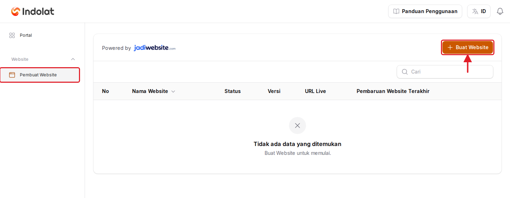
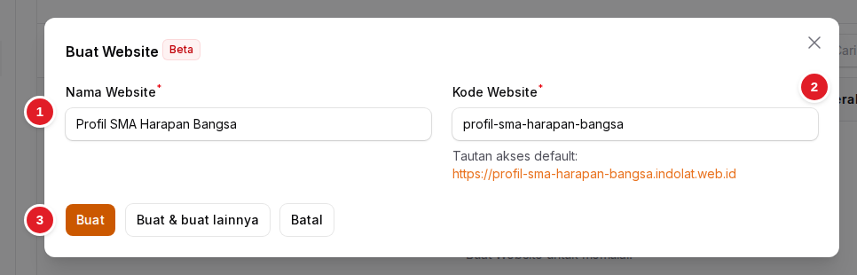
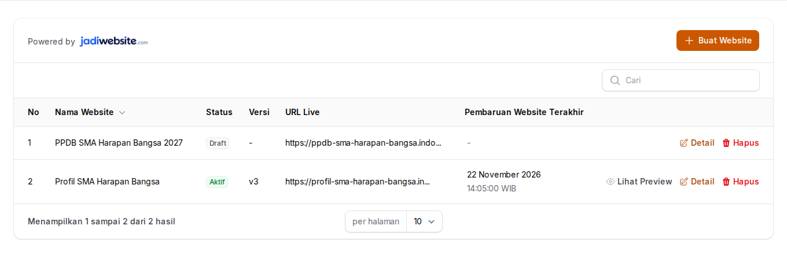
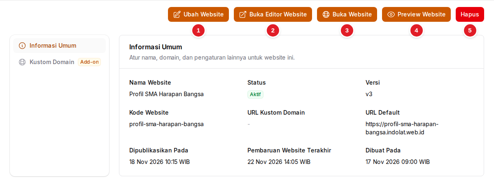
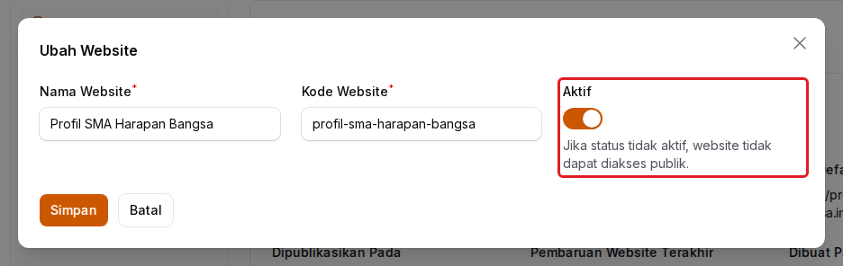
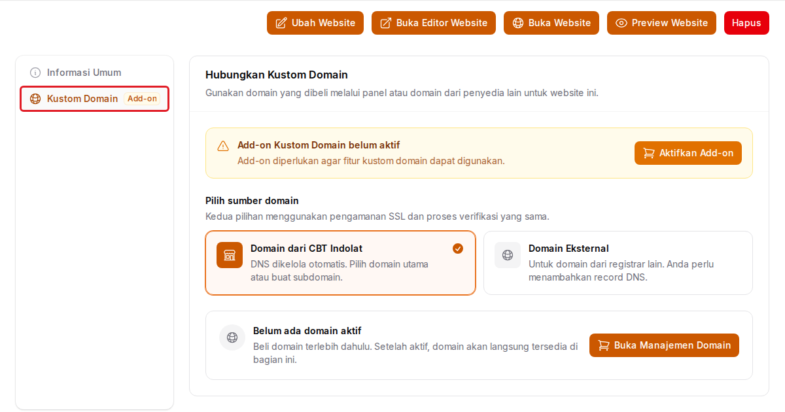

Modul **Pembuat Website** dipakai untuk membuat website lembaga, misalnya profil sekolah atau halaman penerimaan siswa baru, tanpa menulis kode. Halaman website disunting di editor **jadiwebsite.com** yang terhubung dengan Panel, sedangkan pengaturan website (nama, kode, status, dan domain) dikelola dari Panel.

<Info>
  Lokasi menu: **Portal** → **Pembuat Website** → **Website** → **Pembuat Website**.

  Modul ini gratis. Setiap projek dapat memiliki paling banyak 2 website.
</Info>

Contoh di halaman ini memakai projek **SMA Harapan Bangsa** dengan website **Profil SMA Harapan Bangsa**.

## Membuat website baru

<Steps>
  <Step title="Pilih Buat Website">
    Buka **Pembuat Website**, lalu pilih **Buat Website**.

    <Frame>
      
    </Frame>
  </Step>
  <Step title="Isi nama dan kode website">
    <Frame>
      
    </Frame>

    1. **Nama Website**: nama untuk mengenali website di Panel, misalnya **Profil SMA Harapan Bangsa**.
    2. **Kode Website**: terisi otomatis dari nama website dan menjadi alamat bawaan website, misalnya `https://profil-sma-harapan-bangsa.indolat.web.id`. Gunakan huruf kecil, angka, dan tanda hubung saja. Kode harus unik dan tidak boleh sama dengan kode projek mana pun; bila sudah dipakai, muncul pesan **Kode website sudah digunakan. Silakan gunakan kode lain.**
    3. Pilih **Buat**, atau **Buat & buat lainnya** untuk langsung membuat website berikutnya.

    Website baru berstatus **Draft** sampai diterbitkan dari editor.
  </Step>
</Steps>

<Note>
  Bila projek sudah memiliki 2 website, pembuatan website ditolak dengan pesan **Batas website tercapai**. Hapus website yang tidak dipakai atau hubungi tim CBT Indolat untuk menambah jumlah website.
</Note>

## Daftar website

<Frame>
  
</Frame>

Daftar website menampilkan:

- **Status**: **Draft** (belum pernah diterbitkan), **Aktif** (dapat diakses publik), atau **Tidak Aktif** (sudah pernah diterbitkan, tetapi ditutup dari publik).
- **Versi**: nomor penerbitan, misalnya **v3** untuk website yang sudah diterbitkan tiga kali.
- **URL Live**: alamat website. Bila kustom domain sudah aktif, alamat ini memakai domain tersebut.
- **Pembaruan Website Terakhir**: waktu penerbitan terakhir dari editor.

Pilih **Lihat Preview** untuk melihat hasil terbitan terakhir, **Detail** untuk membuka pengaturan website, atau **Hapus** untuk menghapusnya.

## Menyunting dan menerbitkan website

Pilih **Detail** pada website yang ingin dikelola.

<Frame>
  
</Frame>

1. **Ubah Website**: mengubah nama, kode, dan status website.
2. **Buka Editor Website**: membuka editor jadiwebsite.com di tab baru. Anda langsung masuk dengan akun Panel, tanpa login terpisah.
3. **Buka Website**: membuka website yang sudah tayang. Tombol ini hanya tampil bila status website **Aktif**.
4. **Preview Website**: membuka hasil terbitan terakhir. Tombol ini tampil setelah website pernah diterbitkan.
5. **Hapus**: menghapus website.

Tab **Informasi Umum** menampilkan **Nama Website**, **Status**, **Versi**, **Kode Website**, **URL Kustom Domain**, **URL Default**, **Dipublikasikan Pada**, **Pembaruan Website Terakhir**, dan **Dibuat Pada**.

<Steps>
  <Step title="Buka editor">
    Pilih **Buka Editor Website**. Susun halaman, teks, gambar, dan menu website di editor yang terbuka di tab baru.
  </Step>
  <Step title="Terbitkan dari editor">
    Terbitkan website dari editor. Setiap penerbitan menambah nomor **Versi**. Setelah penerbitan pertama, status website berubah menjadi **Aktif** dan website dapat dibuka di **URL Default**.
  </Step>
  <Step title="Periksa hasilnya">
    Kembali ke Panel, lalu pilih **Preview Website** atau **Buka Website** untuk memeriksa hasilnya.
  </Step>
</Steps>

## Mengubah nama, kode, atau status

Pilih **Ubah Website** pada halaman detail.

<Frame>
  
</Frame>

- **Nama Website** dan **Kode Website** mengikuti aturan yang sama dengan saat membuat website. Mengganti kode juga mengganti alamat bawaan website.
- Matikan sakelar **Aktif** untuk menutup website dari publik. Status berubah menjadi **Tidak Aktif** dan website tidak dapat diakses sampai sakelar dinyalakan kembali. Menerbitkan ulang dari editor juga mengaktifkan kembali website tersebut.

Pilih **Simpan** untuk menyimpan perubahan.

<Note>
  Status website yang masih **Draft** tidak dapat diubah dari Panel. Terbitkan website dari editor terlebih dahulu.
</Note>

## Menghubungkan kustom domain

Secara bawaan, website dapat dibuka di `kode-website.indolat.web.id`. Untuk memakai domain sendiri, misalnya `www.smaharapanbangsa.sch.id`, buka tab **Kustom Domain** pada halaman detail.

<Frame>
  
</Frame>

- Fitur ini memerlukan add-on **Kustom Domain**. Bila add-on belum aktif, pilih **Aktifkan Add-on** untuk membelinya melalui **Langganan & Tagihan**.
- **Domain dari CBT Indolat**: domain yang dibeli melalui Panel. DNS diatur otomatis; pilih domain utama atau buat subdomain. Domain utama hanya dapat dipakai untuk satu layanan, sedangkan subdomain dapat dibuat lebih dari satu. Bila belum punya domain, pilih **Buka Manajemen Domain** untuk membelinya di **Administrasi Aplikasi** → **Pengaturan Projek** → **Domain**.
- **Domain Eksternal**: domain dari registrar lain. Setelah permintaan disimpan, Panel menampilkan record DNS yang harus Anda tambahkan di pengelola DNS domain tersebut.

Kedua pilihan memakai SSL dan proses verifikasi yang sama. Selama verifikasi, status domain **Menunggu Verifikasi**. Setelah domain aktif, alamatnya tampil di **URL Kustom Domain** dan tombol **Buka Website** memakai domain tersebut.

## Menghapus website

Pilih **Hapus** pada daftar website atau halaman detail, lalu konfirmasi.

<Warning>
  Menghapus website juga menghapus website tersebut dari editor. Tindakan ini tidak dapat dibatalkan.
</Warning>
